# AVT-3C Wall-Climbing Robot + Zaber XY Stage Straight-Line Marking: Principles, Design and Implementation (Simulink ↔ ROS 2, Pen Kinematic Compensation)

- Author: Prof. Wonkeun Youn, Department of Autonomous Vehicle System Engineering, Chungnam National University
- Repository: <https://github.com/wkyouncnu/AVT3C-XY-Stage-Pen>
- Manual (PDF, Korean): [2_docs/manual/AVT3C_XY_Stage_Pen.pdf](2_docs/manual/AVT3C_XY_Stage_Pen.pdf)
- Manual (PDF, English): [2_docs/manual/AVT3C_XY_Stage_Pen_EN.pdf](2_docs/manual/AVT3C_XY_Stage_Pen_EN.pdf)
- Manual (PDF, Vietnamese): [2_docs/manual/AVT3C_XY_Stage_Pen_VI.pdf](2_docs/manual/AVT3C_XY_Stage_Pen_VI.pdf) (source [README_VI.md](README_VI.md))
- Pen kinematic compensation excerpt (PDF, Korean): [2_docs/manual/AVT3C_XY_Stage_Pen_Control.pdf](2_docs/manual/AVT3C_XY_Stage_Pen_Control.pdf) (Chapter 3, Section 4.1, Chapter 6, Section 8.6, Section 14.6. Generated by `2_docs/make_pen_excerpt.py`)
- Pen kinematic compensation excerpt (PDF, English): [2_docs/manual/AVT3C_XY_Stage_Pen_Control_EN.pdf](2_docs/manual/AVT3C_XY_Stage_Pen_Control_EN.pdf)
- Pen kinematic compensation excerpt (PDF, Vietnamese): [2_docs/manual/AVT3C_XY_Stage_Pen_Control_VI.pdf](2_docs/manual/AVT3C_XY_Stage_Pen_Control_VI.pdf)
- Stage manual (Zaber): [5_references/manuals/X-LSM-E-Manual.pdf](5_references/manuals/X-LSM-E-Manual.pdf), datasheet [5_references/manuals/X-LSM-E-Datasheet.pdf](5_references/manuals/X-LSM-E-Datasheet.pdf). Reference papers: [5_references/README.md](5_references/README.md)

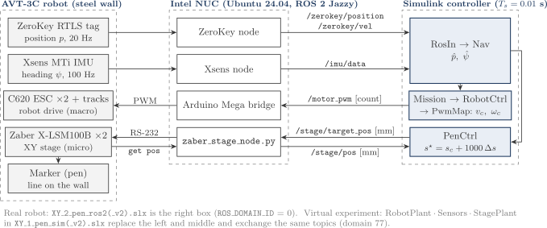

*Figure 1. System configuration. Left: equipment on the robot; centre: ROS 2 nodes on the NUC; right: Simulink controller*

## Abstract

This document addresses the problem of mounting a two-axis XY stage on AVT-3C, a tracked robot that moves while magnetically attached to a vertical steel wall, and drawing a horizontal straight line 1.2 m long on the wall with a marker at the end of the stage. A tracked robot cannot move sideways, slips on the wall surface, and suffers heading fluctuations; a line drawn by the robot alone therefore shows a cross-track error RMS of 14.84 mm in simulation. The document describes a macro–micro structure in which the robot handles travel and large motions while the stage removes only the deviation from the straight line. The stage command is obtained by inverting the kinematic relation from the measured robot pose (pen kinematic compensation). Because the pen position is not measured directly, accuracy is determined by the sensors; in the same simulation the pen cross-track error is reduced to an RMS of 1.17–1.20 mm. The largest error source is ZeroKey position noise. Mounting two tags on the robot body with the pen between them reduces the error to 0.84 mm in an approximate simulation. Since the stage is a commercial product whose internal position servo cannot be modified, the entire design is built only on position commands and position readings.

## Contents

- **Part I. Principles**
    1. [Introduction](#1-introduction)
    2. [System and Signals](#2-system-and-signals)
    3. [Coordinate Frames and Rotation Matrix](#3-coordinate-frames-and-rotation-matrix)
    4. [Formulation of the Control Problem](#4-formulation-of-the-control-problem)
    5. [Macro Level: Robot Control](#5-macro-level-robot-control)
    6. [Micro Level: Pen Kinematic Compensation](#6-micro-level-pen-kinematic-compensation)
    7. [Measurement Error and Sensor Placement](#7-measurement-error-and-sensor-placement)
- **Part II. Detailed Derivation**
    8. [Mathematical Formulation (Detailed Derivation)](#8-mathematical-formulation-detailed-derivation)
- **Part III. Implementation**
    9. [Implementation Overview](#9-implementation-overview)
    10. [Communication Architecture](#10-communication-architecture)
    11. [Controller Hierarchy](#11-controller-hierarchy)
    12. [Motion Model](#12-motion-model)
    13. [Simulink Model Structure](#13-simulink-model-structure)
    14. [Equations and Principles of Each Simulink Function](#14-equations-and-principles-of-each-simulink-function)
    15. [Installation](#15-installation)
    16. [Running](#16-running)
    17. [Inputs and Outputs per Program](#17-inputs-and-outputs-per-program)
- **Part IV. Verification**
    18. [Verification](#18-verification)
    19. [Summary of Results](#19-summary-of-results)
    20. [Comparison of Design Choices](#20-comparison-of-design-choices)
- **Part V. Hardware Deployment**
    21. [Deployment on Real Hardware](#21-deployment-on-real-hardware)
    22. [Hardware Deployment Procedure and Checklist](#22-hardware-deployment-procedure-and-checklist)
    23. [Troubleshooting](#23-troubleshooting)
    24. [Open Items](#24-open-items)
    25. [Conclusion](#25-conclusion)
- [References](#references)

---

# Part I. Principles

## 1. Introduction

### 1.1 Problem Statement

Drawing marking lines on large vertical steel plates, such as shipyard blocks, has traditionally been done by workers on ladders or aerial work platforms using tape measures and chalk lines. For a wall-climbing robot to take over this task, the robot must place the line with millimetre-level accuracy while travelling several metres. These two requirements differ in nature. Large-range motion suits a powerful, slow actuator, whereas millimetre-level precise positioning suits a fast actuator with a narrow range.

AVT-3C is a tracked (skid-steer) robot that attaches to steel plates with magnetic tracks. A tracked robot changes direction through the speed difference between its left and right tracks and cannot move directly in the lateral direction of the body. Such a constraint is called a nonholonomic constraint. A robot that has drifted 1 cm sideways from the line cannot slide back that 1 cm laterally; it must turn, advance obliquely, and then straighten its heading again. During this manoeuvre the robot travels several tens of centimetres, so the rate at which lateral error is reduced is fundamentally slow.

The wall surface makes the problem harder. Since gravity acts downward along the wall, the magnetic tracks slip slightly downward while travelling (creep). Track bumps between the tracks and the steel plate cause heading fluctuations of 1–2°. When these disturbances are included in the simulation, the robot's line-tracking cross-track error is RMS 23.6 mm, and the cross-track error of a line drawn with the pen fixed to the robot is RMS 14.84 mm, with a maximum of 19.6 mm (Chapter 18).

### 1.2 Approach: Macro–Micro Structure

The solution to this problem resembles the way a person writes. The arm moves the hand broadly over the paper, and the fingers finely adjust the pen tip. Even if the arm motion is inaccurate, the writing comes out correctly as long as the fingers make up for that error.

In this system the arm is the robot and the fingers are the XY stage made of two Zaber X-LSM100B axes. The stage has a narrow travel of 101.6 mm, but it is fast, with a maximum speed of 104 mm/s, and its repeatability is 6 µm. The robot brings the pen near the line and advances it along the line, while the stage moves the pen in the opposite direction by exactly the amount the robot deviates from the line at that instant. This division of roles is called the macro–micro structure.

| Item | Robot (macro) | Stage (micro) |
|---|---|---|
| Range | Entire wall (several m) | ±50.8 mm |
| Degrees of freedom | Forward speed $v$, turn rate $\omega$ (no lateral motion) | Two directions, body X and Y |
| Speed | Cross-track error convergence time constant approx. 8.5 s (Section 5.2) | Position servo several–20 Hz |
| Task | Travel along the line, move to start point, heading alignment | Deviation from the line (pen displacement due to cross-track error + heading error) |
| Command | `/motor_pwm` (left/right motor PWM) | `/stage/target_pos` (position [mm]) |

### 1.3 Organisation of the Document

Chapter 2 summarises what the controller measures and what it commands. Chapter 3 defines the coordinate frames and rotation matrix, and Chapter 4 defines the control problem in equations. Chapter 5 derives the robot-side (macro) control, and Chapter 6 the stage-side (micro) pen compensation. Sections 6.2–6.7 examine each variable of the pen compensation code one by one, divided into a body-frame figure, a wall-frame figure, a figure combining the two frames, and a stage-scale figure, and place each equation in the same section as the figure that depicts it. Chapter 7 covers how measurement errors propagate into pen errors and the ZeroKey tag placement. This concludes Part I (Principles).

Part II (Chapter 8) re-derives the same content equation by equation and collects the symbol table, sign checks, and differences from the original paper in bullet form. Part III (Chapters 9–17) covers specifications, ROS 2 topics, controller hierarchy, motion model, Simulink model structure and the equations of each function block (Chapter 14), installation, running, and parameters. Part IV (Chapters 18–20) presents virtual experiment results and comparison of design choices, and Part V (Chapters 21–24) covers the real-hardware deployment procedure, troubleshooting, and open items. Chapter 25 concludes. Chapters 1–7 and Chapter 8 treat the same subject twice, in prose and in bullet form; both are retained because they contain different figures and numerical checks.

---

## 2. System and Signals

### 2.1 Equipment

| Equipment | Role | Connection |
|---|---|---|
| AVT-3C | Magnetic tracked robot, outer dimensions 420 × 343 × 100 mm | Arduino Mega → two C620 ESCs → left/right track motors |
| Zaber X-LSM100B-E03 × 2 | XY stage. X axis below, Y axis mounted on top. Marker on the Y carriage | Direct RS-232 to NUC (115200 bps) |
| 1 ZeroKey RTLS tag | 3-D position of one point on the robot | Anchors → ZeroKey node |
| Xsens MTi IMU | Attitude quaternion, angular rate | USB → Xsens node |
| Intel NUC | ROS 2 Jazzy. Runs sensor, stage and robot bridge nodes | – |
| Simulink controller | All control laws in this document | Communicates with equipment only via ROS 2 topics |

### 2.2 Inputs: What the Controller Measures

The controller receives information from only four topics. Understanding this precisely is the starting point for understanding the algorithm.

| Topic | Measured quantity | Unit · rate | Use in the controller |
|---|---|---|---|
| `/zerokey/position` | World coordinates $(x, y, z)$ of one tag point on the robot | m, 20 Hz, noise approx. 1 mm, latency approx. 50 ms | Wall position in Nav $\hat p = [s_x x;\ z]$ ($s_x$ = `zk_xsign`) |
| `/zerokey/vel` | Velocity of the same tag | m/s, 20 Hz | Latency compensation (off by default), version 2 inner PI |
| `/imu/data` | Attitude quaternion (version 2 also gyro $z$) | –, 100 Hz | heading $\hat\psi$ (version 2: yaw rate $r$) |
| `/stage/pos` | Current position of both stage axes | mm, 20 Hz | Not used in the default configuration (optional features and monitoring) |

Three points are noted here. First, the point measured by ZeroKey is neither the robot centre nor the pen but a single tag point. The tag is located $r_{tag} = (-0.08,\ 0.06)$ m from the robot centre. Second, on a steel wall the magnetometer is useless, so the IMU yaw angle is not an absolute bearing. Nav takes the yaw of the first sample as 0 and adds the starting heading $\psi_0$ to obtain a relative yaw. Drift therefore accumulates over time. Third, no sensor measures the position of the pen tip. The pen position is a quantity computed kinematically from the tag position, heading, and stage position. This fact is why the pen compensation in Chapter 6 has a feedforward structure, and why in Chapter 7 the sensor error becomes the upper bound of the pen error.

### 2.3 Outputs: What the Controller Commands

| Topic | Command | Unit | Receiver |
|---|---|---|---|
| `/motor_pwm` | $[u_L;\ u_R]$ left/right motor pulse width | count (= µs), 1500 stop, 1100–1900 | Arduino bridge → ESC |
| `/stage/target_pos` | $[s_X^{\star};\ s_Y^{\star}]$ stage target position | mm, 0–101.6 | `zaber_stage_node.py` → `move abs` |

There are four commands in total. However, the two left/right PWM values ultimately determine the two degrees of freedom of the robot, forward speed $v$ and turn rate $\omega$, so the independent inputs handled by the controller are the four quantities $(v,\ \omega,\ s_X,\ s_Y)$. The object to be controlled is the two degrees of freedom of a single point, the pen tip $P = (P_1,\ P_2)$ on the wall. Since there are more inputs than outputs, infinitely many input combinations produce the same pen trajectory, and how this redundancy is divided is the core of the design. The division of roles in Section 1.2 is the answer.

### 2.4 Signal Flow During One Cycle (10 ms)

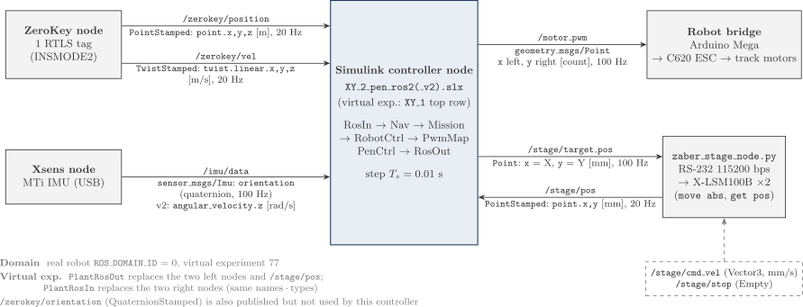

*Figure 2. ROS 2 nodes and topics (type, field, unit, rate)*

Every 10 ms the Simulink controller performs the following in order.

1. RosIn reads the latest values of the four topics. Since ZeroKey runs at 20 Hz, the same value arrives for five cycles.
2. Nav converts the tag position and heading into the wall-frame `pose` $= [\hat x;\ \hat y;\ \hat\psi]$.
3. Mission determines the current stage (mode) and outputs the segment for the robot to follow and the pen line.
4. RobotCtrl computes $(v_c,\ \omega_c)$ with the law appropriate to the mode, and PwmMap converts it into left/right PWM.
5. PenCtrl computes the stage target $s^{\star}$ from the same `pose`.
6. RosOut publishes `/motor_pwm` and `/stage/target_pos`.

The stage node stores only the last of the targets arriving at 100 Hz and sends serial `move abs` at 25 Hz. One serial line takes several ms, so sending all of them at 100 Hz would cause commands to back up.

### 2.5 Four Simulink Files

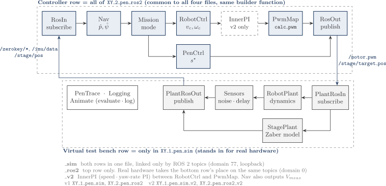

*Figure 3. Relationship among the four files*

The four files are divided by two criteria. The first criterion is the test environment. `XY_1_pen_sim`, whose name ends in `_sim`, is a virtual experiment model containing, beneath the controller, a virtual robot (RobotPlant), virtual sensors (Sensors), and a virtual stage (StagePlant). The virtual equipment publishes and subscribes to ROS 2 topics with exactly the same names and types as the real equipment, and the controller and the virtual equipment are not connected by lines but communicate only through topics. `XY_2_pen_ros2`, whose name ends in `_ros2`, contains only the controller row built by the same builder function, and the nodes on the actual NUC take the place of the virtual equipment. The controller verified in the virtual experiment is therefore connected to the real robot without changing a single character. The two models use different ROS domains (virtual 77, real 0) so that `/motor_pwm` from the virtual experiment does not move a real robot on the same network.

The second criterion is the version. Version 1 converts the outer-loop velocity command $(v_c,\ \omega_c)$ directly into PWM by scaling only. Version 2 (`_v2`) inserts two inner PIs, identical to those of the real Xsens model, in between. One matches the actual forward speed $u_B$, measured by ZeroKey velocity, to $v_c$; the other matches the yaw rate $r$, measured by the gyro, to $\omega_c$. The inner PIs only make the robot move as commanded and do not change pen accuracy. In the virtual experiment the pen RMS is 1.17–1.20 mm for version 1 and 1.21–1.24 mm for version 2.

---

## 3. Coordinate Frames and Rotation Matrix

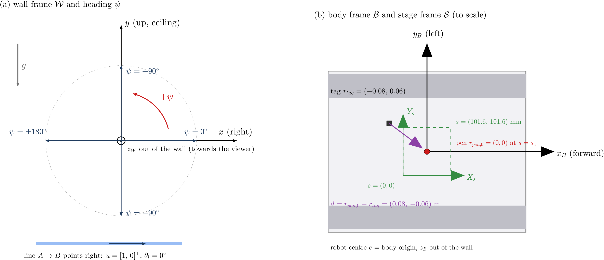

*Figure 4. (a) Wall frame and heading, (b) body and stage frames*

### 3.1 Three Coordinate Frames

The wall frame $\mathcal W$ is fixed to the wall. Viewing the wall from the front, $x$ points right (horizontal), $y$ points up (towards the ceiling), and $z$ points out of the wall. It is a right-handed frame as in ROS REP-103, and since $z$ points in the same direction as the robot body $z_B$, the counterclockwise angle from $x$ to $y$ is positive heading. The real-robot Simulink `plane_project` uses $p_1$ for height and $p_2$ for leftward horizontal, related to the coordinates of this document by $x = -p_2$, $y = p_1$, $\psi = \psi_{old} + 90^{\circ}$. The body frame $\mathcal B$ is attached to the robot and moves with it; $x_B$ is forward and $y_B$ is the robot's left. The stage frame $\mathcal S$ is parallel to the body axes, has its origin at the stage home (one end of travel), and has units of mm.

The heading $\psi$ is the angle measured counterclockwise from the $x$ axis to the $x_B$ axis. When the robot faces right $\psi = 0$, when it faces the ceiling $+90^{\circ}$, and when it faces left $180^{\circ}$. The line in this document runs from $A = (-0.70,\ 0.30)$ m to $B = (0.50,\ 0.30)$ m, 1.2 m to the right at a height of 0.30 m, so the line direction is $\theta_l = 0^{\circ}$.

### 3.2 Rotation Matrix

The matrix that transforms a vector $a_B$ written in body coordinates into wall coordinates is the rotation matrix.

$$
R(\psi) = \begin{bmatrix} \cos\psi & -\sin\psi \cr \sin\psi & \cos\psi \end{bmatrix} = \begin{bmatrix} x_B & y_B \end{bmatrix}, \qquad a_W = R(\psi)\thinspace a_B, \qquad a_B = R^{\top}(\psi)\thinspace a_W \qquad (1)
$$

| Symbol | Pronunciation | Meaning |
|---|---|---|
| $R(\psi)$ | R psi | Body → wall rotation. First column is $x_B$ written in wall coordinates, second column is $y_B$ |
| $R^{\top}(\psi)$ | R transpose | Wall → body. A rotation matrix is orthogonal, so its inverse is its transpose |
| $a_W,\ a_B$ | – | Components of the same arrow written in wall and body coordinates |

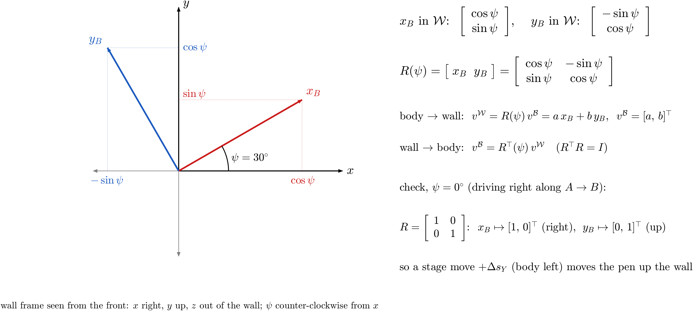

*Figure 5. The columns of the rotation matrix are the body axes written in wall coordinates*

The first column is $x_B$ because substituting the body vector $a_B = (1,\ 0)$, i.e. the unit vector in the $x_B$ direction, makes $R a_B$ equal to the first column. For example, at $\psi = 0$, where the robot faces right, $R = I$, and at $\psi = 90^{\circ}$, where it faces the ceiling, $R = [\thinspace 0\ \ {-1};\ 1\ \ 0\thinspace]$. At $\psi = 0$ the first column $(1,\ 0)$ is the $x$ direction, i.e. rightward on the wall, which is correctly the robot's forward direction. The second column $(0,\ 1)$ is the $y$ direction, i.e. upward. The left of a robot facing right is upward, so this is also correct. In this pose, moving the stage Y axis in the + direction moves the pen upward on the wall. This correspondence is used directly in understanding the signs in Chapter 6.

### 3.3 Lever Arm

The vector from the tag to "the pen when the stage is at the centre of travel", written in body coordinates, is called the lever arm $d$.

$$
d = r_{pen0} - r_{tag} = (0,\ 0) - (-0.08,\ 0.06) = (0.08,\ -0.06)\ \mathrm{m} \qquad (2)
$$

Since $d$ is fixed to the robot, it is constant in body coordinates, but in wall coordinates it becomes $R(\psi)\thinspace d$, whose direction changes with heading. If the heading is known incorrectly, $R(\hat\psi)\thinspace d$ is wrong, and that difference directly becomes pen position error (Chapter 7).

---

## 4. Formulation of the Control Problem

### 4.1 Position of the Pen Tip

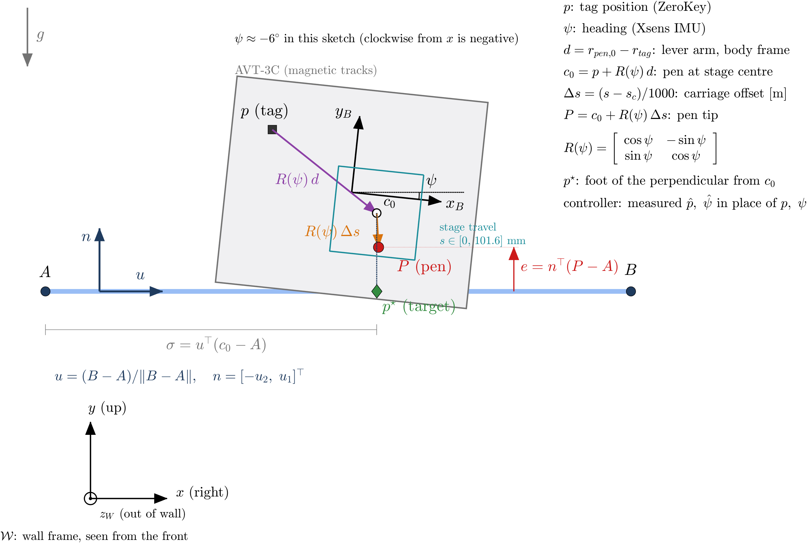

*Figure 6. Wall frame and pen compensation geometry (enlarged, not to scale)*

The pen tip $P$ is the point obtained by starting from the tag position $p$, adding the lever arm $d$ and the stage carriage displacement $\Delta s$ in body coordinates, and rotating the result into the wall frame.

$$
P = p + R(\psi)\thinspace (d + \Delta s), \qquad \Delta s = \frac{s - s_c}{1000}\ [\mathrm{m}] \qquad (3)
$$

| Symbol | Meaning | Unit |
|---|---|---|
| $p$ | Tag position (wall) | m |
| $\psi$ | heading | rad |
| $d$ | Tag → centred pen lever arm (body) | m |
| $s$ | Stage position (Zaber coordinates, home = 0) | mm |
| $s_c$ | Centre of travel, 50.8 mm | mm |
| $\Delta s$ | Carriage displacement from centre (body) | m |

### 4.2 Objective

The pen lying on the line $AB$ means that the distance of the pen in the direction normal to the line, i.e. the cross-track error, is 0.

$$
e(t) = n^{\top}\big(P(t) - A\big) = 0, \qquad u = \frac{B - A}{\lVert B - A\rVert}, \quad n = J u, \quad J = \begin{bmatrix} 0 & -1 \cr 1 & 0 \end{bmatrix} \qquad (4)
$$

$u$ is the unit vector along the line, and $n$ is the normal obtained by rotating $u$ counterclockwise by 90° (the left of the line; upward for this line). Along the line the pen only needs to pass from $A$ to $B$, so no exact timetable is required. That is, the only quantity to be controlled is the cross-track error $e$, and travel is a loose condition that "it only needs to reach the end eventually".

### 4.3 Motion of the Two Actuators

The motion of the robot centre $c$ and the heading is as follows (disturbances and shift of the centre of rotation are treated in Section 8.2).

$$
\dot c = v \begin{bmatrix} \cos\psi \cr \sin\psi \end{bmatrix}, \qquad \dot\psi = \omega \qquad (5)
$$

The absence of lateral velocity in Eq. (5) is the nonholonomic constraint. The robot moves only in the $x_B$ direction, and its lateral position changes only by changing heading. The stage, in contrast, moves body X and Y independently and quickly, but cannot exceed $\lvert\Delta s_i\rvert \le 50.8$ mm.

### 4.4 Rationale for the Division of Roles

Considering Eqs. (3)–(5) together, there are two ways to reduce the cross-track error $e$: the robot turns and returns to the line, or the stage moves the pen towards the line. This system divides the two as follows.

| Component | Assigned to | Reason |
|---|---|---|
| Travel along the line (1.2 m) | Robot $v$ | Impossible with 101.6 mm stage travel |
| Slow component of cross-track error (mean, several cm) | Robot $\omega$ | Keeps the stage working near the centre of travel |
| Fast component of cross-track error (track bumps 0.35 Hz, creep, noise) | Stage $\Delta s$ | Lateral convergence of the robot is slow, several seconds |
| Pen displacement produced by heading error through the lever arm | Stage $\Delta s$ | The pen is a point, so orientation is irrelevant and only position must match |

Since the pen is a point, it has no "orientation". Heading is therefore not a control objective in itself; it is meaningful only through the path by which it affects pen position via the lever arm. Even if the robot heading deviates from the line by 3°, the line is drawn straight as long as the stage moves the pen by the corresponding amount (numerical example in Section 6.7).

---

## 5. Macro Level: Robot Control

### 5.1 Mission Phases and In-Place Turn

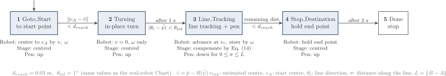

*Figure 7. Mission phases (Stateflow ModeChart)*

The mission is divided into five phases, and the Stateflow state machine ModeChart switches between them. At the start the robot is at $(-0.85,\ 0.10)$ m, away from the line, facing the ceiling ($\psi_0 = 90^{\circ}$).

In mode 1 (Goto_Start) the robot moves to a start point suitable for beginning the line. The target here is not the tag but the start point $c_A$ of the robot centre. Since the in-place turn in the next phase rotates about the robot centre, the centre must be aligned before the turn for the tag to arrive at the designated start point after the turn. If the robot navigated by the tag, the tag would trace an arc of radius 0.1 m during the turn, and the line start point would be off by about 11 cm.

In mode 2 (Turning) the robot turns in place with zero forward speed to align its heading with the line direction $0^{\circ}$. The in-place turn is used only in this phase, and the pen is not yet used. When the error stays within 1° for more than 1 s, the mission advances to the next phase.

In mode 3 (Line_Tracking) the robot travels along the line at 30 mm/s while the stage simultaneously performs pen compensation. A turn-rate command $\omega_c$ is also issued in this phase, but it is not an in-place turn; it is steering that gradually corrects the direction while travelling. The robot steers while travelling, and the stage removes the deviation that still remains. This is the answer to the question "does the system both turn and control the stage?".

In mode 4 (Stop_Destination) the robot stops at the end point, and 2 s later the simulation ends in mode 5. Within mode 3 the pen is evaluated as lowered only while the pen target lies between $A$ and $B$. The real robot does not yet have a pen lifting mechanism, so this interval decision is for logging only.

The segment followed by the robot is not the same line as the pen line. For the pen to lie on the line when the stage is centred, the tag must follow a parallel line offset from the line by $-R(\theta_l)\thinspace d$. In addition, the robot starts 60 mm ahead so that it settles before the pen reaches $A$, and travels 40 mm past the end.

$$
r_A = A - R(\theta_l)\thinspace d - 0.06\thinspace u, \qquad r_B = B - R(\theta_l)\thinspace d + 0.04\thinspace u, \qquad c_A = r_A - R(\theta_l)\thinspace r_{tag} \qquad (6)
$$

### 5.2 Line-Tracking Law

The reference point $x_r$ of mode 3 moves along the segment at a constant speed $v_r$ over time. The robot views its difference from this reference point in body coordinates.

$$
x_r(t) = r_A + v_r\thinspace (t - t_{line})\thinspace u, \qquad
\begin{bmatrix} e_x \cr e_y \end{bmatrix} = R^{\top}(\hat\psi)\thinspace (x_r - \hat p), \qquad
e_\theta = \mathrm{wrap}(\theta_l - \hat\psi) \qquad (7)
$$

$$
v_c = v_r \cos e_\theta + k_x\thinspace e_x, \qquad \omega_c = k_y\thinspace e_y + k_\psi \sin e_\theta \qquad (8)
$$

$e_x$ is how far the reference point lies ahead of the robot, and $e_y$ is how far the reference point lies to the robot's left. The robot can reduce the longitudinal error $e_x$ directly with forward speed, but cannot reduce the lateral error $e_y$ directly. $e_y$ therefore enters the turn command $\omega_c$. If the reference point is to the left ($e_y > 0$), the robot turns left, and the lateral error decreases as it advances with the deflected heading.

Why this process is slow becomes apparent by linearising the equations near the line. Let $y_l$ be the lateral position of the robot measured to the left of the line and $\phi = \psi - \theta_l$ the heading difference from the line; then from Eq. (5), $\dot y_l = v\sin\phi \approx v_r\phi$ and $\dot\phi = \omega$. For small errors $e_y \approx -y_l$ and $e_\theta \approx -\phi$, so Eq. (8) becomes $\omega = -k_y y_l - k_\psi\phi$, and the closed loop is as follows.

$$
\ddot y_l + k_\psi\thinspace \dot y_l + v_r k_y\thinspace y_l = 0, \qquad
\lambda = \frac{-k_\psi \pm \sqrt{k_\psi^2 - 4 v_r k_y}}{2} \qquad (9)
$$

| Quantity | Calculation | Result |
|---|---|---|
| $v_r k_y$ | 0.03 × 5.0 | 0.15 s⁻² |
| Roots $\lambda$ | $(-1.4 \pm \sqrt{1.96 - 0.60})/2$ | $-0.117$, $-1.283$ s⁻¹ |
| Time constant of the slow root | 1/0.117 | 8.5 s |

Since the time constant of the slow root is 8.5 s, the robot reduces a lateral deviation by about 63 % only after 8.5 s. In that time the robot travels about 25 cm. Because the travel speed $v_r$ multiplies the loop gain, the slower the robot travels, the more slowly the lateral error decreases. This is not a problem that can be solved by raising the gain. Doubling $k_y$ reduces the robot RMS from 23.6 mm to 17.1 mm, but the heading fluctuates more and the pen RMS increases from 1.19 mm to 1.32 mm (Section 18.5). This is the reason pen accuracy is entrusted to the stage rather than to the robot.

### 5.3 From Velocity Command to Motors

`calc_pwm` in PwmMap uses the function of the real-robot Simulink as is. On the real robot the inner PI outputs $\bar V,\ \bar W \in [-0.5,\ 0.5]$ enter this function, so version 1 normalises the velocity commands to the same range before feeding them in.

$$
\bar V = \frac{v_c}{2 v_{full}}, \quad \bar W = \frac{\omega_c}{2\omega_{full}}, \qquad
T(\bar V) = d_v\tanh\frac{\bar V}{0.02} + (400 - d_v)\frac{\bar V}{0.5} \qquad (10)
$$

$$
u_L = 1500 + T(\bar V) - T_s(\bar W), \qquad u_R = 1500 - \big(T(\bar V) + T_s(\bar W)\big) \qquad (11)
$$

The first term of $T$ is an inverse compensation that jumps like a step of $d_v$ = 47 count near 0 to skip the ESC dead zone (the range of small PWM in which the motor does not turn), and the second term fills the remaining range linearly. The turn component $T_s$ is subtracted on the left and added on the right to create the left/right speed difference. The right motor is mounted in mirror symmetry, so the sign of the right PWM is reversed.

On the real robot the ESC receives the PWM and controls the motor speed. The RobotPlant of the virtual experiment models this process in the order of ESC inverse mapping, 0.15 s first-order lag, speed PI, traction distribution, and track dynamics (Section 14.4).

---

## 6. Micro Level: Pen Kinematic Compensation

### 6.1 Why Compensation Is Needed

However well the robot control of Chapter 5 performs, the cross-track error of the robot remains several cm. If the stage is fixed at its centre, the pen follows every sway of the robot, and the cross-track error of the drawn line is 14.84 mm RMS. This error has three causes. First, the robot drifts sideways off the line (creep, slow lateral convergence). Second, when the heading oscillates, the pen moves sideways through the lever arm $d$; this amounts to about 1.4 mm per 1° of heading (Section 8.6.5). Third, while the robot advances at an angle, the pen also travels at an angle. All three causes are quantities that can be computed once "where the robot is now and in which direction it points" is known, so the stage only needs to move the pen back by the same amount. This is pen kinematic compensation.

### 6.2 Symbols and Code Variables

Pen compensation consists of a few lines of MATLAB code in the Simulink block PenComp. The equations and figures of this chapter all use the same symbols, and the code variable names are mapped to them once, in the table below. The figures and text use only the mathematical symbols, not the code names.

| Symbol | Code variable | Frame | Unit | Meaning | Figure marker |
|---|---|---|---|---|---|
| $\hat p$ | `pT` = `pose(1:2)` | wall frame $\mathcal W$ | m | Tag position measured by ZeroKey | black square |
| $\hat\psi$ | `pose(3)` | – | rad | Heading measured by the IMU (counter-clockwise from the $x$ axis) | – |
| $R(\hat\psi)$ | `R` | body → wall | – | Matrix that rotates a body arrow into a wall arrow | grey $x_B$, $y_B$ axes |
| $d$ | `pen_d` | body frame $\mathcal B$ | m | Lever arm from the tag to the pen at the stage centre; a constant fixed by the mounting | purple arrow |
| $c_0$ | `pc` | wall | m | Point the pen touches when the stage is at its centre, $\hat p + R(\hat\psi)\thinspace d$ | white circle |
| $A$, $B$, $L$ | `lineAB`, `L` | wall | m | Two endpoints and length of the line to be drawn | navy dots, blue line |
| $u$, $n$ | `u` | wall | – | Unit vector along the line, normal $n = Ju$ (up is +) | navy arrows |
| $\sigma$ | `sigma` | – | m | Distance along the line of $c_0$ | dimension line |
| $e_0$ | – | – | m | Cross-track error with the stage at its centre, $n^{\top}(c_0 - A)$ | – |
| $p^{\star}$ | `p_des` | wall | m | Pen target; the foot of the perpendicular dropped from $c_0$ onto the line | green diamond |
| $\Delta s$ | `e_b` | body | m | Amount by which the stage must move the pen from the centre | orange arrow |
| $s_c$ | `stage_c` | stage | mm | Zaber scale reading at the stage centre (50.8) | black plus |
| $s^{\star}$ | `s_cmd` | stage | mm | Position command sent to the Zaber | red circle |
| $P$ | – | wall | m | Actual pen tip | red circle |

```matlab
A = lineAB(1:2);  B = lineAB(3:4);
L = norm(B - A);  u = (B - A) / max(L, 1e-9);
pT = pose(1:2);
R  = [cos(pose(3)) -sin(pose(3)); sin(pose(3)) cos(pose(3))];
pc = pT + R * pen_d;                 % c0
sigma = dot(u, pc - A);              % sigma
pen_on = 0;
s_cmd = [stage_c; stage_c];
if round(mode) == 3
    p_des = A + sigma * u;           % p*
    e_b = R' * (p_des - pT) - pen_d; % Delta s [m]
    s_cmd = stage_c + 1000 * e_b;    % s* [mm]
    pen_on = double(sigma >= 0 && sigma <= L);
end
```

All numerical values in this chapter belong to one and the same instant. During line following, $\hat p = (-200.0,\ 345.0)$ mm and $\hat\psi = 3^{\circ}$, and the line runs from $A = (-700,\ 300)$ mm to $B = (500,\ 300)$ mm. The controller computes internally in m, but the values in the figures and text are given in mm for readability. All figures are drawn to true scale.

| Figure | Frame viewed | What only this figure shows |
|---|---|---|
| Figure 8 | Body (viewed riding on the robot) | $d$, $\Delta s$ and the arrow triangle |
| Figure 9 | Wall (wall viewed head-on) | $u$, $n$, $\sigma$, $c_0$, $p^{\star}$, $e_0$ |
| Figure 10 | Both frames side by side | How $R^{\top}(\hat\psi)$ changes the scale on which the same arrow is read |
| Figure 11 | Stage (Zaber scale) | $\times 1000$ and $+\thinspace s_c$ |
| Figure 12 | Computation order | Frame and unit of each step |
| Figure 13 | The four above on one sheet | All computation steps and the final command |

### 6.3 Body Frame: Pen Position Equation and Arrow Triangle

The pen tip position is given by Eq. (3). When the stage carriage is moved by $\Delta s$ from the centre, the pen lies at the body arrow $d + \Delta s$ from the tag. Once the wall position $p^{\star}$ that the pen must reach is fixed, solving this equation for $\Delta s$ yields the carriage motion.

$$
p^{\star} = \hat p + R(\hat\psi)\thinspace (d + \Delta s)
\quad\Longrightarrow\quad
\underbrace{d}_{\text{purple}} + \underbrace{\Delta s}_{\text{orange}} = \underbrace{R^{\top}(\hat\psi)\thinspace (p^{\star} - \hat p)}_{\text{green}}
\quad\Longrightarrow\quad
\Delta s = R^{\top}(\hat\psi)\thinspace (p^{\star} - \hat p) - d \qquad (12)
$$

Since $R$ is orthogonal, multiplying both sides by $R^{\top}$ solves the equation directly. The measured values $\hat p$, $\hat\psi$ are used because the measurements are all the controller knows. The middle equation of Eq. (12) is a triangle formed by three arrows in the body frame, and Figure 8 depicts it.

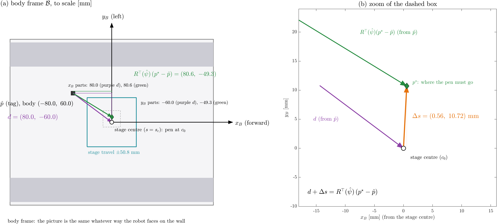

*Figure 8. Eq. (12) viewed in the body frame. (a) Whole robot (true scale), (b) close-up of the stage centre*

Figure 8 is a view from on top of the robot. Because the body frame rotates with the robot, the chassis, tag and stage occupy the same place in this figure regardless of which way the robot faces on the wall. The horizontal axis is the forward direction $x_B$, and the vertical axis is the robot's left $y_B$.

| In the figure | Symbol | Value [mm] (body components) | Meaning |
|---|---|---|---|
| black square | $\hat p$ | body $(-80.0,\ 60.0)$ | The point ZeroKey actually measures; neither the robot centre nor the pen |
| white circle | $c_0$ | body $(0,\ 0)$ | Pen at the stage centre ($s = s_c$) |
| teal square | stage travel | $\pm 50.8$ | Range over which the pen can move relative to the body |
| purple arrow | $d$ | $(80.0,\ -60.0)$ | From $\hat p$ to $c_0$; constant, and the controller cannot change it |
| green arrow | $R^{\top}(\hat\psi)\thinspace (p^{\star} - \hat p)$ | $(80.6,\ -49.3)$ | From $\hat p$ to the pen target; set by the measurement and the line, and changes every cycle |
| green diamond | $p^{\star}$ | body $(0.56,\ 10.72)$ | Where the pen must go |
| orange arrow | $\Delta s$ | $(0.56,\ 10.72)$ | From $c_0$ to $p^{\star}$; the amount by which the stage moves the pen |

There are two paths from $\hat p$ to the pen target: directly along the green arrow, or along the purple arrow to the stage centre and then along the orange arrow to the pen target. Since the two paths end at the same point, Eq. (12) holds. In other words, $\Delta s$ is "the arrow that must be travelled minus the arrow already attached to the robot". The dashed lines in Figure 8(a) show the components of the two arrows separately.

| Component | purple $d$ | green $R^{\top}(\hat\psi)(p^{\star} - \hat p)$ | difference $= \Delta s$ |
|---|---|---|---|
| $x_B$ (forward) | 80.0 | 80.6 | 0.56 |
| $y_B$ (left) | $-60.0$ | $-49.3$ | 10.72 |

The subtraction is performed in the body frame because $d$ is a quantity given in the body frame, and the two stage axes $X_s$, $Y_s$ are also attached to the body axes $x_B$, $y_B$. Arrows can be subtracted or added component-wise only when they are written in the same frame. This is why the wall-frame arrow $p^{\star} - \hat p$ must first be converted into the body frame, a task performed by $R^{\top}(\hat\psi)$ (Section 6.5). The remaining question is where to place $p^{\star}$, which is decided in the wall frame (Section 6.4).

### 6.4 Wall Frame: Pen Target $p^{\star}$

As seen in Section 4.2, the point on the line where the pen should be is not prescribed. The position along the line is set by the robot as it advances, and the stage only needs to remove the deviation from the line. The target is therefore the foot of the perpendicular dropped onto the line from $c_0$, the pen position with the stage at its centre.

$$
c_0 = \hat p + R(\hat\psi)\thinspace d, \qquad \sigma = u^{\top}(c_0 - A), \qquad e_0 = n^{\top}(c_0 - A), \qquad p^{\star} = A + \sigma u = c_0 - e_0\thinspace n \qquad (13)
$$

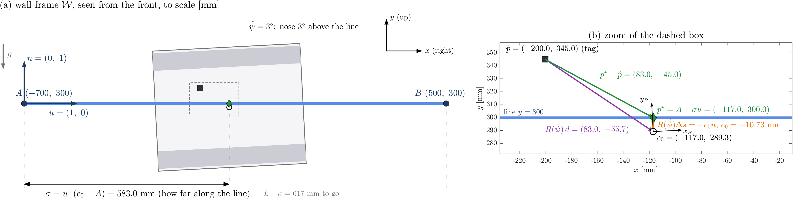

*Figure 9. Eq. (13) viewed in the wall frame. (a) Whole line and distance along the line $\sigma$ (true scale), (b) close-up of the dashed box*

Figure 9 shows the wall viewed head-on. $x$ points right and $y$ points up, and gravity $g$ acts in the $-y$ direction. The robot faces along the line (to the right) with its nose raised $3^{\circ}$ upward.

| In the figure | Symbol | Value [mm] (wall components) | Meaning |
|---|---|---|---|
| blue line, navy dots | $A$, $B$ | $(-700,\ 300)$, $(500,\ 300)$ | Line to be drawn, $L = 1200$ |
| horizontal arrow at $A$ | $u$ | $(1,\ 0)$ | Unit vector along the line, $(B - A)/L$ |
| vertical arrow at $A$ | $n = Ju$ | $(0,\ 1)$ | Line normal; the direction in which the cross-track error is measured (up is +) |
| black square | $\hat p$ | $(-200.0,\ 345.0)$ | ZeroKey measurement |
| purple arrow (b) | $R(\hat\psi)\thinspace d$ | $(83.0,\ -55.7)$ | $d$ of Figure 8 rotated into the wall frame |
| white circle | $c_0$ | $(-117.0,\ 289.3)$ | Point the pen touches when the stage is at its centre |
| lower dimension line | $\sigma$ | 583.0 | Distance from $A$ to $c_0$ measured along the line; how far the pen has come along the line |
| – | $e_0$ | $-10.73$ | $c_0$ lies 10.73 mm below the line |
| green diamond | $p^{\star}$ | $(-117.0,\ 300.0)$ | Point on the line with the same along-line position as $c_0$ |
| green arrow (b) | $p^{\star} - \hat p$ | $(83.0,\ -45.0)$ | Wall components of the green arrow in Figure 8 |
| orange arrow (b) | $R(\hat\psi)\thinspace \Delta s = -e_0\thinspace n$ | $(0.00,\ 10.73)$ | Wall components of the orange arrow in Figure 8 |

$\sigma$ is the inner product with $u$, that is, the projection (shadow) length of the arrow $c_0 - A$ along the line. Likewise, $e_0$ is the projection (shadow) length along the normal $n$. Since $p^{\star}$ is the point obtained by removing only the normal component from $c_0$, the stage moves only perpendicular to the line and only by the magnitude of the cross-track error. The reason for this division of labour is travel. How far along the line the pen has come ($\sigma$) is the robot's share as it advances, so the stage leaves that direction alone. If $p^{\star}$ were set to a specific point on the line (for example a reference point moving in time, or $A$), the stage would try to absorb even the robot's along-line error of several cm, and the 101.6 mm travel would be insufficient. Indeed, when an early version clipped $p^{\star}$ to $A$, the stage X axis went to about 95 mm at the start of mode 3.

The condition for lowering the pen is $0 \le \sigma \le L$ (`pen_on` in the code). In this example $0 \le 583.0 \le 1200$, so the pen is lowered.

### 6.5 $R^{\top}(\hat\psi)$ Linking the Two Frames

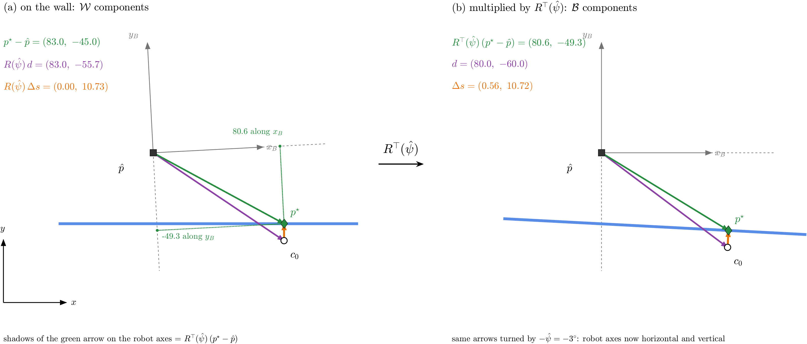

*Figure 10. Reading the same three arrows as (a) wall components and (b) body components. The middle arrow $R^{\top}(\hat\psi)$ converts (a) into (b)*

The two panels of Figure 10 draw the same three arrows; only the scale differs. (a) is read on the wall scale ($x$ right, $y$ up), as in Figure 9(b), and (b) is read on the robot scale ($x_B$ forward, $y_B$ left), as in Figure 8(b). Since (b) is (a) rotated by $-\hat\psi = -3^{\circ}$, the robot axes become horizontal and vertical and the line appears tilted by $3^{\circ}$.

| Arrow | (a) Wall components [mm] | (b) Body components [mm] | Conversion |
|---|---|---|---|
| green: $\hat p \to p^{\star}$ | $p^{\star} - \hat p = (83.0,\ -45.0)$ | $(80.6,\ -49.3)$ | $R^{\top}(\hat\psi)(p^{\star} - \hat p)$ |
| purple: $\hat p \to c_0$ | $R(\hat\psi)\thinspace d = (83.0,\ -55.7)$ | $d = (80.0,\ -60.0)$ | $R^{\top}R\thinspace d = d$ |
| orange: $c_0 \to p^{\star}$ | $R(\hat\psi)\thinspace \Delta s = (0.00,\ 10.73)$ | $\Delta s = (0.56,\ 10.72)$ | $R^{\top}R\thinspace \Delta s = \Delta s$ |

What $R^{\top}(\hat\psi)$ does can be seen from the green dashed lines in Figure 10(a). Dropping perpendiculars from the tip of the green arrow onto the robot axes $x_B$, $y_B$ gives projection lengths on the axes of 80.6 mm and $-49.3$ mm, respectively. As seen in Section 3.2, the two columns of $R$ are $x_B = (\cos\hat\psi,\ \sin\hat\psi)$ and $y_B = (-\sin\hat\psi,\ \cos\hat\psi)$ written in the wall frame, so the two rows of $R^{\top}$ are $x_B^{\top}$, $y_B^{\top}$, and the product with each row is exactly the projection length.

$$
R^{\top}(\hat\psi)\thinspace (p^{\star} - \hat p) =
\begin{bmatrix} x_B^{\top}(p^{\star} - \hat p) \cr y_B^{\top}(p^{\star} - \hat p) \end{bmatrix}
= \begin{bmatrix} 83.0\cos 3^{\circ} - 45.0\sin 3^{\circ} \cr -83.0\sin 3^{\circ} - 45.0\cos 3^{\circ} \end{bmatrix}
= \begin{bmatrix} 80.6 \cr -49.3 \end{bmatrix}\ \mathrm{mm} \qquad (14)
$$

In summary, Eq. (12) reads in three steps.

| Step | Computation | In the figure |
|---|---|---|
| 1 | $p^{\star} - \hat p$ | Measure the green arrow of Figure 9(b) on the wall scale |
| 2 | $R^{\top}(\hat\psi)(\cdot)$ | Re-measure the same arrow on the robot scale (Figure 10(a) → (b)) |
| 3 | $-\thinspace d$ | Subtract the purple arrow already attached to the robot (Figure 8) |

The same result can also be obtained more briefly. Since $c_0 = \hat p + R(\hat\psi)\thinspace d$, Eq. (12) is equivalent to $\Delta s = R^{\top}(\hat\psi)(p^{\star} - c_0)$, and substituting $p^{\star} - c_0 = -e_0\thinspace n$ from Eq. (13) gives the following simple form.

$$
\Delta s = -e_0\thinspace R^{\top}(\hat\psi)\thinspace n = -e_0 \begin{bmatrix} \sin(\hat\psi - \theta_l) \cr \cos(\hat\psi - \theta_l) \end{bmatrix} \qquad (15)
$$

That is, $\Delta s$ is the orange arrow $(0.00,\ 10.73)$ mm of Figure 9(b) re-read on the robot scale, $10.73\thinspace (\sin 3^{\circ},\ \cos 3^{\circ}) = (0.56,\ 10.72)$ mm. When the robot is parallel to the line ($\hat\psi = \theta_l$), $\Delta s = (0,\ -e_0)$; that is, only the Y axis moves, opposite to the cross-track error and by the same amount. When the robot is tilted by 3°, the X axis also moves by $-e_0\sin 3^{\circ}$, so the pen is moved perpendicular to the wall line rather than along the tilted Y axis. In the virtual experiment, the X axis barely moves (51.0–53.8 mm) while the Y axis removes the cross-track error (61.3–72.2 mm), in agreement with this equation. The code computing directly from $\hat p$ without passing through $c_0$ is merely the same equation written in a different order.

### 6.6 From $\Delta s$ to the Zaber Command: 1000 and $s_c$

$\Delta s$ in Eqs. (12)–(15) is a body-frame vector in m. However, the Zaber firmware and the `/stage/target_pos` topic use mm, and their origin is one end of the travel (home). The stage command therefore passes through two more steps.

$$
s^{\star} = s_c + 1000\thinspace \Delta s \quad [\mathrm{mm}], \qquad s_c = 50.8\ \mathrm{mm} \qquad (16)
$$

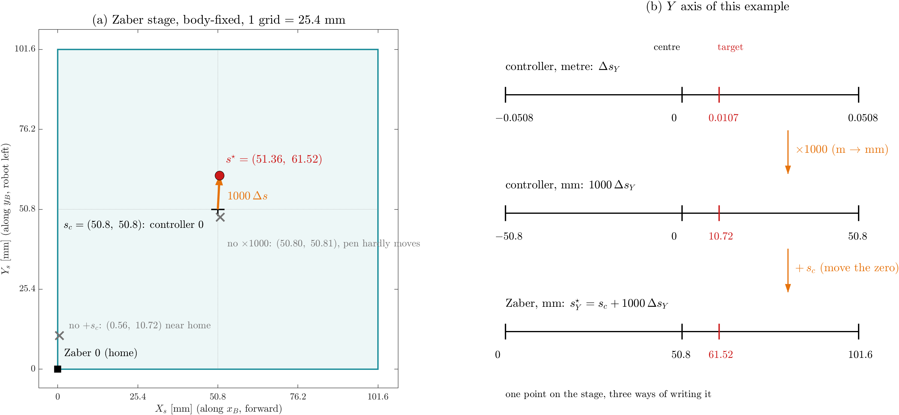

*Figure 11. Eq. (16). (a) Command point on the Zaber stage mounted on the robot, (b) three notations for one point on the Y axis*

Figure 11(a) enlarges the teal square (stage) of Figure 8. The horizontal $X_s$ is in the $x_B$ direction, the vertical $Y_s$ is in the $y_B$ direction, and the lower-left corner is the Zaber 0 (home).

| Operation | Why it is needed | What happens if omitted |
|---|---|---|
| $\times 1000$ | The controller computes all lengths in the SI unit m internally and converts to mm only at the interface with the stage ($1\ \mathrm{m} = 1000\ \mathrm{mm}$) | Sending 0.0107 makes the Zaber interpret it as 0.0107 mm, so the pen barely moves (grey × at the centre of Figure 11(a)) |
| $+\thinspace s_c$ | $\Delta s = 0$ in the controller is the stage centre, whereas the Zaber 0 is home (the edge of the travel) | Sending 10.72 drives the carriage near home, 40 mm below the centre (grey × at the lower left of Figure 11(a)) |

Figure 11(b) writes the same point on the Y axis on three scales. The value 0.0107 on the controller m scale becomes 10.72 on the controller mm scale after multiplication by 1000, and 61.52 on the Zaber scale after adding 50.8. The centres (0, 0, 50.8) and the ends ($\pm 0.0508$ m, $\pm 50.8$ mm, 0 and 101.6 mm) of the three scales are the same points. $s_c$ translates into a Zaber number the design of "starting with the stage at its centre and keeping a margin of $\pm 50.8$ mm on each side". For the same reason, $s^{\star} = (s_c,\ s_c)$ outside mode 3, so the stage waits at its centre while no line is being drawn. Conversely, when the pen position is computed (PenTrace, for evaluation), $s_c$ is subtracted and the result divided by 1000, as in Eq. (3).

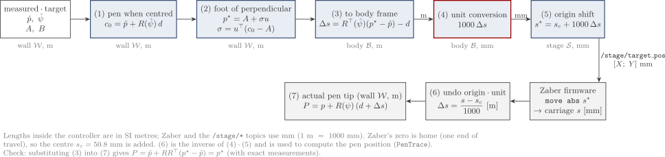

*Figure 12. PenComp computation order and the frame and unit of each step*

Figure 12 lays out the computation order of Eqs. (12)–(16) as blocks. It starts from wall-frame quantities in m ($\hat p$, $c_0$, $p^{\star}$), becomes body frame after passing through $R^{\top}$, and finally becomes the stage mm scale after passing through $\times 1000$ and $+\thinspace s_c$.

### 6.7 Summary of the Numerical Example

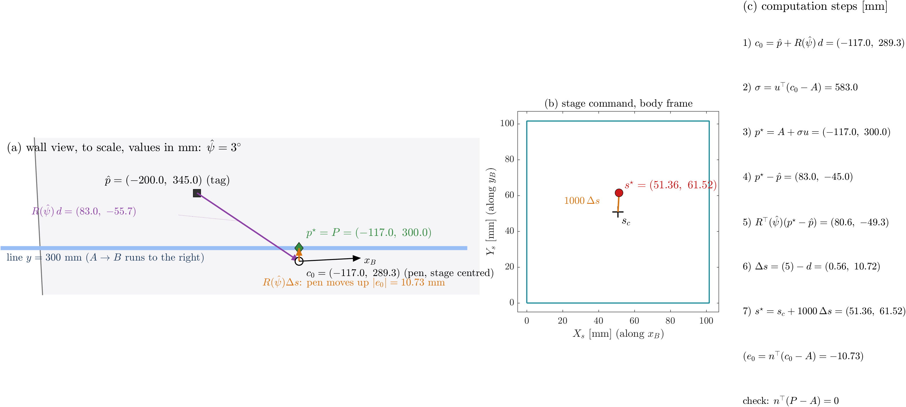

*Figure 13. Summary of the pen compensation numerical example (mm). (a) Wall, (b) stage command, (c) computation steps*

Figure 13 gathers the content of Figures 8–11 on one sheet. It is the instant during line following at which the measurements are $\hat p = (-200.0,\ 345.0)$ mm and $\hat\psi = 3^{\circ}$, with the robot's nose pointing 3° above the line direction $\theta_l = 0^{\circ}$. The computation proceeds in the following order.

| Step | Code | Equation | Value in this example [mm] | In the figure |
|---|---|---|---|---|
| 1 | `pc = pT + R*pen_d` | $c_0 = \hat p + R(\hat\psi)\thinspace d$ | $(-200.0,\ 345.0) + (83.0,\ -55.7) = (-117.0,\ 289.3)$ | Figure 9(b) white circle |
| 2 | `sigma = dot(u, pc - A)` | $\sigma = u^{\top}(c_0 - A)$ | 583.0 | Figure 9(a) dimension line |
| – | – | $e_0 = n^{\top}(c_0 - A)$ | $-10.73$ (pen below the line) | Figure 9(b) |
| 3 | `p_des = A + sigma*u` | $p^{\star} = A + \sigma u$ | $(-117.0,\ 300.0)$ | Figure 9(b) green diamond |
| 4 | `p_des - pT` | $p^{\star} - \hat p$ | $(83.0,\ -45.0)$ | Figure 10(a) green arrow |
| 5 | `R'*(p_des - pT)` | $R^{\top}(\hat\psi)(p^{\star} - \hat p)$ | $(80.6,\ -49.3)$ | Figure 10(b), Figure 8 green arrow |
| 6 | `e_b = ... - pen_d` | $\Delta s$ | $(80.6,\ -49.3) - (80.0,\ -60.0) = (0.56,\ 10.72)$ | Figure 8(b) orange arrow |
| 7 | `s_cmd = stage_c + 1000*e_b` | $s^{\star} = s_c + 1000\thinspace \Delta s$ | $(51.36,\ 61.52)$ | Figure 11(a) red circle |
| 8 | `pen_on` | $0 \le \sigma \le L$ | 1 (pen down) | Figure 9(a) |

Checking with Eq. (15) gives $-e_0\thinspace (\sin 3^{\circ},\ \cos 3^{\circ}) = 10.73\thinspace (0.0523,\ 0.9986) = (0.56,\ 10.72)$ mm, identical to step 6. The result is verified as follows.

| Check item | Computation | Result |
|---|---|---|
| Y-axis motion | $61.52 - 50.8$ | 10.72 mm. In this attitude $y_B$ points almost straight up, so the pen moves upward on the wall |
| X-axis motion | $51.36 - 50.8$ | 0.56 mm. "Up on the wall" and "left of the robot" differ by $3^{\circ}$, so the pen must also be moved forward by $10.73\sin 3^{\circ}$ to go straight up |
| Pen tip | $P = \hat p + R(\hat\psi)\thinspace (d + \Delta s)$ | $(-117.0,\ 300.0) = p^{\star}$ |
| Cross-track error | $n^{\top}(P - A)$ | 0. Since $c_0$ was 10.73 mm below the line, the pen lands exactly on $p^{\star}$, that is, on the line |
| Along-line direction | $u^{\top}(P - c_0)$ | 0. The stage does not move the pen along the line |

### 6.8 The Constraint of a Commercial Stage

The Zaber stage is a commercial product whose internal position servo (stepper drive and encoder correction) is executed by its firmware, and its control law cannot be changed from outside. All that can be done externally is to send a target position (`move abs`), read the current position (`get pos`), and change settings such as maximum speed (`maxspeed`) and acceleration (`accel`). This constraint is reflected in the design as follows.

| Design decision | Relation to the constraint |
|---|---|
| The output of pen compensation is the position $s^{\star}$ | Since only position commands can be given, the compensation is built as a kinematic compensation that computes position, not velocity or force |
| No separate stage position loop is designed | The firmware servo accuracy of 45 µm and repeatability of 6 µm are more than 20 times smaller than the 1 mm sensor noise, so the stage can be assumed to be at the commanded position |
| Commands are saturated and rate-limited in advance | The `Travel` (0–101.6 mm) and `CmdRate` (83 mm/s) blocks of PenCtrl send only commands within the firmware limits, preventing commands from being clipped inside the firmware |
| The node decimates and sends at 25 Hz | Because of serial communication time, not all 100 Hz commands can be sent |
| `/stage/pos` is not used in the compensation computation | The compensation is a feedforward that assumes the stage reaches the commanded position. The read position is used for monitoring, evaluation and the optional stage centring function (Section 8.10) |
| The StagePlant of the virtual experiment models the firmware as a black box | Trapezoidal profile (104 mm/s, 500 mm/s²) + 20 Hz position servo + thrust–speed curve + wall gravity. The internal structure of the firmware is unknown, so it is left as [to be measured] |

Whether the stage is fast enough can be judged by comparison with the speed of the robot disturbances. The fastest disturbance, the track bumps, is 0.35 Hz with an amplitude of 1.5°, and it shakes the pen by about 2 mm at the 0.08 m lever arm. The stage speed needed to remove it is $2\pi \times 0.35 \times 2 \approx 4.4$ mm/s, only 4 % of the maximum speed of 104 mm/s. Indeed, lowering the stage servo bandwidth from 20 Hz to 2 Hz and the command rate from 25 Hz to 5 Hz left the pen RMS unchanged at 1.17–1.20 mm (Chapter 20). At a travel speed of 30 mm/s, stage speed is not the bottleneck.

---

## 7. Measurement Error and Sensor Placement

### 7.1 Propagation of Measurement Error

The compensation of Chapter 6 does not measure the pen; it computes the pen position from the measured robot pose, so the pen departs from the line by as much as the measurement is wrong. Defining the position measurement error as $\delta p = \hat p - p$ and the heading measurement error as $\delta\psi = \hat\psi - \psi$, the pen cross-track error to first order is as follows (Eqs. (39)–(41)).

$$
e \approx -\thinspace n^{\top}\delta p \thickspace -\thickspace \ell_u\thinspace \delta\psi, \qquad \ell_u = u^{\top}R(\psi)(d + \Delta s) \approx 0.08\ \mathrm{m} \qquad (17)
$$

$$
\sigma_e^2 \approx \sigma_p^2 + \ell_u^2\left(\sigma_\psi^2 + \frac{(\dot b_\psi T)^2}{3}\right) = 1.0^2 + 0.42^2 + 0.63^2\ \mathrm{mm}^2, \qquad \sigma_e \approx 1.25\ \mathrm{mm} \qquad (18)
$$

For position error, the component normal to the line becomes pen error directly; for heading error, it is multiplied by the along-line component $\ell_u$ of the lever arm to become pen error. The simulated pen RMS of 1.17–1.20 mm is of the same magnitude as this prediction. In simulations that remove each factor one at a time, setting the ZeroKey noise to 0 gives the largest reduction, to 0.74 mm, and making all sensors ideal leaves 0.41 mm. The remaining 0.41 mm is non-sensor error arising from track bumps, creep and stage dynamics. The result that setting only the IMU noise or drift to 0 instead increases the error to 1.28 mm has not yet been explained (Section 18.5).

The conclusion is clear. What determines the accuracy of this system is not the control law or the stage but the sensors, in particular the ZeroKey position noise.

### 7.2 ZeroKey Tag Placement

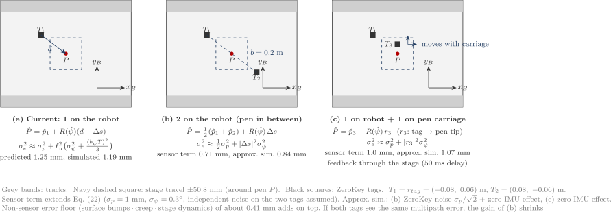

*Figure 14. Three ZeroKey tag placement options (robot viewed from above, body frame)*

Since ZeroKey is the dominant factor, adding one more tag is considered. There are three candidates.

(a) The current configuration has a single tag $T_1$ on the robot. Both the tag noise $\sigma_p$ and the heading error × lever arm enter the pen position estimate.

(b) A second tag $T_2$ is mounted on the robot body so that the pen lies exactly midway between the two tags. In the current layout, $T_2 = -r_{tag} = (0.08,\ -0.06)$ m. When three points on a rigid body lie on one straight line, the position of the middle point is the average of the other two, independent of heading.

$$
c_0 = \tfrac12(p_1 + p_2) \quad\Rightarrow\quad \hat P = \tfrac12(\hat p_1 + \hat p_2) + R(\hat\psi)\thinspace \Delta s, \qquad \sigma_e^2 \approx \tfrac12\sigma_p^2 + \lvert\Delta s\rvert^2\sigma_\psi^2 \qquad (19)
$$

If the noise of the two tags is independent, the variance of the average is halved, and the heading error multiplies only the carriage displacement $\lvert\Delta s\rvert \approx$ 15 mm, shrinking to 0.1 mm or less. That is, the effect of heading drift almost disappears. In addition, heading can be obtained directly from the baseline $b = 0.2$ m joining the two tags. Its noise, $\sqrt2\thinspace \sigma_p/b \approx 0.41^{\circ}$, is larger than that of the IMU, but since it has no drift it can be blended with the IMU in a complementary filter to remove drift.

(c) A second tag $T_3$ is mounted on the stage carriage (next to the pen). Because it measures the pen position almost directly, it has the advantage that lever arm calibration error, stage error and robot pose error all enter the measurement. However, the tag noise $\sigma_p$ remains as is, and the moment the stage is driven by the measured pen position, a feedback loop containing a 50 ms delay is formed, requiring loop design. The tag mass adds to the moving mass of the Y carriage (0.16 kg), and radio signals may be blocked near the marker and the wall.

The predictions and approximate simulations for the three options are as follows. The approximate simulations do not actually add tags to the model but replace them with equivalent conditions: for (b), the ZeroKey noise is set to $\sigma_p/\sqrt2$ and the IMU influence through the lever arm is removed; for (c), only the IMU influence is removed. Each case was run twice, and the difference between the two runs is 0.01 mm or less.

| Option | Sensor-term prediction | Prediction including 0.41 mm non-sensor error | Approximate simulation pen RMS | Pen maximum |
|---|---|---|---|---|
| (a) 1 on robot (current) | 1.25 mm | 1.31 mm | 1.19 mm | 3.9 mm |
| (b) 2 on robot, pen in the middle | 0.71 mm | 0.82 mm | 0.84 mm | 2.5 mm |
| (c) 1 on robot + 1 on carriage | 1.0 mm | 1.08 mm | 1.07 mm | 3.3 mm |

(b) is the most accurate, and since it creates no new feedback loop on the stage side, it is also simple to implement. The second tag is therefore better mounted on the robot body, with the pen exactly midway between the two tags, rather than on the pen. A tag on the pen (carriage) is better suited to calibrating the lever arm $d$ or verifying results. This comparison, however, relies on the assumption that the noise of the two tags is independent. If the two tags are close together and suffer the same multipath error, the gain of (b) shrinks, so the noise correlation should first be measured on the real robot (hardware) with both tags stationary. If the pen is not exactly in the middle, the weighted average $(1-\lambda)\hat p_1 + \lambda\hat p_2$ is used instead of the average of Eq. (19), with variance $((1-\lambda)^2 + \lambda^2)\thinspace \sigma_p^2$. Using this feature requires adding a second tag input to Nav and PenComp (the current model has one tag).

---

# Part II. Detailed Derivation

## 8. Mathematical Formulation (Detailed Derivation)

- Motion model follows the tracked-vehicle dynamics of Zou et al. (2018) [1]; control structure follows the outer kinematic loop + inner speed loop form of Zou [1] and Sabiha et al. (2022) [2]
- Parts changed for wall adhesion, gravity, sign errors in the original paper's equations, and the control laws of the 6WP_sim and real robot (hardware) models are stated in each section
- Equation numbering is continuous throughout the document. The equations of this chapter re-derive the explanations of Chapters 1–7 in report style; the last equation, Eq. (45), is used in Section 21.2

*(Same figure: Figure 6)*

- Control structure and signal units: Figure 15

### 8.0 How to read Figure 6

| In the figure | Meaning |
|---|---|
| Axes at lower left | Wall frame $\mathcal{W}$. The figure views the wall from the front, so $x$ points right, $y$ up, and $z_W$ out of the page (⊙) |
| Horizontal direction | Right side of the figure is $+x$. Line $A \to B$ runs in the $+x$ direction |
| Grey rectangle, $x_B$, $y_B$ | Robot body and body axes. Robot in this figure at $\psi \approx -6^{\circ}$ (facing right, nose slightly down) |
| Black square $p$ | ZeroKey tag. The measured point is this point, not the robot centre |
| Purple arrow $R(\psi)\thinspace d$ | Lever arm from the tag to "the pen with the stage centred" $c_0$ (white circle), expressed in wall coordinates |
| Green dashed rectangle | Stage travel (centred on $c_0$, aligned with the body axes) |
| Orange arrow $R(\psi)\thinspace \Delta s$ | Displacement of the pen on the wall caused by stage carriage motion |
| Red circle $P$ | Actual pen tip |
| Navy diamond $p^{\star}$ | Foot of the perpendicular from $c_0$ to the line = pen target |
| Red arrow $e$ | Pen cross-track error. Distance from the line measured in the $n$ (upward) direction |
| Scale | Lever arm and stage enlarged for readability. Actual proportions in Figure 4 (b) and Figure 13 (a) |

- Figure 6 shows an intermediate state in which the pen has not yet reached the line ($P \ne p^{\star}$). After compensation is complete, $P = p^{\star}$

### 8.1 Coordinate frames

| Frame | Origin | Axes (right-handed) | Unit | Used for |
|---|---|---|---|---|
| Wall $\mathcal{W}$ | ZeroKey origin (fixed point on the wall) | $x$ right (viewed from the front of the wall), $y$ up (ceiling), $z_W$ out of the wall (toward the viewer) | m | Tag position $p$, line $A$·$B$, pen $P$ |
| Body $\mathcal{B}$ | Robot centre $c$ | $x_B$ forward, $y_B$ left (relative to the robot), $z_B$ out of the wall | m | Tag $r_{tag}$, pen $r_{pen,0}$, lever arm $d$ |
| Stage $\mathcal{S}$ | Corner of the travel ($s = (0,0)$) | $X_s \parallel x_B$, $Y_s \parallel y_B$ | mm | Stage command $s$, centre $s_c = (50.8, 50.8)$ |

*(Same figure: Figure 4)*

- Right-hand rule: $x \times y = z_W$ (out of the wall). Body likewise $x_B \times y_B = z_B$ (out of the wall). With the robot attached to the wall, $z_B = z_W$, so the IMU yaw angle and $\psi$ have the same rotation direction
- Same as the textbook plane with $x$ horizontal to the right and $y$ vertical upward, so the rotation matrix also has the textbook form (Section 8.1.2), and screen coordinates of the figures equal wall coordinates (`XY_plot`, `XY_animate`)
- Same form as the ROS REP-103 convention (body x forward, y left, z up; world a right-handed frame with z on the same side)
- Stage axes parallel to the body axes, differing only in origin: $\Delta s = (s - s_c)/1000$ is a vector in body coordinates [m]

#### 8.1.1 heading $\psi$

- Definition: angle from the $x$ axis to the $x_B$ axis measured about $z_W$. Counterclockwise as viewed from the front of the wall is $+$
- Range: $(-\pi, \pi]$; angle differences always brought into this range with $\mathrm{wrap}(\cdot)$

| $\psi$ | Direction of $x_B$ (robot front) | Direction of $y_B$ (robot left) | In this task |
|---|---|---|---|
| $0^{\circ}$ | Right | Up | Heading during line following (mode 3) |
| $+90^{\circ}$ | Up (ceiling) | Left | Start pose ($\psi_0$) |
| $-90^{\circ}$ | Down | Right | – |
| $\pm 180^{\circ}$ | Left | Down | – |

- Line to draw $A = (-0.70,\ 0.30) \to B = (0.50,\ 0.30)$: $u = (B - A)/\lVert B - A\rVert = [1,\ 0]^{\top}$ (right), line angle $\theta_l = \mathrm{atan2}(u_2, u_1) = 0^{\circ}$, normal $n = Ju = [0,\ 1]^{\top}$ (up)
- Hence during line following the robot's left side ($y_B$) faces the ceiling, and increasing stage $Y_s$ moves the pen upward

#### 8.1.2 Derivation of the rotation matrix

$x_B$ is the unit vector obtained by rotating the $x$ axis counterclockwise by $\psi$, and $y_B$ is $x_B$ rotated by a further $+90^{\circ}$.

$$
x_B^{\mathcal{W}} = \begin{bmatrix} \cos\psi \cr \sin\psi \end{bmatrix}, \qquad
y_B^{\mathcal{W}} = \begin{bmatrix} \cos(\psi + 90^{\circ}) \cr \sin(\psi + 90^{\circ}) \end{bmatrix} = \begin{bmatrix} -\sin\psi \cr \cos\psi \end{bmatrix}
$$

A vector $v^{\mathcal{B}} = [a,\ b]^{\top}$ in body coordinates means "$a$ forward, $b$ to the left", so in wall coordinates it is the sum of the two axis vectors.

$$
v^{\mathcal{W}} = a\thinspace x_B^{\mathcal{W}} + b\thinspace y_B^{\mathcal{W}}
= \underbrace{\begin{bmatrix} x_B^{\mathcal{W}} & y_B^{\mathcal{W}} \end{bmatrix}}_{R(\psi)} \begin{bmatrix} a \cr b \end{bmatrix},
\qquad
R(\psi) = \begin{bmatrix} \cos\psi & -\sin\psi \cr \sin\psi & \cos\psi \end{bmatrix}, \qquad
J = R(90^{\circ}) = \begin{bmatrix} 0 & -1 \cr 1 & 0 \end{bmatrix} \qquad (20)
$$

*(Same figure: Figure 5)*

| Property | Equation | Used for |
|---|---|---|
| Body → wall | $v^{\mathcal{W}} = R(\psi)\thinspace v^{\mathcal{B}}$ | Lever arm $R d$, carriage displacement $R\thinspace \Delta s$ (Eq. (32)) |
| Wall → body | $v^{\mathcal{B}} = R^{\top}(\psi)\thinspace v^{\mathcal{W}}$ ($R^{\top}R = I$, $\det R = 1$) | Stage command $\Delta s$ (Eq. (33)), body errors $e_x, e_y$ (Eq. (30a)) |
| Angle composition | $R(\alpha)R(\beta) = R(\alpha + \beta)$, $R^{\top}(\psi) = R(-\psi)$ | $R^{\top}(\psi)\thinspace n = R(\theta_l + 90^{\circ} - \psi)\thinspace e_1$ in Eq. (34) |
| Derivative | $\dot R = \dot\psi\thinspace \partial R/\partial\psi = \omega\thinspace J R$ | Error propagation (Eq. (39)) |
| $+90^{\circ}$ rotation | $J v$ = $v$ rotated to the left, $J^{\top}J = I$, $J^2 = -I$ | Left normal of the line $n = Ju$ |

Check ($\psi = 0^{\circ}$, during line following / $\psi = 90^{\circ}$, start pose)

$$
R(0^{\circ}) = I:\quad
R\begin{bmatrix} 1 \cr 0 \end{bmatrix} = \begin{bmatrix} 1 \cr 0 \end{bmatrix}\ (\text{forward} = \text{right}), \qquad
R(90^{\circ}) = \begin{bmatrix} 0 & -1 \cr 1 & 0 \end{bmatrix}:\quad
R\begin{bmatrix} 1 \cr 0 \end{bmatrix} = \begin{bmatrix} 0 \cr 1 \end{bmatrix}\ (\text{forward} = \text{up})
$$

- During line following, a carriage displacement of 1 mm to the body left ($\Delta s_Y = +0.001$) moves the pen on the wall 1 mm upward ($+y$)
- Body axes and wall axes nearly parallel, so $R \approx I$ during line following; $R$ corrects only the tilt of a few degrees of heading error

#### 8.1.3 Symbols

| Symbol | How to read | Definition | Unit |
|---|---|---|---|
| $x,\ y$ | x, y | Wall coordinates. $x$ = horizontal (right + viewed from the front of the wall), $y$ = height (ceiling +) | m |
| $\psi$ | psi | Heading. Angle from the $x$ axis to the $x_B$ axis (right 0, counterclockwise +) | rad |
| $R(\psi)$ | R of psi | Body → wall rotation matrix (Eq. (20)). $\dot R = \omega J R$ | – |
| $c$ | c | Robot centre position | m |
| $p$ | p | ZeroKey tag position $p = c + R(\psi)\thinspace r_{tag}$ (Eq. (21a)) | m |
| $r_{tag},\ r_{pen,0}$ | – | Tag position in body coordinates, pen position with the stage centred | $(-0.08,\ 0.06)$, $(0,\ 0)$ m |
| $q = [c^{\top},\ \psi]^{\top}$ | q | Robot pose | m, rad |
| $V = [v,\ \omega]^{\top}$ | V | Forward speed, yaw rate | m/s, rad/s |
| $A,\ B$ | A, B | Start and end points of the line to draw | m |
| $u,\ n$ | u, n | Line direction unit vector $u = (B-A)/\lVert B-A\rVert$, normal $n = Ju$ | – |
| $d$ | d | Tag → pen lever arm (body) $d = r_{pen,0} - r_{tag}$ | m |
| $s,\ s_c$ | s | Stage position [X; Y], centre 50.8 mm | mm |
| $\Delta s$ | delta s | Carriage displacement $(s - s_c)/1000$ | m |
| $P$ | capital P | Pen tip position | m |
| $e$ | e | Pen cross-track error $e = n^{\top}(P - A)$ | m |

### 8.2 Tracked robot kinematics

$$
\dot q = S(q)\thinspace V + w(t), \qquad
S(q) = \begin{bmatrix} \cos\psi & u_c \sin\psi \cr \sin\psi & -u_c\cos\psi \cr 0 & 1 \end{bmatrix} \qquad (21)
$$

$$
w(t) = \begin{bmatrix} -k_s\thinspace \lvert v\rvert \cr 0 \cr \dot\psi_w(t) \end{bmatrix}, \qquad
\psi_w(t) = a_w \sin(2\pi f_w t) + \tfrac{1}{2} a_w \sin(2\pi\thinspace 2.3 f_w t + 1) \qquad (22)
$$

| Symbol | Definition | Value |
|---|---|---|
| $u_c$ | Longitudinal shift of the instantaneous centre of rotation (ICR). Zou [1] Eq. (34) $u_c = -\mathrm{sgn}(\omega)\thinspace R_t \sin\alpha$, $R_t = \lvert v/\omega\rvert$ | 0 when $\alpha = 0$ |
| $\alpha$ | Slip angle | `alpha_s` = 0 |
| $k_s$ | Magnetic track creep: slip in the direction of gravity proportional to travel speed | 0.08 [to be measured] |
| $a_w,\ f_w$ | Amplitude and frequency of heading oscillation due to track bumps | 1.5°, 0.35 Hz [to be measured] |

- Eq. (21) has the same form as $S(q)$ in Zou [1] Eqs. (37)–(39) and Sabiha [2] Eqs. (36)–(37) (third component written as $\psi$)
- Eq. (22) is a wall disturbance absent from the original paper. Unlike level ground, gravity lies in the plane of travel, and the term reflects the track being pushed slightly downward over time

Integration point and tag (revised 2026-11-11)

$$
\dot c = \text{position components of Eq. (21)}, \qquad
p = c + R(\psi)\thinspace r_{tag}, \qquad
\dot p = \dot c + \omega\thinspace J R(\psi)\thinspace r_{tag} \qquad (21a)
$$

| Item | Previous version | Current version |
|---|---|---|
| `RobotPlant` integration state | Tag point $p$ (tag as centre of rotation) | Robot centre $c$ (same as original 6WP_sim), initial value `q0c` |
| Output `q_true` | Tag pose | Tag pose (block `TagPoint` converts with Eq. (21a)) |
| ZeroKey velocity (`ZkVel`) | $v\thinspace [\cos\psi,\ \sin\psi]^{\top}$ | $\dot p$ of Eq. (21a) (including the rotational component) |
| Tag during in-place turn | Nearly stationary | Arc of radius $\lVert r_{tag}\rVert$ = 0.1 m (same as the real robot) |

- Pen compensation (Eqs. (32)–(34)) uses only the measurements $\hat p,\ \hat\psi$ and $d$, so it is unaffected by this revision
- Immediately after the revision, pen error grew to RMS 3.46 mm, maximum 25.9 mm. After mode 1 placed the tag at the start point, the roughly 70° turn in mode 2 moved the tag about 11 cm off the line, and the pen went down while heading was still swinging to −115° as mode 3 corrected this. The same phenomenon occurs on the real robot
- Remedy: mode 1 sends the robot centre estimate $\hat c = \hat p - R(\hat\psi)\thinspace r_{tag}$, instead of the tag, to the start centre $c_A = r_A - R(\theta_l)\thinspace r_{tag}$ (Section 8.5). After the turn the tag lands exactly at the start point $r_A$ → tag height at the start of mode 3 $y$ = 0.343 m (target 0.360 m). The remaining 17 mm is the creep slip during the turn, reduced from about 110 mm before the revision
- Results after the remedy in Section 18.3 (pen RMS 1.17–1.20 mm)

### 8.3 Dynamics (wall version)

Reduced dynamics of the two papers (Zou Eq. (33b), Sabiha Eq. (29)) with wall adhesion and gravity added. Second velocity component written as $L\omega$ for dimensional consistency.

$$
\tilde M\thinspace \dot\nu + \tilde C\thinspace \nu + S^{\top}(f_1 + f_2) = \tilde B\thinspace \tau + S^{\top} f_g, \qquad
\nu = \begin{bmatrix} v \cr L\omega \end{bmatrix},\quad \tau = \begin{bmatrix} F_r \cr F_l \end{bmatrix} \qquad (23)
$$

$$
\tilde M = S^{\top} M S = m\begin{bmatrix} 1 & 0 \cr 0 & 1 + u_c^2/L^2 \end{bmatrix}, \quad
\tilde C = S^{\top} M \dot S, \quad
\tilde B = \begin{bmatrix} 1 & 1 \cr b/2L & -b/2L \end{bmatrix}, \quad
L = \sqrt{(l^2 + b^2)/12} \qquad (24)
$$

$$
f_1 = \mu_l N \begin{bmatrix} \cos\psi \cr \sin\psi \cr 0 \end{bmatrix} \tanh\negthinspace \frac{v}{\varepsilon_v}, \qquad
f_2 = \begin{bmatrix} F_y \sin\psi \cr -F_y\cos\psi \cr M_r / L \end{bmatrix}, \qquad
f_g = \begin{bmatrix} 0 \cr -m g \cr 0 \end{bmatrix} \qquad (25)
$$

$$
F_y = 2\mu_t \frac{N}{l}\thinspace u_c \tanh\negthinspace \frac{\omega}{\varepsilon_\omega}, \qquad
M_r = \mu_t \frac{N}{l}\left(\frac{l^2}{4} - u_c^2\right) \tanh\negthinspace \frac{\omega}{\varepsilon_\omega} \qquad (26)
$$

| Symbol | Definition | Value |
|---|---|---|
| $m$ | Robot mass (including stage) | 12 kg [to be measured] |
| $l,\ b$ | Track contact length, distance between left and right track centres | 0.30 m, 0.28 m |
| $L$ | Radius of gyration ($\sqrt{I/m}$ of a rectangular plate) | 0.118 m |
| $N$ | Magnetic adhesion force (normal to the wall) | 400 N [to be measured] |
| $\mu_l,\ \mu_t$ | Rolling resistance coefficient, lateral sliding friction coefficient | 0.05, 0.5 [to be measured] |
| $F_r,\ F_l$ | Right and left track traction force, $\lvert F\rvert \le F_{max}$ | $F_{max}$ = 200 N |
| $\varepsilon_v,\ \varepsilon_\omega$ | Width of the $\tanh$ replacing $\mathrm{sgn}(\cdot)$ | 0.005 m/s, 0.01 rad/s |

Differences from the original paper's equations

| No. | Original paper | This model | Reason |
|---|---|---|---|
| 1 | Normal load $W = mg$ (Zou Eqs. (24)–(27)) | Adhesion force $N$ | On the wall, the normal force producing friction is the magnetic adhesion force, not gravity |
| 2 | No gravity term | $f_g$ (Eq. (25)) | Plane of travel is vertical, so gravity lies in the plane of motion |
| 3 | $M_r = \mathrm{sgn}(\omega)\thinspace \mu_t \frac{W}{l}\left(u_c^2 - \frac{l^2}{4}\right)$ (Zou Eq. (27), Sabiha Eq. (24)) | $\frac{l^2}{4} - u_c^2$ | With the original equation, for $\lvert u_c\rvert < l/2$, $M_r$ takes the opposite sign to $\omega$, so the turning resistance assists the turn. Corrected so that the sign agrees with Wong's magnitude $\mu_t W l / 4$ ($u_c = 0$) |
| 4 | $\upsilon = [v,\ \dot\theta]^{\top}$ (Zou Eq. (19), Sabiha Eq. (18)) | $\nu = [v,\ L\omega]^{\top}$ | With $q_3 = L\theta$, the second component must be $L\dot\theta$ for the third row $[0\ \ 1]$ of $S$ and the first-row term $u_c\sin\psi/L$ to be dimensionally consistent |
| 5 | $M = (F_l + F_r)\thinspace b/2$ (Sabiha Eq. (23)) | $(F_l - F_r)\thinspace b/2$ | Typo. The same paper's Eq. (26c) and $\bar B$ use the difference |
| 6 | $\mathrm{sgn}(\cdot)$ | $\tanh(\cdot/\varepsilon)$ | Prevents numerical chatter near standstill |

Numerical integration step

- Near $\omega = 0$, slope of the turning resistance $\partial M_r/\partial\omega = \mu_t N l / (4\varepsilon_\omega)$ = 1500 N·m·s; divided by the yaw inertia $mL^2$ = 0.168 kg·m², eigenvalue $\lambda \approx 8.9\times10^{3}\ \mathrm{s^{-1}}$
- Against the stability condition $\lvert\lambda h\rvert \lesssim 2.8$ of fixed-step RK4 (ode4), $h$ = 5 ms gives $\lambda h$ = 44 → $\omega$ oscillates numerically (confirmed in Section 18.5)
- At $h$ = 0.5 ms, $\lambda h$ = 4.5 still exceeds the linear criterion, but the slope is large only for $\lvert\omega\rvert < \varepsilon_\omega$, so the oscillation disappears. Difference between $\int\omega\thinspace dt$ and $\Delta\psi$ within 2.5° (measured)

### 8.4 Drive train and inner speed loop

The $(v_c, \omega_c)$ output by the controller is converted to PWM and sent to the ESC, and the speed PI inside the motion model produces the track traction forces.

$$
\bar V = \mathrm{sat}_{0.5}\negthinspace \left(\frac{v_c}{2v_{full}}\right), \quad
\bar W = \mathrm{sat}_{0.5}\negthinspace \left(\frac{\omega_c}{2\omega_{full}}\right), \quad
\begin{aligned}
u_L &= 1500 + T(\bar V) - T_s(\bar W) \cr
u_R &= 1500 - T(\bar V) - T_s(\bar W)
\end{aligned} \qquad (27)
$$

$$
T(\bar V) = d_v \tanh\negthinspace \frac{\bar V}{0.02} + (400 - d_v)\thinspace \frac{\bar V}{0.5}, \qquad
T_s(\bar W) = d_\omega \tanh\negthinspace \frac{\bar W}{0.10} + (400 - d_\omega)\thinspace \frac{\bar W}{0.5} \qquad (28)
$$

$$
\tau_X = K_{P,v}\thinspace e_v + K_{I,v}\negthinspace \int e_v\thinspace dt, \quad
\tau_N = K_{P,\omega}\thinspace L e_\omega + K_{I,\omega}\negthinspace \int L e_\omega\thinspace dt, \quad
\tau = \tilde B^{-1}\begin{bmatrix} \tau_X \cr \tau_N \end{bmatrix} \qquad (29)
$$

| Symbol | Definition | Value |
|---|---|---|
| $v_{full},\ \omega_{full}$ | Speed at PWM 400 count | 0.20 m/s, 1.37 rad/s |
| $d_v,\ d_\omega$ | Deadband inverse compensation of real robot `calc_pwm` | 47, 20 count |
| $u_L,\ u_R$ | `/motor_pwm` [x; y] (including right motor inversion), 1100–1900 | count |
| $e_v,\ e_\omega$ | Difference between the track speed command set by the ESC and the actual speed | m/s, rad/s |
| $K_{P,v},\ K_{I,v},\ K_{P,\omega},\ K_{I,\omega}$ | Speed PI (two PID Controllers of 6WP_sim) | 1500, 15000, 1500, 15000 |

- ESC modelled with a 30 count dead zone and a first-order lag $\tau_{trk}$ = 0.15 s
- Eq. (29) keeps only the PI part of the computed torque + PID of Zou [1] Eq. (42). Model inverse ($\tilde M\dot\nu_c + \tilde C\nu_c + \tilde f$) not used
- Real robot controller (`Tracked_UGV_ZeroKey_XsensIMU`) places two PIs at this point (speed $K_P$ 0.15, $K_I$ 0.8, yaw rate $K_P$ 1.5, $K_I$ 1.5, output ±0.5). Differences in Section 21.1

### 8.5 Outer loop (control laws by mode)

Mode 3 (line following). Tracks a time-varying reference point using body-frame errors.

$$
x_r(t) = W_{prev} + v_r\thinspace (t - t_{line})\thinspace u_r, \qquad
\begin{bmatrix} e_x \cr e_y \end{bmatrix} = R^{\top}(\psi)\thinspace (x_r - p), \qquad
e_\theta = \mathrm{wrap}(\theta_r - \psi) \qquad (30a)
$$

$$
v_c = v_r \cos e_\theta + k_x e_x, \qquad
\omega_c = k_y e_y + k_\psi \sin e_\theta \qquad (30b)
$$

Mode 1 (to the start point), mode 4 (stop at the end point). Polar-form law.

$$
\rho = \lVert W - p\rVert, \quad
\alpha = \mathrm{wrap}\negthinspace \left(\mathrm{atan2}(W - p) - \psi\right), \quad
v_c = k_\rho\thinspace \rho \max(0, \cos\alpha), \quad
\omega_c = k_\alpha\thinspace \alpha + \tfrac{1}{2}\sin\alpha\cos\alpha \qquad (31)
$$

Mode 2 (heading alignment). $v_c = 0$, $\omega_c = k_\alpha\thinspace \mathrm{wrap}(\theta_r - \psi)$. In all modes $\lvert v_c\rvert \le v_{max}$, $\lvert\omega_c\rvert \le \omega_{max}$.

| Symbol | Definition | Value (`XY_setup.m` name) |
|---|---|---|
| $W_{prev},\ W$ | Start point and target point of the robot segment | `WP_prev`, `WP_target` |
| $u_r,\ \theta_r$ | Direction of the robot segment, its angle | – |
| $v_r$ | Speed on the line segment | 0.03 m/s (`v_ref`) |
| $k_x,\ k_y,\ k_\psi$ | Along-track, cross-track, heading gains | 0.3 s⁻¹, 5.0 rad m⁻¹ s⁻¹, 1.4 s⁻¹ (`K_px`, `K_py`, `K_ptheta`) |
| $k_\rho,\ k_\alpha$ | Distance and direction gains | 1.0 s⁻¹, 2.0 s⁻¹ (`K_dist`, `K_yaw`) |
| $v_{max},\ \omega_{max}$ | Command limits | 0.20 m/s, 45 °/s |

- Eq. (30b) is the Kanayama form (Zou Eq. (38), Sabiha Eq. (40)) $\omega_c = \omega_r + v_r\thinspace [k_y' e_y + k_\theta \sin e_\theta]$ with $\omega_r = 0$ (straight line) and $v_r$ absorbed into the gains. $k_y = v_r k_y'$, $k_\psi = v_r k_\theta$
- Reference point is time-based, so if the robot lags or leads, $e_x$ adjusts $v_c$ (see the speed difference in Section 18.5)
- Eq. (31) in mode 1 is computed with the centre estimate $\hat c = \hat p - R(\hat\psi)\thinspace r_{tag}$ and the start centre $c_A = r_A - R(\theta_l)\thinspace r_{tag}$ instead of the tag $\hat p$, and the transition condition `dist_start` also uses $\lVert c_A - \hat c\rVert$. Same meaning as the original 6WP_sim sending the centre to the target point; ensures the tag arrives at $r_A$ after the in-place turn of mode 2 (Section 8.2). Modes 3·4 remain tag-referenced
### 8.6 Pen kinematic compensation (derivation)

Pen tip position is the sum of the tag, the lever arm and the carriage displacement.

$$
P = p + R(\psi)\thinspace (d + \Delta s) = c_0 + R(\psi)\thinspace \Delta s, \qquad c_0 = p + R(\psi)\thinspace d \qquad (32)
$$

- $c_0$ is the pen position with the stage at centre
- Goal: keep the pen on the line while leaving progress along the line to the robot → pen target set to the foot of the perpendicular dropped from $c_0$ onto the line

$$
p^{\star} = A + \sigma\thinspace u, \quad \sigma = u^{\top}(c_0 - A)
\quad\Rightarrow\quad
P = p^{\star}
\ \Leftrightarrow\
\Delta s = R^{\top}(\psi)\thinspace (p^{\star} - p) - d,
\qquad
s^{\star} = s_c + 1000\thinspace \Delta s \qquad (33)
$$

With the uncompensated cross-track error $e_0 = n^{\top}(c_0 - A)$, $p^{\star} - c_0 = -e_0\thinspace n$, hence

$$
\Delta s = -e_0\thinspace R^{\top}(\psi)\thinspace n = -e_0 \begin{bmatrix} \sin(\psi - \theta_l) \cr \cos(\psi - \theta_l) \end{bmatrix},
\qquad u = \begin{bmatrix}\cos\theta_l \cr \sin\theta_l\end{bmatrix} \qquad (34)
$$

- Stage moves only by $e_0$, in a direction set by the angle difference $\psi - \theta_l$ between the robot and the line
- Since $\lvert\psi - \theta_l\rvert$ is small, the X axis (direction of travel) barely moves, by $\lvert e_0\sin(\psi-\theta_l)\rvert$, and the Y axis removes almost all of $e_0$. Consistent with the simulated usage range X 51.0–53.8 mm, Y 61.4–72.2 mm
- $p^{\star}$ not clipped to $[A, B]$. If clipped, with the pen ahead of A the stage tries to cover the distance where $\sigma < 0$, and X hits the end of travel

$$
\mathrm{pen\text{_}on} = \mathbb{1}\left[\thinspace 0 \le \sigma \le \lVert B - A\rVert\thinspace \right], \qquad
s^{\star} \leftarrow \mathrm{rate}_{83\thinspace \mathrm{mm/s}}\negthinspace \left(\mathrm{sat}_{[0,\thinspace 101.6]}(s^{\star})\right) \qquad (35)
$$

#### 8.6.1 Step-by-step meaning of Eqs. (32)–(33)

*(Same figure: Figure 12)*

- 1000 is a unit conversion factor. Controller lengths are in m, while the Zaber firmware and the `/stage/*` topics use mm, so $\Delta s$ [m] × 1000 = [mm]
- $s_c$ = 50.8 mm is an origin shift. Zaber 0 is the home position (one end of travel) and $\Delta s = 0$ is mid-travel, hence the addition

| Step | Equation | Frame | Meaning |
|---|---|---|---|
| 1 | $R(\hat\psi)\thinspace d$ | body → wall | Lever arm fixed to the body (tag → pen) rotated by the current heading into a wall vector |
| 2 | $c_0 = \hat p + R(\hat\psi)\thinspace d$ | wall | Point on the wall touched by the pen with the stage at centre |
| 3 | $\sigma = u^{\top}(c_0 - A)$ | wall | Along-line component of $c_0$ = distance along the line. Also used for the pen down verdict (Eq. (35)) |
| 4 | $e_0 = n^{\top}(c_0 - A)$ | wall | Pen cross-track error without the stage (sign: + towards $n$) |
| 5 | $p^{\star} = A + \sigma u$ | wall | Foot of the perpendicular from $c_0$ onto the line. Target correcting only the cross-track direction, leaving the direction of travel unchanged |
| 6 | $p^{\star} - \hat p$ | wall | Vector from the tag to the pen target |
| 7 | $R^{\top}(\hat\psi)\thinspace (p^{\star} - \hat p)$ | wall → body | Same vector in body coordinates. Body position where the pen must be |
| 8 | $\Delta s = (7) - d$ | body | Quantity the pen must move from the centre position ($d$) = carriage displacement [m] |
| 9 | $s^{\star} = s_c + 1000\thinspace \Delta s$ | stage | Stage coordinates [mm]. Origin at the edge, hence the centre $s_c$ added |

- Check: substituting step 8 into Eq. (32) gives $P = \hat p + R(d + \Delta s) = \hat p + R R^{\top}(p^{\star} - \hat p) = p^{\star}$
- Reason for the foot of the perpendicular: the pen position along the line ($u$) is set by the robot. If the stage also tried to match the along-line direction, it would have to cover robot travel errors of several cm, exceeding the travel (±50.8 mm)

#### 8.6.2 Numerical example

One instant during line following. Measured $\hat p = (-200.0,\ 345.0)$ mm, $\hat\psi = 3^{\circ}$ (nose $3^{\circ}$ above the line angle $0^{\circ}$). Same instant and same values as Section 6.7 (mm)

*(Same figure: Figure 13)*

| Quantity | Calculation | Value [mm] |
|---|---|---|
| $R(\hat\psi)$ | $\cos 3^{\circ} = 0.9986$, $\sin 3^{\circ} = 0.0523$ | $[\thinspace 0.9986\ \ {-0.0523};\ 0.0523\ \ 0.9986\thinspace]$ |
| $R\thinspace d$ | $d = (80.0,\ -60.0)$ | $(83.0,\ -55.7)$ |
| $c_0$ | $\hat p + R d$ | $(-117.0,\ 289.3)$ |
| $\sigma$ | $u^{\top}(c_0 - A) = -117.0 - (-700)$ | 583.0 (within the pen down interval $0 \le \sigma \le 1200$) |
| $e_0$ | $n^{\top}(c_0 - A) = 289.3 - 300$ | $-10.73$ (pen 10.73 mm below the line) |
| $p^{\star}$ | $A + \sigma u$ | $(-117.0,\ 300.0)$ |
| $p^{\star} - \hat p$ | – | $(83.0,\ -45.0)$ |
| $R^{\top}(p^{\star} - \hat p)$ | – | $(80.6,\ -49.3)$ |
| $\Delta s$ | $(80.6 - 80.0,\ -49.3 + 60.0)$ | $(0.56,\ 10.72)$ |
| Eq. (34) check | $-e_0\thinspace [\sin 3^{\circ},\ \cos 3^{\circ}]$ | $(0.56,\ 10.72)$, match |
| $s^{\star}$ | $50.8 + 1000\thinspace \Delta s$ ($\Delta s$ in m) | $(51.36,\ 61.52)$ |
| $P$ | $\hat p + R(d + \Delta s)$ | $(-117.0,\ 300.0) = p^{\star}$ |

- Stage moves 10.72 mm in Y (body left = wall up), raising the pen onto the line. X moves only 0.56 mm ($3^{\circ}$ tilt component)
- Same magnitude and direction as the stage usage range in the virtual experiment (X 51.0–53.8 mm, Y 61.3–72.2 mm)

#### 8.6.3 Sign check

Reference $\theta_l = 0^{\circ}$ (line to the right). $\Delta s = -e_0\thinspace [\sin(\psi - \theta_l),\ \cos(\psi - \theta_l)]^{\top}$.

| Situation | $\psi - \theta_l$ | $e_0$ | $\Delta s_X$ | $\Delta s_Y$ | Direction of pen motion on the wall | Verdict |
|---|---|---|---|---|---|---|
| Pen below the line, robot parallel | $0$ | $< 0$ | 0 | $+\lvert e_0\rvert$ | $y_B$ = up | towards the line |
| Pen above the line, robot parallel | $0$ | $> 0$ | 0 | $-\lvert e_0\rvert$ | $-y_B$ = down | towards the line |
| Pen below the line, nose $3^{\circ}$ up | $+3^{\circ}$ | $< 0$ | $+0.05\lvert e_0\rvert$ | $+\lvert e_0\rvert$ | $y_B$ tilted by $3^{\circ}$, so a little X added to raise vertically | towards the line |
| Pen below the line, robot reversed ($B \to A$) | $180^{\circ}$ | $< 0$ | 0 | $-\lvert e_0\rvert$ | $y_B$ = down, so $-y_B$ = up | towards the line |

- In all cases the pen moves in the $-e_0\thinspace n$ direction, i.e. towards the line. When the heading changes, the equation switches axes automatically

#### 8.6.4 Equation to Simulink code mapping (`PenCtrl/PenComp`)

| Equation | PenComp in `build_xy_models.m` |
|---|---|
| $u = (B - A)/\lVert B - A\rVert$ | `u = (B - A) / max(L, 1e-9);` |
| $R(\hat\psi)$ (Eq. (20)) | `R = [cos(pose(3)) -sin(pose(3)); sin(pose(3)) cos(pose(3))];` |
| $c_0 = \hat p + R d$ | `pc = pT + R * pen_d;` |
| $\sigma = u^{\top}(c_0 - A)$ | `sigma = dot(u, pc - A);` |
| $p^{\star} = A + \sigma u$ | `p_des = A + sigma * u;` |
| $\Delta s = R^{\top}(p^{\star} - \hat p) - d$ | `e_b = R' * (p_des - pT) - pen_d;` |
| $s^{\star} = s_c + 1000\thinspace \Delta s$ | `s_cmd = stage_c + 1000 * e_b;` |
| pen_on (Eq. (35)) | `pen_on = double(sigma >= 0 && sigma <= L);` |
| Modes other than 3 | `s_cmd = [stage_c; stage_c]` (stage at centre, pen up) |

- `pose` = $[\hat x;\ \hat y;\ \hat\psi]$ (Nav output, wall frame), `pen_d` = $d$, `stage_c` = $s_c$ (`XY_setup.m`)
- Saturation and rate limit of Eq. (35) implemented by the `PenCtrl/Travel` (Saturation, 0–`stage_travel`) and `PenCtrl/CmdRate` (Rate Limiter, ±`stage_vcmd`) blocks after the PenComp output

#### 8.6.5 Effect of heading error

Since the compensator uses $\hat\psi$, a heading error of $\delta\psi$ moves the pen off the line by $\ell_u\thinspace \delta\psi$ (Eq. (40)).

| $\delta\psi$ | Pen error (pose of the numerical example, exact calculation) | First-order approximation $\ell_u\thinspace \delta\psi$, $\ell_u$ = 0.083 m |
|---|---|---|
| $1^{\circ}$ | 1.46 mm | 1.45 mm |
| $3^{\circ}$ | 4.25 mm | 4.35 mm |

- Position error enters the pen 1 : 1; heading error enters multiplied by the lever arm length. Reducing the along-line component of the lever arm $\ell_u \approx d_x$ (placing the pen at the same fore-aft position as the tag) reduces heading sensitivity

### 8.7 Stage model

Modelled as a position servo per axis behind the trapezoidal trajectory generator of the Zaber firmware.

$$
m_i\thinspace \ddot x_i + c_s\thinspace \dot x_i = \mathrm{sat}_{F_{max}(\dot x_i)}\negthinspace \left(K_{P,i} e_i + K_{D,i}\thinspace \dot e_i + K_{I,i}\negthinspace \int e_i\thinspace dt\right) - m_i\thinspace g_{B,i}(\psi), \qquad i \in \lbrace X, Y\rbrace \qquad (36)
$$

$$
K_{P,i} = m_i\thinspace \omega_{n,s}^2, \quad K_{D,i} = 2\zeta_s m_i\thinspace \omega_{n,s}, \quad K_{I,i} = K_{P,i}\thinspace \omega_{n,s}/5, \quad
g_B(\psi) = R^{\top}(\psi)\begin{bmatrix} 0 \cr -g \end{bmatrix} \qquad (37)
$$

| Symbol | Definition | Value |
|---|---|---|
| $m_X,\ m_Y$ | X axis = carriage + Y stage + pen, Y axis = carriage + pen | 0.55 kg, 0.16 kg |
| $e_i$ | Difference between the trajectory generator output and the carriage position | m |
| $F_{max}(\dot x)$ | Datasheet thrust-speed curve (10-point interpolation) | 32 N → 9 N |
| $\omega_{n,s},\ \zeta_s$ | Bandwidth lumping stepper stiffness and firmware correction, damping | 2π·20 rad/s, 0.8 [to be measured] |
| $c_s$ | Viscous friction | 2.0 N·s/m |

### 8.8 Measurement model

$$
\hat p(t_k) = p(t_k - \tau_{zk}) + \eta_p, \quad \eta_p \sim \mathcal{N}(0, \sigma_p^2 I), \qquad
\hat\psi(t) = \psi(t) + \eta_\psi + \dot b_\psi\thinspace t, \quad \eta_\psi \sim \mathcal{N}(0, \sigma_\psi^2) \qquad (38)
$$

| Symbol | Definition | Value |
|---|---|---|
| $\sigma_p,\ \tau_{zk}$ | ZeroKey position noise, latency (20 Hz) | 1.0 mm, 50 ms [to be measured] |
| $\sigma_\psi,\ \dot b_\psi$ | Xsens yaw noise, drift (100 Hz, no magnetometer due to steel plate) | 0.3°, 0.02 °/s |

### 8.9 Error propagation and error budget

The compensator solves Eq. (33) with the measurements $\hat p,\ \hat\psi$, so $\hat p + R(\hat\psi)(d + \Delta s)$ lies on the line. First-order expansion of the difference from the actual pen:

$$
P = \underbrace{\hat p + R(\hat\psi)(d + \Delta s)}_{\text{on the line}} - \delta p + \big(R(\psi) - R(\hat\psi)\big)(d + \Delta s),
\qquad R(\psi) - R(\hat\psi) \approx -\delta\psi\thinspace J R(\psi) \qquad (39)
$$

$$
e = n^{\top}(P - A) \approx -\thinspace n^{\top}\delta p \thickspace -\thickspace \delta\psi\thickspace \ell_u, \qquad
\ell_u = u^{\top} R(\psi)\thinspace (d + \Delta s) \qquad (40)
$$

- $\delta p = \hat p - p$, $\delta\psi = \hat\psi - \psi$. Since $n = Ju$ and $J^{\top}J = I$, $n^{\top}J = u^{\top}J^{\top}J = u^{\top}$ used
- In the previous version, the second term of Eq. (40) had a $+$ sign ($n^{\top}J = -u^{\top}$ written by mistake). Corrected after confirming that, at the numerical-example pose with $\delta\psi = +1^{\circ}$, the directly computed $e = -1.44$ mm matches $-\delta\psi\thinspace \ell_u$. Variance Eq. (41) unaffected since squared
- Position error contributes only its line-normal component; heading error becomes pen error multiplied by the along-line component of the lever arm $\ell_u$. In the current layout $\ell_u \approx d_x$ = 0.08 m

$$
\sigma_e^2 \approx \sigma_p^2 + \ell_u^2\thinspace \sigma_\psi^2 + \ell_u^2\thinspace \frac{(\dot b_\psi T)^2}{3}
= (1.0)^2 + (0.42)^2 + (0.63)^2\ \mathrm{mm}^2
\ \Rightarrow\ \sigma_e \approx 1.25\ \mathrm{mm} \qquad (41)
$$

- $T$ = 39.3 s (pen down time). Drift term is the RMS of an error increasing linearly from 0 to $\dot b_\psi T$
- Same magnitude as the simulated RMS 1.17–1.20 mm (current version; previous version 1.17–1.61 mm). Simulation results with each term set to 0 one at a time: table in Section 18.5

### 8.10 Optional features (off by default)

| Feature | Location | Equation | Parameter |
|---|---|---|---|
| ZeroKey latency compensation | Nav | $\hat p \leftarrow \hat p + \tau_{pred}\thinspace \hat{\dot p}$ | `tau_pred` (default 0) |
| Stage centring | RobotCtrl M3 | $e_y \leftarrow e_y + k_c e_s + k_{ci}\int e_s\thinspace dt$, $e_s = (s_{Y,meas} - s_c)/1000$ | `K_c`, `K_ci` (default 0) |

- Effect: see comparison in Chapter 20

### 8.11 References

- References [1]–[5] collected at the end of the document

---

# Part III. Implementation

## 9. Implementation Overview

### 9.1 Purpose

- Zaber X-LSM100B two-axis XY stage mounted on AVT-3C, a tracked robot that adheres magnetically to a vertical steel wall; a single straight line drawn on the wall with the marker at the stage tip
- Robot (macro) handles advance and large-range motion; stage (micro) removes the cross-track error and heading error relative to the straight line
- Virtual experiment model and real robot (hardware) model use the same ROS 2 topic names and message formats, so the simulation controller connects directly to the real robot

### 9.2 Main specifications

| Item | Value | Basis |
|---|---|---|
| Line to draw | A = (−0.70, 0.30) m → B = (0.50, 0.30) m, horizontal 1.2 m (wall frame x right, y up) | `XY_setup.m` Section 2 |
| Robot | AVT-3C tracked, outer dimensions 420 × 343 × 100 mm | CAD STL |
| Stage | Zaber X-LSM100B-E03 × 2 (X lower axis, Y upper axis), layout option 3 (pen = robot centre) | Datasheet, CAD |
| Stage travel · maximum speed | 101.6 mm · 104 mm/s | Datasheet |
| Position sensor | One ZeroKey RTLS tag (robot), approx. 20 Hz | Real robot configuration |
| Heading sensor | Xsens IMU `/imu/data` (relative yaw; magnetometer unusable on steel plate) | Real robot configuration |
| Controller rate · plant model integration step | 0.01 s (100 Hz) · 0.5 ms | Same as real robot Simulink · Section 8.3 |
| Speed on straight segment | 30 mm/s (pen down approx. 39.3 s) | `v_ref` |
| Result (baseline condition) | Pen cross-track error RMS 1.17–1.20 mm, maximum 3.9 mm | Chapter 18 |
| Robot only, without stage | Pen cross-track error RMS 14.84 mm, maximum 19.6 mm | Chapter 18 |

### 9.3 External interfaces

| Category | Content |
|---|---|
| Controller input | `/zerokey/position`, `/zerokey/vel`, `/imu/data`, `/stage/pos` |
| Controller output | `/motor_pwm` (robot), `/stage/target_pos` (stage) |
| Stage node | `zaber_stage_node.py` — `/stage/target_pos` → RS-232 `move abs`, `get pos` → `/stage/pos` |
| ROS 2 domain | Virtual experiment 77, real robot 0 |

### 9.4 Repository layout

- Every folder has a guide in Korean, English and Vietnamese (`README_KO.md`, `README.md`, `README_VI.md`).

```
├── README_KO.md              Korean original (source)
├── README.md                 This document (English edition, shown first on GitHub; same chapter, equation and figure numbers)
├── README_VI.md              Vietnamese edition (same numbering, uses the English diagrams)
├── 1_simulation/             Simulink models and scripts for the virtual experiment and the real robot (comments in Korean and English)
│   ├── XY_setup.m            Parameters (run first)
│   ├── build_xy_models.m     Model builder — the two .slx files are created only by this
│   ├── XY_1_pen_sim.slx      Virtual experiment (controller + plant model + sensors, ROS 2 loopback)
│   ├── XY_2_pen_ros2.slx     Real robot (controller only)
│   ├── XY_1_pen_sim_v2.slx, XY_2_pen_ros2_v2.slx   Version 2: includes real robot inner PI (Section 21.2)
│   ├── XY_run_all.m          Setup → build → run → figures → video
│   ├── XY_compare.m          Design choice comparison (Chapter 20), XY_compare_plot.m
│   ├── XY_animate.m          Run-button real-time dashboard, XY_stop.m (StopFcn: result figures)
│   ├── XY_record_live.m      Dashboard video (replays the log after the run, off-screen rendering)
│   ├── XY_plot.m             Result figures
│   ├── img/                  Model figures, result graphs
│   └── video/                Result videos
├── 2_docs/
│   ├── img/                  Diagram SVGs (English edition: *_en.svg), equation figure PNGs (src/make_fig_math.m, pen compensation figure src/make_fig_pen.m)
│   ├── manual/               PDFs generated from README_KO, README and README_VI (full manual and pen control excerpt, each in Korean, English and Vietnamese)
│   └── make_pen_excerpt.py   Builds the pen control excerpt
├── 3_robot_code/zaber_stage_node.py   Stage node running on the NUC (RS-232)
├── 4_CAD/AVT-3C.stl          Robot outline STL (420 × 343 × 100 mm, for the animation)
├── 5_references/
│   ├── manuals/              Zaber X-LSM-E user manual and datasheet (PDF)
│   └── README.md             Reference papers (DOI). Paper PDFs are not in the repository for copyright reasons
└── _tools/                   Simulink tidy and check tools (paint_roles, check_lines, check_flow, check_tags …)
```

---

## 10. Communication Architecture

### 10.1 Topics

*(Same figure: Figure 2)*

| Topic | Type | Publish → subscribe | Rate | Content |
|---|---|---|---|---|
| `/zerokey/position` | geometry_msgs/PointStamped | Sensor → controller | 20 Hz | Tag world coordinates [m]. x = wall horizontal (direction by `zk_xsign`), y = wall normal, z = height |
| `/zerokey/vel` | geometry_msgs/TwistStamped | Sensor → controller | 20 Hz | Tag velocity [m/s] (linear.x, linear.z used) |
| `/zerokey/orientation` | geometry_msgs/QuaternionStamped | Sensor → (real robot model) | 20 Hz | ZeroKey INS attitude. Not used by this controller; for real robot model compatibility |
| `/imu/data` | sensor_msgs/Imu | Sensor → controller | 100 Hz | orientation quaternion → yaw |
| `/stage/pos` | geometry_msgs/PointStamped | Stage node → controller | 20 Hz | Stage X, Y [mm] |
| `/motor_pwm` | geometry_msgs/Point | Controller → robot | 100 Hz | x = left, y = right PWM count (neutral 1500 ± 400) |
| `/stage/target_pos` | geometry_msgs/Point | Controller → stage node | 100 Hz | Target X, Y [mm] (node decimates to 25 Hz for transmission) |
| `/stage/cmd_vel`, `/stage/stop` | Vector3, Empty | Auxiliary → stage node | As needed | Velocity command (watchdog 0.5 s), stop |

Field unit mapping (signal names and units inside Simulink)

| Topic · field | Simulink signal (box) | Size · unit | Meaning inside the controller |
|---|---|---|---|
| `/zerokey/position` `point.x, y, z` | `zerokey_position` (RosIn) | 3, m | Converted in Nav to wall frame $\hat p = [\pm x;\ z]$ = [horizontal (right +); height] (sign `zk_xsign`). `y` (wall normal) not used |
| `/zerokey/vel` `twist.linear.x, y, z` | `zerokey_vel` (RosIn) | 3, m/s | Used only for delay compensation (`tau_pred` > 0) and version 2 $u_B$ |
| `/imu/data` `orientation.w, x, y, z` | `imu_quat` (version 1), `imu_data(1:4)` (version 2) | 4, – | Yaw $\mathrm{atan2}(2(q_wq_z + q_xq_y),\ 1 - 2(q_y^2 + q_z^2))$, relative to first sample + $\psi_0$ |
| `/imu/data` `angular_velocity.z` | `imu_data(5)` (version 2 only) | 1, rad/s | Version 2 yaw rate PI feedback $r$ |
| `/stage/pos` `point.x, y` | `stage_pos_meas` (RosIn) | 2, mm | Used only for stage centring (`K_c`, `K_ci` > 0). Not used by pen compensation in the default setting |
| `/motor_pwm` `x, y` | `motor_pwm` (PwmMap) | 2, count (= µs) | [left; right], 1500 stop, 1100–1900. Right side sign inverted |
| `/stage/target_pos` `x, y` | `stage_target_pos` (PenCtrl) | 2, mm | [X; Y], X = $x_B$ (forward) axis, Y = $y_B$ (left) axis, 0–101.6 |

- In the virtual experiment, the plant model, sensor and stage models actually publish the topics above; the controller only subscribes
- Hence the controller never sees true values (`q_true`, `x_s`) and operates only on the same information as on the real robot
- Pen down signal `pen_on` not published (for logging and evaluation). No pen lift mechanism or topic exists, so when the marker touches the wall on the real robot must be confirmed (Chapter 24)

### 10.2 Coordinate conventions

| Symbol | Definition |
|---|---|
| x | Wall horizontal, right + when facing the wall (= `zk_xsign` × ZeroKey x) |
| y | Wall height, ceiling + (= ZeroKey z) |
| z | Out of the wall (same direction as robot z_B). Right-handed frame with x × y = z |
| ψ | Angle from x axis toward y axis (right 0, ceiling +90°, counter-clockwise +) |
| Body | x_B forward, y_B left, z_B out of the wall. R(ψ) = [cos ψ −sin ψ; sin ψ cos ψ] maps body → wall frame |
| Stage | Axis 1 = x_B, axis 2 = y_B, unit mm, centre s_c = 50.8 mm |

- ROS REP-103 form: body x forward, y left, z up (on the wall, out of the wall); world is a right-handed frame with z on the same side as robot z. Equivalent to a map of the wall laid flat like a floor
- Relation to the previous version (real robot Simulink `plane_project`: p₁ up, p₂ left, ceiling direction ψ = 0): x = −p₂, y = p₁, ψ = ψ_prev + 90°. Control equations unchanged; only numbers change (changed 2026-11-13)
- Direction of ZeroKey world x set by `zk_xsign`. Default −1 (left + when facing the wall, assumption of `plane_project`). +1 if site calibration sets x to the right [to be confirmed on site]

---

## 11. Controller Hierarchy

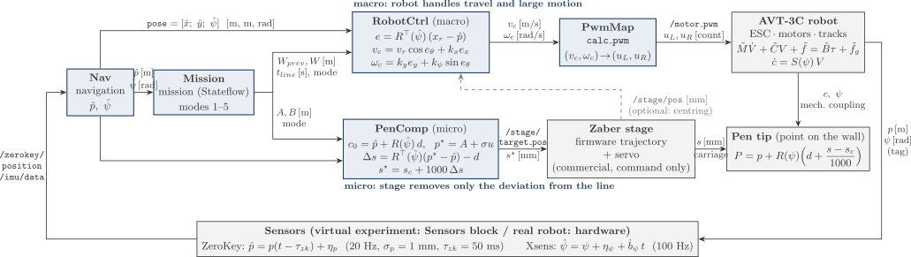

*Figure 15. Control structure and signal units (top: robot macro loop, bottom: stage micro loop, very bottom: measurement feedback)*

| In the drawing | Input → output (unit) | Meaning |
|---|---|---|
| Nav | ZeroKey position [m], IMU quaternion → $\hat p$ [m], $\hat\psi$ [rad] | Measured tag position and heading. All of the robot state known to the controller |
| Mission | $\hat p,\ \hat\psi$ → mode, $W_{prev},\ W$ [m], $t_{line}$ [s], $A,\ B$ [m] | Decides what to do and when (move to start → turn → straight line → stop) |
| RobotCtrl | Reference point $x_r$ [m], $\hat p,\ \hat\psi$ → $v_c$ [m/s], $\omega_c$ [rad/s] | Outer loop that makes the robot follow the straight line (Eq. (30)) |
| PwmMap | $v_c,\ \omega_c$ → $u_L,\ u_R$ [count] | Real robot `calc_pwm`. Converts velocity commands to ESC pulse widths (Eqs. (27)–(28)) |
| AVT-3C robot | $u_L,\ u_R$ → centre $c$ [m], $\psi$ [rad] | ESC speed loop + track dynamics. RobotPlant in the virtual experiment |
| PenComp | $\hat p,\ \hat\psi,\ A,\ B$ → $s^{\star}$ [mm] | Computes the stage target so that the pen lies on the straight line (Eq. (33)) |
| Zaber stage | $s^{\star}$ [mm] → $s$ [mm] | Commercial firmware tracks the position. Externally, only position commands and position reads are possible |
| Pen tip | $c,\ \psi,\ s$ → $P$ [m] | Marker position on the wall. Not measured by the controller (evaluation by PenTrace) |
| Sensor | $p,\ \psi$ → $\hat p,\ \hat\psi$ | Measurement with added noise, delay and drift. Upper bound of pen accuracy (Section 18.5) |

### 11.1 Role of each tier

| Tier | Block | Input | Output | Rate |
|---|---|---|---|---|
| 0 measurement | RosIn → Nav | ZeroKey position and velocity, IMU quaternion | `pose` = [x; y; ψ] (wall frame) | 0.01 s |
| 1 mission | Guards → ModeChart → Waypoints | `pose` | `mode`, `WP_prev`, `WP_target`, `t_line`, `lineAB` | 0.01 s |
| 2 macro | RobotCtrl → PwmMap → RosOut | `WP_*`, `mode`, `t_line`, `pose`, `stage_pos_meas` | `v_cmd`, `w_cmd` → `/motor_pwm` | Continuous / 0.01 s publish |
| 2 micro | PenCtrl → RosOut | `lineAB`, `mode`, `pose` | `stage_target_pos` → `/stage/target_pos`, `pen_on` | Continuous / 0.01 s publish |
| 3 inner loop | ESC speed loop, Zaber firmware position loop | `/motor_pwm`, `/stage/target_pos` | Track speed, stage position | Inside the equipment |

### 11.2 State values

| Name | Size | Unit | Location | Meaning |
|---|---|---|---|---|
| `pose` | 3 | m, m, rad | Nav output | Measured tag position [x; y] (wall frame) + heading ψ |
| `mode` | 1 | – | ModeChart | 1 move to start, 2 turn, 3 line tracking, 4 stop, 5 finished |
| `WP_prev`, `WP_target` | 2, 2 | m | Waypoints | Start and end of the segment the robot (tag) follows |
| `lineAB` | 4 | m | Waypoints | Straight line the pen draws [A; B] |
| `t_line` | 1 | s | Waypoints | Time of entry into mode 3 (start of reference point advance) |
| `v_cmd`, `w_cmd` | 1, 1 | m/s, rad/s | RobotCtrl | Robot velocity commands |
| `e_cross` | 1 | m | RobotCtrl M3 | Body cross-track error relative to the robot reference point |
| `motor_pwm` | 2 | count | PwmMap | [left; right] |
| `stage_target_pos` | 2 | mm | PenCtrl | Stage target [X; Y] |
| `pen_on` | 1 | – | PenCtrl | Pen down (0 ≤ σ ≤ L) |
| `stage_pos_meas` | 2 | mm | RosIn | `/stage/pos` measurement |
| `q_true`, `V_true` | 3, 2 | m, rad / m/s, rad/s | RobotPlant | True pose, true velocity (for evaluation; unknown to the controller) |
| `x_t` | 4 | mm, mm/s | StagePlant | Firmware trajectory state |
| `x_s` | 6 | m, m/s, m·s | StagePlant | Stage position, velocity and integrator state |
| `pen_true`, `e_pen` | 2, 1 | m | PenTrace | True pen position, pen cross-track error (evaluation) |
| `pen_nocomp`, `e_nocomp` | 2, 1 | m | PenTrace | Pen position and cross-track error with the stage fixed at the centre |

### 11.3 Mission state machine

*(Same figure: Figure 7)*

| Mode | Control law (same equations as 6WP_sim and the real robot model) | Pen |
|---|---|---|
| 1 Goto_Start | v = K_dist·d·max(0, cos α), ω = K_yaw·α + 0.5 sin α cos α | Up, stage centred |
| 2 Turning | v = 0, ω = K_yaw·Δθ | Up |
| 3 Line_Tracking | Time-based reference point x_r = WP_prev + v_ref (t − t_line) u, body error e = Rᵀ(θ)(x_r − p): v = v_ref cos e_θ + K_px e_x, ω = K_py e_y + K_pθ sin e_θ | Compensated, down for 0 ≤ σ ≤ L |
| 4 Stop_Destination | Mode 1 equations applied continuously toward the end point (ω = 0 for d < 0.01 m) | Up |

- Segment the robot follows = pen line translated in parallel by R·d + extended by `line_pre` 60 mm before and `line_post` 40 mm after
- On entry into mode 3, the stage is sent to its target before pen down, removing the start transient

---

## 12. Motion Model

### 12.1 Robot (wall version of the 6WP_sim plant model)

| Stage | Block | Equation · value |
|---|---|---|
| ESC inverse | EscInv | PWM → track speed, dead zone `pwm_dz` = 30 count, 400 count = 0.2 m/s |
| Motor lag | TrackLag | First-order lag τ_trk = 0.15 s |
| Speed loop | PID_v, PID_w | Same position as the two 6WP PID Controllers, gains scaled to AVT-3C size (Kp 1500, Ki 15000) |
| Drive force allocation | Control_allocation | B̃ = [1 1; b/2L −b/2L], \|F\| ≤ F_max = 200 N |
| Dynamics | Dynamics | Wall version of the 6WP equations (Section 8.3) |
| Kinematics | Kinematics | q̇ = S(q)V + wall disturbance (creep 8 % in the gravity direction, heading unevenness ±1.5°, 0.35 Hz) |
| Integration | ode4 fixed step | `Ts_plant` = 0.5 ms (at 5 ms, ω oscillates numerically because of the rotational friction tanh) |

- Equations and changes from the original paper: Sections 4.2–8.4
- 6WP_sim Dynamics implements the Zou [1] equations as they are, so the sign correction (M_r) of Section 8.3 also applies to the original 6WP

Comparison with the original 6WP_sim (`2_시뮬레이션_simulink/6WP_sim/Tracked_UGV_PID_Control_Scenario_6wp_sim.slx`) (block code and parameters read directly from the model and compared)

| Item | Original 6WP_sim | This model `RobotPlant` | Same |
|---|---|---|---|
| Block chain | Speed error → 2 PIDs → Control allocation → Dynamics → integration → Kinematics → integration | ESC inverse · motor lag added in front; rest of the chain the same | Same structure |
| `compute_u`, `Control_allocation` | $u = -\mathrm{sgn}(\omega) R_t \sin\alpha$, $\tilde B = [1\ 1;\ b/2L\ \ {-b/2L}]$ | Same equations | Same |
| Dynamics $\tilde M,\ \tilde C,\ S,\ \dot S$ and $V$ derivative | Form of Eqs. (23)–(24) | Same equations | Same |
| Vehicle size (Table 1) | $m$ 3700 kg, $l$ 5.0 m, $b$ 1.1 m | 12 kg, 0.30 m, 0.28 m | Different (AVT-3C) |
| Friction normal force | $W = mg$ (ground) | Magnetic adhesion force $N$ = 400 N | Different (wall) |
| Gravity term | None | $f_g = [0,\ -mg,\ 0]^{\top}$ | Added |
| Turning resistance $M_r$ | $\mathrm{sgn}(\omega)(u^2 - l^2/4)$ | $\tanh(\omega/\varepsilon)(l^2/4 - u^2)$ | Sign corrected (Section 8.3, Table item 3) |
| $\mathrm{sgn}(\cdot)$ | As is | $\tanh(\cdot/\varepsilon)$ | Prevents numerical chatter |
| Speed PID | P 150000, I 0, D 0 (P control) | P 1500, I 15000 (PI) | Different (mass 1/300, steady-state error removed) |
| Kinematics | $\dot q = S(q)V$, state = robot centre, $q_3 = L\theta$ notation | Same equations + wall disturbance (creep, unevenness), state = robot centre, $q_3 = \psi$ | Same + disturbance |
| Integration point | Robot centre | Robot centre (tag point before the 2026-11-11 fix) | Same |
| Output | Centre pose $q$ | Tag pose (`TagPoint`, Eq. (21a)) | Matched to sensor location |

- The $(u/L)\sin\theta$ term in the first two rows of the original Kinematics is dimensionally inconsistent when the second velocity component is $\omega$, but has no effect at $\alpha = 0$ ($u = 0$). This model writes it as $u\thinspace \omega\sin\psi$ (Eq. (21))

### 12.2 Zaber stage (datasheet + CAD)

| Specification (X-LSM100B-E03) | Reflected in model | Value |
|---|---|---|
| Travel | PenCtrl `Travel`, StagePlant `Encoder` saturation | 0–101.6 mm |
| Maximum speed | ZaberTraj trapezoidal trajectory | 104 mm/s |
| Acceleration/deceleration | ZaberTraj | 500 mm/s² [to be measured: `get accel`] |
| Thrust-speed curve | ZaberServo thrust limit (10-point interpolation) | 32 N (stall) → 9 N (104 mm/s) |
| Moving mass | X axis = carriage + Y stage + pen, Y axis = carriage + pen | 0.55 kg, 0.16 kg |
| Wall gravity | Axial component m g | X 5.4 N, Y 1.6 N (below continuous thrust 25 N and back-drive force 24 N) |
| Position loop | Stepper stiffness + firmware correction | Bandwidth 20 Hz, damping 0.8 [to be measured] |
| Command rate · delay | CmdHold, CmdDelay | 25 Hz (node `cmd_rate`), 10 ms |
| Position report | `/stage/pos` | 20 Hz |
| Accuracy · repeatability | Not reflected | 45 µm · 6 µm (negligible against 1 mm sensor noise) |

### 12.3 Sensors

| Sensor | Noise (1σ) | Delay | Rate |
|---|---|---|---|
| ZeroKey position | 1.0 mm | 50 ms [to be measured] | 20 Hz |
| IMU yaw | 0.3°, drift 0.02°/s | – | 100 Hz |
| ZeroKey INS attitude | 0.9° | – | 20 Hz |

---

## 13. Simulink Model Structure

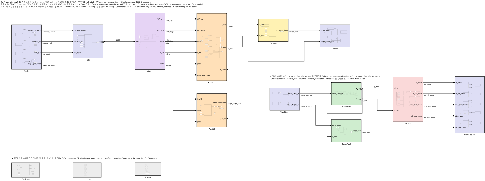

*Figure 16. XY_1_pen_sim top level (top row controller, lower right virtual test bench, lower left evaluation, logging and real-time display)*

*(Same figure: Figure 3)*

| File | Controller row | Virtual test bench row | Inner PI | ROS domain | Use |
|---|---|---|---|---|---|
| `XY_1_pen_sim.slx` | Yes | Yes (RobotPlant, Sensors, StagePlant, PlantRosIn/Out) + PenTrace, Logging, Animate | None | 77 | Virtual experiment version 1 |
| `XY_2_pen_ros2.slx` | Yes | None (real equipment instead) | None | 0 | Real robot version 1 |
| `XY_1_pen_sim_v2.slx` | Yes | Yes | InnerPI | 77 | Virtual experiment version 2 |
| `XY_2_pen_ros2_v2.slx` | Yes | None | InnerPI | 0 | Real robot version 2 |

| Category | Difference between `_sim` and `_ros2` | Difference between version 1 and version 2 |
|---|---|---|
| What differs | `_sim` attaches a virtual robot, sensors and stage to the same controller. `_ros2` has only the controller and exchanges topics with the real equipment | Version 2 places the same speed and yaw rate PI as the real robot Xsens model between `RobotCtrl` and `PwmMap` (Section 21.2) |
| Controller equations | Same (same builder function) | Outer loop and pen compensation the same. Only whether the `PwmMap` input is the velocity command (version 1) or the PI output (version 2) differs |
| Additional input | – | `angular_velocity.z` of `/imu/data`, Nav output $V_{meas} = [u_B;\ r]$ |
| Run time | `_sim` stops when the mission ends (`T_run` 70 s) | Same |
| Result (virtual experiment) | – | Pen RMS version 1 1.17–1.20 mm, version 2 1.21–1.24 mm |

- All computation code in MATLAB Function blocks inside the model (no external .m functions)
- Left → right layout: navigation (RosIn, Nav) → mission → control → allocation → ROS boundary and plant → measurement
- Signals between boxes connected directly by lines (signal names on lines). Boxes aligned to the port heights of the preceding box so lines are horizontal straight lines
- Inside subsystems also connected by lines (Simulink layered layout). Goto/From used only in two cases
  - Taps for logging and evaluation (signals pulled by Logging, PenTrace, Animate)
  - Inside RobotCtrl, where the four mode boxes share the same inputs
- Controller and virtual test bench connected only through ROS 2 topics, not lines (RosOut → PlantRosIn, PlantRosOut → RosIn)
- Blocks use parameter names instead of numbers (only `XY_setup.m` needs editing)
- Controller continuous, ode4 fixed step 0.0005 s (`Ts_plant`). Discrete blocks (sensor ZOH, Nav persistent, command ZOH) state their reason in the Description
- Logging via a single Bus Creator → ZOH (0.01 s) → To Workspace `log`

| Subsystem figure | File |
|---|---|
| Mission | `1_simulation/img/XY_1_pen_sim__Mission.png` |
| Robot control | `1_simulation/img/XY_1_pen_sim__RobotCtrl.png`, `__RobotCtrl__M3_Line.png` |
| Pen compensation | `1_simulation/img/XY_1_pen_sim__PenCtrl.png` |
| Robot plant model | `1_simulation/img/XY_1_pen_sim__RobotPlant.png` |
| Stage model | `1_simulation/img/XY_1_pen_sim__StagePlant.png` |
| Sensors | `1_simulation/img/XY_1_pen_sim__Sensors.png` |

Input/output of each MATLAB Function block (each block's code header carries comments with identical content in Korean and English)

| Block (box) | Input (unit) | Output (unit) | Equation | Basis |
|---|---|---|---|---|
| NavFcn (Nav) | ZeroKey position [m], velocity [m/s], IMU quaternion, $\psi_0$ [rad], $\tau_{pred}$ [s], `zk_xsign` | `pose` = $[\hat x;\ \hat y;\ \hat\psi]$ [m, m, rad] (version 2: + $V_{meas}$ [m/s, rad/s]) | $\hat p = [\pm x_{zk};\ z_{zk}]$, $\hat\psi = \mathrm{yaw} - \mathrm{yaw}_0 + \psi_0$ | Real robot `plane_project` in REP-103 form |
| Guards (Mission) | `pose`, $A,\ B,\ d$, `line_pre`, `line_post`, $r_{tag}$ [m] | `dist_start` [m], `th_err` [rad], `along_rem` [m] | $\lVert c_A - \hat c\rVert$, $\mathrm{wrap}(\theta_l - \hat\psi)$, $u^{\top}(r_B - \hat p)$ | Real robot Chart |
| ModeChart (Mission) | The three above, time $t$ [s] | `mode`, `t_line` [s] | Figure 7 | 6WP_sim Chart |
| Waypoints (Mission) | `mode`, line geometry [m] | `WP_prev`, `WP_target`, `lineAB` [m] | $r_A = A - R(\theta_l)d - u\thinspace \ell_{pre}$, $c_A = r_A - R(\theta_l) r_{tag}$ | Section 8.5 |
| Fcn1 Goto_Start (RobotCtrl) | `WP_target` [m], `pose` | $v$ [m/s], $\omega$ [rad/s] | Eq. (31), centre-based | 6WP_sim |
| Fcn2 Turning | `WP_prev`, `WP_target`, `pose` | $v = 0$, $\omega$ [rad/s] | $\omega = k_\alpha\thinspace \mathrm{wrap}(\theta_l - \hat\psi)$ | 6WP_sim |
| Fcn3 Line_Tracking | Segment [m], `t_line` [s], `pose`, `/stage/pos` [mm] | $v$ [m/s], $\omega$ [rad/s], `e_cross` [m] | Eq. (30) (+ Section 8.10 stage centring) | 6WP_sim, real robot gains |
| Fcn4 Stop_Destination | `WP_target`, `pose` | $v$, $\omega$ | Eq. (31) | 6WP_sim |
| SpeedErr (InnerPI, version 2) | $v_c$ [m/s], $\omega_c$ [rad/s], $V_{meas}$, `mode` | $e_v$ [m/s], $e_\omega$ [rad/s], reset | Eq. (45) | Real robot Xsens model |
| calc_pwm (PwmMap) | Version 1 $v_c,\ \omega_c$ / version 2 $\bar V,\ \bar W$ [–] | `motor_pwm` [count] | Eqs. (27)–(28) | Real robot MATLAB Function6 |
| PenComp (PenCtrl) | `lineAB` [m], `mode`, `pose`, $d$ [m], $s_c$ [mm] | $s^{\star}$ [mm], `pen_on`, $\sigma$ [m] | Eqs. (32)–(35), Figure 12 | Section 8.6 |
| EscInv (RobotPlant) | `motor_pwm` [count] | Track speed command [m/s] | Dead zone 30 count, 400 count = 0.2 m/s | Assumption [to be measured] |
| SpeedErr (RobotPlant) | Track speed [m/s], $V$ | $e_v$, $L e_\omega$ [m/s] | $v_c = (v_L + v_R)/2$, $\omega_c = (v_R - v_L)/B$ | 6WP_sim |
| Control_allocation | $\tau_X$, $\tau_N$ [N] | $F_r,\ F_l$ [N] | $\tilde B^{-1}[\tau_X;\ \tau_N]$ | 6WP_sim |
| compute_u | $V$, $\alpha$ [rad] | $u$ [m] | $u = -\mathrm{sgn}(\omega) R_t\sin\alpha$ | 6WP_sim |
| Dynamics | $q$, $V$, $u$, $\dot u$, $F_r,\ F_l$ | $\dot V$ [m/s², rad/s²] | Eqs. (23)–(26) | Section 8.3 |
| Kinematics | $V$, $q$, $u$, $t$ | $\dot q$ (centre) [m/s, m/s, rad/s] | Eq. (21) + wall disturbance | Section 8.2 |
| TagPoint | Centre pose $q_c$, $r_{tag}$ | `q_true` (tag) | Eq. (21a) | Section 8.2 |
| ZkWorld, ZkVel, ImuQuat, ZkQuat (Sensors) | `q_true`, `V_true`, noise | Topic values [m], [m/s], quaternion | Eq. (38) | Section 12.3 |
| ZaberTraj (StagePlant) | $s^{\star}$ [mm] | Trajectory [mm, mm/s] | Trapezoidal (104 mm/s, 500 mm/s²) | Datasheet |
| ZaberServo | Trajectory, carriage state, `q_true` | Acceleration [m/s²] | Eqs. (36)–(37) | Section 8.7 |
| Encoder | Carriage position [m] | `stage_pos` [mm] | $1000\thinspace x$, 0–101.6 saturation | `get pos` |
| PenTraceFcn (evaluation) | `q_true`, `stage_pos` [mm] | True pen position [m], cross-track error [m] | $P = p + R(\psi)(d + (s - s_c)/1000)$ | Figure 12 (6)–(7) |

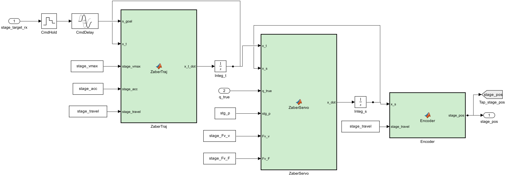

*Figure 17. Inside StagePlant (command ZOH → delay → firmware trajectory → servo → encoder)*

---

## 14. Equations and Principles of Each Simulink Function

All computation resides in MATLAB Function blocks inside the model, and the header of each block's code states the inputs, outputs, units and principle with identical content in Korean and English. The blocks are summarised below in the order in which the signals flow.

### 14.1 Nav (navigation)

| Input | Output |
|---|---|
| `zerokey_position` [m], `zerokey_vel` [m/s], `imu_quat`, `psi0` [rad], `tau_pred` [s], `zk_xsign` | `pose` = $[\hat x;\ \hat y;\ \hat\psi]$ [m, m, rad] (version 2: + `V_meas`) |

$$
\hat p = \begin{bmatrix} z \cr x \end{bmatrix}, \qquad
\mathrm{yaw} = \mathrm{atan2}\big(2(q_w q_z + q_x q_y),\ 1 - 2(q_y^2 + q_z^2)\big), \qquad
\hat\psi = \mathrm{wrap}(\mathrm{yaw} - \mathrm{yaw}_0 + \psi_0) \qquad (42)
$$

In ZeroKey world coordinates $z$ is the height and $x$ is the wall horizontal, so the wall frame coordinates are $[s_x x;\ z]$. $s_x$ (`zk_xsign`) is $-1$ (default) if ZeroKey $x$ is positive to the left when facing the wall, and $+1$ if it is positive to the right. The wall normal component $y$ is discarded. The yaw angle is extracted from the quaternion with the standard formula, and the yaw $\mathrm{yaw}_0$ of the first valid sample is stored and subtracted to obtain a relative yaw. Because this block must remember previous values, it is a discrete block (0.01 s). Version 2 additionally outputs the body forward velocity $u_B = \dot x\cos\hat\psi + \dot y\sin\hat\psi$ and the gyro rate $r$ as `V_meas`.

### 14.2 Mission (Guards → ModeChart → Waypoints)

Guards produces three values used as transition conditions: the distance to the start centre $\lVert c_A - \hat c\rVert$ (where $\hat c = \hat p - R(\hat\psi) r_{tag}$ is the estimated centre), the line direction error $\mathrm{wrap}(\theta_l - \hat\psi)$, and the remaining along-track distance to the end point $u^{\top}(r_B - \hat p)$ (all in m or rad). ModeChart uses these values to evaluate the transitions of Figure 7 and records the time $t_{line}$ of entry into mode 3. Waypoints outputs the segment the robot follows according to the mode. The target in mode 1 is the start centre $c_A$; thereafter it is the tag segment $r_A \to r_B$ (Eq. (6)). The pen line `lineAB` = $[A;\ B]$ is passed to PenCtrl.

### 14.3 RobotCtrl (four per-mode boxes + Merge)

One Enabled Subsystem is enabled for each mode, and Merge passes on only the output of the enabled box. All outputs are $v$ [m/s] and $\omega$ [rad/s], saturated at $\lvert v\rvert \le 0.2$ m/s and $\lvert\omega\rvert \le 45$ °/s.

Modes 1 and 4 use a polar-coordinate law. From the distance to the target $\rho$ and the bearing error $\alpha$, the law outputs

$$
v = k_\rho\thinspace \rho\thinspace \max(0,\ \cos\alpha), \qquad \omega = k_\alpha\thinspace \alpha + \tfrac12\sin\alpha\cos\alpha \qquad (43)
$$

Owing to $\max(0,\ \cos\alpha)$, the robot only rotates without advancing when the bearing is off by more than 90°, and it moves faster as the heading becomes aligned. Mode 1 steers the centre to the target, and mode 4 steers the tag. Mode 2 rotates in place with $v = 0$, $\omega = k_\alpha\thinspace \mathrm{wrap}(\theta_l - \hat\psi)$. Mode 3 follows Eqs. (7)–(8). When the optional stage centring ($K_c,\ K_{ci} > 0$) is enabled, the Y deviation of `/stage/pos`, $e_s = (s_Y - s_c)/1000$ [m], is added to the cross-track error so that the robot moves toward the pen side and the stage operates in the middle of its travel.

### 14.4 InnerPI (version 2 only)

$$
e_v = v_c - u_B, \quad e_\omega = \omega_c - g_\omega r, \qquad
\bar V = \mathrm{sat}_{[0,\thinspace 0.5]}\Big(K_{P,v} e_v + K_{I,v}\sum e_v T_s\Big), \quad
\bar W = \mathrm{sat}_{[-0.5,\thinspace 0.5]}\Big(K_{P,\omega} e_\omega + K_{I,\omega}\sum e_\omega T_s\Big) \qquad (44)
$$

This is the same discrete PI as in the real robot Xsens model (Forward Euler, 0.01 s, integrator clamping). Using the real robot values unchanged causes two problems. The gyro scale factor $g_\omega = 0.1443$ is inconsistent in units with the rad/s command and makes ω oscillate, so it is set to 1; and the integrator value carried over at a mode change causes forward motion during rotation, so the integrators are reset at mode transitions. Confirmation of the source remains outstanding (Section 21.2).

### 14.5 PwmMap (`calc_pwm`)

The input is $v_c$ [m/s], $\omega_c$ [rad/s] in version 1 ($\bar V,\ \bar W$ [–] in version 2), and the output is `motor_pwm` [count]. The mapping is given by Eqs. (10)–(11) and was explained in Section 5.3.

### 14.6 PenCtrl (PenComp → Travel → CmdRate)

The inputs are `lineAB` [m], `mode`, `pose`, and the constants $d$ [m] and $s_c$ [mm]. The outputs are $s^{\star}$ [mm], `pen_on` and $\sigma$ [m]. The computation is given by Eqs. (12)–(16) and was explained in Chapter 6. Outside mode 3, the stage is held at the centre ($s_c$). Unlike the pen down condition $0 \le \sigma \le L$, compensation starts at the instant of entry into mode 3; the stage is sent to its target before the pen is lowered in order to remove the start transient (15.8 mm). The subsequent `Travel` block clips the command to 0–101.6 mm, and `CmdRate` limits the rate of change to 83 mm/s.

### 14.7 RobotPlant (virtual robot, `_sim` only)

| Block | Input → output | Equation and principle |
|---|---|---|
| EscInv | PWM [count] → track speed command [m/s] | Undoes the right-side inversion, subtracts the 30 count dead zone, then scales proportionally so that 400 count equals 0.2 m/s. An assumption about ESC behaviour [to be measured] |
| TrackLag | → [m/s] | First-order lag with time constant 0.15 s. ESC ramp and motor response |
| SpeedErr | Track speed, $V$ → $e_v$, $L e_\omega$ [m/s] | $v_c = (v_L + v_R)/2$, $\omega_c = (v_R - v_L)/B$. As in 6WP, the second component is in units of $L\omega$ |
| PID_v, PID_w | → $\tau_X$, $\tau_N$ [N] | Speed PI (1500, 15000). Takes the place of the real robot ESC speed loop |
| Control_allocation | → $F_r,\ F_l$ [N] | Solves $[\tau_X;\ \tau_N] = \tilde B [F_r;\ F_l]$, $\tilde B = [1\ \ 1;\ b/2L\ \ {-b/2L}]$ and clips to ±200 N |
| compute_u | $V$ → $u$ [m] | Longitudinal shift of the instantaneous centre of rotation (ICR). Zero for the default $\alpha = 0$ |
| Dynamics | Forces, state → $\dot V$ | Zou (2018) tracked vehicle dynamics $\tilde M\dot\nu + \tilde C\nu + S^{\top}(f_1 + f_2) = \tilde B\tau + S^{\top}f_g$. Wall version: normal force = magnet 400 N, gravity $f_g = [0;\ -mg;\ 0]$, turning resistance sign corrected, sgn → tanh |
| Kinematics | $V$ → centre $\dot q$ | Eq. (5) + wall disturbance (creep: downward by 8 % of travel speed, unevenness: 0.35 Hz, 1.5°) |
| TagPoint | Centre pose → tag pose `q_true` | $p = c + R(\psi) r_{tag}$. Integration at the centre; the sensor sees the tag |

### 14.8 Sensors and StagePlant (virtual sensors and stage, `_sim` only)

Sensors adds noise, delay and sampling rate to the true values to produce real robot topic values. ZkWorld converts the wall frame position to world coordinates $[s_x x;\ y_{wall};\ y]$, adds 1 mm noise, and outputs it with a 50 ms delay at 20 Hz. ZkVel outputs the tag velocity $\dot p = v[\cos\psi;\ \sin\psi] + \omega J R r_{tag}$ in world coordinates. ImuQuat adds 0.3° noise and 0.02 °/s drift to the heading and converts it to the quaternion $[\cos(\psi/2);\ 0;\ 0;\ \sin(\psi/2)]$.

StagePlant is a model that treats the Zaber firmware as a black box. After the command ZOH (25 Hz) and serial delay (10 ms), ZaberTraj generates a trapezoidal trajectory (the smaller of the speed $\sqrt{2a\lvert e\rvert}$ at which the carriage can still stop within the remaining distance and the maximum speed), and ZaberServo tracks the trajectory with a 20 Hz position servo that includes the carriage mass (X 0.55 kg, Y 0.16 kg), the thrust-speed curve (32 N → 9 N), and the axial component of wall gravity $R^{\top}(\psi)[0;\ -g]$. Encoder converts the position to mm and outputs it as `/stage/pos`.

### 14.9 PenTrace (evaluation, unknown to the controller)

From the true tag pose and the encoder position, the actual pen position $P = p + R(\psi)(d + (s - s_c)/1000)$ and the cross-track error $e = n^{\top}(P - A)$ are computed. The pen position and cross-track error that would have arisen in the same run with the stage fixed at the centre are also computed, so that the effect of compensation can be compared.

---

## 15. Installation

### 15.1 Requirements

| Item | Version |
|---|---|
| MATLAB / Simulink | R2025a or later |
| Toolboxes | ROS Toolbox, Stateflow |
| Real robot NUC | Ubuntu 24.04, ROS 2 Jazzy, Python 3, `zaber-motion` |
| Animation (optional) | `4_CAD/AVT-3C.stl` (included in the repository; drawn as a box if missing) |

### 15.2 Procedure

| Step | Command | Result |
|---|---|---|
| 1 | `git clone https://github.com/wkyouncnu/AVT3C-XY-Stage-Pen.git` | Repository |
| 2 | In MATLAB, move to `1_simulation`, `XY_setup` | Path and parameters, `ROS_DOMAIN_ID` 77 |
| 3 | `build_xy_models` | Two .slx files generated, check results printed |
| 4 (NUC) | `pip install zaber-motion` | Stage node dependency |

---

## 16. Running

| Purpose | Command | Duration |
|---|---|---|
| Directly in Simulink | After `XY_setup`, open `XY_1_pen_sim.slx` and press the Run button | 48 s of simulation in approx. 15–17 s. Dashboard during the run, two result figures at the end |
| Full (setup → build → run → figures → video) | `XY_run_all` | Approx. 4 min |
| One virtual experiment | `XY_1_pen_sim_run` | Approx. 20 s + video approx. 100 s (skipped if `make_video = 0`) |
| Result figures only | `M = XY_plot(out)` | – |
| Dashboard video | `XY_record_live(out)` or `XY_record_live` | Approx. 100 s → `video/XY_1_live_view.mp4` |
| Design choice comparison | `XY_compare; XY_compare_plot` | 10 cases, approx. 3–4 min |
| Real robot | Chapter 21 | – |

- Virtual experiment runs at `PacingRate` 4 (up to 4 times real time). Publish/subscribe order of the ROS 2 loopback topics preserved; numbers vary slightly from run to run (Section 18.5)
- Real robot model at real time 1×
- Automatic stop when the mission ends (mode 5)

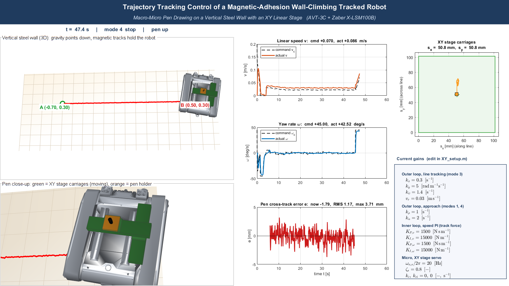

*Figure 18. Real-time dashboard (left: 3D wall and pen close-up, centre: v and ω commands versus actual and pen cross-track error, right: stage carriage and current gains)*

Behaviour when run with the Run button

| Item | Content |
|---|---|
| Dashboard | Animate box → `XY_animate.m`. A Zero-Order Hold (`anim_Ts` = 0.2 s) on each input so the function is called only every 0.2 s |
| Dashboard content | 3D wall (STL robot, gravity direction, target line, pen trace), pen close-up, $v_c$ vs $v$ [m/s], $\omega_c$ vs $\omega$ [deg/s], pen cross-track error [mm] (current, RMS, maximum), stage carriage position [mm], current gains (LaTeX notation, symbols of Sections 4.4–8.7) |
| Turning off | `animate = 0` then Run again. Recommended for repeated runs such as gain searches (speed difference small) |
| After finish | StopFcn `XY_stop.m` moves `log` to `out.log` and runs `XY_plot(out)` → wall trajectory, time response figures, RMS in the Command Window |
| Video | `XY_record_live(out)`: feeds the log back into `XY_animate` at 0.1 s intervals and renders a single figure window off-screen (`print -RGBImage`), 20 fps (2× speed). Not a screen capture, so other windows are not recorded |
| Script execution | Both features turned off with `XY_batch = 1`, `animate = 0`; return value of `sim(..., 'ReturnWorkspaceOutputs','on')` used |

---

## 17. Inputs and Outputs per Program

### 17.1 Parameters (`XY_setup.m`)

| Section | Name | Value | Remarks |
|---|---|---|---|
| 1 | `Ts_ctrl`, `Ts_plant` | 0.01, 0.0005 s | Control rate, integration step (Section 8.3) |
| 2 | `pen_A`, `pen_B` | (−0.70, 0.30), (0.50, 0.30) m | Line to draw (1.2 m) |
| 3 | `q0` | (−0.85, 0.10, 90°) | Start pose (facing the ceiling). `psi0` = 90° |
| 4 | `K_dist`, `K_yaw` | 1.0, 2.0 | Modes 1, 2 |
| 4 | `v_ref`, `K_px`, `K_py`, `K_ptheta` | 0.03 m/s, 0.3, 5.0, 1.4 | Mode 3 (real robot ZeroKey model values, only speed lowered) |
| 4 | `K_c`, `K_ci` | 0, 0 | Stage centring (optional) |
| 5 | `r_tag`, `r_pen0` | (−0.08, 0.06), (0, 0) m | [to be measured] |
| 6 | `m_r`, `N_mag`, `mu_l`, `mu_t` | 12 kg, 400 N, 0.05, 0.5 | [to be measured] |
| 7 | Stage | Section 12.2 | |
| 8 | `zk_*`, `imu_*`, `tau_pred` | Section 12.3, 0 | |
| 9 | `animate`, `anim_Ts`, `XY_batch` | 1, 0.2 s, 0 | Dashboard on, update rate, script execution flag |
| 10 | `Kin_Pv`, `Kin_Iv`, `Kin_Pw`, `Kin_Iw`, `w_fb_gain`, `inner_reset` | 0.15, 0.8, 1.5, 1.5, 1.0, 1 | Version 2 inner PI (Section 21.2); not read by version 1 |

### 17.2 Change items

| Change | File to edit | Rebuild |
|---|---|---|
| Gains, line, mass, sensor noise | `XY_setup.m` | Not required (run `XY_setup` again) |
| Block structure, function equations | `build_xy_models.m` | `build_xy_models` |
| Stage node rate | `zaber_stage_node.py` parameter `cmd_rate` + `XY_setup` `stage_cmd_Ts` | Model rebuild not required |

### 17.3 Stage node (`zaber_stage_node.py`)

| Parameter | Default | Meaning |
|---|---|---|
| `port` | `/dev/ttyUSB0` | RS-232 port (115200) |
| `x_device`, `y_device` | 1, 2 | Daisy chain addresses |
| `publish_rate` | 20 Hz | `/stage/pos` |
| `cmd_rate` | 25 Hz | `move abs` transmission rate (latest target only) |
| `cmd_deadband` | 0.001 mm | No retransmission if the change is smaller than this |
| `cmd_timeout` | 0.5 s | `/stage/cmd_vel` watchdog |
| `home_on_start` | True | Return to home on start-up |

- Controller sends targets at 100 Hz, but one serial line (request + response) takes several ms, so the node decimates to 25 Hz. Same as simulation `stage_cmd_Ts` = 0.04 s

---

# Part IV. Verification

## 18. Verification

### 18.1 Verification items

| Category | Run | Target | Criterion |
|---|---|---|---|
| Model structure | `build_xy_models` | Both models | `check_flow` 0, `check_tags` 0, `check_lines` overlaps·pass-throughs·diagonals·block overlaps 0 |
| ROS loopback | `XY_1_pen_sim_run` | Topic publishing·subscribing | Mission mode 1 → 5 completed |
| Real-robot model | `update diagram` (domain 0) | `XY_2_pen_ros2` | No errors |
| Pen accuracy | `XY_plot` | Pen-down interval | Cross-track error RMS ≤ 2 mm, no stage saturation |

### 18.2 Model structure results

| Model | check_flow | check_tags | Overlaps·pass-throughs·diagonals·block overlaps | 3 or more bends | Goto / From |
|---|---|---|---|---|---|
| XY_1_pen_sim | 0 | 0 | 0 | 10 | 26 / 49 |
| XY_2_pen_ros2 | 0 | 0 | 0 | 2 | 19 / 29 |

- Lines with 3 or more bends: integrator feedback inside the motion model (lines returning V, q, x_t, x_s to earlier blocks) and long top-level connections (pose, q_true, stage_target_pos)
- From increased from 44 → 49 because the signals taken out by the Animate box (v_cmd, w_cmd, V_true, mode, e_pen) increased
- One pass-through inside RobotPlant, where the compute_u → Dynamics line grazed the dist_p constant, removed by moving the constant in the builder
- The previous version (Goto/From connections, 78 / 123) had 0 for this item, but signal flow was not visible as lines, so it was changed to line connections. Feedback lines are not hidden behind Goto/From again

### 18.3 Virtual experiment results (baseline)

| Item | Value |
|---|---|
| Straight line | A (−0.70, 0.30) → B (0.50, 0.30) m, 1.2 m, 30 mm/s |
| Mode transitions | 2 → 1.5 s, 3 → 4.1 s, 4 → 45.4 s, end 47.4 s |
| Pen-down time | 39.1 s |
| Pen cross-track error (stage compensation) | RMS 1.17–1.20 mm, max 3.9 mm (4 runs) |
| Pen cross-track error (no compensation, same run) | RMS 14.84 mm, max 19.6 mm |
| Robot reference-point cross-track error `e_cross` (mode 3) | RMS 23.6 mm |
| Stage range used | X 51.0–53.8 mm, Y 61.4–72.2 mm (travel 0–101.6) |

- Both axes move. X (direction of travel) nearly fixed within a 2.8 mm band; Y (line normal) removes the cross-track error (Eq. (34))
- Values differ from run to run (Section 18.5)

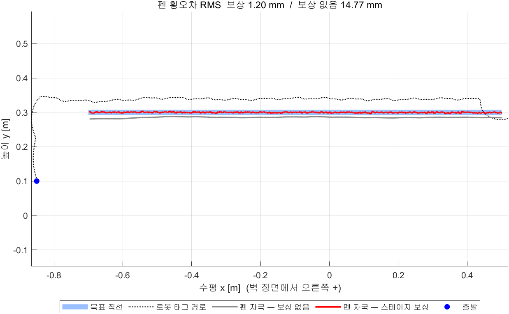

*Figure 19. Wall trajectory (blue target line, red compensated pen mark, grey uncompensated pen mark, dashed robot tag path)*

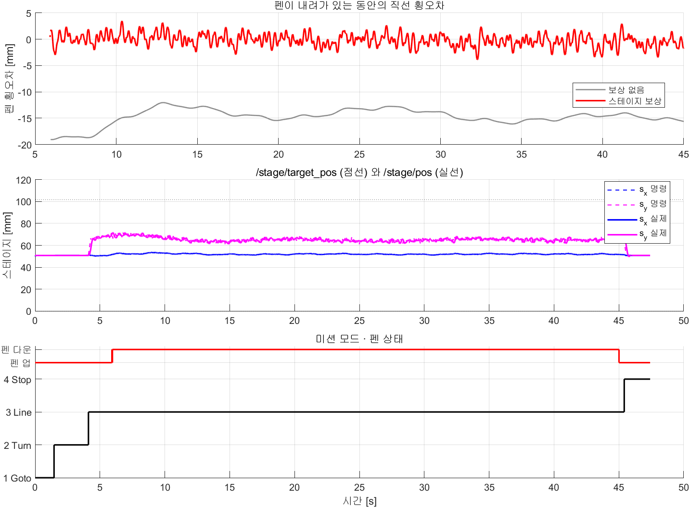

*Figure 20. Pen cross-track error, stage position, mode, pen state*

### 18.4 Video

| File | Content |
|---|---|
| `1_simulation/video/XY_1_live_view.mp4` | Figure 18 dashboard, 1600 × 900, 20 fps, 23.9 s (recorded with the previous-version plant, 47.8 s of simulation at 2× speed) |

- Generated with `XY_record_live`. Log playback + off-screen rendering, so other windows·messengers are not captured during recording

### 18.5 Inner loops and error-source diagnosis

Results of checking the inner loops and gains with the command-versus-actual values on the dashboard (centre of Figure 18). All tables are values re-run on 2026-11-11 with the plant after the Section 8.2 correction (`1_simulation/logs/gain_sweep_a.mat`, `gain_sweep_b.mat`, `error_budget.mat`).

Yaw-rate jitter (2 runs per case)

| Item | Integration step 5 ms | 0.5 ms (current) |
|---|---|---|
| ω tracking error RMS (pen down) | 6.3 deg/s | 1.4 deg/s |
| Pen RMS | 1.19–1.20 mm | 1.18–1.20 mm |
| Agreement of $\int\omega\thinspace dt$ and $\Delta\psi$ (checked in previous version) | No agreement (numerical oscillation) | Within 2.5° |
| Cause | Step large relative to the slope of the turning resistance $\tanh(\omega/\varepsilon_\omega)$ ($\lambda h \approx 44$, Section 8.3) | – |

- The jitter was a numerical-integration problem, not a gain problem. Pen RMS is the same even at 5 ms (the jitter frequency barely appears in the heading measurement within the stage compensation band)

Gain changes (3 runs per case, pen RMS difference among the 3 runs 0.02 mm or less)

| Case | Pen RMS [mm] | Pen max [mm] | Robot RMS [mm] | Stage Y [mm] |
|---|---|---|---|---|
| Baseline | 1.19 ± 0.01 | 3.9 | 23.6 | 61.3–72.2 |
| $k_y$ × 0.5 | 1.19 | 3.8 | 38.2 | 68.4–90.0 |
| $k_y$ × 2 | 1.32 | 4.3 | 17.1 | 44.6–69.4 |
| $k_\psi$ × 0.5 | 1.41 | 4.3 | 21.5 | 37.3–72.3 |
| $k_\psi$ × 2 | 1.19 | 3.8 | 37.7 | 67.2–89.8 |
| All inner PI × 0.5 | 1.21 | 3.9 | 24.0 | 58.3–73.2 |
| All inner PI × 2 | 1.19 | 3.8 | 23.4 | 61.4–71.3 |
| ZeroKey noise 0 (for comparison) | 0.74 | 2.3 | 23.6 | 62.5–71.7 |

- Robot cross-track error varies widely with gain, 17–38 mm; pen cross-track error varies within 1.19–1.41 mm
- Holding the robot tighter ($k_y$ × 2) or loosening heading ($k_\psi$ × 0.5) makes heading oscillate more, increasing pen error by 0.13–0.22 mm. The opposite ($k_y$ × 0.5, $k_\psi$ × 2) keeps pen error the same but drives stage Y up to 90 mm (11.6 mm from the travel end at 101.6 mm)
- Current gains ($k_y$ 5.0, $k_\psi$ 1.4): the balance point between pen error and travel margin. Inner PI gains have no effect
- Gain comparison table (outer loop)

| Source | Along-track | Cross-track | heading | Remarks |
|---|---|---|---|---|
| This model (real-robot ZeroKey model values) | $k_x$ 0.3 | $k_y$ 5.0 | $k_\psi$ 1.4 | $v_r$ absorbed into gains, Eq. (30b) |
| Zou [1] Eq. (38) | $k_x$ 12 | $k_y$ 6.3 | $k_\theta$ 3.3 | Ground vehicle, multiplied by $v_r$, inner PID 36 / 30 / 16 |
| Sabiha [2] (optimized backstepping + SMC) | 5.2 | 3.7 | 2.1 | $K_1$ 5.4, $K_2$ 7.3, $\rho$ 9.5 |

- Paper values are optimized for ground driving·different mass, so they are not transferred directly

Error budget (simulations with only one factor set to 0, 2 runs per case, pen RMS)

| Case | Pen RMS [mm] | Prediction of Eq. (41) |
|---|---|---|
| Baseline | 1.19 | Total 1.25 |
| ZeroKey noise 0 | 0.74 | $\sigma_p$ = 1.0 removed → 0.76 |
| IMU noise 0 | 1.28 | $\ell_u\sigma_\psi$ = 0.42 removed → 1.18 |
| IMU drift 0 | 1.27–1.28 | $\ell_u \dot b_\psi T/\sqrt3$ = 0.63 removed → 1.08 |
| heading track bumps 0 | 1.10 | – |
| Creep 0 | 1.18 (robot RMS 6.1 mm) | – |
| All sensors ideal | 0.41 | Remaining: stage tracking lag and track bumps |
| Sensors ideal + track bumps 0 | 0.12 | – |

- Dominant factor: ZeroKey position noise. Removing it alone gives 1.19 → 0.74 mm, matching the prediction of Eq. (41) (0.76 mm)
- Removing IMU noise·drift instead increases the error to 1.28 mm. Eq. (41) assumes the error terms are mutually independent, but in this single run the slow heading bias produced by drift appears to have partly cancelled other biases (robot response to track bumps·creep). To be confirmed by repeated runs with different seeds (Chapter 24)
- Creep produces robot error (23.6 → 6.1 mm) but the stage removes it, so it has almost no effect on pen error
- Higher accuracy requires reducing ZeroKey position noise, not changing gains (stationary averaging, filter, 2 tags). Half the noise gives 0.89 mm (Section 20.1)

Velocity-loop steady-state offset

- Pen-down interval average: command $v_c$ 0.0228 m/s, actual $v$ 0.0308 m/s (current version)
- Cause: difference between the controller's PWM inverse-compensation deadband $d_v$ = 47 count and the motion model's ESC deadzone 30 count. The open-loop PWM mapping pushes too hard, and the outer loop $k_x e_x$ reduces the command to match the time reference point
- ω command rising to 45 deg/s at the end of mode 4: normal behaviour of the mode 4 law that turns toward the end point (Eq. (31))

Values differing from run to run

- In the current version, the pen RMS difference over 3 repetitions of the same condition is 0.02 mm or less (baseline 1.17–1.20 mm)
- In the previous version (tag-integrating plant), it varied widely, 1.17–1.61 mm. The tag-referenced mode 1 and the turning response appear to have been sensitive to ROS 2 reception timing (cause not confirmed)

---

## 19. Summary of Results

1.2 m straight line, 30 mm/s, virtual experiment (XY_1_pen_sim, ROS 2 loopback), difference between repeated runs under the same condition 0.02 mm or less.

| Item | Value |
|---|---|
| Pen cross-track error (stage compensation) | RMS 1.17–1.20 mm, max 3.9 mm |
| Pen cross-track error (stage fixed at centre) | RMS 14.84 mm, max 19.6 mm |
| Robot cross-track error (mode 3) | RMS 23.6 mm |
| Stage range used | X 51.0–53.8 mm, Y 61.3–72.2 mm (travel 0–101.6 mm) |
| Version 2 (inner PI) | Pen RMS 1.21–1.24 mm |
| All sensor noise removed | 0.41 mm |
| Only ZeroKey noise removed | 0.74 mm |
| 2 tags (b) approximation | 0.84 mm |

*(Same figure: Figure 19)*

The robot advances while deviating from the line by several centimetres, but the pen stays on the line at the 1 mm level. The difference between the grey mark and the red mark in Figure 19 is the work done by the stage.

---

## 20. Comparison of Design Choices

With `XY_compare.m`, 10 cases were run on the same ROS 2 loopback model, changing one or two values from the baseline (1.2 m straight line, 30 mm/s). One run per case. Since the pen RMS difference over repetitions of the same condition is 0.02 mm or less (Section 18.5), differences of 0.05 mm or more are regarded as real.

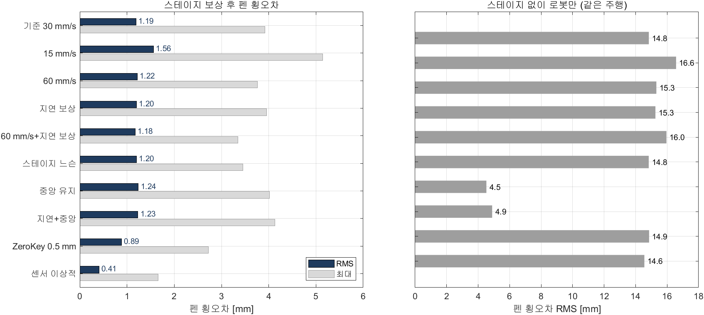

*Figure 21. Pen cross-track error per case (left stage compensation, right with the stage fixed at the centre in the same run)*

### 20.1 Results

| Case | Changed value | Pen RMS [mm] | Pen max [mm] | Robot-only RMS [mm] | Stage Y [mm] |
|---|---|---|---|---|---|
| Baseline | – | 1.19 | 3.92 | 14.84 | 61.4–72.2 |
| Speed 15 mm/s | `v_ref` 0.015 (pen down 79.3 s) | 1.56 | 5.14 | 16.57 | 61.8–70.2 |
| Speed 60 mm/s | `v_ref` 0.060 (pen down 19.4 s) | 1.22 | 3.76 | 15.32 | 58.9–75.8 |
| 60 mm/s + latency compensation | `v_ref` 0.060, `tau_pred` 0.05 s | 1.18 | 3.35 | 15.96 | 58.8–78.3 |
| Latency compensation | `tau_pred` 0.05 s | 1.20 | 3.96 | 15.26 | 61.7–75.2 |
| Loose stage | Bandwidth 2 Hz, command 5 Hz | 1.20 | 3.46 | 14.83 | 61.1–72.0 |
| Stage centring | `K_c` 0.5, `K_ci` 0.3 | 1.24 | 4.02 | 4.52 | 43.2–70.9 |
| Latency compensation + stage centring | Three values | 1.23 | 4.13 | 4.89 | 42.6–73.4 |
| ZeroKey noise 0.5 mm | `zk_sigma` 0.0005 | 0.89 | 2.72 | 14.86 | 62.1–72.2 |
| Sensor noise 0 | ZeroKey·IMU noise·drift 0 | 0.41 | 1.66 | 14.56 | 62.7–71.3 |

- Values re-run on 2026-11-11 after the Section 8.2 correction (integration point = centre, mode 1 = centre-referenced). Largest difference from the previous version: loose stage (1.73 → 1.20 mm)

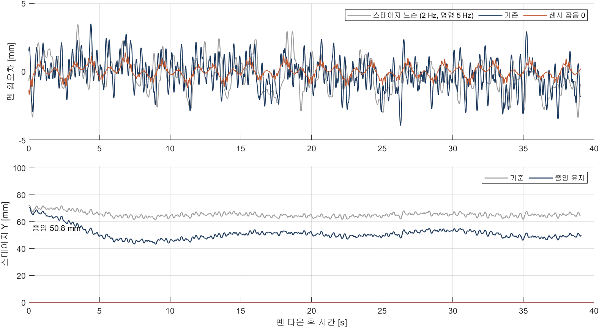

*Figure 22. Top: pen cross-track error (loose stage · baseline · sensor noise 0), bottom: stage Y (baseline · stage centring)*

### 20.2 Interpretation

| Item | Result | Basis |
|---|---|---|
| Driving speed | 1.2 mm at 30–60 mm/s, 1.6 mm at 15 mm/s | When slow, pen-down time is long and heading drift accumulates (the $\dot b_\psi T$ term of Eq. (41)) |
| Latency compensation | No difference (1.19 → 1.20 mm, within run-to-run variation) | On a straight line, ZeroKey latency becomes along-track error, and pen compensation uses only the line-normal component ($n^{\top}\delta p$ of Eq. (40)) |
| Loosening the stage servo | 1.19 → 1.17–1.20 mm (3 repetitions), previous version 1.73 mm | No effect. Even with bandwidth 2 Hz, command 5 Hz, compensation for heading track bumps (0.35, 0.8 Hz) is sufficient. The previous version's 1.73 mm is of the same size as the previous version's large run-to-run variation (1.17–1.61 mm) |
| Factor determining the error | Sensors | Half the noise → 0.89 mm, noise 0 → 0.41 mm |
| Robot only | 14.6–16.6 mm | A tracked robot cannot move laterally directly (corrects only by turning) and cannot fully remove wall creep·track bumps |
| Stage centring loop | Pen RMS unchanged, robot error 14.8 → 4.5 mm, stage Y range shifted toward the centre (50.8 mm) | The integral of the stage offset removes, on the robot side, the steady-state offset caused by wall creep → travel margin secured |

### 20.3 Drawing after stopping versus drawing while driving

| Category | Drawing after stopping (segments of about 90 mm joined) | Drawing while driving (current method) |
|---|---|---|
| Straightness within a segment | No creep·track bumps while stopped; with ZeroKey 2 s averaging, noise 1/√40 → about 0.2 mm (calculated value) | RMS about 1.2 mm (simulation) |
| Segment joints | A step at every joint. Size ≈ √2 × ZeroKey absolute error (bias is not reduced by averaging) | None |
| Time for 1.2 m | 14 or more stops·starts | Continuous 39 s |
| Suitable case | Short lines (100 mm or less), joints acceptable, 0.5 mm or less required | Continuous straight line, mm-level required |

- Drawing after stopping not verified by simulation (calculated value). Measurement of ZeroKey stationary absolute error required

### 20.4 Conclusion

- Dual-drive (macro–micro) structure retained: robot only 14.6–16.6 mm, stage compensation 1.2 mm
- Leaving the stage servo itself to the Zaber firmware and sending only target positions at 25 Hz is sufficient. Pen error does not increase even when lowered to bandwidth 2 Hz, command 5 Hz (Section 20.2)
- Upper limit of accuracy: the measurements entering the compensation calculation — ZeroKey noise, IMU heading and lever arm, stage axis mounting angle. Control gains do not change the upper limit (Section 18.5)
- Enabling the stage centring loop (`K_ci` 0.3) on the real robot recommended for travel margin

---

# Part V. Hardware Deployment

## 21. Deployment on Real Hardware

| Step | Content |
|---|---|
| 1 | Start ZeroKey, Xsens and robot bridge nodes on the NUC (`ROS_DOMAIN_ID=0`) |
| 2 | On the NUC, `python3 zaber_stage_node.py --ros-args -p port:=/dev/ttyUSB0` (confirm `/stage/pos` publishing after homing) |
| 3 | MATLAB: `XY_setup; setenv('ROS_DOMAIN_ID', num2str(ros_domain_real))` |
| 4 | Open and run `XY_2_pen_ros2.slx` (`T_run_ros` = 300 s) |
| 5 | Drive once without the pen, confirm the `/stage/target_pos` range is within 10–90 mm, then mount the pen |

- Even when the virtual experiment (domain 77) and the real robot (domain 0) are on the same network, neither receives the other's `/motor_pwm`
- Signs to check before the real robot: whether stage axis 1 increases in the x_B (forward) direction and axis 2 in the y_B (left) direction

### 21.1 Scope of using the simulation controller on the real robot

`XY_2_pen_ros2` builds the upper controller row of the virtual experiment with the same builder functions, so topics·equations·gains are the same.

| Item | Virtual experiment (XY_1) | Real robot (XY_2) | Status |
|---|---|---|---|
| Position | `/zerokey/position` (motion model + noise published) | ZeroKey node | Same |
| Velocity | `/zerokey/vel` | ZeroKey node | Same (used only when latency compensation is on) |
| heading | `/imu/data` orientation → relative yaw | Xsens node | Same |
| Stage position | `/stage/pos` (published by StagePlant) | `zaber_stage_node.py` | Same (used only when stage centring is on) |
| Robot command | `/motor_pwm` | Arduino bridge | Same |
| Stage command | `/stage/target_pos` | `zaber_stage_node.py` → RS-232 `move abs` | Same |
| Inner PI before `calc_pwm` | Version 1 none, version 2 present (Section 21.2) | Present in the real-robot Xsens model | Same in version 2 |

- The real-robot ZeroKey + Xsens model (`Tracked_UGV_ZeroKey_XsensIMU`) places two PIs before `calc_pwm`
  - Velocity: $K_P$ 0.15, $K_I$ 0.8, output [0, 0.5], feedback = ZeroKey body velocity
  - Yaw rate: $K_P$ 1.5, $K_I$ 1.5, output ±0.5, feedback = 0.1443 × IMU gyro z
- The version 1 XY model sends $(v_c, \omega_c)$ through the open-loop PWM mapping (Eqs. (27)–(28)) without these PIs. The outer loop made up the velocity offset (Section 18.5), so pen accuracy was not affected
- `/zerokey/orientation`, used by the real-robot model, is not used in the XY controller (heading from Xsens)

### 21.2 Version 2 model (with inner PI)

Version 1 model left as is; a separate model built with the inner PI of the real-robot Xsens model.

| File | Content |
|---|---|
| `XY_1_pen_sim_v2.slx` | Virtual experiment version 2 (ROS 2 loopback, domain 77) |
| `XY_2_pen_ros2_v2.slx` | Real robot version 2 (controller only, domain 0) |
| Generation | `XY_setup; build_xy_models([1 2], 2)` (version 1 with `build_xy_models` unchanged) |

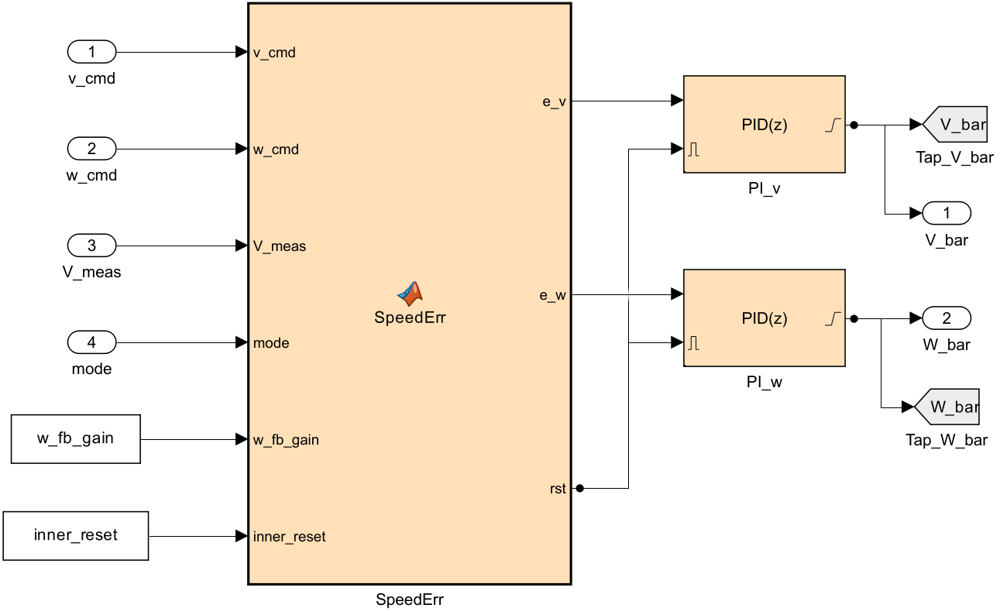

*Figure 23. Version 2 InnerPI box (error calculation → two discrete PIs, integral reset at mode switching)*

Boxes changed from version 1

| Box | Version 2 content |
|---|---|
| RosIn | Also reads `angular_velocity.z` from `/imu/data` → `imu_data` = [quaternion; gyro z] |
| Nav | Additionally outputs `V_meas` = [$u_B$; $r$]. $u_B = \dot x\cos\psi + \dot y\sin\psi$ (ZeroKey velocity, same equation as real-robot `transform_state`), $r$ = gyro z |
| InnerPI (new box) | Eq. (45) below |
| PwmMap | PI outputs $\bar V, \bar W$ fed directly into the real-robot `calc_pwm` (no velocity normalization of Eq. (27)) |
| Sensors · PlantRosOut | Attitude and gyro z (true angular rate + noise 0.1°/s) published together in one IMU message |

$$
\bar V = \mathrm{sat}_{[0,\thinspace 0.5]}\negthinspace \Big(K_{P,v}^{in} e_v + K_{I,v}^{in}\negthinspace \sum e_v\thinspace T_s\Big),\ e_v = v_c - u_B, \qquad
\bar W = \mathrm{sat}_{[-0.5,\thinspace 0.5]}\negthinspace \Big(K_{P,\omega}^{in} e_\omega + K_{I,\omega}^{in}\negthinspace \sum e_\omega\thinspace T_s\Big),\ e_\omega = \omega_c - g_\omega\thinspace r \qquad (45)
$$

| Symbol | Definition | Value (`XY_setup.m` section 10) |
|---|---|---|
| $K_{P,v}^{in},\ K_{I,v}^{in}$ | Velocity PI | 0.15, 0.8 (`Kin_Pv`, `Kin_Iv`, same as real robot) |
| $K_{P,\omega}^{in},\ K_{I,\omega}^{in}$ | Yaw-rate PI | 1.5, 1.5 (`Kin_Pw`, `Kin_Iw`, same as real robot) |
| $T_s$ | Discrete PI period (Forward Euler, integral clamping) | 0.01 s (same as real robot) |
| $g_\omega$ | Gyro feedback scale | 1.0 (`w_fb_gain`). Real-robot model 0.1443 |
| Reset | Both integrators set to 0 at the sample where the mode changes | `inner_reset` = 1 (absent in the real-robot model) |

Results (1.2 m straight line, 30 mm/s, plant after the Section 8.2 correction, 3 runs per case. Pen RMS difference among the 3 runs 0.02 mm or less)

| Case | Pen RMS [mm] | Pen max [mm] | Robot RMS [mm] | Stage Y [mm] | Velocity command / actual [m/s] | ω tracking error RMS [deg/s] |
|---|---|---|---|---|---|---|
| Version 1 (no inner PI) | 1.17–1.20 | 3.9 | 23.6 | 61.3–72.2 | 0.0228 / 0.0308 | 1.4 |
| Version 2 default ($g_\omega$ = 1, reset) | 1.21–1.24 | 3.7 | 22.6 | 63.5–70.9 | 0.0312 / 0.0312 | 1.7 |
| Version 2, $g_\omega$ = 0.1443 (real-robot value), reset | 1.41–1.44 | 4.7–5.0 | 22.3 | 62.9–70.5 | 0.0310 / 0.0309 | 5.4 |
| Version 2, $g_\omega$ = 1, no reset (same as real robot) | 1.22 | 3.7 | 20.6 | 33.0–70.8 | 0.0312 / 0.0306 | 1.6 |
| Version 2, $g_\omega$ = 0.1443, no reset | 1.43 | 4.6–4.7 | 20.1 | 52.1–70.6 | 0.0308 / 0.0305 | 5.4 |

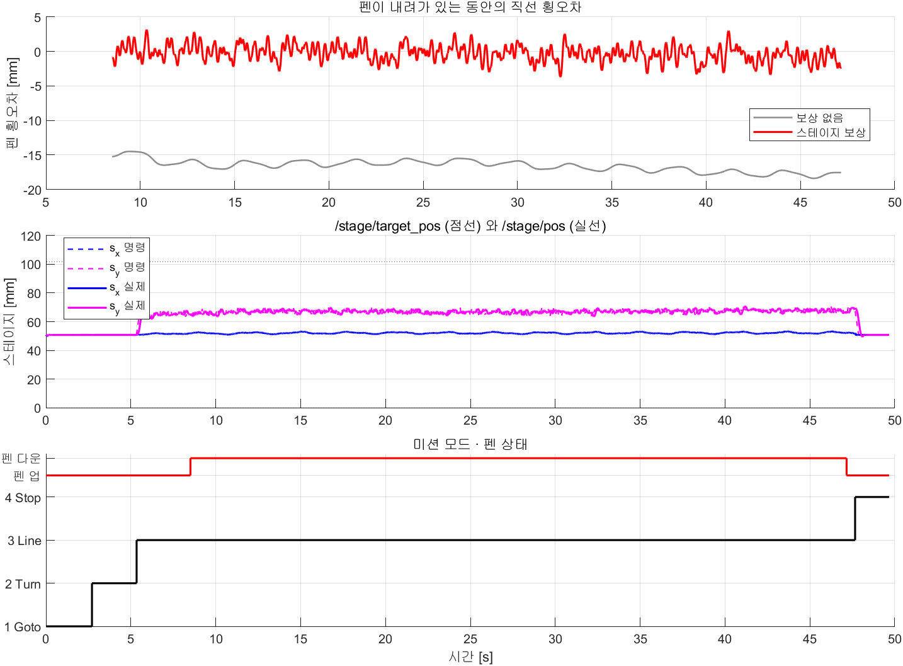

*Figure 24. Pen cross-track error, stage position and mode for the version 2 default setting*

Interpretation

- Version 2 default setting: pen accuracy at the same level as version 1, and the offset between velocity command and actual velocity (version 1: 0.0228 vs 0.0308 m/s) eliminated
- Upper limit of pen accuracy still set by the sensors (Section 18.5). The inner PI only makes the robot move as commanded; it does not reduce pen error
- Problems when using the real-robot model values as is

| Problem | Cause | Current-version result | Version 2 action |
|---|---|---|---|
| ω oscillates more than the command (ω tracking error RMS 5.4 vs 1.7 deg/s, pen RMS +0.2 mm) | Feedback 0.1443 × gyro z does not match the rad/s command in units, so the integral accumulates until ω ≈ 6.9 ω_c → the outer loop reduces it again, causing oscillation | Reproduced | $g_\omega$ = 1 |
| Velocity PI integral remains after mode switching, driving forward even while turning | The velocity PI output lower limit is 0 and there is no feedforward, so the integral value remains even when $v_c$ = 0 | In the previous version (tag integration, tag-referenced mode 1), the start point was off by 100 mm and stage Y saturated at 0 mm (pen RMS 7.47 mm). In the current version, stage Y minimum 33 mm, no saturation (pen RMS 1.22 mm) | Integral reset at mode switching (`inner_reset`). Retained for travel margin (Y minimum 33 → 63 mm) |

- The reduced effect of no reset appears to be because mode 1 changed to centre-referenced, altering the velocity at the end of mode 1 and the position change during turning. On the real robot, checking whether it moves forward during mode 2 via `V_meas(1)` required
- Origin of 0.1443 to be confirmed: whether the real-robot IMU node outputs `angular_velocity` in a unit other than rad/s, or whether there is another intent (e.g. conversion to track speed difference with $b/2$)
- Real-robot version 2 test sequence: drive without the pen with `XY_2_pen_ros2_v2` and check the `V_meas`, `V_bar`, `W_bar` logs → same procedure as version 1 (Chapter 21)

---

## 22. Hardware Deployment Procedure and Checklist

The simulation controller connects directly to the real robot, but the following values are assumptions of the simulation and must be confirmed before real-robot operation. In particular, if a sign or a unit is wrong, the compensation doubles the error instead of reducing it.

| Order | Check | Method | If wrong |
|---|---|---|---|
| 1 | Stage axis signs: X increases toward $x_B$ (forward), Y toward $y_B$ (left) | With the robot standing still, send (60, 50.8) and (50.8, 60) to `/stage/target_pos` and check the carriage direction | The pen moves away from the line |
| 2 | Tag position $r_{tag}$, pen position $r_{pen0}$ | Laser tracker or ruler | The pen draws an arc when heading changes |
| 3 | Heading reference $\psi_0$ and IMU rotation direction | Start facing the ceiling ($\psi_0 = 90^{\circ}$), rotate counter-clockwise as seen from in front of the wall and check that $\hat\psi$ increases | If the rotation direction is reversed, mode 2 diverges |
| 4 | ZeroKey axes (z up +, x direction → `zk_xsign`) | Move the robot to the right as seen from in front of the wall and check the increase/decrease of x in `/zerokey/position`: decrease → $-1$, increase → $+1$ | The robot moves horizontally in the opposite direction |
| 5 | ZeroKey noise·latency | 1-minute stationary log, standard deviation and latency | The error budget of Chapter 7 changes |
| 6 | ESC deadzone, `v_full` | Measure driving speed at constant PWM | Modes 1·4 slow or jittery (little effect on pen accuracy) |
| 7 | Driving without the pen | Whether `/stage/target_pos` is within 10–90 mm | Saturation at the travel end |
| 8 | Pen lift | Decide when to put the marker on the wall | Lines drawn into the extension intervals before and after the line |
| 9 | Version 2: gyro unit | Whether `angular_velocity.z` is in rad/s (origin of 0.1443) | ω oscillation |

---

## 23. Troubleshooting

| Symptom | Cause | Action |
|---|---|---|
| At the start of mode 3, stage X goes near the travel end (95 mm) | p* clipped to A, so the stage makes up the remaining along-track distance | Change p* to the unclipped foot of the perpendicular |
| Heading 2 Hz jitter, cross-track error 3.6 mm | 6WP turning resistance sign (u² − l²/4) | Corrected to (l²/4 − u²) |
| Merge sample time mismatch error | Continuous Clock of mode 3 versus 0.01 s of other modes | Digital Clock (Ts_ctrl) in mode 3 |
| To Workspace sample time warning | Signals of different periods logged in one Bus | ZOH (0.01 s) after the Bus |
| Real-robot stage commands lag | 100 Hz `move abs` saturates the 115200 bps serial link | Node sends only the latest target at 25 Hz |
| Risk of simulation `/motor_pwm` moving the actual robot | Same domain | Virtual experiment separated to domain 77 |
| VideoWriter permission error | A previous VideoReader holds the file | Re-run after `clear` |
| Values differ from run to run | ROS 2 reception timing | Normal. In the current version, repetition difference 0.02 mm or less (pen RMS 1.17–1.20 mm) |
| Dashboard run very slow (113 s for 48 s) | Animate MATLAB Function inputs are continuous, so the plotting function is called every 0.5 ms step | Zero-Order Hold on each input (`anim_Ts` 0.2 s) |
| ω jitters heavily (tracking error 6 deg/s) | Integration step 5 ms large relative to turning resistance tanh | `Ts_plant` 0.5 ms (Section 8.3) |
| Variable error during `XY_compare` | `r`, `s` left in the base workspace conflict with script variables | `clear r s` after `XY_setup` |
| Other windows captured in recording | Screen-capture method | Changed to off-screen rendering (`print -RGBImage`). Not reverted to screen capture |

---

## 24. Open Items

| Item | Current setting | What to check |
|---|---|---|
| Tag·pen positions `r_tag`, `r_pen0` | (−0.08, 0.06), (0, 0) m | Laser tracker measurement |
| Stage axis signs·mounting angle | Axis 1 = x_B, axis 2 = y_B, 0° | Real-robot assembly check |
| ZeroKey world x direction `zk_xsign` | −1 (left + as seen from in front of the wall, real-robot `plane_project` assumption) | Move the robot to the right by hand and check the increase/decrease of `/zerokey/position` x. +1 if it increases |
| Stage acceleration/deceleration | 500 mm/s² | `get accel` |
| Stage position-loop bandwidth · command latency | 20 Hz · 10 ms | Step command response measurement |
| Robot mass · adhesion force · friction | 12 kg · 400 N · μ_l 0.05, μ_t 0.5 | Measurement |
| ESC deadzone · track time constant · maximum driving force | 30 count · 0.15 s · 200 N | Measurement |
| ZeroKey latency · noise · stationary absolute error | 50 ms · 1 mm · undetermined | Stationary log |
| Number of ZeroKey tags | 1 (robot) | Progress report lists marker unit + 2 MC. Actual configuration to be confirmed. Placement comparison in Chapter 7 (2 on the robot body with the pen between them: approximate simulation 0.84 mm) |
| Pen lift | No device·topic (`pen_on` for logging only) | When and how the marker is put on the wall |
| Wall creep · heading track bumps | 8 % · ±1.5°, 0.35 Hz | Real-robot video·logs |
| Pen holder mass | 0.10 kg | Measurement |

Remaining work

- Re-run `XY_compare` after applying measured values
- Decide default values after improving the entry transient of the stage centring loop (gradual integral enable)
- Compare real-robot test (`XY_2_pen_ros2`) results with simulation
- Confirm the origin of the gyro feedback scale 0.1443 of the real-robot Xsens model; real-robot test of version 2 (`XY_2_pen_ros2_v2`) (Section 21.2)
- Review ways to reduce ZeroKey position noise (dominant factor, Section 18.5 error budget): filter, stationary averaging, 2 tags
- Confirm the cause of increased pen error when IMU noise·drift were removed (repeated runs with different seeds, Section 18.5)
- English·Vietnamese manuals


---

## 25. Conclusion

A wall-climbing tracked robot cannot move sideways and slips on the wall, so the robot alone cannot draw a straight line at the millimetre level. The structure described in this document accepts this limitation and assigns along-track progress and large motions to the robot, and deviations from the line to the fast, short-travel XY stage. The stage command is obtained by inverting the pen position equation using the measured tag position and heading, and by placing the target at the foot of the perpendicular, the stage removes only the cross-track error. The position servo of the commercial stage cannot be changed, but its accuracy is far better than that of the sensors and the required speed is only a few percent of its maximum speed, so position commands alone are sufficient. The remaining error is determined by the sensors, and the largest of these, ZeroKey noise, can be reduced by mounting one more tag on the robot body with the pen between the two tags.

---

## References

1. T. Zou, J. Angeles, F. Hassani, "Dynamic modeling and trajectory tracking control of unmanned tracked vehicles," *Robotics and Autonomous Systems*, vol. 110, pp. 102–111, 2018. doi:10.1016/j.robot.2018.09.008
2. A. D. Sabiha, M. A. Kamel, E. Said, W. M. Hussein, "ROS-based trajectory tracking control for autonomous tracked vehicle using optimized backstepping and sliding mode control," *Robotics and Autonomous Systems*, vol. 152, 104058, 2022. doi:10.1016/j.robot.2022.104058
3. Y. Kanayama, Y. Kimura, F. Miyazaki, T. Noguchi, "A stable tracking control method for an autonomous mobile robot," *Proc. IEEE ICRA*, pp. 384–389, 1990. doi:10.1109/ROBOT.1990.126006
4. A. Sharon, N. Hogan, D. E. Hardt, "The macro/micro manipulator: An improved architecture for robot control," *Robotics and Computer-Integrated Manufacturing*, vol. 10, no. 3, pp. 209–222, 1993. doi:10.1016/0736-5845(93)90056-P
5. J. Y. Wong, *Theory of Ground Vehicles*, 4th ed., Wiley, 2008 (turning resistance $\mu_t W l/4$)

---

The PDF is generated from README.md with headless Chrome (marked.js).
