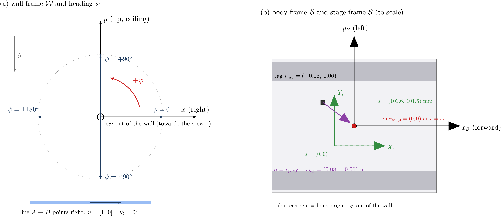
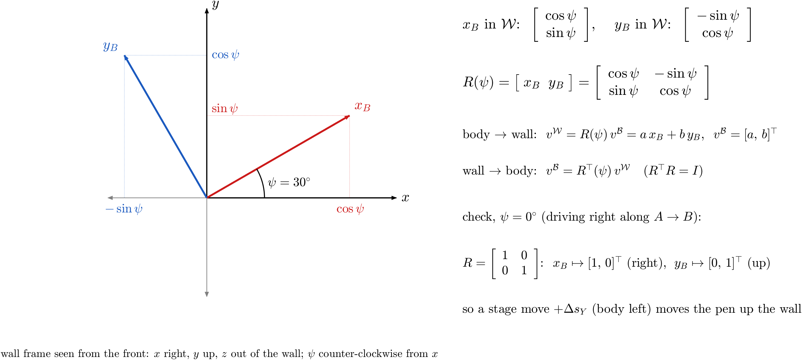
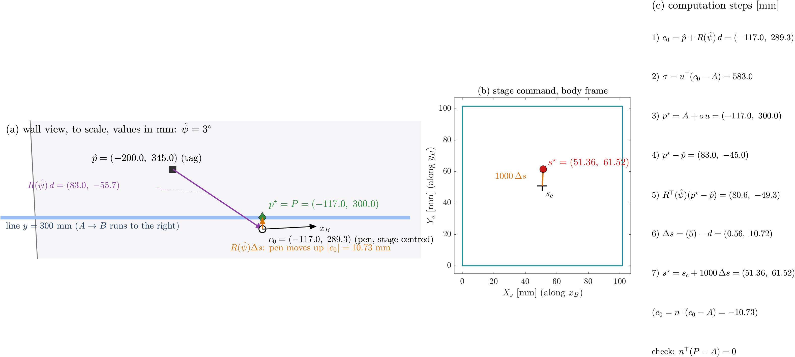
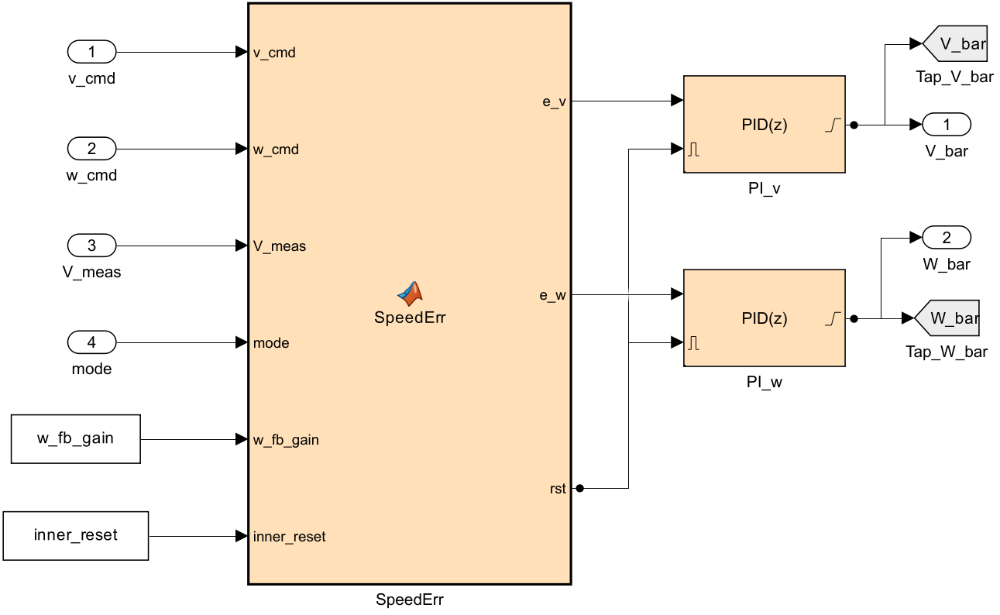
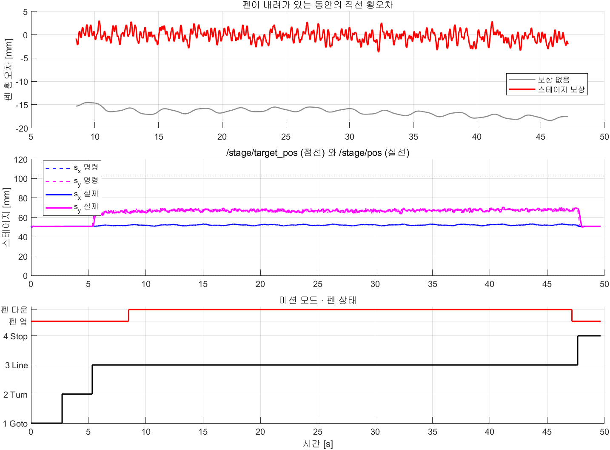

# AVT-3C 벽면 로봇 + Zaber XY 스테이지 직선 마킹 (Simulink ↔ ROS 2, 펜 기구학 보상)

- 작성: 충남대학교 자율운항시스템공학과 윤원근 교수
- 저장소: <https://github.com/wkyouncnu/AVT3C-XY-Stage-Pen>
- 매뉴얼(PDF): [docs/manual/AVT3C_XY_Stage_Pen.pdf](docs/manual/AVT3C_XY_Stage_Pen.pdf)


*그림 1. 시스템 구성*

## 목차

1. [개요](#1-개요)
2. [통신 구조](#2-통신-구조)
3. [제어기 계층 구조](#3-제어기-계층-구조)
4. [수학적 정식화](#4-수학적-정식화)
5. [운동모델](#5-운동모델)
6. [Simulink 모델 구성](#6-simulink-모델-구성)
7. [설치](#7-설치)
8. [실행](#8-실행)
9. [프로그램별 입출력](#9-프로그램별-입출력)
10. [검증](#10-검증)
11. [설계 선택 비교](#11-설계-선택-비교)
12. [실장비 적용](#12-실장비-적용)
13. [문제 해결](#13-문제-해결)
14. [확인 필요 사항](#14-확인-필요-사항)

---

## 1. 개요

### 1.1 목적

- 수직 철판 벽에 자석으로 붙는 궤도형 로봇 AVT-3C 위에 Zaber X-LSM100B 두 축 XY 스테이지를 얹고, 스테이지 끝 마커로 벽에 직선 하나를 그음
- 로봇(macro)은 진행과 큰 범위 이동을 맡고, 스테이지(micro)는 직선에서 벗어난 횡오차와 heading 오차를 지움
- 가상 실험 모델과 실기 모델이 같은 ROS 2 토픽 이름·메시지 형식을 쓰므로 시뮬레이션의 제어기를 그대로 실기에 연결함

### 1.2 주요 사양

| 항목 | 값 | 근거 |
|---|---|---|
| 그릴 직선 | A = (0.30, 0.70) m → B = (0.30, −0.50) m, 수평 1.2 m | `XY_setup.m` 2 절 |
| 로봇 | AVT-3C 궤도형, 외형 420 × 343 × 100 mm | CAD STL |
| 스테이지 | Zaber X-LSM100B-E03 × 2 (X 아래 축, Y 위 축), 배치 3안 (펜 = 로봇 중심) | 데이터시트, CAD |
| 스테이지 행정 · 최고속도 | 101.6 mm · 104 mm/s | 데이터시트 |
| 위치 센서 | ZeroKey RTLS 태그 1개 (로봇), 약 20 Hz | 실기 구성 |
| heading 센서 | Xsens IMU `/imu/data` (상대 요각, 철판이라 자력계 사용 불가) | 실기 구성 |
| 제어기 주기 · 운동모델 적분 스텝 | 0.01 s (100 Hz) · 0.5 ms | 실기 Simulink 와 같음 · 4.3 절 |
| 직선 구간 속도 | 30 mm/s (펜 다운 약 39.3 s) | `v_ref` |
| 결과 (기준 조건) | 펜 횡오차 RMS 1.18–1.20 mm, 최대 3.9 mm | 10 장 |
| 스테이지 없이 로봇만 | 펜 횡오차 RMS 14.84 mm, 최대 19.6 mm | 10 장 |

### 1.3 외부 인터페이스

| 구분 | 내용 |
|---|---|
| 제어기 입력 | `/zerokey/position`, `/zerokey/vel`, `/imu/data`, `/stage/pos` |
| 제어기 출력 | `/motor_pwm` (로봇), `/stage/target_pos` (스테이지) |
| 스테이지 노드 | `zaber_stage_node.py` — `/stage/target_pos` → RS-232 `move abs`, `get pos` → `/stage/pos` |
| ROS 2 도메인 | 가상 실험 77, 실기 0 |

### 1.4 저장소 구성

```
├── README.md                 이 문서 (원본)
├── docs/img/                 다이어그램 SVG, 수식 그림 PNG (src/make_fig_math.m)
├── docs/manual/              README 에서 생성한 PDF
├── 1_시뮬레이션/
│   ├── XY_setup.m            파라미터 (먼저 실행)
│   ├── build_xy_models.m     모델 생성기 — 두 .slx 는 이것으로만 만듦
│   ├── XY_1_pen_sim.slx      가상 실험 (제어기 + 운동모델 + 센서, ROS 2 루프백)
│   ├── XY_2_pen_ros2.slx     실기 (제어기만)
│   ├── XY_1_pen_sim_v2.slx, XY_2_pen_ros2_v2.slx   2 판: 실기 내부 PI 포함 (12.2 절)
│   ├── XY_run_all.m          설정 → 빌드 → 실행 → 그림 → 동영상
│   ├── XY_compare.m          설계 선택 비교 (11 장), XY_compare_plot.m
│   ├── XY_animate.m          Run 버튼 실시간 대시보드, XY_stop.m (StopFcn: 결과 그림)
│   ├── XY_record_live.m      대시보드 동영상 (실행 뒤 기록 재생, 화면 밖 렌더링)
│   ├── XY_plot.m             결과 그림
│   ├── img/                  모델 그림, 결과 그래프
│   └── video/                결과 동영상
├── 3_로봇탑재코드/zaber_stage_node.py
└── _tools/                   Simulink 정리·검사 도구 (paint_roles, check_lines, check_flow, check_tags …)
```

---

## 2. 통신 구조

### 2.1 토픽

| 토픽 | 형식 | 발행 → 구독 | 주기 | 내용 |
|---|---|---|---|---|
| `/zerokey/position` | geometry_msgs/PointStamped | 센서 → 제어기 | 20 Hz | 태그 월드 좌표 [m]. x = 벽 수평(왼쪽 +), z = 높이 |
| `/zerokey/vel` | geometry_msgs/TwistStamped | 센서 → 제어기 | 20 Hz | 태그 속도 [m/s] (linear.x, linear.z 사용) |
| `/zerokey/orientation` | geometry_msgs/QuaternionStamped | 센서 → (실기 모델) | 20 Hz | ZeroKey INS 자세. 이 제어기는 사용하지 않음, 실기 모델 호환용 |
| `/imu/data` | sensor_msgs/Imu | 센서 → 제어기 | 100 Hz | orientation 쿼터니언 → 요각 |
| `/stage/pos` | geometry_msgs/PointStamped | 스테이지 노드 → 제어기 | 20 Hz | 스테이지 X, Y [mm] |
| `/motor_pwm` | geometry_msgs/Point | 제어기 → 로봇 | 100 Hz | x = 왼쪽, y = 오른쪽 PWM count (중립 1500 ± 400) |
| `/stage/target_pos` | geometry_msgs/Point | 제어기 → 스테이지 노드 | 100 Hz | 목표 X, Y [mm] (노드가 25 Hz 로 솎아 전송) |
| `/stage/cmd_vel`, `/stage/stop` | Vector3, Empty | 보조 → 스테이지 노드 | 필요 시 | 속도 명령 (워치독 0.5 s), 정지 |

- 가상 실험에서 운동모델·센서·스테이지 모델은 위 토픽을 실제로 발행하고, 제어기는 구독만 함
- 따라서 제어기는 참값(`q_true`, `x_s`)을 보지 못하고 실기와 같은 정보만으로 동작함

### 2.2 좌표 규약

| 기호 | 정의 |
|---|---|
| p₁ | world z, 높이 (천장 +) |
| p₂ | world x, 수평 (벽 정면에서 왼쪽 +) |
| ψ | p₁ 축에서 p₂ 축으로 도는 각 (천장 방향 0, 왼쪽 +90°) |
| 바디 | x_B 전진, y_B 좌측. R(ψ) = [cos ψ −sin ψ; sin ψ cos ψ] 가 바디 → 벽면 |
| 스테이지 | 축 1 = x_B, 축 2 = y_B, 단위 mm, 중앙 s_c = 50.8 mm |

- 실기 Simulink 의 `plane_project` 와 같은 규약

---

## 3. 제어기 계층 구조


*그림 2. 제어기 계층 구조와 단별 신호*

### 3.1 단별 역할

| 단 | 블록 | 입력 | 출력 | 주기 |
|---|---|---|---|---|
| 0 측정 | RosIn → Nav | ZeroKey 위치·속도, IMU 쿼터니언 | `pose` = [p₁; p₂; ψ] | 0.01 s |
| 1 미션 | Guards → ModeChart → Waypoints | `pose` | `mode`, `WP_prev`, `WP_target`, `t_line`, `lineAB` | 0.01 s |
| 2 macro | RobotCtrl → PwmMap → RosOut | `WP_*`, `mode`, `t_line`, `pose`, `stage_pos_meas` | `v_cmd`, `w_cmd` → `/motor_pwm` | 연속 / 0.01 s 발행 |
| 2 micro | PenCtrl → RosOut | `lineAB`, `mode`, `pose` | `stage_target_pos` → `/stage/target_pos`, `pen_on` | 연속 / 0.01 s 발행 |
| 3 내부 루프 | ESC 속도 루프, Zaber 펌웨어 위치 루프 | `/motor_pwm`, `/stage/target_pos` | 궤도 속도, 스테이지 위치 | 장비 내부 |

### 3.2 상태 값

| 이름 | 크기 | 단위 | 위치 | 의미 |
|---|---|---|---|---|
| `pose` | 3 | m, m, rad | Nav 출력 | 측정 태그 위치 [p₁; p₂] + heading ψ |
| `mode` | 1 | – | ModeChart | 1 출발점 이동, 2 회전, 3 직선 추종, 4 정지, 5 종료 |
| `WP_prev`, `WP_target` | 2, 2 | m | Waypoints | 로봇(태그)이 따라갈 선분의 시작·끝 |
| `lineAB` | 4 | m | Waypoints | 펜이 그릴 직선 [A; B] |
| `t_line` | 1 | s | Waypoints | 모드 3 진입 시각 (기준점 진행 시작) |
| `v_cmd`, `w_cmd` | 1, 1 | m/s, rad/s | RobotCtrl | 로봇 속도 명령 |
| `e_cross` | 1 | m | RobotCtrl M3 | 로봇 기준점 대비 바디 횡오차 |
| `motor_pwm` | 2 | count | PwmMap | [왼쪽; 오른쪽] |
| `stage_target_pos` | 2 | mm | PenCtrl | 스테이지 목표 [X; Y] |
| `pen_on` | 1 | – | PenCtrl | 펜 다운 (0 ≤ σ ≤ L) |
| `stage_pos_meas` | 2 | mm | RosIn | `/stage/pos` 측정값 |
| `q_true`, `V_true` | 3, 2 | m, rad / m/s, rad/s | RobotPlant | 참 자세, 참 속도 (평가용, 제어기는 모름) |
| `x_t` | 4 | mm, mm/s | StagePlant | 펌웨어 궤적 상태 |
| `x_s` | 6 | m, m/s, m·s | StagePlant | 스테이지 위치·속도·적분 상태 |
| `pen_true`, `e_pen` | 2, 1 | m | PenTrace | 참 펜 위치, 펜 횡오차 (평가) |
| `pen_nocomp`, `e_nocomp` | 2, 1 | m | PenTrace | 스테이지를 중앙에 고정했을 때의 펜 위치·횡오차 |

### 3.3 미션 상태기계


*그림 3. ModeChart 전이*

| 모드 | 제어 법칙 (6WP_sim · 실기 모델과 같은 식) | 펜 |
|---|---|---|
| 1 Goto_Start | v = K_dist·d·max(0, cos α), ω = K_yaw·α + 0.5 sin α cos α | 올림, 스테이지 중앙 |
| 2 Turning | v = 0, ω = K_yaw·Δθ | 올림 |
| 3 Line_Tracking | 시간 기준점 x_r = WP_prev + v_ref (t − t_line) u, 바디 오차 e = Rᵀ(θ)(x_r − p): v = v_ref cos e_θ + K_px e_x, ω = K_py e_y + K_pθ sin e_θ | 보상, 0 ≤ σ ≤ L 에서 다운 |
| 4 Stop_Destination | 모드 1 식을 끝점에 대해 계속 적용 (d < 0.01 m 에서 ω = 0) | 올림 |

- 로봇이 따라갈 선분 = 펜 직선을 R·d 만큼 평행 이동 + 앞뒤로 `line_pre` 60 mm, `line_post` 40 mm 연장
- 모드 3 에 들어서면 펜 다운 전부터 스테이지를 목표로 보내 시작 과도를 없앰

---

## 4. 수학적 정식화

- 운동모델은 Zou 등 (2018) [1] 의 궤도차량 동역학, 제어 구조는 Zou [1] 와 Sabiha 등 (2022) [2] 의 외부 기구학 루프 + 내부 속도 루프 형태를 따름
- 벽면 흡착, 중력, 원 논문 식의 부호 오류, 6WP_sim · 실기 모델의 제어 법칙에 맞춰 바꾼 부분은 각 절에 명시함
- 식 번호 (1)–(23) 은 이 문서 안에서만 쓰는 번호임 ((23) 은 12.2 절)


*그림 4. 벽면 좌표계와 펜 보상 기하 (레버암·스테이지 크기는 읽기 쉽게 확대, 축척 아님)*


*그림 5. 제어 구조 (위: 로봇 macro 루프, 아래: 스테이지 micro 루프, 맨 아래: 측정 되먹임)*

### 4.0 그림 4 읽는 법

| 그림에서 | 의미 |
|---|---|
| 왼쪽 아래 축 | 벽면 좌표계 $\mathcal{W}$. 벽을 정면에서 본 그림이므로 $p_1$ 은 위, $p_2$ 는 왼쪽, $z_W$ 는 종이에서 나오는 방향 (⊙) |
| 가로축 방향 | 그림의 오른쪽은 $-p_2$. 직선 $A \to B$ 는 $p_2$ 가 줄어드는 방향, 즉 오른쪽으로 진행 |
| 회색 사각형, $x_B$, $y_B$ | 로봇 차체와 바디 축. 이 그림의 로봇은 $\psi \approx -96^{\circ}$ (오른쪽을 보고 코가 약간 아래) |
| 검은 사각형 $p$ | ZeroKey 태그. 측정되는 점은 로봇 중심이 아니라 이 점 |
| 보라 화살표 $R(\psi)\,d$ | 태그에서 "스테이지가 중앙일 때의 펜" $c_0$ (흰 원) 까지의 레버암을 벽면 좌표로 쓴 것 |
| 초록 점선 사각형 | 스테이지 행정 ($c_0$ 를 중심으로 바디 축에 정렬) |
| 주황 화살표 $R(\psi)\,\Delta s$ | 스테이지 캐리지 이동이 벽면에서 펜을 옮기는 양 |
| 빨간 원 $P$ | 실제 펜 끝 |
| 남색 마름모 $p^{\star}$ | $c_0$ 를 직선에 내린 수선의 발 = 펜 목표 |
| 빨간 화살표 $e$ | 펜 횡오차. 직선에서 $n$ (위쪽) 방향으로 잰 거리 |
| 축척 | 레버암·스테이지는 읽기 쉽게 확대. 실제 비율은 그림 6 (b) 와 그림 8 (a) |

- 그림 4 는 펜이 아직 직선에 닿지 않은 중간 상태 ($P \ne p^{\star}$) 를 그린 것. 보상이 끝나면 $P = p^{\star}$

### 4.1 좌표계

| 좌표계 | 원점 | 축 (오른손 좌표계) | 단위 | 쓰는 곳 |
|---|---|---|---|---|
| 벽면 $\mathcal{W}$ | ZeroKey 원점 (벽 위 고정점) | $p_1$ 위 (천장), $p_2$ 왼쪽 (벽 정면에서 볼 때), $z_W$ 벽 밖 (보는 사람 쪽) | m | 태그 위치 $p$, 직선 $A$·$B$, 펜 $P$ |
| 바디 $\mathcal{B}$ | 로봇 중심 $c$ | $x_B$ 전진, $y_B$ 왼쪽 (로봇 기준), $z_B$ 벽 밖 | m | 태그 $r_{tag}$, 펜 $r_{pen,0}$, 레버암 $d$ |
| 스테이지 $\mathcal{S}$ | 행정의 모서리 ($s = (0,0)$) | $X_s \parallel x_B$, $Y_s \parallel y_B$ | mm | 스테이지 명령 $s$, 중앙 $s_c = (50.8, 50.8)$ |



*그림 6. (a) 벽면 좌표계와 heading 의 부호, (b) 바디·스테이지 좌표계 (축척대로)*

- 오른손 규칙: 화면 오른쪽·위·화면 밖을 $(x, y, z)$ 로 두면 $p_1 = (0,1,0)$, $p_2 = (-1,0,0)$ 이고 $p_1 \times p_2 = (0,0,1) = z_W$ (벽 밖). 바디도 $x_B \times y_B = z_B$ (벽 밖)
- 따라서 $(p_1, p_2)$ 는 "가로 $x$ 오른쪽, 세로 $y$ 위" 인 교과서 평면과 축 이름만 다르고 같은 오른손 평면. 회전행렬도 교과서 형태 그대로 씀 (4.1.2 절)
- 그림에 그릴 때만 화면 좌표 = $(-p_2,\ p_1)$ 로 바꿈 (`XY_plot`, `XY_live`)
- 스테이지 축은 바디 축과 평행이고 원점만 다름: $\Delta s = (s - s_c)/1000$ 은 바디 좌표의 벡터 [m]

#### 4.1.1 heading $\psi$

- 정의: $p_1$ 축에서 $x_B$ 축까지 $z_W$ 둘레로 잰 각. 벽 정면에서 볼 때 반시계 방향이 $+$
- 범위: $(-\pi, \pi]$, 각 차이는 항상 $\mathrm{wrap}(\cdot)$ 으로 이 범위에 넣음

| $\psi$ | $x_B$ (로봇 앞) 이 향하는 곳 | $y_B$ (로봇 왼쪽) 이 향하는 곳 | 이 과제에서 |
|---|---|---|---|
| $0^{\circ}$ | 위 (천장) | 왼쪽 | – |
| $+90^{\circ}$ | 왼쪽 | 아래 | – |
| $-90^{\circ}$ | 오른쪽 | 위 | 직선 추종 (모드 3) 중 heading |
| $\pm 180^{\circ}$ | 아래 | 오른쪽 | – |

- 그릴 직선 $A = (0.30,\ 0.70) \to B = (0.30,\ -0.50)$: $u = (B - A)/\lVert B - A\rVert = [0,\ -1]^{\top}$ (오른쪽), 직선 각 $\theta_l = \mathrm{atan2}(u_2, u_1) = -90^{\circ}$, 법선 $n = Ju = [1,\ 0]^{\top}$ (위)
- 따라서 직선 추종 중 로봇의 왼쪽 ($y_B$) 이 천장을 향하고, 스테이지 $Y_s$ 가 늘면 펜이 위로 감

#### 4.1.2 회전행렬 유도

$x_B$ 는 $p_1$ 축을 $\psi$ 만큼 반시계로 돌린 단위벡터이고, $y_B$ 는 $x_B$ 를 다시 $+90^{\circ}$ 돌린 벡터.

$$
x_B^{\mathcal{W}} = \begin{bmatrix} \cos\psi \\ \sin\psi \end{bmatrix}, \qquad
y_B^{\mathcal{W}} = \begin{bmatrix} \cos(\psi + 90^{\circ}) \\ \sin(\psi + 90^{\circ}) \end{bmatrix} = \begin{bmatrix} -\sin\psi \\ \cos\psi \end{bmatrix}
$$

바디 좌표로 $v^{\mathcal{B}} = [a,\ b]^{\top}$ 인 벡터는 "앞으로 $a$, 왼쪽으로 $b$" 이므로 벽면 좌표로는 두 축벡터의 합.

$$
v^{\mathcal{W}} = a\,x_B^{\mathcal{W}} + b\,y_B^{\mathcal{W}}
= \underbrace{\begin{bmatrix} x_B^{\mathcal{W}} & y_B^{\mathcal{W}} \end{bmatrix}}_{R(\psi)} \begin{bmatrix} a \\ b \end{bmatrix},
\qquad
R(\psi) = \begin{bmatrix} \cos\psi & -\sin\psi \\ \sin\psi & \cos\psi \end{bmatrix}, \qquad
J = R(90^{\circ}) = \begin{bmatrix} 0 & -1 \\ 1 & 0 \end{bmatrix} \tag{1}
$$



*그림 7. 회전행렬의 열 = 벽면 좌표로 쓴 바디 축 ($\psi = 30^{\circ}$ 예). 빨강 $x_B$, 파랑 $y_B$ 와 그 성분*

| 성질 | 식 | 쓰는 곳 |
|---|---|---|
| 바디 → 벽면 | $v^{\mathcal{W}} = R(\psi)\,v^{\mathcal{B}}$ | 레버암 $R d$, 캐리지 이동 $R\,\Delta s$ (식 (13)) |
| 벽면 → 바디 | $v^{\mathcal{B}} = R^{\top}(\psi)\,v^{\mathcal{W}}$ ($R^{\top}R = I$, $\det R = 1$) | 스테이지 명령 $\Delta s$ (식 (14)), 바디 오차 $e_x, e_y$ (식 (11a)) |
| 각 합성 | $R(\alpha)R(\beta) = R(\alpha + \beta)$, $R^{\top}(\psi) = R(-\psi)$ | 식 (15) 의 $R^{\top}(\psi)\,n = R(\theta_l + 90^{\circ} - \psi)\,e_1$ |
| 미분 | $\dot R = \dot\psi\,\partial R/\partial\psi = \omega\,J R$ | 오차 전파 (식 (20)) |
| $+90^{\circ}$ 회전 | $J v$ = $v$ 를 왼쪽으로 돌린 벡터, $J^{\top}J = I$, $J^2 = -I$ | 직선의 왼쪽 법선 $n = Ju$ |

검산 ($\psi = -90^{\circ}$, 직선 추종 중)

$$
R(-90^{\circ}) = \begin{bmatrix} 0 & 1 \\ -1 & 0 \end{bmatrix}:\quad
R\begin{bmatrix} 1 \\ 0 \end{bmatrix} = \begin{bmatrix} 0 \\ -1 \end{bmatrix}\ (\text{앞} = \text{오른쪽}), \qquad
R\begin{bmatrix} 0 \\ 1 \end{bmatrix} = \begin{bmatrix} 1 \\ 0 \end{bmatrix}\ (\text{왼쪽} = \text{위})
$$

- 바디 왼쪽 1 mm 의 캐리지 이동 ($\Delta s_Y = +0.001$) 은 벽에서 펜을 위 ($+p_1$) 로 1 mm 옮김
- 거꾸로 벽에서 위로 1 mm ($[0.001,\ 0]^{\top}$) 는 $R^{\top}$ 을 곱해 바디 $[0,\ 0.001]^{\top}$, 즉 $Y_s$ +1 mm

#### 4.1.3 기호

| 기호 | 읽는 법 | 정의 | 단위 |
|---|---|---|---|
| $p_1,\ p_2$ | 피 원, 피 투 | 벽면 좌표. $p_1$ = 높이 (천장 +), $p_2$ = 수평 (벽 정면에서 왼쪽 +) | m |
| $\psi$ | 프사이 | heading. $p_1$ 축에서 $x_B$ 축까지의 각 (천장 방향 0, 반시계 +) | rad |
| $R(\psi)$ | 알 프사이 | 바디 → 벽면 회전행렬 (식 (1)). $\dot R = \omega J R$ | – |
| $c$ | 씨 | 로봇 중심 위치 | m |
| $p$ | 피 | ZeroKey 태그 위치 $p = c + R(\psi)\,r_{tag}$ (식 (2a)) | m |
| $r_{tag},\ r_{pen,0}$ | – | 바디 좌표의 태그 위치, 스테이지 중앙일 때의 펜 위치 | $(-0.08,\ 0.06)$, $(0,\ 0)$ m |
| $q = [c^{\top},\ \psi]^{\top}$ | 큐 | 로봇 자세 | m, rad |
| $V = [v,\ \omega]^{\top}$ | 브이 | 전진 속도, 요 각속도 | m/s, rad/s |
| $A,\ B$ | 에이, 비 | 그릴 직선의 시작점·끝점 | m |
| $u,\ n$ | 유, 엔 | 직선 방향 단위벡터 $u = (B-A)/\lVert B-A\rVert$, 법선 $n = Ju$ | – |
| $d$ | 디 | 태그 → 펜 레버암 (바디) $d = r_{pen,0} - r_{tag}$ | m |
| $s,\ s_c$ | 에스 | 스테이지 위치 [X; Y], 중앙 50.8 mm | mm |
| $\Delta s$ | 델타 에스 | 캐리지 이동량 $(s - s_c)/1000$ | m |
| $P$ | 대문자 피 | 펜 끝 위치 | m |
| $e$ | 이 | 펜 횡오차 $e = n^{\top}(P - A)$ | m |

### 4.2 궤도 로봇 기구학

$$
\dot q = S(q)\,V + w(t), \qquad
S(q) = \begin{bmatrix} \cos\psi & u_c \sin\psi \\ \sin\psi & -u_c\cos\psi \\ 0 & 1 \end{bmatrix} \tag{2}
$$

$$
w(t) = \begin{bmatrix} -k_s\,\lvert v\rvert \\ 0 \\ \dot\psi_w(t) \end{bmatrix}, \qquad
\psi_w(t) = a_w \sin(2\pi f_w t) + \tfrac{1}{2} a_w \sin(2\pi\,2.3 f_w t + 1) \tag{3}
$$

| 기호 | 정의 | 값 |
|---|---|---|
| $u_c$ | 순간 회전 중심 (ICR) 의 길이방향 이동량. Zou [1] 식 (14) $u_c = -\mathrm{sgn}(\omega)\,R_t \sin\alpha$, $R_t = \lvert v/\omega\rvert$ | $\alpha = 0$ 이면 0 |
| $\alpha$ | 미끄럼각 (slip angle) | `alpha_s` = 0 |
| $k_s$ | 자석 궤도 크리프: 이동 속도에 비례한 중력 방향 미끄러짐 | 0.08 [실측 필요] |
| $a_w,\ f_w$ | 궤도 요철에 의한 heading 흔들림 진폭·주파수 | 1.5°, 0.35 Hz [실측 필요] |

- 식 (2) 는 Zou [1] 식 (17)–(19), Sabiha [2] 식 (17)–(18) 의 $S(q)$ 와 같은 형태 (제 3 성분을 $\psi$ 로 씀)
- 식 (3) 은 원 논문에 없는 벽면 외란. 수평 지면과 달리 중력이 진행 평면 안에 있어 궤도가 아래로 조금씩 밀리는 현상을 반영함

적분점과 태그 (2026-11-11 수정)

$$
\dot c = \text{식 (2) 의 위치 성분}, \qquad
p = c + R(\psi)\,r_{tag}, \qquad
\dot p = \dot c + \omega\,J R(\psi)\,r_{tag} \tag{2a}
$$

| 항목 | 이전 판 | 현재 판 |
|---|---|---|
| `RobotPlant` 적분 상태 | 태그 점 $p$ (태그가 회전 중심) | 로봇 중심 $c$ (원본 6WP_sim 과 같음), 초기값 `q0c` |
| 출력 `q_true` | 태그 자세 | 태그 자세 (블록 `TagPoint` 가 식 (2a) 로 변환) |
| ZeroKey 속도 (`ZkVel`) | $v\,[\cos\psi,\ \sin\psi]^{\top}$ | 식 (2a) 의 $\dot p$ (회전 성분 포함) |
| 제자리 회전 시 태그 | 거의 제자리 | 반경 $\lVert r_{tag}\rVert$ = 0.1 m 원호 (실기와 같음) |

- 펜 보상 (식 (13)–(15)) 은 측정 $\hat p,\ \hat\psi$ 와 $d$ 만 쓰므로 이 수정과 무관함
- 수정 직후 펜 오차가 RMS 3.46 mm, 최대 25.9 mm 로 커짐. 모드 1 이 태그를 출발점에 맞춘 뒤 모드 2 에서 약 70° 돌면 태그가 직선에서 약 11 cm 벗어나고, 모드 3 이 이를 고치는 동안 heading 이 −115° 까지 흔들린 채 펜이 내려갔기 때문. 실기에서도 같은 현상이 생김
- 대책: 모드 1 이 태그 대신 로봇 중심 추정 $\hat c = \hat p - R(\hat\psi)\,r_{tag}$ 을 출발 중심 $c_A = r_A - R(\theta_l)\,r_{tag}$ 로 보냄 (4.5 절). 회전 뒤 태그가 정확히 출발점 $r_A$ 에 옴 → 모드 3 시작 시 태그 $p_1$ = 0.343 m (목표 0.360 m). 남은 17 mm 는 회전 중 크리프로 미끄러진 양이며, 수정 전 약 110 mm 에서 줄어듦
- 대책 후 결과는 10.3 절 (펜 RMS 1.18–1.20 mm)

### 4.3 동역학 (벽면판)

두 논문의 축약 동역학 (Zou 식 (33b), Sabiha 식 (29)) 에 벽면 흡착과 중력을 넣은 식. 제 2 속도 성분은 차원을 맞추기 위해 $L\omega$ 로 씀.

$$
\tilde M\,\dot\nu + \tilde C\,\nu + S^{\top}(f_1 + f_2) = \tilde B\,\tau + S^{\top} f_g, \qquad
\nu = \begin{bmatrix} v \\ L\omega \end{bmatrix},\quad \tau = \begin{bmatrix} F_r \\ F_l \end{bmatrix} \tag{4}
$$

$$
\tilde M = S^{\top} M S = m\begin{bmatrix} 1 & 0 \\ 0 & 1 + u_c^2/L^2 \end{bmatrix}, \quad
\tilde C = S^{\top} M \dot S, \quad
\tilde B = \begin{bmatrix} 1 & 1 \\ b/2L & -b/2L \end{bmatrix}, \quad
L = \sqrt{(l^2 + b^2)/12} \tag{5}
$$

$$
f_1 = \mu_l N \begin{bmatrix} \cos\psi \\ \sin\psi \\ 0 \end{bmatrix} \tanh\!\frac{v}{\varepsilon_v}, \qquad
f_2 = \begin{bmatrix} F_y \sin\psi \\ -F_y\cos\psi \\ M_r / L \end{bmatrix}, \qquad
f_g = \begin{bmatrix} -m g \\ 0 \\ 0 \end{bmatrix} \tag{6}
$$

$$
F_y = 2\mu_t \frac{N}{l}\,u_c \tanh\!\frac{\omega}{\varepsilon_\omega}, \qquad
M_r = \mu_t \frac{N}{l}\left(\frac{l^2}{4} - u_c^2\right) \tanh\!\frac{\omega}{\varepsilon_\omega} \tag{7}
$$

| 기호 | 정의 | 값 |
|---|---|---|
| $m$ | 로봇 질량 (스테이지 포함) | 12 kg [실측 필요] |
| $l,\ b$ | 궤도 접지 길이, 좌우 궤도 중심 간격 | 0.30 m, 0.28 m |
| $L$ | 회전 반경 (직사각형 판의 $\sqrt{I/m}$) | 0.118 m |
| $N$ | 자석 흡착력 (벽 수직 방향) | 400 N [실측 필요] |
| $\mu_l,\ \mu_t$ | 구름 저항 계수, 횡 미끄럼 마찰 계수 | 0.05, 0.5 [실측 필요] |
| $F_r,\ F_l$ | 오른쪽·왼쪽 궤도 구동력, $\lvert F\rvert \le F_{max}$ | $F_{max}$ = 200 N |
| $\varepsilon_v,\ \varepsilon_\omega$ | $\mathrm{sgn}(\cdot)$ 을 대신하는 $\tanh$ 의 폭 | 0.005 m/s, 0.01 rad/s |

원 논문 식과 다른 점

| 번호 | 원 논문 | 이 모델 | 이유 |
|---|---|---|---|
| 1 | 수직 하중 $W = mg$ (Zou 식 (24)–(27)) | 흡착력 $N$ | 벽에서는 마찰을 만드는 수직력이 중력이 아니라 자석 흡착력 |
| 2 | 중력 항 없음 | $f_g$ (식 (6)) | 진행 평면이 수직이므로 중력이 운동 평면 안에 있음 |
| 3 | $M_r = \mathrm{sgn}(\omega)\,\mu_t \frac{W}{l}\left(u_c^2 - \frac{l^2}{4}\right)$ (Zou 식 (27), Sabiha 식 (24)) | $\frac{l^2}{4} - u_c^2$ | 원식은 $\lvert u_c\rvert < l/2$ 에서 $M_r$ 이 $\omega$ 와 반대 부호가 되어 회전 저항이 회전을 도움. Wong 의 크기 $\mu_t W l / 4$ ($u_c = 0$) 와 부호가 맞도록 수정 |
| 4 | $\upsilon = [v,\ \dot\theta]^{\top}$ (Zou 식 (19), Sabiha 식 (18)) | $\nu = [v,\ L\omega]^{\top}$ | $q_3 = L\theta$ 일 때 $S$ 의 제 3 행 $[0\ \ 1]$ 과 제 1 행 $u_c\sin\psi/L$ 의 차원이 맞으려면 제 2 성분이 $L\dot\theta$ 여야 함 |
| 5 | $M = (F_l + F_r)\,b/2$ (Sabiha 식 (23)) | $(F_l - F_r)\,b/2$ | 오타. 같은 논문 식 (26c), $\bar B$ 는 차이로 씀 |
| 6 | $\mathrm{sgn}(\cdot)$ | $\tanh(\cdot/\varepsilon)$ | 정지 근처 수치 떨림 방지 |

수치 적분 스텝

- $\omega = 0$ 근처에서 회전 저항의 기울기는 $\partial M_r/\partial\omega = \mu_t N l / (4\varepsilon_\omega)$ = 1500 N·m·s, 이를 요 관성 $mL^2$ = 0.168 kg·m² 로 나눈 고유값 $\lambda \approx 8.9\times10^{3}\ \mathrm{s^{-1}}$
- 고정 스텝 RK4 (ode4) 의 안정 조건 $\lvert\lambda h\rvert \lesssim 2.8$ 에 대해 $h$ = 5 ms 는 $\lambda h$ = 44 → $\omega$ 가 수치적으로 진동 (10.5 절에서 확인)
- $h$ = 0.5 ms 에서 $\lambda h$ = 4.5 로 선형 기준은 아직 넘지만 기울기가 $\lvert\omega\rvert < \varepsilon_\omega$ 에서만 크므로 진동이 사라짐. $\int\omega\,dt$ 와 $\Delta\psi$ 의 차이 2.5° 이내 (실측)

### 4.4 구동계와 내부 속도 루프

제어기가 내는 $(v_c, \omega_c)$ 는 PWM 으로 바뀌어 ESC 로 가고, 운동모델 안의 속도 PI 가 궤도 구동력을 만듦.

$$
\bar V = \mathrm{sat}_{0.5}\!\left(\frac{v_c}{2v_{full}}\right), \quad
\bar W = \mathrm{sat}_{0.5}\!\left(\frac{\omega_c}{2\omega_{full}}\right), \quad
\begin{aligned}
u_L &= 1500 + T(\bar V) - T_s(\bar W) \\
u_R &= 1500 - T(\bar V) - T_s(\bar W)
\end{aligned} \tag{8}
$$

$$
T(\bar V) = d_v \tanh\!\frac{\bar V}{0.02} + (400 - d_v)\,\frac{\bar V}{0.5}, \qquad
T_s(\bar W) = d_\omega \tanh\!\frac{\bar W}{0.10} + (400 - d_\omega)\,\frac{\bar W}{0.5} \tag{9}
$$

$$
\tau_X = K_{P,v}\,e_v + K_{I,v}\!\int e_v\,dt, \quad
\tau_N = K_{P,\omega}\,L e_\omega + K_{I,\omega}\!\int L e_\omega\,dt, \quad
\tau = \tilde B^{-1}\begin{bmatrix} \tau_X \\ \tau_N \end{bmatrix} \tag{10}
$$

| 기호 | 정의 | 값 |
|---|---|---|
| $v_{full},\ \omega_{full}$ | PWM 400 count 일 때 속도 | 0.20 m/s, 1.37 rad/s |
| $d_v,\ d_\omega$ | 실기 `calc_pwm` 데드밴드 역보상 | 47, 20 count |
| $u_L,\ u_R$ | `/motor_pwm` [x; y] (오른쪽 모터 반전 포함), 1100–1900 | count |
| $e_v,\ e_\omega$ | ESC 가 정한 궤도 속도 명령과 실제 속도의 차 | m/s, rad/s |
| $K_{P,v},\ K_{I,v},\ K_{P,\omega},\ K_{I,\omega}$ | 속도 PI (6WP_sim PID Controller 두 개) | 1500, 15000, 1500, 15000 |

- ESC 는 데드존 30 count 와 1 차 지연 $\tau_{trk}$ = 0.15 s 로 모델링함
- 식 (10) 은 Zou [1] 식 (42) 의 계산 토크 + PID 중 PI 부분만 남긴 형태. 모델 역 ($\tilde M\dot\nu_c + \tilde C\nu_c + \tilde f$) 을 쓰지 않음
- 실기 제어기 (`Tracked_UGV_ZeroKey_XsensIMU`) 는 이 자리에 PI 두 개를 둠 (속도 $K_P$ 0.15, $K_I$ 0.8, 요 각속도 $K_P$ 1.5, $K_I$ 1.5, 출력 ±0.5). 차이는 12.1 절

### 4.5 외부 루프 (모드별 제어 법칙)

모드 3 (직선 추종). 시간에 따라 움직이는 기준점을 바디 좌표 오차로 따라감.

$$
x_r(t) = W_{prev} + v_r\,(t - t_{line})\,u_r, \qquad
\begin{bmatrix} e_x \\ e_y \end{bmatrix} = R^{\top}(\psi)\,(x_r - p), \qquad
e_\theta = \mathrm{wrap}(\theta_r - \psi) \tag{11a}
$$

$$
v_c = v_r \cos e_\theta + k_x e_x, \qquad
\omega_c = k_y e_y + k_\psi \sin e_\theta \tag{11b}
$$

모드 1 (출발점으로), 모드 4 (끝점에서 정지). 극좌표형 법칙.

$$
\rho = \lVert W - p\rVert, \quad
\alpha = \mathrm{wrap}\!\left(\mathrm{atan2}(W - p) - \psi\right), \quad
v_c = k_\rho\,\rho \max(0, \cos\alpha), \quad
\omega_c = k_\alpha\,\alpha + \tfrac{1}{2}\sin\alpha\cos\alpha \tag{12}
$$

모드 2 (방향 맞추기). $v_c = 0$, $\omega_c = k_\alpha\,\mathrm{wrap}(\theta_r - \psi)$. 모든 모드에서 $\lvert v_c\rvert \le v_{max}$, $\lvert\omega_c\rvert \le \omega_{max}$.

| 기호 | 정의 | 값 (`XY_setup.m` 이름) |
|---|---|---|
| $W_{prev},\ W$ | 로봇 선분 시작점, 목표점 | `WP_prev`, `WP_target` |
| $u_r,\ \theta_r$ | 로봇 선분 방향, 그 각 | – |
| $v_r$ | 직선 구간 속도 | 0.03 m/s (`v_ref`) |
| $k_x,\ k_y,\ k_\psi$ | 진행·횡·heading 게인 | 0.3 s⁻¹, 5.0 rad m⁻¹ s⁻¹, 1.4 s⁻¹ (`K_px`, `K_py`, `K_ptheta`) |
| $k_\rho,\ k_\alpha$ | 거리·방향 게인 | 1.0 s⁻¹, 2.0 s⁻¹ (`K_dist`, `K_yaw`) |
| $v_{max},\ \omega_{max}$ | 명령 한계 | 0.20 m/s, 45 °/s |

- 식 (11b) 는 Kanayama 형 (Zou 식 (38), Sabiha 식 (40)) $\omega_c = \omega_r + v_r\,[k_y' e_y + k_\theta \sin e_\theta]$ 에서 $\omega_r = 0$ (직선) 이고 $v_r$ 을 게인에 흡수한 형태. $k_y = v_r k_y'$, $k_\psi = v_r k_\theta$
- 기준점은 시간 기준이므로 로봇이 늦거나 빠르면 $e_x$ 가 $v_c$ 를 조절함 (10.5 절의 속도 차이 참조)
- 모드 1 의 식 (12) 는 태그 $\hat p$ 대신 중심 추정 $\hat c = \hat p - R(\hat\psi)\,r_{tag}$ 와 출발 중심 $c_A = r_A - R(\theta_l)\,r_{tag}$ 로 계산하고, 전이 조건 `dist_start` 도 $\lVert c_A - \hat c\rVert$ 를 씀. 원본 6WP_sim 이 중심을 목표점으로 보내는 것과 같은 뜻이며, 모드 2 의 제자리 회전 뒤 태그가 $r_A$ 에 오게 함 (4.2 절). 모드 3·4 는 태그 기준 그대로

### 4.6 펜 기구학 보상 (유도)

펜 끝 위치는 태그, 레버암, 캐리지 이동의 합.

$$
P = p + R(\psi)\,(d + \Delta s) = c_0 + R(\psi)\,\Delta s, \qquad c_0 = p + R(\psi)\,d \tag{13}
$$

- $c_0$ 는 스테이지가 중앙에 있을 때의 펜 위치
- 목표: 펜이 직선 위에 있게 하되, 직선 방향 진행은 로봇에게 맡김 → 펜 목표를 $c_0$ 를 직선에 내린 수선의 발로 둠

$$
p^{\star} = A + \sigma\,u, \quad \sigma = u^{\top}(c_0 - A)
\quad\Rightarrow\quad
P = p^{\star}
\ \Leftrightarrow\
\Delta s = R^{\top}(\psi)\,(p^{\star} - p) - d,
\qquad
s^{\star} = s_c + 1000\,\Delta s \tag{14}
$$

보상 없는 횡오차 $e_0 = n^{\top}(c_0 - A)$ 를 쓰면 $p^{\star} - c_0 = -e_0\,n$ 이므로

$$
\Delta s = -e_0\,R^{\top}(\psi)\,n = -e_0 \begin{bmatrix} \sin(\psi - \theta_l) \\ \cos(\psi - \theta_l) \end{bmatrix},
\qquad u = \begin{bmatrix}\cos\theta_l \\ \sin\theta_l\end{bmatrix} \tag{15}
$$

- 스테이지는 $e_0$ 만큼만 움직이고, 그 방향은 로봇과 직선의 각도차 $\psi - \theta_l$ 로 정해짐
- $\lvert\psi - \theta_l\rvert$ 가 작으므로 X 축 (진행 방향) 은 $\lvert e_0\sin(\psi-\theta_l)\rvert$ 로 거의 움직이지 않고 Y 축이 $e_0$ 를 거의 전부 지움. 시뮬레이션 사용 범위 X 51.0–53.8 mm, Y 61.4–72.2 mm 와 일치
- $p^{\star}$ 를 $[A, B]$ 로 자르지 않음. 자르면 펜이 A 앞에 있을 때 $\sigma < 0$ 인 거리를 스테이지가 메우려 해 X 가 행정 끝에 닿음

$$
\mathrm{pen\_on} = \mathbb{1}\left[\,0 \le \sigma \le \lVert B - A\rVert\,\right], \qquad
s^{\star} \leftarrow \mathrm{rate}_{83\,\mathrm{mm/s}}\!\left(\mathrm{sat}_{[0,\,101.6]}(s^{\star})\right) \tag{16}
$$

#### 4.6.1 식 (13)–(14) 의 단계별 의미

| 단계 | 식 | 좌표계 | 의미 |
|---|---|---|---|
| 1 | $R(\hat\psi)\,d$ | 바디 → 벽면 | 바디에 고정된 레버암 (태그 → 펜) 을 현재 heading 으로 돌려 벽면 벡터로 만듦 |
| 2 | $c_0 = \hat p + R(\hat\psi)\,d$ | 벽면 | 스테이지가 중앙일 때 펜이 닿을 벽 위의 점 |
| 3 | $\sigma = u^{\top}(c_0 - A)$ | 벽면 | $c_0$ 의 직선 방향 성분 = 직선 위 진행 거리. 펜 다운 판정 (식 (16)) 에도 씀 |
| 4 | $e_0 = n^{\top}(c_0 - A)$ | 벽면 | 스테이지를 쓰지 않을 때의 펜 횡오차 (부호: $n$ 쪽이 +) |
| 5 | $p^{\star} = A + \sigma u$ | 벽면 | $c_0$ 에서 직선에 내린 수선의 발. 진행 방향은 그대로 두고 횡 방향만 고친 목표 |
| 6 | $p^{\star} - \hat p$ | 벽면 | 태그에서 펜 목표까지의 벡터 |
| 7 | $R^{\top}(\hat\psi)\,(p^{\star} - \hat p)$ | 벽면 → 바디 | 같은 벡터를 바디 좌표로. 펜이 있어야 할 바디 위치 |
| 8 | $\Delta s = (7) - d$ | 바디 | 펜이 중앙 위치 ($d$) 에서 움직여야 할 양 = 캐리지 이동량 [m] |
| 9 | $s^{\star} = s_c + 1000\,\Delta s$ | 스테이지 | 스테이지 좌표 [mm]. 원점이 모서리이므로 중앙 $s_c$ 를 더함 |

- 검산: 단계 8 을 식 (13) 에 넣으면 $P = \hat p + R(d + \Delta s) = \hat p + R R^{\top}(p^{\star} - \hat p) = p^{\star}$
- 수선의 발을 쓰는 이유: 직선 방향 ($u$) 의 펜 위치는 로봇이 정함. 스테이지가 직선 방향까지 맞추려 하면 로봇 진행 오차 수 cm 를 메워야 해서 행정 (±50.8 mm) 이 모자람

#### 4.6.2 수치 예

직선 추종 중 한 시점. 측정 $\hat p = (0.345,\ 0.200)$ m, $\hat\psi = -87^{\circ}$ (직선 각 $-90^{\circ}$ 보다 코가 $3^{\circ}$ 위).



*그림 8. 펜 보상 수치 예. (a) 벽면 (축척대로), (b) 스테이지 명령, (c) 계산 순서*

| 양 | 계산 | 값 |
|---|---|---|
| $R(\hat\psi)$ | $\cos(-87^{\circ}) = 0.0523$, $\sin(-87^{\circ}) = -0.9986$ | $\begin{bmatrix} 0.0523 & 0.9986 \\ -0.9986 & 0.0523 \end{bmatrix}$ |
| $R\,d$ | $d = (0.08,\ -0.06)$ | $(-0.0557,\ -0.0830)$ m |
| $c_0$ | $\hat p + R d$ | $(0.2893,\ 0.1170)$ m |
| $\sigma$ | $u^{\top}(c_0 - A) = -(0.1170 - 0.70)$ | 0.5830 m (펜 다운 구간 $0 \le \sigma \le 1.2$ 안) |
| $e_0$ | $n^{\top}(c_0 - A) = 0.2893 - 0.30$ | $-0.0107$ m (펜이 직선보다 10.7 mm 아래) |
| $p^{\star}$ | $A + \sigma u$ | $(0.3000,\ 0.1170)$ m |
| $p^{\star} - \hat p$ | – | $(-0.0450,\ -0.0830)$ m |
| $R^{\top}(p^{\star} - \hat p)$ | – | $(0.0806,\ -0.0493)$ m |
| $\Delta s$ | $(0.0806 - 0.08,\ -0.0493 + 0.06)$ | $(0.0006,\ 0.0107)$ m |
| 식 (15) 검산 | $-e_0\,[\sin 3^{\circ},\ \cos 3^{\circ}]$ | $(0.00056,\ 0.01069)$ m, 일치 |
| $s^{\star}$ | $50.8 + 1000\,\Delta s$ | $(51.36,\ 61.52)$ mm |
| $P$ | $\hat p + R(d + \Delta s)$ | $(0.3000,\ 0.1170)$ m $= p^{\star}$ |

- 스테이지는 Y 로 10.7 mm (바디 왼쪽 = 벽 위쪽) 움직여 펜을 직선으로 올림. X 는 0.56 mm 만 움직임 ($3^{\circ}$ 기울기 성분)
- 가상 실험의 스테이지 사용 범위 (X 51.0–53.8 mm, Y 61.4–72.2 mm) 와 같은 크기와 방향

#### 4.6.3 부호 점검

$\theta_l = -90^{\circ}$ (직선이 오른쪽) 기준. $\Delta s = -e_0\,[\sin(\psi - \theta_l),\ \cos(\psi - \theta_l)]^{\top}$.

| 상황 | $\psi - \theta_l$ | $e_0$ | $\Delta s_X$ | $\Delta s_Y$ | 벽에서 펜이 움직이는 방향 | 판정 |
|---|---|---|---|---|---|---|
| 펜이 직선 아래, 로봇 평행 | $0$ | $< 0$ | 0 | $+\lvert e_0\rvert$ | $y_B$ = 위 | 직선 쪽 |
| 펜이 직선 위, 로봇 평행 | $0$ | $> 0$ | 0 | $-\lvert e_0\rvert$ | $-y_B$ = 아래 | 직선 쪽 |
| 펜이 직선 아래, 코 $3^{\circ}$ 위 | $+3^{\circ}$ | $< 0$ | $+0.05\lvert e_0\rvert$ | $+\lvert e_0\rvert$ | $y_B$ 가 $3^{\circ}$ 기울었으므로 X 를 조금 더해 수직으로 올림 | 직선 쪽 |
| 펜이 직선 아래, 로봇이 거꾸로 ($B \to A$) | $180^{\circ}$ | $< 0$ | 0 | $-\lvert e_0\rvert$ | $y_B$ = 아래이므로 $-y_B$ = 위 | 직선 쪽 |

- 모든 경우 펜이 $-e_0\,n$ 방향, 즉 직선 쪽으로 움직임. heading 이 바뀌어도 식이 자동으로 축을 바꿔 줌

#### 4.6.4 식과 Simulink 코드 대응 (`PenCtrl/PenComp`)

| 식 | `build_xy_models.m` 의 PenComp |
|---|---|
| $u = (B - A)/\lVert B - A\rVert$ | `u = (B - A) / max(L, 1e-9);` |
| $R(\hat\psi)$ (식 (1)) | `R = [cos(pose(3)) -sin(pose(3)); sin(pose(3)) cos(pose(3))];` |
| $c_0 = \hat p + R d$ | `pc = pT + R * pen_d;` |
| $\sigma = u^{\top}(c_0 - A)$ | `sigma = dot(u, pc - A);` |
| $p^{\star} = A + \sigma u$ | `p_des = A + sigma * u;` |
| $\Delta s = R^{\top}(p^{\star} - \hat p) - d$ | `e_b = R' * (p_des - pT) - pen_d;` |
| $s^{\star} = s_c + 1000\,\Delta s$ | `s_cmd = stage_c + 1000 * e_b;` |
| pen_on (식 (16)) | `pen_on = double(sigma >= 0 && sigma <= L);` |
| 모드 3 이외 | `s_cmd = [stage_c; stage_c]` (스테이지 중앙, 펜 올림) |

- `pose` = $[\hat p_1;\ \hat p_2;\ \hat\psi]$ (Nav 출력), `pen_d` = $d$, `stage_c` = $s_c$ (`XY_setup.m`)
- 식 (16) 의 포화·속도 제한은 PenComp 출력 뒤 `PenCtrl/Travel` (Saturation, 0–`stage_travel`) 과 `PenCtrl/CmdRate` (Rate Limiter, ±`stage_vcmd`) 블록

#### 4.6.5 heading 오차의 영향

보상기가 $\hat\psi$ 를 쓰므로 heading 이 $\delta\psi$ 만큼 틀리면 펜이 $\ell_u\,\delta\psi$ 만큼 직선에서 벗어남 (식 (21)).

| $\delta\psi$ | 펜 오차 (수치 예의 자세, 정확히 계산) | 1 차 근사 $\ell_u\,\delta\psi$, $\ell_u$ = 0.083 m |
|---|---|---|
| $1^{\circ}$ | 1.46 mm | 1.45 mm |
| $3^{\circ}$ | 4.25 mm | 4.35 mm |

- 위치 오차는 1 : 1 로, heading 오차는 레버암 길이 배로 펜에 들어감. 레버암의 직선 방향 성분 $\ell_u \approx d_x$ 를 줄이면 (펜을 태그와 같은 전후 위치에 두면) heading 민감도가 줄어듦

### 4.7 스테이지 모델

Zaber 펌웨어의 사다리꼴 궤적 생성기 뒤에 축마다 위치 서보가 있는 구조로 모델링함.

$$
m_i\,\ddot x_i + c_s\,\dot x_i = \mathrm{sat}_{F_{max}(\dot x_i)}\!\left(K_{P,i} e_i + K_{D,i}\,\dot e_i + K_{I,i}\!\int e_i\,dt\right) - m_i\,g_{B,i}(\psi), \qquad i \in \{X, Y\} \tag{17}
$$

$$
K_{P,i} = m_i\,\omega_{n,s}^2, \quad K_{D,i} = 2\zeta_s m_i\,\omega_{n,s}, \quad K_{I,i} = K_{P,i}\,\omega_{n,s}/5, \quad
g_B(\psi) = R^{\top}(\psi)\begin{bmatrix} -g \\ 0 \end{bmatrix} \tag{18}
$$

| 기호 | 정의 | 값 |
|---|---|---|
| $m_X,\ m_Y$ | X 축 = 캐리지 + Y 스테이지 + 펜, Y 축 = 캐리지 + 펜 | 0.55 kg, 0.16 kg |
| $e_i$ | 궤적 생성기 출력과 캐리지 위치의 차 | m |
| $F_{max}(\dot x)$ | 데이터시트 추력-속도 곡선 (10 점 보간) | 32 N → 9 N |
| $\omega_{n,s},\ \zeta_s$ | 스테퍼 강성 + 펌웨어 보정을 묶은 대역, 감쇠 | 2π·20 rad/s, 0.8 [실측 필요] |
| $c_s$ | 점성 마찰 | 2.0 N·s/m |

### 4.8 측정 모델

$$
\hat p(t_k) = p(t_k - \tau_{zk}) + \eta_p, \quad \eta_p \sim \mathcal{N}(0, \sigma_p^2 I), \qquad
\hat\psi(t) = \psi(t) + \eta_\psi + \dot b_\psi\,t, \quad \eta_\psi \sim \mathcal{N}(0, \sigma_\psi^2) \tag{19}
$$

| 기호 | 정의 | 값 |
|---|---|---|
| $\sigma_p,\ \tau_{zk}$ | ZeroKey 위치 잡음, 지연 (20 Hz) | 1.0 mm, 50 ms [실측 필요] |
| $\sigma_\psi,\ \dot b_\psi$ | Xsens 요각 잡음, 드리프트 (100 Hz, 강판이라 자력계 없음) | 0.3°, 0.02 °/s |

### 4.9 오차 전파와 오차 예산

보상기는 측정값 $\hat p,\ \hat\psi$ 로 식 (14) 를 풀므로 $\hat p + R(\hat\psi)(d + \Delta s)$ 가 직선 위에 놓임. 실제 펜과의 차를 1 차로 전개하면

$$
P = \underbrace{\hat p + R(\hat\psi)(d + \Delta s)}_{\text{on the line}} - \delta p + \big(R(\psi) - R(\hat\psi)\big)(d + \Delta s),
\qquad R(\psi) - R(\hat\psi) \approx -\delta\psi\,J R(\psi) \tag{20}
$$

$$
e = n^{\top}(P - A) \approx -\,n^{\top}\delta p \;-\; \delta\psi\;\ell_u, \qquad
\ell_u = u^{\top} R(\psi)\,(d + \Delta s) \tag{21}
$$

- $\delta p = \hat p - p$, $\delta\psi = \hat\psi - \psi$. $n = Ju$ 이고 $J^{\top}J = I$ 이므로 $n^{\top}J = u^{\top}J^{\top}J = u^{\top}$ 을 씀
- 이전 판의 식 (21) 은 둘째 항 부호가 $+$ 였음 ($n^{\top}J = -u^{\top}$ 으로 잘못 씀). 수치 예 자세에서 $\delta\psi = +1^{\circ}$ 일 때 직접 계산한 $e = -1.44$ mm 가 $-\delta\psi\,\ell_u$ 와 일치함을 확인하고 수정. 분산 식 (22) 는 제곱이므로 영향 없음
- 위치 오차는 직선 법선 성분만, heading 오차는 레버암의 직선 방향 성분 $\ell_u$ 를 곱해 펜 오차가 됨. 현재 배치에서 $\ell_u \approx d_x$ = 0.08 m

$$
\sigma_e^2 \approx \sigma_p^2 + \ell_u^2\,\sigma_\psi^2 + \ell_u^2\,\frac{(\dot b_\psi T)^2}{3}
= (1.0)^2 + (0.42)^2 + (0.63)^2\ \mathrm{mm}^2
\ \Rightarrow\ \sigma_e \approx 1.25\ \mathrm{mm} \tag{22}
$$

- $T$ = 39.3 s (펜 다운 시간). 드리프트 항은 0 에서 $\dot b_\psi T$ 까지 선형 증가하는 오차의 RMS
- 시뮬레이션 RMS 1.18–1.20 mm (현재 판, 이전 판 1.17–1.61 mm) 와 같은 크기. 각 항을 하나씩 0 으로 둔 시뮬레이션 결과는 10.5 절 표

### 4.10 선택 기능 (기본 꺼짐)

| 기능 | 위치 | 식 | 파라미터 |
|---|---|---|---|
| ZeroKey 지연 보상 | Nav | $\hat p \leftarrow \hat p + \tau_{pred}\,\hat{\dot p}$ | `tau_pred` (기본 0) |
| 스테이지 중앙 유지 | RobotCtrl M3 | $e_y \leftarrow e_y + k_c e_s + k_{ci}\int e_s\,dt$, $e_s = (s_{Y,meas} - s_c)/1000$ | `K_c`, `K_ci` (기본 0) |

- 효과는 11 장 비교 참조

### 4.11 참고문헌

1. T. Zou, J. Angeles, F. Hassani, "Dynamic modeling and trajectory tracking control of unmanned tracked vehicles," *Robotics and Autonomous Systems*, vol. 110, pp. 102–111, 2018. doi:10.1016/j.robot.2018.09.008
2. A. D. Sabiha, M. A. Kamel, E. Said, W. M. Hussein, "ROS-based trajectory tracking control for autonomous tracked vehicle using optimized backstepping and sliding mode control," *Robotics and Autonomous Systems*, vol. 152, 104058, 2022. doi:10.1016/j.robot.2022.104058
3. J. Y. Wong, *Theory of Ground Vehicles*, 4th ed., Wiley, 2008 (회전 저항 $\mu_t W l/4$)

---

## 5. 운동모델

### 5.1 로봇 (6WP_sim 운동모델의 벽면판)

| 단계 | 블록 | 식·값 |
|---|---|---|
| ESC 역변환 | EscInv | PWM → 궤도 속도, 데드존 `pwm_dz` = 30 count, 400 count = 0.2 m/s |
| 모터 지연 | TrackLag | 1차 지연 τ_trk = 0.15 s |
| 속도 루프 | PID_v, PID_w | 6WP PID Controller 두 개와 같은 자리, 게인은 AVT-3C 크기에 맞춤 (Kp 1500, Ki 15000) |
| 구동력 배분 | Control_allocation | B̃ = [1 1; b/2L −b/2L], \|F\| ≤ F_max = 200 N |
| 동역학 | Dynamics | 6WP 식의 벽면판 (4.3 절) |
| 기구학 | Kinematics | q̇ = S(q)V + 벽면 외란 (중력 방향 크리프 8 %, heading 요철 ±1.5°, 0.35 Hz) |
| 적분 | ode4 고정 스텝 | `Ts_plant` = 0.5 ms (5 ms 에서는 회전 마찰 tanh 때문에 ω 가 수치 진동) |

- 식과 원 논문 대비 변경점: 4.2–4.4 절
- 6WP_sim Dynamics 는 Zou [1] 식을 그대로 구현한 것이므로 4.3 절의 부호 수정 (M_r) 이 6WP 원본에도 해당함

원본 6WP_sim (`2_시뮬레이션_simulink/6WP_sim/Tracked_UGV_PID_Control_Scenario_6wp_sim.slx`) 과의 대조 (블록 코드와 파라미터를 모델에서 직접 읽어 비교)

| 항목 | 원본 6WP_sim | 이 모델 `RobotPlant` | 같음 |
|---|---|---|---|
| 블록 사슬 | 속도 오차 → PID 2 개 → Control allocation → Dynamics → 적분 → Kinematics → 적분 | 앞에 ESC 역변환 · 모터 지연을 더하고 나머지 사슬은 같음 | 구조 같음 |
| `compute_u`, `Control_allocation` | $u = -\mathrm{sgn}(\omega) R_t \sin\alpha$, $\tilde B = [1\ 1;\ b/2L\ \ {-b/2L}]$ | 같은 식 | 같음 |
| Dynamics 의 $\tilde M,\ \tilde C,\ S,\ \dot S$ 와 $V$ 미분식 | 식 (4)–(5) 형태 | 같은 식 | 같음 |
| 차량 크기 (Table 1) | $m$ 3700 kg, $l$ 5.0 m, $b$ 1.1 m | 12 kg, 0.30 m, 0.28 m | 다름 (AVT-3C) |
| 마찰 수직력 | $W = mg$ (지면) | 자석 흡착력 $N$ = 400 N | 다름 (벽면) |
| 중력 항 | 없음 | $f_g = [-mg,\ 0,\ 0]^{\top}$ | 추가 |
| 회전 저항 $M_r$ | $\mathrm{sgn}(\omega)(u^2 - l^2/4)$ | $\tanh(\omega/\varepsilon)(l^2/4 - u^2)$ | 부호 수정 (4.3 절 표 3 번) |
| $\mathrm{sgn}(\cdot)$ | 그대로 | $\tanh(\cdot/\varepsilon)$ | 수치 떨림 방지 |
| 속도 PID | P 150000, I 0, D 0 (P 제어) | P 1500, I 15000 (PI) | 다름 (질량 1/300, 정상 편차 제거) |
| Kinematics | $\dot q = S(q)V$, 상태 = 로봇 중심, $q_3 = L\theta$ 표기 | 같은 식 + 벽면 외란 (크리프, 요철), 상태 = 로봇 중심, $q_3 = \psi$ | 같음 + 외란 |
| 적분점 | 로봇 중심 | 로봇 중심 (2026-11-11 수정 전에는 태그 점) | 같음 |
| 출력 | 중심 자세 $q$ | 태그 자세 (`TagPoint`, 식 (2a)) | 센서 위치에 맞춤 |

- 원본 Kinematics 의 첫 두 행 $(u/L)\sin\theta$ 항은 둘째 속도 성분이 $\omega$ 일 때 차원이 맞지 않으나 $\alpha = 0$ ($u = 0$) 에서는 영향 없음. 이 모델은 $u\,\omega\sin\psi$ 로 씀 (식 (2))

### 5.2 Zaber 스테이지 (데이터시트 + CAD)

| 스펙 (X-LSM100B-E03) | 모델 반영 | 값 |
|---|---|---|
| 행정 | PenCtrl `Travel`, StagePlant `Encoder` 포화 | 0–101.6 mm |
| 최고속도 | ZaberTraj 사다리꼴 궤적 | 104 mm/s |
| 가감속 | ZaberTraj | 500 mm/s² [실측 필요: `get accel`] |
| 추력-속도 곡선 | ZaberServo 추력 한계 (10 점 보간) | 32 N (정지) → 9 N (104 mm/s) |
| 이동 질량 | X 축 = 캐리지 + Y 스테이지 + 펜, Y 축 = 캐리지 + 펜 | 0.55 kg, 0.16 kg |
| 벽면 중력 | 축 방향 성분 m g | X 5.4 N, Y 1.6 N (연속 추력 25 N, 역구동력 24 N 이하) |
| 위치 루프 | 스테퍼 강성 + 펌웨어 보정 | 대역 20 Hz, 감쇠 0.8 [실측 필요] |
| 명령 주기·지연 | CmdHold, CmdDelay | 25 Hz (노드 `cmd_rate`), 10 ms |
| 위치 보고 | `/stage/pos` | 20 Hz |
| 정확도 · 반복정밀도 | 반영하지 않음 | 45 µm · 6 µm (센서 잡음 1 mm 대비 무시) |

### 5.3 센서

| 센서 | 잡음 (1σ) | 지연 | 주기 |
|---|---|---|---|
| ZeroKey 위치 | 1.0 mm | 50 ms [실측 필요] | 20 Hz |
| IMU 요각 | 0.3°, 드리프트 0.02°/s | – | 100 Hz |
| ZeroKey INS 자세 | 0.9° | – | 20 Hz |

---

## 6. Simulink 모델 구성


*그림 9. XY_1_pen_sim 최상위 (윗줄 제어기, 오른쪽 아래 가상 실험장, 왼쪽 아래 평가·기록·실시간 화면)*

| 모델 | 구성 | 용도 |
|---|---|---|
| `XY_1_pen_sim.slx` | 제어기 (RosIn, Nav, Mission, RobotCtrl, PwmMap, PenCtrl, RosOut) + 가상 실험장 (PlantRosIn, RobotPlant, StagePlant, Sensors, PlantRosOut) + PenTrace, Logging, Animate | 가상 실험 (도메인 77) |
| `XY_2_pen_ros2.slx` | 같은 빌더 함수로 만든 제어기 윗줄만 | 실기 (도메인 0) |

- 모든 계산 코드는 모델 안의 MATLAB Function 블록에 있음 (외부 .m 함수 없음)
- 왼쪽 → 오른쪽 배치: 항법 (RosIn, Nav) → 미션 → 제어 → 배분 → ROS 경계·플랜트 → 측정
- 상자 사이 신호는 선으로 바로 연결 (선에 신호 이름). 상자는 앞 상자의 포트 높이에 맞춰 선이 수평 직선
- 서브시스템 안도 선으로 연결 (Simulink 층 배치). Goto/From 은 두 경우에만 사용
  - 기록·평가용 탭 (Logging, PenTrace, Animate 가 꺼내 쓰는 신호)
  - RobotCtrl 안에서 모드 상자 네 개가 같은 입력을 나눠 쓰는 곳
- 제어기와 가상 실험장은 선이 아니라 ROS 2 토픽으로만 연결 (RosOut → PlantRosIn, PlantRosOut → RosIn)
- 블록에는 숫자 대신 파라미터 이름 (`XY_setup.m` 하나만 고치면 됨)
- 제어기는 연속, ode4 고정 스텝 0.0005 s (`Ts_plant`). 이산 블록 (센서 ZOH, Nav persistent, 명령 ZOH) 은 Description 에 이유 기재
- 기록은 Bus Creator → ZOH (0.01 s) → To Workspace `log` 하나

| 서브시스템 그림 | 파일 |
|---|---|
| 미션 | `1_시뮬레이션/img/XY_1_pen_sim__Mission.png` |
| 로봇 제어 | `1_시뮬레이션/img/XY_1_pen_sim__RobotCtrl.png`, `__RobotCtrl__M3_Line.png` |
| 펜 보상 | `1_시뮬레이션/img/XY_1_pen_sim__PenCtrl.png` |
| 로봇 운동모델 | `1_시뮬레이션/img/XY_1_pen_sim__RobotPlant.png` |
| 스테이지 모델 | `1_시뮬레이션/img/XY_1_pen_sim__StagePlant.png` |
| 센서 | `1_시뮬레이션/img/XY_1_pen_sim__Sensors.png` |


*그림 10. StagePlant 내부 (명령 ZOH → 지연 → 펌웨어 궤적 → 서보 → 엔코더)*

---

## 7. 설치

### 7.1 요구 사항

| 항목 | 버전 |
|---|---|
| MATLAB / Simulink | R2025a 이상 |
| 툴박스 | ROS Toolbox, Stateflow |
| 실기 NUC | Ubuntu 24.04, ROS 2 Jazzy, Python 3, `zaber-motion` |
| 애니메이션 (선택) | `4_CAD/AVT-3C.stl` (저장소에 포함하지 않음) |

### 7.2 절차

| 단계 | 명령 | 결과 |
|---|---|---|
| 1 | `git clone https://github.com/wkyouncnu/AVT3C-XY-Stage-Pen.git` | 저장소 |
| 2 | MATLAB 에서 `1_시뮬레이션` 으로 이동, `XY_setup` | 경로·파라미터, `ROS_DOMAIN_ID` 77 |
| 3 | `build_xy_models` | 두 .slx 생성, 검사 결과 출력 |
| 4 (NUC) | `pip install zaber-motion` | 스테이지 노드 의존성 |

---

## 8. 실행

| 목적 | 명령 | 소요 |
|---|---|---|
| Simulink 에서 바로 | `XY_setup` 후 `XY_1_pen_sim.slx` 를 열고 Run 버튼 | 시뮬레이션 48 s 를 약 15–17 s 에. 실행 중 대시보드, 끝나면 결과 그림 두 장 |
| 전체 (설정 → 빌드 → 실행 → 그림 → 동영상) | `XY_run_all` | 약 4 분 |
| 가상 실험 한 번 | `XY_1_pen_sim_run` | 약 20 s + 동영상 약 100 s (`make_video = 0` 이면 생략) |
| 결과 그림만 | `M = XY_plot(out)` | – |
| 대시보드 동영상 | `XY_record_live(out)` 또는 `XY_record_live` | 약 100 s → `video/XY_1_live_view.mp4` |
| 설계 선택 비교 | `XY_compare; XY_compare_plot` | 10 경우, 약 3–4 분 |
| 실기 | 12 장 | – |

- 가상 실험은 `PacingRate` 4 (실시간의 최대 4 배) 로 진행. ROS 2 루프백 토픽의 발행·구독 순서는 유지되며, 실행마다 수치가 조금 다름 (10.5 절)
- 실기 모델은 실시간 1×
- 미션이 끝나면 (모드 5) 자동 정지


*그림 11. 실시간 대시보드 (왼쪽 3D 벽면·펜 확대, 가운데 v·ω 명령 대비 실제와 펜 횡오차, 오른쪽 스테이지 캐리지와 현재 게인)*

Run 버튼으로 실행할 때의 동작

| 항목 | 내용 |
|---|---|
| 대시보드 | Animate 상자 → `XY_animate.m`. 입력마다 Zero-Order Hold (`anim_Ts` = 0.2 s) 를 두어 함수가 0.2 s 마다만 호출됨 |
| 대시보드 내용 | 3D 벽면 (STL 로봇, 중력 방향, 목표 직선, 펜 자국), 펜 확대, $v_c$ 대 $v$ [m/s], $\omega_c$ 대 $\omega$ [deg/s], 펜 횡오차 [mm] (현재·RMS·최대), 스테이지 캐리지 위치 [mm], 현재 게인 (LaTeX 표기, 4.4–4.7 절 기호) |
| 끄기 | `animate = 0` 후 다시 Run. 게인 탐색처럼 여러 번 돌릴 때 권장 (속도 차이는 작음) |
| 종료 후 | StopFcn `XY_stop.m` 이 `log` 를 `out.log` 로 옮기고 `XY_plot(out)` 실행 → 벽면 궤적, 시간 응답 그림, 명령창에 RMS |
| 동영상 | `XY_record_live(out)`: 기록을 0.1 s 간격으로 `XY_animate` 에 다시 넣어 그림 창 하나를 화면 밖에서 렌더링 (`print -RGBImage`), 20 fps (2 배속). 화면 캡처가 아니므로 다른 창이 찍히지 않음 |
| 스크립트 실행 | `XY_batch = 1`, `animate = 0` 으로 두 기능을 끄고 `sim(..., 'ReturnWorkspaceOutputs','on')` 반환값 사용 |

---

## 9. 프로그램별 입출력

### 9.1 파라미터 (`XY_setup.m`)

| 절 | 이름 | 값 | 비고 |
|---|---|---|---|
| 1 | `Ts_ctrl`, `Ts_plant` | 0.01, 0.0005 s | 제어 주기, 적분 스텝 (4.3 절) |
| 2 | `pen_A`, `pen_B` | (0.30, 0.70), (0.30, −0.50) m | 그릴 직선 (1.2 m) |
| 3 | `q0` | (0.10, 0.85, 0) | 출발 자세 |
| 4 | `K_dist`, `K_yaw` | 1.0, 2.0 | 모드 1, 2 |
| 4 | `v_ref`, `K_px`, `K_py`, `K_ptheta` | 0.03 m/s, 0.3, 5.0, 1.4 | 모드 3 (실기 ZeroKey 모델 값, 속도만 낮춤) |
| 4 | `K_c`, `K_ci` | 0, 0 | 스테이지 중앙 유지 (선택) |
| 5 | `r_tag`, `r_pen0` | (−0.08, 0.06), (0, 0) m | [실측 필요] |
| 6 | `m_r`, `N_mag`, `mu_l`, `mu_t` | 12 kg, 400 N, 0.05, 0.5 | [실측 필요] |
| 7 | 스테이지 | 5.2 절 | |
| 8 | `zk_*`, `imu_*`, `tau_pred` | 5.3 절, 0 | |
| 9 | `animate`, `anim_Ts`, `XY_batch` | 1, 0.2 s, 0 | 대시보드 켜기, 갱신 주기, 스크립트 실행 표시 |
| 10 | `Kin_Pv`, `Kin_Iv`, `Kin_Pw`, `Kin_Iw`, `w_fb_gain`, `inner_reset` | 0.15, 0.8, 1.5, 1.5, 1.0, 1 | 2 판 내부 PI (12.2 절), 1 판은 읽지 않음 |

### 9.2 변경 항목

| 변경 | 수정 파일 | 재빌드 |
|---|---|---|
| 게인, 직선, 질량, 센서 잡음 | `XY_setup.m` | 불필요 (다시 `XY_setup`) |
| 블록 구성, 함수 식 | `build_xy_models.m` | `build_xy_models` |
| 스테이지 노드 주기 | `zaber_stage_node.py` 파라미터 `cmd_rate` + `XY_setup` `stage_cmd_Ts` | 모델 재빌드 불필요 |

### 9.3 스테이지 노드 (`zaber_stage_node.py`)

| 파라미터 | 기본값 | 의미 |
|---|---|---|
| `port` | `/dev/ttyUSB0` | RS-232 포트 (115200) |
| `x_device`, `y_device` | 1, 2 | 데이지 체인 주소 |
| `publish_rate` | 20 Hz | `/stage/pos` |
| `cmd_rate` | 25 Hz | `move abs` 전송 주기 (마지막 목표만) |
| `cmd_deadband` | 0.001 mm | 변화가 이보다 작으면 재전송하지 않음 |
| `cmd_timeout` | 0.5 s | `/stage/cmd_vel` 워치독 |
| `home_on_start` | True | 기동 시 원점 복귀 |

- 제어기는 100 Hz 로 목표를 보내지만 시리얼 한 줄(요청+응답)이 수 ms 걸리므로 노드가 25 Hz 로 솎음. 시뮬레이션 `stage_cmd_Ts` = 0.04 s 와 같음

---

## 10. 검증

### 10.1 검증 항목

| 구분 | 실행 | 대상 | 기준 |
|---|---|---|---|
| 모델 구조 | `build_xy_models` | 두 모델 | `check_flow` 0, `check_tags` 0, `check_lines` 겹침·관통·사선·블록겹침 0 |
| ROS 루프백 | `XY_1_pen_sim_run` | 토픽 발행·구독 | 미션 모드 1 → 5 완주 |
| 실기 모델 | `update diagram` (도메인 0) | `XY_2_pen_ros2` | 오류 없음 |
| 펜 정확도 | `XY_plot` | 펜 다운 구간 | 횡오차 RMS ≤ 2 mm, 스테이지 포화 없음 |

### 10.2 모델 구조 결과

| 모델 | check_flow | check_tags | 겹침·관통·사선·블록겹침 | 3회 이상 꺾임 | Goto / From |
|---|---|---|---|---|---|
| XY_1_pen_sim | 0 | 0 | 0 | 10 | 26 / 49 |
| XY_2_pen_ros2 | 0 | 0 | 0 | 2 | 19 / 29 |

- 3회 이상 꺾인 선은 운동모델 안의 적분기 되먹임 (V, q, x_t, x_s 를 앞 블록으로 되돌리는 선) 과 최상위의 긴 연결 (pose, q_true, stage_target_pos)
- From 이 44 → 49 로 는 것은 Animate 상자가 꺼내는 신호 (v_cmd, w_cmd, V_true, mode, e_pen) 가 늘었기 때문
- RobotPlant 안에서 compute_u → Dynamics 선이 dist_p 상수를 스치던 관통 1 건은 빌더에서 상수를 옮겨 없앰
- 이전 판 (Goto/From 연결, 78 / 123) 은 이 항목이 0 이었으나 신호 흐름이 선으로 보이지 않아 선 연결로 바꿈. 되먹임 선을 다시 Goto/From 으로 숨기지 않음

### 10.3 가상 실험 결과 (기준 조건)

| 항목 | 값 |
|---|---|
| 직선 | A (0.30, 0.70) → B (0.30, −0.50) m, 1.2 m, 30 mm/s |
| 모드 전이 | 2 → 1.5 s, 3 → 4.1 s, 4 → 45.4 s, 종료 47.4 s |
| 펜 다운 시간 | 39.1 s |
| 펜 횡오차 (스테이지 보상) | RMS 1.18–1.20 mm, 최대 3.9 mm (4 회 실행) |
| 펜 횡오차 (보상 없음, 같은 주행) | RMS 14.84 mm, 최대 19.6 mm |
| 로봇 기준점 횡오차 `e_cross` (모드 3) | RMS 23.6 mm |
| 스테이지 사용 범위 | X 51.0–53.8 mm, Y 61.4–72.2 mm (행정 0–101.6) |

- 두 축 모두 움직임. X (진행 방향) 는 2.8 mm 폭으로 거의 고정, Y (직선 법선) 가 횡오차를 지움 (식 (15))
- 실행마다 수치 차이 있음 (10.5 절)


*그림 12. 벽면 궤적 (파랑 목표 직선, 빨강 보상 펜 자국, 회색 보상 없는 펜 자국, 점선 로봇 태그 경로)*


*그림 13. 펜 횡오차, 스테이지 위치, 모드, 펜 상태*

### 10.4 동영상

| 파일 | 내용 |
|---|---|
| `1_시뮬레이션/video/XY_1_live_view.mp4` | 그림 11 대시보드, 1600 × 900, 20 fps, 23.9 s (이전 판 플랜트로 녹화, 시뮬레이션 47.8 s 를 2 배속) |

- `XY_record_live` 로 생성. 기록 재생 + 화면 밖 렌더링이므로 녹화 중 다른 창·메신저가 찍히지 않음

### 10.5 내부 루프와 오차 요인 진단

대시보드의 명령 대비 실제 값 (그림 11 가운데) 으로 내부 루프와 게인을 점검한 결과. 모든 표는 4.2 절 수정 후 플랜트로 2026-11-11 재실행한 값 (`1_시뮬레이션/logs/gain_sweep_a.mat`, `gain_sweep_b.mat`, `error_budget.mat`).

요 각속도 떨림 (경우마다 2 회 실행)

| 항목 | 적분 스텝 5 ms | 0.5 ms (현재) |
|---|---|---|
| ω 추종 오차 RMS (펜 다운) | 6.3 deg/s | 1.4 deg/s |
| 펜 RMS | 1.19–1.20 mm | 1.18–1.20 mm |
| $\int\omega\,dt$ 와 $\Delta\psi$ 일치 (이전 판 확인) | 맞지 않음 (수치 진동) | 2.5° 이내 |
| 원인 | 회전 저항 $\tanh(\omega/\varepsilon_\omega)$ 의 기울기에 비해 스텝이 큼 ($\lambda h \approx 44$, 4.3 절) | – |

- 떨림은 게인 문제가 아니라 수치 적분 문제였음. 5 ms 에서도 펜 RMS 는 같음 (떨림 주파수가 스테이지 보상 대역 안의 heading 측정에 거의 나타나지 않음)

게인 변경 (경우마다 3 회 실행, 3 회 사이 펜 RMS 차이 0.02 mm 이하)

| 경우 | 펜 RMS [mm] | 펜 최대 [mm] | 로봇 RMS [mm] | 스테이지 Y [mm] |
|---|---|---|---|---|
| 기준 | 1.19 ± 0.01 | 3.9 | 23.6 | 61.3–72.2 |
| $k_y$ × 0.5 | 1.19 | 3.8 | 38.2 | 68.4–90.0 |
| $k_y$ × 2 | 1.32 | 4.3 | 17.1 | 44.6–69.4 |
| $k_\psi$ × 0.5 | 1.41 | 4.3 | 21.5 | 37.3–72.3 |
| $k_\psi$ × 2 | 1.19 | 3.8 | 37.7 | 67.2–89.8 |
| 내부 PI 모두 × 0.5 | 1.21 | 3.9 | 24.0 | 58.3–73.2 |
| 내부 PI 모두 × 2 | 1.19 | 3.8 | 23.4 | 61.4–71.3 |
| ZeroKey 잡음 0 (비교용) | 0.74 | 2.3 | 23.6 | 62.5–71.7 |

- 로봇 횡오차는 게인에 따라 17–38 mm 로 크게 변하고, 펜 횡오차는 1.19–1.41 mm 범위에서 변함
- 로봇을 세게 붙잡는 쪽 ($k_y$ × 2) 이나 heading 을 느슨하게 하는 쪽 ($k_\psi$ × 0.5) 은 heading 이 더 흔들려 펜 오차가 0.13–0.22 mm 늘어남. 반대쪽 ($k_y$ × 0.5, $k_\psi$ × 2) 은 펜 오차는 같지만 스테이지 Y 가 90 mm (행정 끝 101.6 mm 까지 11.6 mm) 까지 감
- 현재 게인 ($k_y$ 5.0, $k_\psi$ 1.4) 이 펜 오차와 행정 여유 사이의 균형점. 내부 PI 게인은 영향 없음
- 게인 비교 표 (외부 루프)

| 출처 | 진행 | 횡 | heading | 비고 |
|---|---|---|---|---|
| 이 모델 (실기 ZeroKey 모델 값) | $k_x$ 0.3 | $k_y$ 5.0 | $k_\psi$ 1.4 | $v_r$ 을 게인에 흡수, 식 (11b) |
| Zou [1] 식 (38) | $k_x$ 12 | $k_y$ 6.3 | $k_\theta$ 3.3 | 지상 차량, $v_r$ 곱함, 내부 PID 36 / 30 / 16 |
| Sabiha [2] (최적화 backstepping + SMC) | 5.2 | 3.7 | 2.1 | $K_1$ 5.4, $K_2$ 7.3, $\rho$ 9.5 |

- 논문 값은 지상 주행·다른 질량에서 최적화된 값이므로 그대로 옮기지 않음

오차 예산 (각 요인만 0 으로 둔 시뮬레이션, 경우마다 2 회 실행, 펜 RMS)

| 경우 | 펜 RMS [mm] | 식 (22) 의 예측 |
|---|---|---|
| 기준 | 1.19 | 전체 1.25 |
| ZeroKey 잡음 0 | 0.74 | $\sigma_p$ = 1.0 제거 → 0.76 |
| IMU 잡음 0 | 1.28 | $\ell_u\sigma_\psi$ = 0.42 제거 → 1.18 |
| IMU 드리프트 0 | 1.27–1.28 | $\ell_u \dot b_\psi T/\sqrt3$ = 0.63 제거 → 1.08 |
| heading 요철 0 | 1.10 | – |
| 크리프 0 | 1.18 (로봇 RMS 6.1 mm) | – |
| 센서 모두 이상적 | 0.41 | 남는 것은 스테이지 추종 지연과 요철 |
| 센서 이상적 + 요철 0 | 0.12 | – |

- 지배 요인은 ZeroKey 위치 잡음: 이것만 없애면 1.19 → 0.74 mm 로 식 (22) 의 예측 (0.76 mm) 과 맞음
- IMU 잡음·드리프트를 없애면 오히려 1.28 mm 로 커짐. 식 (22) 는 오차 항들이 서로 독립이라고 가정하지만, 이 한 번의 주행에서는 드리프트가 만드는 느린 heading 편향이 다른 편향 (요철·크리프에 대한 로봇 응답) 과 일부 상쇄되고 있었던 것으로 보임. 시드를 바꾼 반복 실행으로 확인 필요 (14 장)
- 크리프는 로봇 오차 (23.6 → 6.1 mm) 를 만들지만 스테이지가 지우므로 펜 오차에는 거의 영향 없음
- 정확도를 높이려면 게인이 아니라 ZeroKey 위치 잡음을 줄여야 함 (정지 평균, 필터, 태그 2 개). 잡음 절반이면 0.89 mm (11.1 절)

속도 루프 정상 편차

- 펜 다운 구간 평균: 명령 $v_c$ 0.0228 m/s, 실제 $v$ 0.0308 m/s (현재 판)
- 원인: 제어기의 PWM 역보상 데드밴드 $d_v$ = 47 count 와 운동모델 ESC 데드존 30 count 의 차이. 개루프 PWM 사상이 과하게 밀고, 외부 루프 $k_x e_x$ 가 명령을 줄여 시간 기준점에 맞춤
- 모드 4 끝에서 ω 명령이 45 deg/s 까지 오르는 것은 끝점을 향해 도는 모드 4 법칙 (식 (12)) 의 정상 동작

실행마다 다른 수치

- 현재 판에서는 같은 조건 3 회 반복의 펜 RMS 차이가 0.02 mm 이하 (기준 1.18–1.20 mm)
- 이전 판 (태그 적분 플랜트) 에서는 1.17–1.61 mm 로 크게 변했음. 태그 기준 모드 1 과 회전 응답이 ROS 2 수신 시점에 민감했던 것으로 보임 (원인 확인하지 않음)

---

## 11. 설계 선택 비교

`XY_compare.m` 으로 기준 조건 (1.2 m 직선, 30 mm/s) 에서 한두 값만 바꿔 10 경우를 같은 ROS 2 루프백 모델로 실행함. 경우마다 1 회 실행. 같은 조건 반복 시 펜 RMS 차이는 0.02 mm 이하 (10.5 절) 이므로 0.05 mm 이상 차이는 실제 차이로 봄.


*그림 14. 경우별 펜 횡오차 (왼쪽 스테이지 보상, 오른쪽 같은 주행에서 스테이지를 중앙에 고정했을 때)*

### 11.1 결과

| 경우 | 바꾼 값 | 펜 RMS [mm] | 펜 최대 [mm] | 로봇만 RMS [mm] | 스테이지 Y [mm] |
|---|---|---|---|---|---|
| 기준 | – | 1.19 | 3.92 | 14.84 | 61.4–72.2 |
| 속도 15 mm/s | `v_ref` 0.015 (펜 다운 79.3 s) | 1.56 | 5.14 | 16.57 | 61.8–70.2 |
| 속도 60 mm/s | `v_ref` 0.060 (펜 다운 19.4 s) | 1.22 | 3.76 | 15.32 | 58.9–75.8 |
| 60 mm/s + 지연 보상 | `v_ref` 0.060, `tau_pred` 0.05 s | 1.18 | 3.35 | 15.96 | 58.8–78.3 |
| 지연 보상 | `tau_pred` 0.05 s | 1.20 | 3.96 | 15.26 | 61.7–75.2 |
| 스테이지 느슨 | 대역 2 Hz, 명령 5 Hz | 1.20 | 3.46 | 14.83 | 61.1–72.0 |
| 중앙 유지 | `K_c` 0.5, `K_ci` 0.3 | 1.24 | 4.02 | 4.52 | 43.2–70.9 |
| 지연 보상 + 중앙 유지 | 세 값 | 1.23 | 4.13 | 4.89 | 42.6–73.4 |
| ZeroKey 잡음 0.5 mm | `zk_sigma` 0.0005 | 0.89 | 2.72 | 14.86 | 62.1–72.2 |
| 센서 잡음 0 | ZeroKey·IMU 잡음·드리프트 0 | 0.41 | 1.66 | 14.56 | 62.7–71.3 |

- 4.2 절 수정 (적분점 = 중심, 모드 1 = 중심 기준) 후 2026-11-11 재실행 값. 이전 판 대비 가장 큰 차이는 스테이지 느슨 (1.73 → 1.20 mm)


*그림 15. 위: 펜 횡오차 (스테이지 느슨 · 기준 · 센서 잡음 0), 아래: 스테이지 Y (기준 · 중앙 유지)*

### 11.2 해석

| 항목 | 결과 | 근거 |
|---|---|---|
| 주행 속도 | 30–60 mm/s 에서 1.2 mm, 15 mm/s 에서 1.6 mm | 느리면 펜 다운 시간이 길어 heading 드리프트가 쌓임 (식 (22) 의 $\dot b_\psi T$ 항) |
| 지연 보상 | 차이 없음 (1.19 → 1.20 mm, 실행 편차 안) | 직선 위에서 ZeroKey 지연은 진행 방향 오차가 되고, 펜 보상은 직선 법선 성분만 씀 (식 (21) 의 $n^{\top}\delta p$) |
| 스테이지 서보를 느슨하게 | 1.19 → 1.17–1.20 mm (3 회 반복), 이전 판은 1.73 mm | 영향 없음. 대역 2 Hz, 명령 5 Hz 로도 heading 요철 (0.35, 0.8 Hz) 에 대한 보상이 충분함. 이전 판의 1.73 mm 는 이전 판의 큰 실행 간 편차 (1.17–1.61 mm) 와 같은 크기 |
| 오차를 정하는 요인 | 센서 | 잡음 절반 → 0.89 mm, 잡음 0 → 0.41 mm |
| 로봇만으로 | 14.6–16.6 mm | 궤도 로봇은 횡방향으로 직접 움직이지 못하고 (회전으로만 고침), 벽면 크리프·요철을 다 지우지 못함 |
| 중앙 유지 루프 | 펜 RMS 그대로, 로봇 오차 14.8 → 4.5 mm, 스테이지 Y 범위 중앙 (50.8 mm) 쪽으로 이동 | 스테이지 편차의 적분이 벽면 크리프로 생긴 정상 편차를 로봇 쪽에서 없앰 → 행정 여유 확보 |

### 11.3 정지 후 긋기와 주행 중 긋기

| 구분 | 정지 후 긋기 (구간 약 90 mm 씩 이어 붙임) | 주행 중 긋기 (현재 방식) |
|---|---|---|
| 구간 안 직선도 | 정지 중 크리프·요철 없음, ZeroKey 2 s 평균 시 잡음 1/√40 → 약 0.2 mm (계산값) | RMS 약 1.2 mm (시뮬레이션) |
| 구간 이음매 | 이음매마다 계단. 크기 ≈ √2 × ZeroKey 절대 오차 (편향은 평균으로 줄지 않음) | 없음 |
| 1.2 m 소요 | 정지·출발 14 회 이상 | 연속 39 s |
| 적합한 경우 | 짧은 선 (100 mm 이하), 이음매 허용, 0.5 mm 이하 요구 | 연속 직선, mm 급 요구 |

- 정지 후 긋기는 시뮬레이션으로 확인하지 않음 (계산값). ZeroKey 정지 절대 오차의 실측 필요

### 11.4 결론

- 이중 구동 (macro–micro) 구조 유지: 로봇만 14.6–16.6 mm, 스테이지 보상 1.2 mm
- 스테이지 서보 자체는 Zaber 펌웨어에 맡기고 목표 위치만 25 Hz 로 보내면 충분함. 대역 2 Hz, 명령 5 Hz 까지 낮춰도 펜 오차가 늘지 않음 (11.2 절)
- 정확도의 상한은 보상 계산에 들어가는 측정값: ZeroKey 잡음, IMU heading 과 레버암, 스테이지 축 장착 각도. 제어 게인은 상한을 바꾸지 못함 (10.5 절)
- 행정 여유를 위해 중앙 유지 루프 (`K_ci` 0.3) 를 실기에서 켜는 것을 권장함

---

## 12. 실장비 적용

| 단계 | 내용 |
|---|---|
| 1 | NUC 에서 ZeroKey, Xsens, 로봇 브리지 노드 기동 (`ROS_DOMAIN_ID=0`) |
| 2 | NUC 에서 `python3 zaber_stage_node.py --ros-args -p port:=/dev/ttyUSB0` (원점 복귀 후 `/stage/pos` 발행 확인) |
| 3 | MATLAB: `XY_setup; setenv('ROS_DOMAIN_ID', num2str(ros_domain_real))` |
| 4 | `XY_2_pen_ros2.slx` 열고 실행 (`T_run_ros` = 300 s) |
| 5 | 펜 없이 한 번 주행해 `/stage/target_pos` 범위가 10–90 mm 안인지 확인 후 펜 장착 |

- 가상 실험 (도메인 77) 과 실기 (도메인 0) 가 같은 망에 있어도 서로의 `/motor_pwm` 을 받지 않음
- 실기 전 확인할 부호: 스테이지 축 1 이 x_B (전진), 축 2 가 y_B (좌측) 방향으로 증가하는지

### 12.1 시뮬레이션 제어기의 실기 사용 범위

`XY_2_pen_ros2` 는 가상 실험의 제어기 윗줄을 같은 빌더 함수로 만든 것이므로 토픽·식·게인이 같음.

| 항목 | 가상 실험 (XY_1) | 실기 (XY_2) | 상태 |
|---|---|---|---|
| 위치 | `/zerokey/position` (운동모델 + 잡음 발행) | ZeroKey 노드 | 같음 |
| 속도 | `/zerokey/vel` | ZeroKey 노드 | 같음 (지연 보상 켤 때만 사용) |
| heading | `/imu/data` orientation → 상대 요각 | Xsens 노드 | 같음 |
| 스테이지 위치 | `/stage/pos` (StagePlant 발행) | `zaber_stage_node.py` | 같음 (중앙 유지 켤 때만 사용) |
| 로봇 명령 | `/motor_pwm` | Arduino 브리지 | 같음 |
| 스테이지 명령 | `/stage/target_pos` | `zaber_stage_node.py` → RS-232 `move abs` | 같음 |
| `calc_pwm` 앞 내부 PI | 1 판 없음, 2 판 있음 (12.2 절) | 실기 Xsens 모델에는 있음 | 2 판에서 같음 |

- 실기 ZeroKey + Xsens 모델 (`Tracked_UGV_ZeroKey_XsensIMU`) 은 `calc_pwm` 앞에 PI 두 개를 둠
  - 속도: $K_P$ 0.15, $K_I$ 0.8, 출력 [0, 0.5], 되먹임 = ZeroKey 바디 속도
  - 요 각속도: $K_P$ 1.5, $K_I$ 1.5, 출력 ±0.5, 되먹임 = 0.1443 × IMU 자이로 z
- 1 판 XY 모델은 이 PI 없이 $(v_c, \omega_c)$ 를 개루프 PWM 사상 (식 (8)–(9)) 으로 보냄. 외부 루프가 속도 편차 (10.5 절) 를 메워 펜 정확도에는 영향이 없었음
- 실기 모델이 쓰는 `/zerokey/orientation` 은 XY 제어기에서 사용하지 않음 (heading 은 Xsens)

### 12.2 2 판 모델 (내부 PI 포함)

1 판 모델은 그대로 두고, 실기 Xsens 모델의 내부 PI 를 넣은 모델을 따로 만듦.

| 파일 | 내용 |
|---|---|
| `XY_1_pen_sim_v2.slx` | 가상 실험 2 판 (ROS 2 루프백, 도메인 77) |
| `XY_2_pen_ros2_v2.slx` | 실기 2 판 (제어기만, 도메인 0) |
| 생성 | `XY_setup; build_xy_models([1 2], 2)` (1 판은 `build_xy_models` 그대로) |



*그림 16. 2 판 InnerPI 상자 (오차 계산 → 이산 PI 두 개, 모드 전환 시 적분 리셋)*

1 판 대비 바뀐 상자

| 상자 | 2 판 내용 |
|---|---|
| RosIn | `/imu/data` 에서 `angular_velocity.z` 도 읽음 → `imu_data` = [쿼터니언; 자이로 z] |
| Nav | `V_meas` = [$u_B$; $r$] 를 더 냄. $u_B = \dot p_1\cos\psi + \dot p_2\sin\psi$ (ZeroKey 속도, 실기 `transform_state` 와 같은 식), $r$ = 자이로 z |
| InnerPI (새 상자) | 아래 식 (23) |
| PwmMap | PI 출력 $\bar V, \bar W$ 를 실기 `calc_pwm` 에 그대로 넣음 (식 (8) 의 속도 정규화 없음) |
| Sensors · PlantRosOut | IMU 메시지 하나에 자세와 자이로 z (참 각속도 + 잡음 0.1°/s) 를 같이 실어 발행 |

$$
\bar V = \mathrm{sat}_{[0,\,0.5]}\!\Big(K_{P,v}^{in} e_v + K_{I,v}^{in}\!\sum e_v\,T_s\Big),\ e_v = v_c - u_B, \qquad
\bar W = \mathrm{sat}_{[-0.5,\,0.5]}\!\Big(K_{P,\omega}^{in} e_\omega + K_{I,\omega}^{in}\!\sum e_\omega\,T_s\Big),\ e_\omega = \omega_c - g_\omega\,r \tag{23}
$$

| 기호 | 정의 | 값 (`XY_setup.m` 10 절) |
|---|---|---|
| $K_{P,v}^{in},\ K_{I,v}^{in}$ | 속도 PI | 0.15, 0.8 (`Kin_Pv`, `Kin_Iv`, 실기와 같음) |
| $K_{P,\omega}^{in},\ K_{I,\omega}^{in}$ | 요 각속도 PI | 1.5, 1.5 (`Kin_Pw`, `Kin_Iw`, 실기와 같음) |
| $T_s$ | 이산 PI 주기 (Forward Euler, 적분 clamping) | 0.01 s (실기와 같음) |
| $g_\omega$ | 자이로 되먹임 배율 | 1.0 (`w_fb_gain`). 실기 모델은 0.1443 |
| 리셋 | 모드가 바뀌는 샘플에서 두 적분기를 0 으로 | `inner_reset` = 1 (실기 모델에는 없음) |

결과 (1.2 m 직선, 30 mm/s, 4.2 절 수정 후 플랜트, 경우마다 3 회 실행. 3 회 사이 펜 RMS 차이 0.02 mm 이하)

| 경우 | 펜 RMS [mm] | 펜 최대 [mm] | 로봇 RMS [mm] | 스테이지 Y [mm] | 속도 명령 / 실제 [m/s] | ω 추종 오차 RMS [deg/s] |
|---|---|---|---|---|---|---|
| 1 판 (내부 PI 없음) | 1.18–1.20 | 3.9 | 23.6 | 61.3–72.2 | 0.0228 / 0.0308 | 1.4 |
| 2 판 기본 ($g_\omega$ = 1, 리셋) | 1.22–1.23 | 3.7 | 22.6 | 63.5–70.9 | 0.0312 / 0.0312 | 1.7 |
| 2 판, $g_\omega$ = 0.1443 (실기 값), 리셋 | 1.41–1.44 | 4.7–5.0 | 22.3 | 62.9–70.5 | 0.0310 / 0.0309 | 5.4 |
| 2 판, $g_\omega$ = 1, 리셋 없음 (실기와 같음) | 1.22 | 3.7 | 20.6 | 33.0–70.8 | 0.0312 / 0.0306 | 1.6 |
| 2 판, $g_\omega$ = 0.1443, 리셋 없음 | 1.43 | 4.6–4.7 | 20.1 | 52.1–70.6 | 0.0308 / 0.0305 | 5.4 |



*그림 17. 2 판 기본 설정의 펜 횡오차, 스테이지 위치, 모드*

해석

- 2 판 기본 설정은 펜 정확도가 1 판과 같은 수준이고, 속도 명령과 실제 속도의 편차 (1 판 0.0228 대 0.0308 m/s) 가 없어짐
- 펜 정확도의 상한은 여전히 센서 (10.5 절). 내부 PI 는 로봇이 명령대로 움직이게 할 뿐 펜 오차를 줄이지 않음
- 실기 모델 값을 그대로 쓸 때의 문제

| 문제 | 원인 | 현재 판 결과 | 2 판 조치 |
|---|---|---|---|
| ω 가 명령보다 크게 흔들림 (ω 추종 오차 RMS 5.4 대 1.7 deg/s, 펜 RMS +0.2 mm) | 되먹임 0.1443 × 자이로 z 는 rad/s 명령과 단위가 맞지 않아, 적분이 ω ≈ 6.9 ω_c 가 될 때까지 쌓임 → 외부 루프가 이를 다시 줄이며 진동 | 재현됨 | $g_\omega$ = 1 |
| 모드 전환 뒤 속도 PI 적분이 남아 회전 중에도 전진 | 속도 PI 출력 하한이 0 이고 앞먹임이 없어 $v_c$ = 0 이 되어도 적분값이 남음 | 이전 판 (태그 적분, 태그 기준 모드 1) 에서는 시작점이 100 mm 어긋나 스테이지 Y 가 0 mm 에 포화 (펜 RMS 7.47 mm). 현재 판에서는 스테이지 Y 최저 33 mm 로 포화 없음 (펜 RMS 1.22 mm) | 모드 전환 시 적분 리셋 (`inner_reset`). 행정 여유 (Y 최저 33 → 63 mm) 를 위해 유지 |

- 리셋 없음의 영향이 줄어든 것은 모드 1 이 중심 기준으로 바뀌어 모드 1 끝의 속도와 회전 중 위치 변화가 달라졌기 때문으로 보임. 실기에서 모드 2 동안 `V_meas(1)` 로 전진 여부 확인 필요
- 0.1443 의 출처 확인 필요: 실기 IMU 노드가 `angular_velocity` 를 rad/s 가 아닌 다른 단위로 내거나, 다른 의도 (예: $b/2$ 로 궤도 속도 차로 환산) 가 있는지
- 실기 2 판 시험 순서: 펜 없이 `XY_2_pen_ros2_v2` 로 주행하며 `V_meas`, `V_bar`, `W_bar` 기록 확인 → 1 판과 같은 절차 (12 장)

---

## 13. 문제 해결

| 증상 | 원인 | 조치 |
|---|---|---|
| 모드 3 시작 때 스테이지 X 가 행정 끝 (95 mm) 근처까지 감 | p* 를 A 로 잘라 남은 진행 거리를 스테이지가 메움 | p* 를 자르지 않는 수선의 발로 변경 |
| heading 2 Hz 떨림, 횡오차 3.6 mm | 6WP 회전 저항 부호 (u² − l²/4) | (l²/4 − u²) 로 수정 |
| Merge 샘플 시간 불일치 오류 | 모드 3 의 연속 Clock 과 다른 모드의 0.01 s | 모드 3 에 Digital Clock (Ts_ctrl) |
| To Workspace 샘플 시간 경고 | 서로 다른 주기 신호를 한 Bus 로 기록 | Bus 뒤 ZOH (0.01 s) |
| 실기 스테이지 명령이 밀림 | 100 Hz `move abs` 가 시리얼 115200 bps 를 포화 | 노드에서 마지막 목표만 25 Hz 로 전송 |
| 시뮬레이션 `/motor_pwm` 이 실제 로봇을 움직일 위험 | 같은 도메인 | 가상 실험 도메인 77 분리 |
| VideoWriter 권한 오류 | 이전 VideoReader 가 파일을 잡고 있음 | `clear` 후 재실행 |
| 실행마다 수치가 다름 | ROS 2 수신 시점 | 정상. 현재 판에서는 반복 차이 0.02 mm 이하 (펜 RMS 1.18–1.20 mm) |
| 대시보드 실행이 매우 느림 (48 s 에 113 s) | Animate 의 MATLAB Function 입력이 연속이라 0.5 ms 스텝마다 그림 함수 호출 | 입력마다 Zero-Order Hold (`anim_Ts` 0.2 s) |
| ω 가 크게 떨림 (추종 오차 6 deg/s) | 회전 저항 tanh 에 비해 적분 스텝 5 ms 가 큼 | `Ts_plant` 0.5 ms (4.3 절) |
| `XY_compare` 중 변수 오류 | base 작업공간에 남은 `r`, `s` 가 스크립트 변수와 충돌 | `XY_setup` 뒤 `clear r s` |
| 녹화에 다른 창이 찍힘 | 화면 캡처 방식 | 화면 밖 렌더링 (`print -RGBImage`) 으로 변경. 화면 캡처로 되돌리지 않음 |

---

## 14. 확인 필요 사항

| 항목 | 현재 설정 | 확인 대상 |
|---|---|---|
| 태그·펜 위치 `r_tag`, `r_pen0` | (−0.08, 0.06), (0, 0) m | 레이저 트래커 실측 |
| 스테이지 축 부호·장착 각도 | 축 1 = x_B, 축 2 = y_B, 0° | 실기 조립 확인 |
| 스테이지 가감속 | 500 mm/s² | `get accel` |
| 스테이지 위치 루프 대역 · 명령 지연 | 20 Hz · 10 ms | 계단 명령 응답 측정 |
| 로봇 질량 · 흡착력 · 마찰 | 12 kg · 400 N · μ_l 0.05, μ_t 0.5 | 실측 |
| ESC 데드존 · 궤도 시정수 · 최대 구동력 | 30 count · 0.15 s · 200 N | 실측 |
| ZeroKey 지연 · 잡음 · 정지 절대 오차 | 50 ms · 1 mm · 미정 | 정지 로그 |
| ZeroKey 태그 수 | 1개 (로봇) | 진행 보고서에는 마커부 + MC 2개로 기재됨. 실제 구성 확인 |
| 벽면 크리프 · heading 요철 | 8 % · ±1.5°, 0.35 Hz | 실기 영상·로그 |
| 펜 홀더 질량 | 0.10 kg | 실측 |

잔여 작업

- 실측값 반영 후 `XY_compare` 재실행
- 중앙 유지 루프의 진입 과도 개선 (적분 서서히 켜기) 후 기본값 결정
- 실기 시험 (`XY_2_pen_ros2`) 결과와 시뮬레이션 대조
- 실기 Xsens 모델의 자이로 되먹임 배율 0.1443 의 출처 확인, 2 판 (`XY_2_pen_ros2_v2`) 실기 시험 (12.2 절)
- ZeroKey 위치 잡음 감소 방안 검토 (지배 요인, 10.5 절 오차 예산): 필터, 정지 평균, 태그 2 개
- IMU 잡음·드리프트를 없앴을 때 펜 오차가 늘어난 원인 확인 (시드를 바꾼 반복 실행, 10.5 절)
- 영문·베트남어 매뉴얼

---

PDF 는 이 README 에서 Chrome 헤드리스 (marked.js) 로 생성함.
