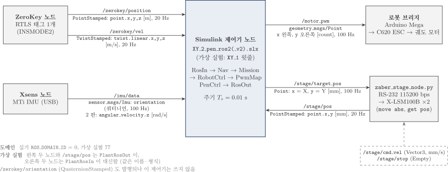
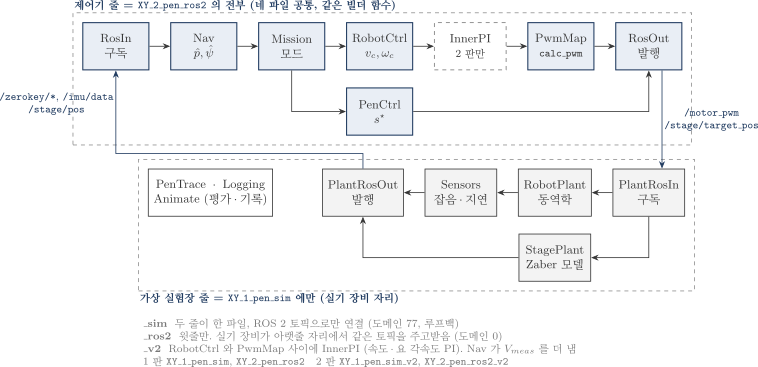
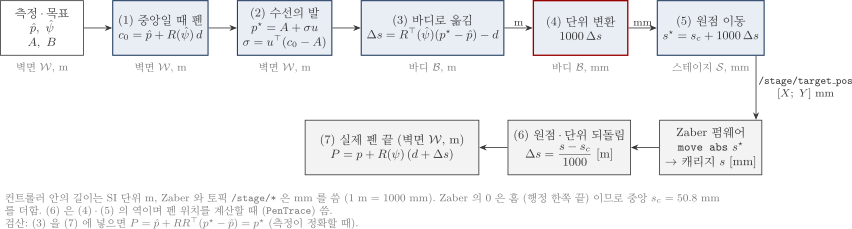
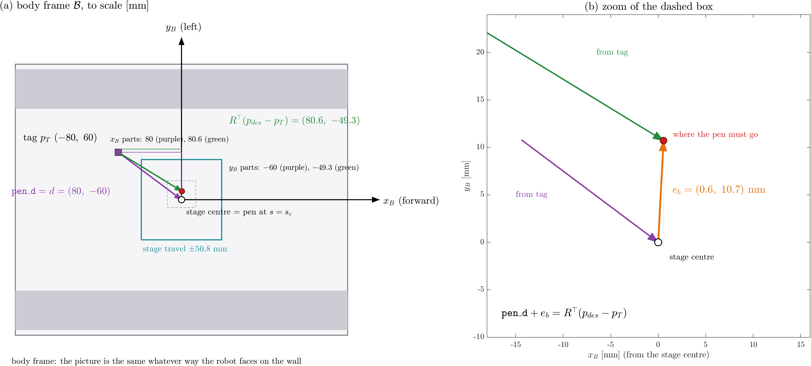
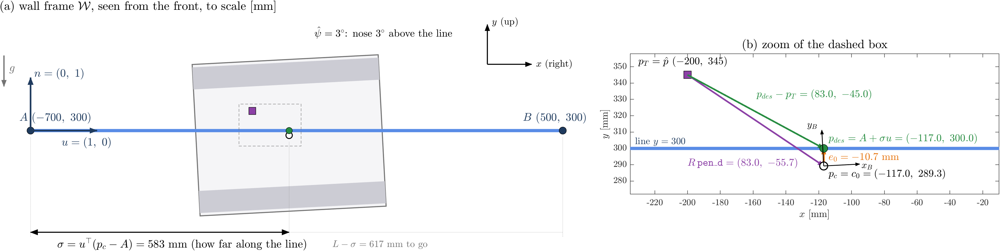
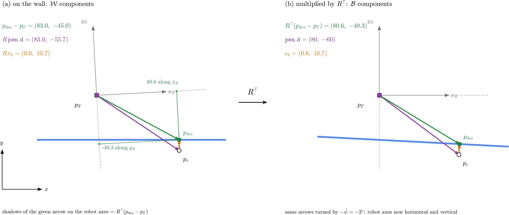
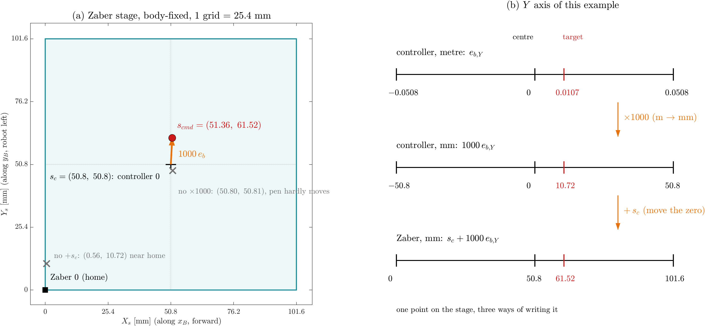
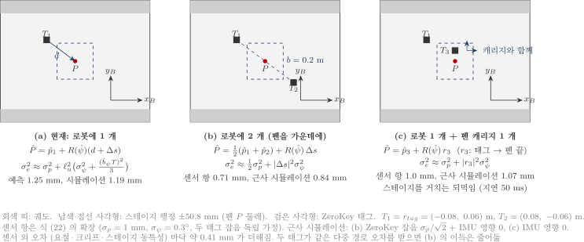
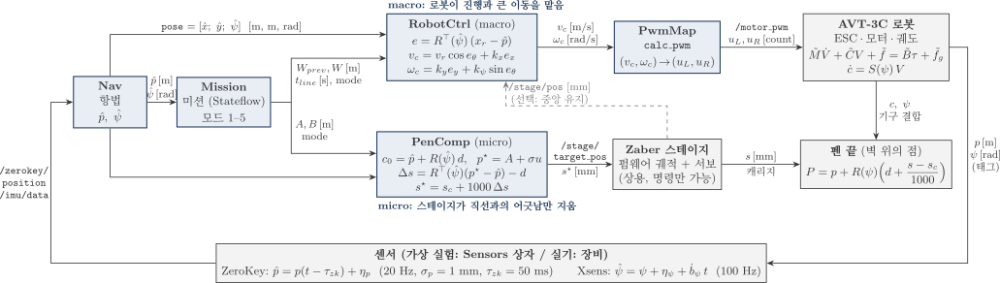

# AVT-3C 벽면 로봇 + Zaber XY 스테이지 직선 마킹: 원리·설계·구현 (Simulink ↔ ROS 2, 펜 기구학 보상)

- 작성: 충남대학교 자율운항시스템공학과 윤원근 교수
- 저장소: <https://github.com/wkyouncnu/AVT3C-XY-Stage-Pen>
- 매뉴얼(PDF): [docs/manual/AVT3C_XY_Stage_Pen.pdf](docs/manual/AVT3C_XY_Stage_Pen.pdf)


*그림 1. 시스템 구성. 왼쪽 로봇 위 장비, 가운데 NUC 의 ROS 2 노드, 오른쪽 Simulink 제어기*

## 초록

수직 철판 벽에 자석으로 붙어 움직이는 궤도 로봇 AVT-3C 위에 두 축 XY 스테이지를 얹고, 스테이지 끝의 마커로 벽에 길이 1.2 m 의 수평 직선을 긋는 문제를 다룬다. 궤도 로봇은 옆으로 움직일 수 없고 벽면에서 미끄러지며 heading 이 흔들리므로, 로봇만으로 그은 선은 시뮬레이션에서 횡오차 RMS 14.84 mm 를 보인다. 이 문서는 로봇이 진행과 큰 이동을 맡고 스테이지가 직선과의 어긋남만 지우는 거시–미시(macro–micro) 구조를 설명한다. 스테이지 명령은 측정된 로봇 자세로부터 기구학 관계를 거꾸로 풀어 얻는다(펜 기구학 보상). 펜 위치를 직접 측정하지 않으므로 정확도는 센서가 정하며, 같은 시뮬레이션에서 펜 횡오차는 RMS 1.17–1.20 mm 로 줄어든다. 오차의 가장 큰 원인은 ZeroKey 위치 잡음이다. 태그를 로봇 몸체에 펜을 가운데 두고 두 개 달면 근사 시뮬레이션에서 0.84 mm 까지 줄어든다. 스테이지는 내부 위치 서보를 바꿀 수 없는 상용품이므로, 설계 전체를 위치 명령과 위치 읽기만으로 구성하였다.

## 목차

- **제1부 원리**
    1. [서론](#1-서론)
    2. [시스템과 신호](#2-시스템과-신호)
    3. [좌표계와 회전행렬](#3-좌표계와-회전행렬)
    4. [제어 문제의 정식화](#4-제어-문제의-정식화)
    5. [거시 수준: 로봇 제어](#5-거시-수준-로봇-제어)
    6. [미시 수준: 펜 기구학 보상](#6-미시-수준-펜-기구학-보상)
    7. [측정 오차와 센서 배치](#7-측정-오차와-센서-배치)
- **제2부 상세 유도**
    8. [수학적 정식화 (상세 유도)](#8-수학적-정식화-상세-유도)
- **제3부 구현**
    9. [구현 개요](#9-구현-개요)
    10. [통신 구조](#10-통신-구조)
    11. [제어기 계층 구조](#11-제어기-계층-구조)
    12. [운동모델](#12-운동모델)
    13. [Simulink 모델 구성](#13-simulink-모델-구성)
    14. [Simulink 함수별 수식과 원리](#14-simulink-함수별-수식과-원리)
    15. [설치](#15-설치)
    16. [실행](#16-실행)
    17. [프로그램별 입출력](#17-프로그램별-입출력)
- **제4부 검증**
    18. [검증](#18-검증)
    19. [결과 요약](#19-결과-요약)
    20. [설계 선택 비교](#20-설계-선택-비교)
- **제5부 실기 적용**
    21. [실장비 적용](#21-실장비-적용)
    22. [실기 적용 절차와 점검 항목](#22-실기-적용-절차와-점검-항목)
    23. [문제 해결](#23-문제-해결)
    24. [확인 필요 사항](#24-확인-필요-사항)
    25. [결론](#25-결론)
- [참고문헌](#참고문헌)

---

# 제1부 원리

## 1. 서론

### 1.1 풀어야 할 문제

조선소 블록처럼 넓은 수직 철판에 표시선을 긋는 일은 사람이 사다리나 고소 작업대 위에서 줄자와 먹줄로 해 왔다. 벽에 붙어 움직이는 로봇이 이 일을 대신하려면, 로봇이 수 m 를 이동하면서도 선의 위치를 mm 수준으로 맞춰야 한다. 이 두 요구는 서로 성격이 다르다. 큰 범위의 이동에는 힘이 크고 느린 구동기가 맞고, mm 수준의 정밀 위치에는 범위가 좁고 빠른 구동기가 맞는다.

AVT-3C 는 자석 궤도로 철판에 붙는 궤도형(skid-steer) 로봇이다. 궤도 로봇은 좌우 궤도의 속도 차로 방향을 바꾸며, 차체 옆 방향으로는 직접 움직이지 못한다. 이런 구속을 비홀로노믹(nonholonomic) 구속이라 한다. 직선에서 옆으로 1 cm 벗어난 로봇은 그 1 cm 를 옆으로 미끄러져 돌아올 수 없고, 방향을 틀어 비스듬히 전진한 뒤 다시 방향을 바로잡아야 한다. 그 사이에 로봇은 수십 cm 를 진행하므로, 옆 방향 오차를 줄이는 속도는 근본적으로 느리다.

벽면은 이 문제를 더 어렵게 한다. 중력이 벽면 아래쪽으로 작용하므로 자석 궤도는 진행하는 동안 조금씩 아래로 미끄러진다(크리프). 궤도와 철판 사이의 요철은 heading 을 1–2° 흔든다. 시뮬레이션에서 이 외란을 넣으면 로봇의 직선 추종 횡오차는 RMS 23.6 mm 이고, 펜을 로봇에 고정한 채로 그은 선의 횡오차는 RMS 14.84 mm, 최대 19.6 mm 이다(18 장).

### 1.2 접근: 거시–미시 구조

이 문제의 해법은 사람이 글씨를 쓰는 방식과 닮았다. 팔은 종이 위에서 손을 크게 옮기고, 손가락은 펜 끝을 미세하게 조정한다. 팔의 움직임이 정확하지 않아도 손가락이 그 오차를 메우면 글씨는 바르게 써진다.

이 시스템에서 팔은 로봇이고 손가락은 Zaber X-LSM100B 두 축으로 된 XY 스테이지이다. 스테이지는 행정이 101.6 mm 로 좁지만, 최고속도 104 mm/s 로 빠르고 반복정밀도는 6 µm 이다. 로봇은 펜을 직선 근처로 데려가고 직선을 따라 진행시키며, 스테이지는 그 순간 로봇이 직선에서 벗어난 만큼만 펜을 반대로 옮긴다. 이 역할 분담을 거시–미시(macro–micro) 구조라 한다.

| 구분 | 로봇 (macro) | 스테이지 (micro) |
|---|---|---|
| 범위 | 벽 전체 (수 m) | ±50.8 mm |
| 자유도 | 전진 속도 $v$, 회전 속도 $\omega$ (옆으로 못 감) | 바디 좌표 X, Y 두 방향 |
| 빠르기 | 횡오차 수렴 시정수 약 8.5 s (5.2 절) | 위치 서보 수–20 Hz |
| 맡는 일 | 직선 방향 진행, 출발점 이동, 방향 맞추기 | 직선과의 어긋남 (횡오차 + heading 오차에 의한 펜 이동) |
| 명령 | `/motor_pwm` (좌우 모터 PWM) | `/stage/target_pos` (위치 [mm]) |

### 1.3 문서의 구성

2 장은 제어기가 무엇을 측정하고 무엇을 명령하는지를 정리한다. 3 장은 좌표계와 회전행렬을, 4 장은 제어 문제를 식으로 정의한다. 5 장은 로봇 쪽(거시) 제어를, 6 장은 스테이지 쪽(미시) 펜 보상을 유도한다. 6.5 절은 펜 보상 코드의 변수 하나하나를 바디 좌표 그림, 벽면 좌표 그림, 두 좌표를 합친 그림, 스테이지 눈금 그림으로 나누어 짚는다. 7 장은 측정 오차가 펜 오차로 전파되는 과정과 ZeroKey 태그 배치를 다룬다. 여기까지가 제1부(원리)이다.

제2부(8 장)는 같은 내용을 식 단위로 다시 유도하고 기호표·부호 점검·원 논문과의 차이를 개조식으로 모은다. 제3부(9–17 장)는 사양, ROS 2 토픽, 제어기 계층, 운동모델, Simulink 모델 구성과 함수 블록별 수식(14 장), 설치·실행·파라미터를 다룬다. 제4부(18–20 장)는 가상 실험 결과와 설계 선택 비교, 제5부(21–24 장)는 실장비 적용 절차·문제 해결·확인 필요 사항이다. 25 장에서 결론을 맺는다. 1–7 장과 8 장은 같은 대상을 서술형과 개조식으로 두 번 다루며, 서로 다른 그림과 수치 확인을 담고 있으므로 둘 다 남겼다.

---

## 2. 시스템과 신호

### 2.1 장비

| 장비 | 역할 | 연결 |
|---|---|---|
| AVT-3C | 자석 궤도 로봇, 외형 420 × 343 × 100 mm | Arduino Mega → C620 ESC 두 개 → 좌우 궤도 모터 |
| Zaber X-LSM100B-E03 × 2 | XY 스테이지. X 축이 아래, Y 축이 그 위에 얹힘. Y 캐리지에 마커 | NUC 에 RS-232 직결 (115200 bps) |
| ZeroKey RTLS 태그 1 개 | 로봇 위 한 점의 3 차원 위치 | 앵커 → ZeroKey 노드 |
| Xsens MTi IMU | 자세 쿼터니언, 각속도 | USB → Xsens 노드 |
| Intel NUC | ROS 2 Jazzy. 센서·스테이지·로봇 브리지 노드 실행 | – |
| Simulink 제어기 | 이 문서의 제어 법칙 전부 | ROS 2 토픽으로만 장비와 통신 |

### 2.2 입력: 제어기는 무엇을 측정하는가

제어기가 받는 정보는 네 개의 토픽뿐이다. 이 점을 정확히 이해하는 것이 알고리즘 이해의 출발점이다.

| 토픽 | 측정하는 것 | 단위 · 주기 | 제어기에서 쓰는 곳 |
|---|---|---|---|
| `/zerokey/position` | 로봇에 붙은 태그 한 점의 월드 좌표 $(x, y, z)$ | m, 20 Hz, 잡음 약 1 mm, 지연 약 50 ms | Nav 에서 벽면 위치 $\hat p = [s_x x;\ z]$ ($s_x$ = `zk_xsign`) |
| `/zerokey/vel` | 같은 태그의 속도 | m/s, 20 Hz | 지연 보상 (기본 꺼짐), 2 판 내부 PI |
| `/imu/data` | 자세 쿼터니언 (2 판은 자이로 $z$ 도) | –, 100 Hz | heading $\hat\psi$ (2 판: 요 각속도 $r$) |
| `/stage/pos` | 스테이지 두 축의 현재 위치 | mm, 20 Hz | 기본 설정에서는 쓰지 않음 (선택 기능·감시용) |

여기서 세 가지를 짚어 둔다. 첫째, ZeroKey 가 측정하는 점은 로봇 중심도 펜도 아닌 태그 한 점이다. 태그는 로봇 중심에서 $r_{tag} = (-0.08,\ 0.06)$ m 떨어져 있다. 둘째, 철판 벽 위에서는 자력계가 쓸모없으므로 IMU 의 요각은 절대 방위가 아니다. Nav 는 첫 샘플의 요각을 0 으로 잡고 출발 heading $\psi_0$ 를 더해 상대 요각을 쓴다. 따라서 시간이 지나면 드리프트가 쌓인다. 셋째, 펜 끝의 위치는 아무 센서도 측정하지 않는다. 펜 위치는 태그 위치, heading, 스테이지 위치로부터 기구학으로 계산되는 양이다. 이 사실이 6 장의 펜 보상이 앞먹임(feedforward) 구조가 되는 이유이고, 7 장에서 센서 오차가 펜 오차의 상한이 되는 이유이다.

### 2.3 출력: 제어기는 무엇을 명령하는가

| 토픽 | 명령 | 단위 | 받는 쪽 |
|---|---|---|---|
| `/motor_pwm` | $[u_L;\ u_R]$ 좌우 모터 펄스 폭 | count (= µs), 1500 정지, 1100–1900 | Arduino 브리지 → ESC |
| `/stage/target_pos` | $[s_X^{\star};\ s_Y^{\star}]$ 스테이지 목표 위치 | mm, 0–101.6 | `zaber_stage_node.py` → `move abs` |

명령은 모두 네 개이다. 그러나 좌우 PWM 두 개는 결국 로봇의 전진 속도 $v$ 와 회전 속도 $\omega$ 두 자유도를 정하므로, 제어기가 다루는 독립 입력은 $(v,\ \omega,\ s_X,\ s_Y)$ 네 개이다. 제어하려는 대상은 벽 위 펜 끝 한 점 $P = (P_1,\ P_2)$ 의 두 자유도이다. 입력이 출력보다 많으므로 같은 펜 궤적을 만드는 입력 조합은 무수히 많고, 이 여유를 어떻게 나눌지가 설계의 핵심이다. 1.2 절의 역할 분담이 그 답이다.

### 2.4 한 주기 (10 ms) 동안의 신호 흐름



*그림 2. ROS 2 노드와 토픽 (형식, 필드, 단위, 주기)*

Simulink 제어기는 10 ms 마다 다음을 순서대로 한다.

1. RosIn 이 네 토픽의 최신 값을 읽는다. ZeroKey 는 20 Hz 이므로 다섯 주기 동안 같은 값이 들어온다.
2. Nav 가 태그 위치와 heading 을 벽면 좌표 `pose` $= [\hat x;\ \hat y;\ \hat\psi]$ 로 만든다.
3. Mission 이 지금 어느 단계(모드)인지 정하고, 로봇이 따라갈 선분과 펜 직선을 낸다.
4. RobotCtrl 가 모드에 맞는 법칙으로 $(v_c,\ \omega_c)$ 를 계산하고, PwmMap 이 이를 좌우 PWM 으로 바꾼다.
5. PenCtrl 이 같은 `pose` 로 스테이지 목표 $s^{\star}$ 를 계산한다.
6. RosOut 이 `/motor_pwm` 과 `/stage/target_pos` 를 발행한다.

스테이지 노드는 100 Hz 로 들어오는 목표 중 마지막 값만 기억했다가 25 Hz 로 시리얼 `move abs` 를 보낸다. 시리얼 한 줄에 수 ms 가 걸리므로 100 Hz 로 모두 보내면 명령이 밀리기 때문이다.

### 2.5 Simulink 파일 네 개



*그림 3. 네 파일의 관계*

네 파일은 두 가지 기준으로 나뉜다. 첫째 기준은 실험장이다. 이름이 `_sim` 으로 끝나는 `XY_1_pen_sim` 은 제어기 아래에 가상 로봇(RobotPlant), 가상 센서(Sensors), 가상 스테이지(StagePlant)를 함께 담은 가상 실험 모델이다. 가상 장비는 실기 장비와 똑같은 이름·형식의 ROS 2 토픽을 발행하고 구독하며, 제어기와 가상 장비는 선으로 연결되지 않고 오직 토픽으로만 대화한다. 이름이 `_ros2` 로 끝나는 `XY_2_pen_ros2` 는 같은 빌더 함수로 만든 제어기 줄만 담고 있으며, 실제 NUC 의 노드들이 가상 장비 자리를 대신한다. 따라서 가상 실험에서 검증한 제어기가 글자 하나 바꾸지 않고 실기에 연결된다. 두 모델은 ROS 도메인(가상 77, 실기 0)을 달리하여, 가상 실험의 `/motor_pwm` 이 같은 망의 실제 로봇을 움직이지 않게 한다.

둘째 기준은 판이다. 1 판은 바깥 루프의 속도 명령 $(v_c,\ \omega_c)$ 를 비율만 맞춰 곧바로 PWM 으로 바꾼다. 2 판(`_v2`)은 그 사이에 실기 Xsens 모델과 같은 내부 PI 두 개를 둔다. 하나는 ZeroKey 속도로 잰 실제 전진 속도 $u_B$ 를 $v_c$ 에 맞추고, 다른 하나는 자이로로 잰 요 각속도 $r$ 을 $\omega_c$ 에 맞춘다. 내부 PI 는 로봇이 명령대로 움직이게 해 줄 뿐 펜 정확도를 바꾸지 않는다. 가상 실험에서 펜 RMS 는 1 판 1.17–1.20 mm, 2 판 1.21–1.24 mm 이다.

---

## 3. 좌표계와 회전행렬


*그림 4. (a) 벽면 좌표계와 heading, (b) 바디·스테이지 좌표계*

### 3.1 세 좌표계

벽면 좌표계 $\mathcal W$ 는 벽에 고정되어 있다. 벽을 정면에서 볼 때 $x$ 는 오른쪽(수평), $y$ 는 위(천장 방향), $z$ 는 벽 바깥이다. ROS REP-103 과 같은 오른손 좌표계이며, $z$ 가 로봇 바디의 $z_B$ 와 같은 방향이므로 $x$ 에서 $y$ 로 돌리는 반시계 각이 양의 heading 이 된다. 실기 Simulink 의 `plane_project` 는 높이를 $p_1$, 왼쪽 수평을 $p_2$ 로 두었으며 이 문서의 좌표와는 $x = -p_2$, $y = p_1$, $\psi = \psi_{old} + 90^{\circ}$ 의 관계가 있다. 바디 좌표계 $\mathcal B$ 는 로봇에 붙어 함께 움직이며 $x_B$ 가 전진, $y_B$ 가 로봇의 왼쪽이다. 스테이지 좌표계 $\mathcal S$ 는 바디 축과 평행하고 원점이 스테이지의 홈(행정 한쪽 끝)이며 단위가 mm 이다.

heading $\psi$ 는 $x$ 축에서 $x_B$ 축까지 반시계로 잰 각이다. 로봇이 오른쪽을 보면 $\psi = 0$, 천장을 보면 $+90^{\circ}$, 왼쪽을 보면 $180^{\circ}$ 이다. 이 문서의 직선은 $A = (-0.70,\ 0.30)$ m 에서 $B = (0.50,\ 0.30)$ m 로, 높이 0.30 m 에서 오른쪽으로 1.2 m 이므로 직선 방향은 $\theta_l = 0^{\circ}$ 이다.

### 3.2 회전행렬

바디 좌표로 쓴 벡터 $a_B$ 를 벽면 좌표로 옮기는 행렬이 회전행렬이다.

$$
R(\psi) = \begin{bmatrix} \cos\psi & -\sin\psi \\ \sin\psi & \cos\psi \end{bmatrix} = \begin{bmatrix} x_B & y_B \end{bmatrix}, \qquad a_W = R(\psi)\,a_B, \qquad a_B = R^{\top}(\psi)\,a_W \tag{1}
$$

| 기호 | 읽는 법 | 의미 |
|---|---|---|
| $R(\psi)$ | 알 프사이 | 바디 → 벽면 회전. 첫 열은 벽면 좌표로 쓴 $x_B$, 둘째 열은 $y_B$ |
| $R^{\top}(\psi)$ | 알 트랜스포즈 | 벽면 → 바디. 회전행렬은 직교행렬이므로 역행렬이 전치행렬 |
| $a_W,\ a_B$ | – | 같은 화살표를 벽면 좌표, 바디 좌표로 쓴 성분 |


*그림 5. 회전행렬의 열은 벽면 좌표로 쓴 바디 축이다*

첫 열이 $x_B$ 인 이유는 바디 벡터 $a_B = (1,\ 0)$, 즉 $x_B$ 방향 단위 벡터를 넣으면 $R a_B$ 가 첫 열이 되기 때문이다. 예를 들어 로봇이 오른쪽을 보는 $\psi = 0$ 에서 $R = I$ 이고, 천장을 보는 $\psi = 90^{\circ}$ 에서 $R = \begin{bmatrix} 0 & -1 \\ 1 & 0 \end{bmatrix}$ 이다. $\psi = 0$ 에서 첫 열 $(1,\ 0)$ 은 $x$ 방향, 즉 벽에서 오른쪽이므로 로봇의 전진 방향이 맞다. 둘째 열 $(0,\ 1)$ 은 $y$ 방향, 즉 위쪽이다. 오른쪽을 보는 로봇의 왼쪽은 위쪽이므로 이것도 맞다. 이 자세에서 스테이지 Y 축을 + 로 움직이면 펜은 벽에서 위로 올라간다. 이 대응은 6 장의 부호를 이해하는 데 그대로 쓰인다.

### 3.3 레버암

태그에서 "스테이지가 행정 가운데 있을 때의 펜" 까지의 벡터를 바디 좌표로 쓴 것을 레버암 $d$ 라 한다.

$$
d = r_{pen0} - r_{tag} = (0,\ 0) - (-0.08,\ 0.06) = (0.08,\ -0.06)\ \mathrm{m} \tag{2}
$$

$d$ 는 로봇에 고정된 값이므로 바디 좌표에서는 상수이지만, 벽면 좌표에서는 $R(\psi)\,d$ 로 heading 에 따라 방향이 바뀐다. heading 을 틀리게 알면 $R(\hat\psi)\,d$ 가 틀리고, 그 차이가 곧 펜 위치 오차가 된다(7 장).

---

## 4. 제어 문제의 정식화

### 4.1 펜 끝의 위치


*그림 6. 벽면 좌표계와 펜 보상 기하 (확대, 축척 아님)*

펜 끝 $P$ 는 태그 위치 $p$ 에서 출발해 레버암 $d$ 와 스테이지 캐리지 이동 $\Delta s$ 를 바디 좌표에서 더한 뒤 벽면으로 돌린 점이다.

$$
P = p + R(\psi)\,(d + \Delta s), \qquad \Delta s = \frac{s - s_c}{1000}\ [\mathrm{m}] \tag{3}
$$

| 기호 | 의미 | 단위 |
|---|---|---|
| $p$ | 태그 위치 (벽면) | m |
| $\psi$ | heading | rad |
| $d$ | 태그 → 중앙 펜 레버암 (바디) | m |
| $s$ | 스테이지 위치 (Zaber 좌표, 홈 = 0) | mm |
| $s_c$ | 행정 가운데, 50.8 mm | mm |
| $\Delta s$ | 가운데로부터의 캐리지 이동 (바디) | m |

### 4.2 목표

펜이 직선 $AB$ 위에 있다는 것은 펜의 직선 법선 방향 거리, 즉 횡오차가 0 이라는 뜻이다.

$$
e(t) = n^{\top}\big(P(t) - A\big) = 0, \qquad u = \frac{B - A}{\lVert B - A\rVert}, \quad n = J u, \quad J = \begin{bmatrix} 0 & -1 \\ 1 & 0 \end{bmatrix} \tag{4}
$$

$u$ 는 직선 방향 단위 벡터, $n$ 은 $u$ 를 반시계로 90° 돌린 법선(직선의 왼쪽, 이 직선에서는 위쪽)이다. 직선 방향으로는 펜이 $A$ 에서 $B$ 까지 지나가기만 하면 되므로 정확한 시각표는 요구하지 않는다. 즉 제어해야 할 것은 횡오차 $e$ 하나이고, 진행은 "언젠가 끝까지 가면 되는" 느슨한 조건이다.

### 4.3 두 구동기의 운동

로봇 중심 $c$ 와 heading 의 운동은 다음과 같다(외란과 회전 중심 이동은 8.2 절).

$$
\dot c = v \begin{bmatrix} \cos\psi \\ \sin\psi \end{bmatrix}, \qquad \dot\psi = \omega \tag{5}
$$

식 (5) 에 옆 방향 속도가 없다는 것이 비홀로노믹 구속이다. 로봇은 $x_B$ 방향으로만 움직이고 옆 방향 위치는 heading 을 바꿔야만 바뀐다. 반면 스테이지는 바디 좌표의 X, Y 를 독립적으로, 빠르게 움직이지만 $\lvert\Delta s_i\rvert \le 50.8$ mm 를 넘을 수 없다.

### 4.4 역할 분담의 근거

식 (3)–(5) 를 함께 보면 횡오차 $e$ 를 줄이는 방법은 두 가지이다. 로봇이 방향을 틀어 직선으로 돌아오거나, 스테이지가 펜을 직선 쪽으로 옮기는 것이다. 이 시스템은 둘을 다음과 같이 나눈다.

| 성분 | 담당 | 이유 |
|---|---|---|
| 직선 방향 진행 (1.2 m) | 로봇 $v$ | 스테이지 행정 101.6 mm 로는 불가능 |
| 횡오차의 느린 성분 (평균, 수 cm) | 로봇 $\omega$ | 스테이지가 행정 가운데에서 일하게 함 |
| 횡오차의 빠른 성분 (요철 0.35 Hz, 크리프, 잡음) | 스테이지 $\Delta s$ | 로봇의 횡방향 수렴이 수 초로 느림 |
| heading 오차가 레버암으로 만드는 펜 이동 | 스테이지 $\Delta s$ | 펜은 점이므로 방향은 상관없고 위치만 맞추면 됨 |

펜은 점이므로 펜의 "방향" 이라는 것은 없다. 따라서 heading 은 그 자체로 제어 목표가 아니며, 레버암을 통해 펜 위치에 영향을 주는 경로로만 의미가 있다. 로봇의 heading 이 직선과 3° 어긋나 있어도 스테이지가 그만큼 펜을 옮기면 선은 곧게 그어진다(6.4 절의 수치 예).

---

## 5. 거시 수준: 로봇 제어

### 5.1 임무 단계와 제자리 회전


*그림 7. 임무 단계 (Stateflow ModeChart)*

임무는 다섯 단계로 나뉘고 Stateflow 상태기계 ModeChart 가 단계를 바꾼다. 출발할 때 로봇은 직선에서 떨어진 곳 $(-0.85,\ 0.10)$ m 에서 천장을 보고 있다($\psi_0 = 90^{\circ}$).

모드 1(Goto_Start)에서 로봇은 직선을 시작하기 좋은 출발점으로 간다. 이때 목표는 태그가 아니라 로봇 중심의 출발점 $c_A$ 이다. 다음 단계의 제자리 회전은 로봇 중심을 축으로 돌기 때문에, 회전 뒤 태그가 정해진 출발점에 오려면 회전 전에 중심을 맞춰 두어야 한다. 태그 기준으로 가면 회전하는 동안 태그가 반경 0.1 m 원호를 그려 직선 시작점이 약 11 cm 어긋난다.

모드 2(Turning)에서 로봇은 전진 속도 0 으로 제자리에서 돌아 heading 을 직선 방향 $0^{\circ}$ 에 맞춘다. 제자리 회전은 이 단계에서만 쓰이며 펜은 아직 쓰지 않는다. 오차가 1° 이내로 1 s 이상 유지되면 다음 단계로 간다.

모드 3(Line_Tracking)에서 로봇은 30 mm/s 로 직선을 따라 진행하고, 동시에 스테이지가 펜 보상을 한다. 이 단계에도 회전 속도 명령 $\omega_c$ 가 나오지만 그것은 제자리 회전이 아니라 진행하면서 방향을 조금씩 바로잡는 조향이다. 로봇은 진행하면서 조향하고, 스테이지는 그래도 남는 어긋남을 지운다. 이것이 "회전도 하고 스테이지도 제어하는가" 라는 질문에 대한 답이다.

모드 4(Stop_Destination)에서 로봇은 끝점에 서고, 2 s 뒤 모드 5 에서 시뮬레이션이 끝난다. 펜은 모드 3 안에서 펜 목표가 $A$ 와 $B$ 사이에 있을 때만 내리는 것으로 평가한다. 실기에는 아직 펜 승강 장치가 없으므로 이 구간 판정은 기록용이다.

로봇이 따라가는 선분은 펜 직선과 같은 선이 아니다. 스테이지가 가운데 있을 때 펜이 직선 위에 오려면 태그는 직선에서 $-R(\theta_l)\,d$ 만큼 떨어진 평행선을 따라가야 한다. 또 펜이 $A$ 에 닿기 전에 로봇이 안정되도록 앞쪽으로 60 mm, 끝을 지나 40 mm 더 간다.

$$
r_A = A - R(\theta_l)\,d - 0.06\,u, \qquad r_B = B - R(\theta_l)\,d + 0.04\,u, \qquad c_A = r_A - R(\theta_l)\,r_{tag} \tag{6}
$$

### 5.2 직선 추종 법칙

모드 3 의 기준점 $x_r$ 은 시간에 따라 선분 위를 일정한 속도 $v_r$ 로 움직인다. 로봇은 이 기준점과의 차이를 바디 좌표로 본다.

$$
x_r(t) = r_A + v_r\,(t - t_{line})\,u, \qquad
\begin{bmatrix} e_x \\ e_y \end{bmatrix} = R^{\top}(\hat\psi)\,(x_r - \hat p), \qquad
e_\theta = \mathrm{wrap}(\theta_l - \hat\psi) \tag{7}
$$

$$
v_c = v_r \cos e_\theta + k_x\,e_x, \qquad \omega_c = k_y\,e_y + k_\psi \sin e_\theta \tag{8}
$$

$e_x$ 는 기준점이 로봇 앞쪽으로 얼마나 앞서 있는가이고, $e_y$ 는 기준점이 로봇 왼쪽으로 얼마나 떨어져 있는가이다. 로봇은 앞뒤 오차 $e_x$ 는 전진 속도로 직접 줄일 수 있지만, 옆 오차 $e_y$ 는 직접 줄일 수 없다. 그래서 $e_y$ 는 회전 명령 $\omega_c$ 로 들어간다. 기준점이 왼쪽에 있으면($e_y > 0$) 왼쪽으로 돌고, 방향이 틀어진 채로 전진하면서 옆 오차가 줄어든다.

이 과정이 왜 느린지는 직선 근처에서 식을 선형화하면 보인다. 직선에서 왼쪽으로 잰 로봇의 옆 위치를 $y_l$, 직선과의 방향 차를 $\phi = \psi - \theta_l$ 라 하면, 식 (5) 로부터 $\dot y_l = v\sin\phi \approx v_r\phi$, $\dot\phi = \omega$ 이다. 작은 오차에서 $e_y \approx -y_l$, $e_\theta \approx -\phi$ 이므로 식 (8) 은 $\omega = -k_y y_l - k_\psi\phi$ 가 되고, 닫힌 루프는 다음과 같다.

$$
\ddot y_l + k_\psi\,\dot y_l + v_r k_y\,y_l = 0, \qquad
\lambda = \frac{-k_\psi \pm \sqrt{k_\psi^2 - 4 v_r k_y}}{2} \tag{9}
$$

| 값 | 계산 | 결과 |
|---|---|---|
| $v_r k_y$ | 0.03 × 5.0 | 0.15 s⁻² |
| 근 $\lambda$ | $(-1.4 \pm \sqrt{1.96 - 0.60})/2$ | $-0.117$, $-1.283$ s⁻¹ |
| 느린 근의 시정수 | 1/0.117 | 8.5 s |

느린 근의 시정수가 8.5 s 이므로 로봇은 옆으로 벗어난 오차를 8.5 s 에 걸쳐서야 약 63 % 줄인다. 그 사이 로봇은 약 25 cm 를 진행한다. 진행 속도 $v_r$ 이 루프 이득에 곱해져 있으므로 천천히 갈수록 옆 오차는 더 느리게 줄어든다. 이것은 게인을 키워 해결할 수 있는 문제가 아니다. $k_y$ 를 두 배로 하면 로봇 RMS 는 23.6 mm 에서 17.1 mm 로 줄지만 heading 이 더 흔들려 펜 RMS 가 1.19 mm 에서 1.32 mm 로 늘어난다(18.5 절). 펜 정확도를 로봇에 맡기지 않고 스테이지에 맡기는 이유가 여기에 있다.

### 5.3 속도 명령에서 모터까지

PwmMap 의 `calc_pwm` 은 실기 Simulink 의 함수를 그대로 쓴다. 실기에서는 내부 PI 출력 $\bar V,\ \bar W \in [-0.5,\ 0.5]$ 가 이 함수에 들어가므로, 1 판은 속도 명령을 같은 범위로 정규화하여 넣는다.

$$
\bar V = \frac{v_c}{2 v_{full}}, \quad \bar W = \frac{\omega_c}{2\omega_{full}}, \qquad
T(\bar V) = d_v\tanh\frac{\bar V}{0.02} + (400 - d_v)\frac{\bar V}{0.5} \tag{10}
$$

$$
u_L = 1500 + T(\bar V) - T_s(\bar W), \qquad u_R = 1500 - \big(T(\bar V) + T_s(\bar W)\big) \tag{11}
$$

$T$ 의 첫 항은 0 근처에서 $d_v$ = 47 count 만큼 계단처럼 뛰어 ESC 의 데드존(작은 PWM 에서 모터가 돌지 않는 구간)을 건너뛰게 하는 역보상이고, 둘째 항은 나머지 범위를 선형으로 채운다. 회전 성분 $T_s$ 는 왼쪽에서 빼고 오른쪽에 더해 좌우 속도 차를 만든다. 오른쪽 모터는 거울 대칭으로 달려 있으므로 오른쪽 PWM 은 부호를 뒤집는다.

실기에서는 ESC 가 PWM 을 받아 모터 속도를 제어한다. 가상 실험의 RobotPlant 는 이 과정을 ESC 역변환, 0.15 s 1 차 지연, 속도 PI, 구동력 배분, 궤도 동역학의 순서로 모델링한다(14.4 절).

---

## 6. 미시 수준: 펜 기구학 보상

### 6.1 보상이 필요한 이유

5 장의 로봇 제어가 아무리 잘 되어도 로봇의 횡오차는 수 cm 이다. 스테이지를 가운데에 고정하면 펜은 로봇을 따라 그대로 흔들리고, 그은 선의 횡오차는 RMS 14.84 mm 이다. 이 오차의 원인은 세 가지이다. 첫째, 로봇이 직선에서 옆으로 벗어난다(크리프, 느린 횡방향 수렴). 둘째, heading 이 흔들리면 레버암 $d$ 를 통해 펜이 옆으로 움직인다. heading 1° 마다 약 1.4 mm 이다(8.6.5 절). 셋째, 로봇이 비스듬히 진행하는 동안 펜도 비스듬히 지나간다. 세 원인 모두 "지금 로봇이 어디에 어떤 방향으로 있는가" 를 알면 계산할 수 있는 양이므로, 스테이지가 그만큼 펜을 반대로 옮기면 된다. 이것이 펜 기구학 보상이다.

### 6.2 유도

식 (3) 에서 펜이 가야 할 벽면 위치 $p^{\star}$ 가 정해지면, 필요한 캐리지 이동은 식 (3) 을 $\Delta s$ 에 대해 풀어 얻는다.

$$
p^{\star} = \hat p + R(\hat\psi)\,(d + \Delta s)
\quad\Longrightarrow\quad
\Delta s = R^{\top}(\hat\psi)\,(p^{\star} - \hat p) - d \tag{12}
$$

$R$ 이 직교행렬이므로 양변에 $R^{\top}$ 을 곱하면 바로 풀린다. 측정값 $\hat p,\ \hat\psi$ 를 쓰는 이유는 제어기가 아는 것이 측정값뿐이기 때문이다.

남은 문제는 $p^{\star}$ 를 어디로 둘 것인가이다. 펜이 직선 위의 어느 점에 있어야 하는지는 4.2 절에서 보았듯 정해져 있지 않다. 직선 방향 위치는 로봇이 진행하며 정하고, 스테이지는 직선과의 어긋남만 지우면 된다. 그러므로 스테이지가 가운데일 때의 펜 위치 $c_0$ 에서 직선에 수선을 내린 발을 목표로 한다.

$$
c_0 = \hat p + R(\hat\psi)\,d, \qquad \sigma = u^{\top}(c_0 - A), \qquad p^{\star} = A + \sigma u \tag{13}
$$

$\sigma$ 는 $c_0$ 의 직선 방향 위치, 곧 직선 위 진행 거리이다. $p^{\star}$ 는 $c_0$ 와 직선 방향 위치가 같고 횡오차만 0 인 점이다. 이렇게 하면 스테이지는 직선에 수직한 방향으로만, 횡오차의 크기만큼만 움직인다. 만약 $p^{\star}$ 를 직선 위의 특정 점(예를 들어 시간에 따라 움직이는 기준점)으로 두면, 로봇의 진행 오차 수 cm 까지 스테이지가 메우려 해서 행정이 모자란다. 실제로 초기 판에서 $p^{\star}$ 를 $A$ 로 자르자 모드 3 시작 때 스테이지 X 가 95 mm 근처까지 갔다.

식 (12) 에 $p^{\star} - c_0 = -e_0\,n$ ($e_0$ 는 보상 없는 횡오차) 을 넣으면 다음 간단한 형태가 나온다.

$$
\Delta s = -e_0\,R^{\top}(\hat\psi)\,n = -e_0 \begin{bmatrix} \sin(\hat\psi - \theta_l) \\ \cos(\hat\psi - \theta_l) \end{bmatrix} \tag{14}
$$

로봇이 직선과 나란하면($\hat\psi = \theta_l$) $\Delta s = (0,\ -e_0)$ 이다. 즉 Y 축만 횡오차만큼 반대로 움직인다. 로봇이 3° 기울어 있으면 X 축이 $e_0\sin 3^{\circ}$ 만큼 함께 움직여, 기울어진 Y 축 대신 벽에 수직한 방향으로 펜을 옮긴다. 가상 실험에서 X 축은 51.0–53.8 mm 로 거의 움직이지 않고 Y 축이 61.3–72.2 mm 로 횡오차를 지운 것이 이 식과 맞는다.

### 6.3 1000 과 $s_c$ 의 의미



*그림 8. PenComp 계산 순서와 각 단계의 좌표계·단위*

식 (12) 의 $\Delta s$ 는 바디 좌표의 m 단위 벡터이다. 그런데 Zaber 펌웨어와 `/stage/target_pos` 토픽은 mm 를 쓰고, 원점이 행정의 한쪽 끝(홈)이다. 그래서 스테이지 명령은 두 단계를 더 거친다.

$$
s^{\star} = s_c + 1000\,\Delta s \quad [\mathrm{mm}], \qquad s_c = 50.8\ \mathrm{mm} \tag{15}
$$

1000 은 m 를 mm 로 바꾸는 단위 변환 계수이다($1\ \mathrm{m} = 1000\ \mathrm{mm}$). 제어기 안에서는 모든 길이를 SI 단위인 m 로 계산하고, 스테이지와 주고받는 경계에서만 mm 로 바꾼다. $s_c$ 는 원점 이동이다. 제어기의 $\Delta s = 0$ 은 "스테이지 가운데" 를 뜻하지만 Zaber 의 0 은 "홈 쪽 끝" 이므로, 가운데 위치 50.8 mm 를 더해야 같은 지점을 가리킨다. 반대로 펜 위치를 계산할 때(평가용 PenTrace)는 식 (3) 처럼 $s_c$ 를 빼고 1000 으로 나눈다. 예를 들어 Y 축 명령 61.52 mm 는 가운데에서 10.72 mm, 즉 0.01072 m 왼쪽이다.

### 6.4 수치 예


*그림 9. 펜 보상 수치 예. (a) 벽면, (b) 스테이지 명령, (c) 계산 순서*

직선 추종 중 측정 $\hat p = (-0.200,\ 0.345)$ m, $\hat\psi = 3^{\circ}$ 인 순간을 보자. 로봇은 직선 방향 $0^{\circ}$ 보다 코가 3° 위를 향한다. 레버암을 벽면으로 돌리면 $R d = (0.0830,\ -0.0557)$ m 이고, 스테이지 가운데일 때의 펜은 $c_0 = (-0.1170,\ 0.2893)$ m 이다. 직선의 높이는 0.30 m 이므로 펜은 직선보다 10.7 mm 아래에 있다($e_0 = -0.0107$ m). 수선의 발은 $p^{\star} = (-0.1170,\ 0.3000)$ m 이다. 식 (12) 로 계산하면 $\Delta s = (0.0006,\ 0.0107)$ m 이고, 식 (14) 의 $-e_0[\sin 3^{\circ},\ \cos 3^{\circ}] = (0.00056,\ 0.01069)$ m 와 같다. 스테이지 명령은 $s^{\star} = (51.36,\ 61.52)$ mm 이다. 오른쪽을 보는 로봇의 $y_B$ 는 위쪽이므로, Y 축이 10.7 mm 늘어나면 펜이 위로 10.7 mm 올라가 직선에 놓인다.

### 6.5 그림으로 읽는 펜 보상

6.2–6.4 절의 식은 Simulink 블록 PenComp 안에서 아래 코드가 된다. 이 절은 6.4 절의 수치 예($\hat p = (-0.200,\ 0.345)$ m, $\hat\psi = 3^{\circ}$, $A = (-0.70,\ 0.30)$ m, $B = (0.50,\ 0.30)$ m)를 그대로 써서, 코드의 변수 하나하나가 그림의 어디를 가리키는지 보인다. 그림은 네 장이다. 바디 좌표만 그린 그림(그림 10), 벽면 좌표만 그린 그림(그림 11), 같은 화살표를 두 좌표로 나란히 그린 합친 그림(그림 12), 그리고 결과를 Zaber 숫자로 바꾸는 그림(그림 13)이다. 네 그림 모두 실제 축척이며 길이 단위는 mm 이다.

```matlab
A = lineAB(1:2);  B = lineAB(3:4);
L = norm(B - A);  u = (B - A) / max(L, 1e-9);
pT = pose(1:2);
R  = [cos(pose(3)) -sin(pose(3)); sin(pose(3)) cos(pose(3))];
pc = pT + R * pen_d;                 % 스테이지 중앙일 때 펜 위치
sigma = dot(u, pc - A);              % 직선 위 진행 거리
pen_on = 0;
s_cmd = [stage_c; stage_c];
if round(mode) == 3
    p_des = A + sigma * u;
    e_b = R' * (p_des - pT) - pen_d;   % 바디 좌표 펜 이동량 [m]
    s_cmd = stage_c + 1000 * e_b;
    pen_on = double(sigma >= 0 && sigma <= L);
end
```

코드의 변수와 본문 기호는 다음과 같이 대응한다.

| 코드 | 본문 기호 | 뜻 |
|---|---|---|
| `pT` | $\hat p$ | ZeroKey 가 잰 태그 위치 (벽면) |
| `pen_d` | $d$ | 태그에서 스테이지 가운데의 펜까지 레버암 (바디) |
| `pc` | $c_0$ | 스테이지를 가운데에 두었을 때 펜이 닿는 점 (벽면) |
| `sigma` | $\sigma$ | 직선 위 진행 거리 |
| `p_des` | $p^{\star}$ | 펜 목표, $c_0$ 에서 직선에 내린 수선의 발 (벽면) |
| `e_b` | $\Delta s$ | 스테이지가 펜을 가운데에서 옮겨야 할 양 (바디, m) |
| `stage_c` | $s_c$ | 스테이지 가운데의 Zaber 눈금 50.8 mm |
| `s_cmd` | $s^{\star}$ | Zaber 에 보내는 위치 명령 (mm) |

#### 6.5.1 코드 한 줄과 그림의 대응

| 코드 | 그림에서 | 의미와 이 예의 값 |
|---|---|---|
| `A = lineAB(1:2); B = lineAB(3:4)` | 그림 11(a) 파란 직선의 양 끝 | 그어야 할 직선의 시작점 $(-700,\ 300)$ mm 와 끝점 $(500,\ 300)$ mm |
| `L = norm(B - A)` | $A$ 에서 $B$ 까지 길이 | 1200 mm |
| `u = (B - A)/L` | 그림 11(a) $A$ 에서 오른쪽으로 나가는 남색 화살표 | 직선 방향의 단위 벡터 $(1,\ 0)$. 길이 $L$ 로 나누어 방향만 남긴다 |
| `pT = pose(1:2)` | 보라 사각형 | ZeroKey 가 잰 태그 위치 $(-200,\ 345)$ mm |
| `R = [cos -sin; sin cos]` | 그림 12(a) 회색 $x_B$, $y_B$ 축 | 바디 화살표를 벽면 화살표로 돌리는 행렬. 이 예에서 $3^{\circ}$ 회전 |
| `pc = pT + R*pen_d` | 그림 11(b) 흰 원 | 그림 10 의 보라 화살표 `pen_d` 를 로봇 방향만큼 돌려 태그에 붙인 끝점. 스테이지가 가운데일 때 펜이 닿는 곳 $(-117.0,\ 289.3)$ mm |
| `sigma = dot(u, pc - A)` | 그림 11(a) 아래 치수선 | $A$ 에서 $p_c$ 까지 화살표를 직선 방향으로만 잰 길이 583 mm. 내적은 화살표의 그림자 길이를 재는 계산이다 |
| `p_des = A + sigma*u` | 그림 11(b) 초록 원 | $A$ 에서 직선을 따라 $\sigma$ 만큼 간 점 $(-117.0,\ 300.0)$ mm. $p_c$ 에서 직선에 수직으로 내린 발과 같다 |
| `R'*(p_des - pT)` | 그림 10(a) 초록 화살표 | 태그에서 $p_{des}$ 까지 화살표를 바디 눈금으로 다시 읽은 값 $(80.6,\ -49.3)$ mm |
| `e_b = R'*(p_des - pT) - pen_d` | 그림 10(b) 주황 화살표 | 초록 화살표에서 보라 화살표를 뺀 나머지 $(0.6,\ 10.7)$ mm. 펜을 가운데에서 옮겨야 할 양 |
| `s_cmd = stage_c + 1000*e_b` | 그림 13(a) 빨간 원 | m 를 mm 로 바꾸고 Zaber 눈금으로 옮긴 값 $(51.36,\ 61.52)$ mm |
| `pen_on = (0 ≤ sigma ≤ L)` | 그림 11(a) 치수선 끝이 $A$–$B$ 사이인가 | $0 \le 583 \le 1200$ 이므로 1, 곧 펜을 내린다 |

#### 6.5.2 바디 좌표만 보기: `pen_d` 와 `e_b`



*그림 10. 바디 좌표에서 본 `pen_d`, $R^{\top}(p_{des} - p_T)$, `e_b`. (a) 로봇 전체 (실제 축척), (b) 스테이지 가운데 확대*

그림 10 는 로봇 위에 올라타서 본 그림이다. 바디 좌표는 로봇과 함께 돌기 때문에 로봇이 벽에서 어느 쪽을 보든 이 그림의 회색 차체, 태그, 스테이지는 같은 자리에 있다. 가로가 전진 방향 $x_B$, 세로가 로봇의 왼쪽 $y_B$ 이다.

| 그림에서 | 기호 | 값 [mm] | 뜻 |
|---|---|---|---|
| 보라 사각형 | $p_T$ (태그) | 바디 $(-80,\ 60)$ | ZeroKey 가 실제로 재는 점. 로봇 중심도 펜도 아니다 |
| 흰 원 | 스테이지 가운데 | 바디 $(0,\ 0)$ | $s = s_c$ 일 때 펜 끝이 있는 곳 |
| 청록 사각형 | 스테이지 행정 | $\pm 50.8$ | 펜이 바디에 대해 움직일 수 있는 범위 |
| 보라 화살표 | `pen_d` $= d$ | $(80,\ -60)$ | 태그에서 스테이지 가운데의 펜까지. 장착으로 정해지는 상수이며 제어기가 바꿀 수 없다 |
| 초록 화살표 | $R^{\top}(p_{des} - p_T)$ | $(80.6,\ -49.3)$ | 태그에서 펜이 가야 할 곳까지. 측정과 직선으로 정해지며 매 주기 바뀐다 |
| 빨간 원 | 펜 목표 | $(0.6,\ 10.7)$ | 초록 화살표의 끝 |
| 주황 화살표 | `e_b` $= \Delta s$ | $(0.6,\ 10.7)$ | 스테이지 가운데에서 펜 목표까지. 스테이지가 펜을 옮길 양 |

세 화살표는 삼각형을 이룬다. 태그에서 펜 목표까지 가는 길은 두 가지이다. 초록 화살표로 곧장 가거나, 보라 화살표로 스테이지 가운데까지 간 뒤 주황 화살표로 펜 목표까지 가는 것이다. 두 길의 끝이 같으므로

$$
\underbrace{d}_{\text{보라}} + \underbrace{e_b}_{\text{주황}} = \underbrace{R^{\top}(\hat\psi)\,(p^{\star} - \hat p)}_{\text{초록}}
\quad\Longrightarrow\quad
e_b = R^{\top}(\hat\psi)\,(p^{\star} - \hat p) - d \tag{16}
$$

이다. 곧 `e_b` 는 "가야 할 화살표에서, 로봇에 원래 붙어 있는 화살표를 뺀 나머지" 이다. 그림 10(a) 의 점선은 두 화살표의 성분을 나누어 보인다. $x_B$ 성분은 보라 80, 초록 80.6 이므로 차이 0.6 mm, $y_B$ 성분은 보라 $-60$, 초록 $-49.3$ 이므로 차이 10.7 mm 이다. 이 두 차이가 `e_b` 의 두 성분이다. 그림 10(b) 는 차이가 작아 (a) 에서 잘 보이지 않는 주황 화살표를 확대한 것이다.

이 뺄셈을 바디 좌표에서 하는 이유는 `pen_d` 가 바디 좌표로 주어진 양이고, 스테이지의 두 축 $X_s$, $Y_s$ 도 바디 축 $x_B$, $y_B$ 에 붙어 있기 때문이다. 같은 좌표로 쓴 화살표끼리만 성분별로 빼거나 더할 수 있다. 벽면 좌표의 화살표 $p^{\star} - \hat p$ 를 먼저 바디 좌표로 바꾸어야 하는 이유가 여기에 있으며, 그 일을 $R^{\top}$ 이 맡는다(6.5.4 절).

#### 6.5.3 벽면 좌표만 보기: $u$, $\sigma$, $p_c$, $p_{des}$



*그림 11. 벽면 좌표에서 본 직선과 펜 목표. (a) 직선 전체와 진행 거리 $\sigma$ (실제 축척), (b) 점선 상자 확대*

그림 11 은 벽을 정면에서 본 그림이다. $x$ 는 오른쪽, $y$ 는 위이며 중력 $g$ 는 $-y$ 방향이다. 로봇은 오른쪽(직선 방향)을 보고 코가 $3^{\circ}$ 위로 들려 있다.

| 그림에서 | 기호 | 값 [mm] | 뜻 |
|---|---|---|---|
| 파란 선, 남색 점 | $A$, $B$ | $(-700,\ 300)$, $(500,\ 300)$ | 그어야 할 직선 |
| $A$ 의 가로 화살표 | $u$ | $(1,\ 0)$ | 직선 방향 단위 벡터 |
| $A$ 의 세로 화살표 | $n = Ju$ | $(0,\ 1)$ | 직선 법선. 횡오차를 재는 방향 (위가 +) |
| 보라 사각형 | $p_T = \hat p$ | $(-200,\ 345)$ | ZeroKey 측정 |
| 보라 화살표 (b) | $R\,d$ | $(83.0,\ -55.7)$ | 그림 10 의 `pen_d` 를 벽면 좌표로 돌린 것 |
| 흰 원 | $p_c = c_0$ | $(-117.0,\ 289.3)$ | 스테이지가 가운데일 때 펜이 닿는 점 |
| 아래 치수선 | $\sigma$ | 583 | $A$ 에서 $p_c$ 까지를 직선 방향으로 잰 거리. 펜이 직선을 따라 얼마나 왔는지 |
| 초록 원 | $p_{des} = p^{\star}$ | $(-117.0,\ 300.0)$ | $A + \sigma u$. $p_c$ 와 직선 방향 위치가 같고 직선 위에 있는 점 |
| 초록 화살표 (b) | $p_{des} - p_T$ | $(83.0,\ -45.0)$ | 태그에서 펜 목표까지 (벽면 성분) |
| 주황 화살표 (b) | $-e_0\,n$ | $(0,\ 10.7)$ | $p_c$ 에서 $p_{des}$ 까지. 보상 없는 횡오차 $e_0 = -10.7$ mm 를 지우는 이동 |

$p_{des}$ 를 수선의 발로 잡는 것은 일을 나누기 위해서이다. 직선을 따라 어디까지 왔는지($\sigma$)는 로봇이 진행하며 정하는 몫이므로 스테이지는 그 방향을 건드리지 않는다. 스테이지는 직선에서 위아래로 어긋난 10.7 mm 만 지운다. 만약 $p_{des}$ 를 $A$ 처럼 직선 위의 고정된 점으로 잡으면 스테이지가 수십 cm 의 진행 거리까지 메우려 하다 행정 101.6 mm 끝에 부딪힌다. 코드 주석의 "A 로 자르면 행정 끝에 닿는다" 가 이 뜻이다.

#### 6.5.4 합쳐 보기: 같은 삼각형을 두 좌표로 읽기



*그림 12. 같은 세 화살표를 (a) 벽면 성분과 (b) 바디 성분으로 읽기. 가운데 화살표 $R^{\top}$ 이 (a) 를 (b) 로 바꾼다*

그림 12 의 두 그림은 같은 화살표 세 개를 그린 것이다. 다른 것은 눈금뿐이다. (a) 는 벽의 눈금($x$ 오른쪽, $y$ 위)으로 읽고, (b) 는 로봇의 눈금($x_B$ 전진, $y_B$ 왼쪽)으로 읽는다. (b) 는 (a) 를 $-\hat\psi = -3^{\circ}$ 만큼 돌린 그림이므로 로봇 축이 가로·세로가 되고 직선이 $3^{\circ}$ 기울어 보인다.

| 화살표 | (a) 벽면 성분 [mm] | (b) 바디 성분 [mm] | 바꾸는 식 |
|---|---|---|---|
| 초록: 태그 → 펜 목표 | $p_{des} - p_T = (83.0,\ -45.0)$ | $(80.6,\ -49.3)$ | $R^{\top}(p_{des} - p_T)$ |
| 보라: 태그 → 스테이지 가운데 | $R\,d = (83.0,\ -55.7)$ | $d = (80,\ -60)$ | $R^{\top}(R\,d) = d$ |
| 주황: 스테이지 가운데 → 펜 목표 | $R\,e_b = (0.0,\ 10.7)$ | $e_b = (0.6,\ 10.7)$ | $R^{\top}(R\,e_b) = e_b$ |

$R^{\top}$ 이 하는 일은 그림 12(a) 의 초록 점선으로 볼 수 있다. 초록 화살표의 끝에서 로봇 축 $x_B$, $y_B$ 에 수직선을 내리면, 축 위에 생기는 그림자의 길이가 각각 80.6 mm 와 $-49.3$ mm 이다. 단위 벡터 $x_B = (\cos\hat\psi,\ \sin\hat\psi)$, $y_B = (-\sin\hat\psi,\ \cos\hat\psi)$ 와의 내적이 바로 그 그림자 길이이고, $R^{\top}$ 의 두 행이 $x_B^{\top}$ 와 $y_B^{\top}$ 이므로

$$
R^{\top}(p_{des} - p_T) =
\begin{bmatrix} x_B^{\top}(p_{des} - p_T) \\ y_B^{\top}(p_{des} - p_T) \end{bmatrix}
= \begin{bmatrix} 83.0\cos 3^{\circ} - 45.0\sin 3^{\circ} \\ -83.0\sin 3^{\circ} - 45.0\cos 3^{\circ} \end{bmatrix}
= \begin{bmatrix} 80.6 \\ -49.3 \end{bmatrix}\ \mathrm{mm} \tag{17}
$$

이다. 정리하면 식 (16) 는 세 단계로 읽힌다.

| 단계 | 계산 | 그림에서 |
|---|---|---|
| 1 | $p_{des} - p_T$ | 그림 11(b) 초록 화살표를 벽 눈금으로 잰다 |
| 2 | $R^{\top}(\cdot)$ | 같은 화살표를 로봇 눈금으로 다시 잰다 (그림 12(a) → (b)) |
| 3 | $-\,d$ | 로봇에 원래 붙어 있는 보라 화살표를 뺀다 (그림 10) |

같은 결과를 더 짧게 얻을 수도 있다. $p_c = p_T + R\,d$ 이므로 식 (16) 는 $e_b = R^{\top}(p_{des} - p_c)$ 와 같다. 곧 `e_b` 는 그림 11(b) 의 주황 화살표 $(0,\ 10.7)$ mm 를 로봇 눈금으로 다시 읽은 것이며, $(10.7\sin 3^{\circ},\ 10.7\cos 3^{\circ}) = (0.56,\ 10.69)$ mm 이다. 이것이 식 (14) 이다. 코드가 $p_c$ 를 거치지 않고 $p_T$ 에서 바로 계산하는 것은 같은 식을 다른 순서로 쓴 것일 뿐이다.

#### 6.5.5 `e_b` 를 Zaber 숫자로: 1000 과 `stage_c`



*그림 13. `e_b` 에서 `s_cmd` 까지. (a) 로봇에 붙은 Zaber 스테이지 위의 명령점, (b) Y 축 한 점의 세 가지 표기*

그림 13(a) 는 그림 10 의 청록 사각형(스테이지)을 키운 것이다. `e_b` 를 그대로 Zaber 에 보낼 수 없는 이유가 두 가지이므로, `s_cmd = stage_c + 1000*e_b` 에는 연산이 두 개 붙어 있다.

| 연산 | 필요한 이유 | 빠지면 생기는 일 |
|---|---|---|
| $\times 1000$ | 제어기 안은 모든 길이를 m 로 계산하고, Zaber 와 토픽 `/stage/target_pos` 는 mm 를 쓴다 | 0.0107 을 보내면 Zaber 는 0.0107 mm 로 받아들여 펜이 거의 움직이지 않는다 (그림 13(a) 가운데 회색 ×) |
| $+\,s_c$ | 제어기의 0 은 스테이지 가운데이고, Zaber 의 0 은 홈(행정의 모서리)이다 | 10.72 를 보내면 캐리지가 가운데보다 40 mm 아래인 홈 근처로 간다 (그림 13(a) 왼쪽 아래 회색 ×) |

그림 13(b) 는 Y 축의 같은 점을 세 가지 눈금으로 쓴 것이다. 제어기 m 눈금의 0.0107 은 1000 을 곱해 제어기 mm 눈금의 10.72 가 되고, 50.8 을 더해 Zaber 눈금의 61.52 가 된다. 세 눈금의 가운데(0, 0, 50.8)와 양 끝($\pm 0.0508$ m, $\pm 50.8$ mm, 0 과 101.6 mm)은 모두 같은 점이다. `stage_c` 는 "스테이지를 가운데에 두고 출발하여 양쪽으로 $\pm 50.8$ mm 씩 움직일 여유를 가진다" 는 설계를 Zaber 숫자로 옮긴 값이다. 모드 3 이 아닐 때 `s_cmd = [stage_c; stage_c]` 인 것도 같은 이유로, 직선을 긋지 않는 동안 스테이지를 가운데에 대기시킨다.

#### 6.5.6 결과 확인

| 확인 항목 | 계산 | 결과 |
|---|---|---|
| Y 축 이동 | $61.52 - 50.8$ | 10.72 mm. 이 자세의 $y_B$ 는 거의 위쪽이므로 펜이 벽에서 10.7 mm 위로 올라간다 |
| X 축 이동 | $51.36 - 50.8$ | 0.56 mm. 로봇이 $3^{\circ}$ 기울어 "벽의 위쪽" 과 "로봇의 왼쪽" 이 $3^{\circ}$ 어긋나므로 $10.7\sin 3^{\circ} \approx 0.56$ 만큼 앞으로도 옮겨야 펜이 똑바로 위로 간다 |
| 펜 끝 | $P = \hat p + R(\hat\psi)\,(d + e_b)$ | $(-117.0,\ 300.0)$ mm $= p_{des}$ |
| 횡오차 | $n^{\top}(P - A)$ | 0. 흰 원 $p_c$ 가 직선보다 10.7 mm 아래였으므로 펜이 정확히 초록 원, 곧 직선 위에 놓인다 |
| 진행 방향 | $u^{\top}(P - p_c)$ | 0. 스테이지는 직선 방향으로는 펜을 옮기지 않는다 |

### 6.6 상용 스테이지라는 제약

Zaber 스테이지는 내부 위치 서보(스테퍼 구동과 엔코더 보정)를 펌웨어가 수행하는 상용품이며, 외부에서는 그 제어 법칙을 바꿀 수 없다. 외부에서 할 수 있는 일은 목표 위치를 보내는 것(`move abs`), 현재 위치를 읽는 것(`get pos`), 최고속도(`maxspeed`)와 가감속(`accel`) 같은 설정값을 바꾸는 것뿐이다. 이 제약은 설계에 다음과 같이 반영되었다.

| 설계 결정 | 제약과의 관계 |
|---|---|
| 펜 보상의 출력은 위치 $s^{\star}$ 이다 | 위치 명령만 줄 수 있으므로, 속도·힘이 아니라 위치를 계산하는 기구학 보상으로 만들었다 |
| 스테이지 위치 루프를 따로 설계하지 않는다 | 펌웨어 서보의 정확도 45 µm, 반복정밀도 6 µm 는 센서 잡음 1 mm 보다 20 배 이상 작아, 명령한 위치에 있다고 보아도 된다 |
| 명령을 미리 포화·속도 제한한다 | PenCtrl 의 `Travel` (0–101.6 mm) 과 `CmdRate` (83 mm/s) 블록이 펌웨어 한계 안의 명령만 보내, 펌웨어 안에서 명령이 잘리는 일을 막는다 |
| 노드가 25 Hz 로 솎아 보낸다 | 시리얼 통신 시간 때문에 100 Hz 를 모두 보낼 수 없다 |
| `/stage/pos` 는 보상 계산에 쓰지 않는다 | 보상은 명령한 위치에 스테이지가 간다는 가정의 앞먹임이다. 읽은 위치는 감시, 평가, 선택 기능인 중앙 유지(8.10 절)에 쓴다 |
| 가상 실험의 StagePlant 는 펌웨어를 블랙박스로 모델링한다 | 사다리꼴 궤적(104 mm/s, 500 mm/s²) + 20 Hz 위치 서보 + 추력-속도 곡선 + 벽면 중력. 펌웨어 내부 구조는 모르므로 [실측 필요] 로 남긴다 |

스테이지가 충분히 빠른지는 로봇 외란의 빠르기와 비교하면 알 수 있다. 가장 빠른 외란인 궤도 요철은 0.35 Hz, 진폭 1.5° 이고, 레버암 0.08 m 에서 펜을 약 2 mm 흔든다. 이를 지우는 데 필요한 스테이지 속도는 $2\pi \times 0.35 \times 2 \approx 4.4$ mm/s 로, 최고속도 104 mm/s 의 4 % 에 불과하다. 실제로 스테이지 서보 대역을 20 Hz 에서 2 Hz 로, 명령 주기를 25 Hz 에서 5 Hz 로 낮춰도 펜 RMS 는 1.17–1.20 mm 로 같았다(20 장). 30 mm/s 진행에서는 스테이지의 빠르기가 병목이 아니다.

---

## 7. 측정 오차와 센서 배치

### 7.1 측정 오차의 전파

6 장의 보상은 펜을 측정하지 않고 측정된 로봇 자세로 펜 위치를 계산하므로, 측정이 틀린 만큼 펜이 직선에서 벗어난다. 위치 측정 오차를 $\delta p = \hat p - p$, heading 측정 오차를 $\delta\psi = \hat\psi - \psi$ 라 하면, 1 차 근사로 펜 횡오차는 다음과 같다(식 (40)–(42)).

$$
e \approx -\,n^{\top}\delta p \;-\; \ell_u\,\delta\psi, \qquad \ell_u = u^{\top}R(\psi)(d + \Delta s) \approx 0.08\ \mathrm{m} \tag{18}
$$

$$
\sigma_e^2 \approx \sigma_p^2 + \ell_u^2\left(\sigma_\psi^2 + \frac{(\dot b_\psi T)^2}{3}\right) = 1.0^2 + 0.42^2 + 0.63^2\ \mathrm{mm}^2, \qquad \sigma_e \approx 1.25\ \mathrm{mm} \tag{19}
$$

위치 오차는 직선 법선 성분이 그대로 펜 오차가 되고, heading 오차는 레버암의 직선 방향 성분 $\ell_u$ 를 곱해 펜 오차가 된다. 시뮬레이션의 펜 RMS 1.17–1.20 mm 는 이 예측과 같은 크기이다. 각 요인을 하나씩 없앤 시뮬레이션에서 ZeroKey 잡음을 0 으로 두면 0.74 mm 로 가장 크게 줄었고, 모든 센서를 이상적으로 두면 0.41 mm 가 남았다. 남은 0.41 mm 는 요철·크리프와 스테이지 동특성에서 오는 센서 외 오차이다. IMU 잡음이나 드리프트만 0 으로 두었을 때 오히려 1.28 mm 로 커진 결과는 아직 원인을 확인하지 못했다(18.5 절).

결론은 분명하다. 이 시스템의 정확도를 정하는 것은 제어 법칙이나 스테이지가 아니라 센서, 특히 ZeroKey 위치 잡음이다.

### 7.2 ZeroKey 태그 배치



*그림 14. ZeroKey 태그 배치 세 안 (위에서 본 로봇, 바디 좌표)*

지배 요인이 ZeroKey 이므로 태그를 하나 더 다는 것을 검토한다. 후보는 세 가지이다.

(a) 현재 구성은 로봇에 태그 하나 $T_1$ 이다. 펜 위치 추정에 태그 잡음 $\sigma_p$ 와 heading 오차 × 레버암이 모두 들어간다.

(b) 로봇 몸체에 두 번째 태그 $T_2$ 를 펜이 두 태그의 한가운데에 오도록 단다. 현재 배치에서는 $T_2 = -r_{tag} = (0.08,\ -0.06)$ m 이다. 강체 위 세 점이 한 직선 위에 있으면, 가운데 점의 위치는 heading 과 무관하게 두 점의 평균이다.

$$
c_0 = \tfrac12(p_1 + p_2) \quad\Rightarrow\quad \hat P = \tfrac12(\hat p_1 + \hat p_2) + R(\hat\psi)\,\Delta s, \qquad \sigma_e^2 \approx \tfrac12\sigma_p^2 + \lvert\Delta s\rvert^2\sigma_\psi^2 \tag{20}
$$

두 태그의 잡음이 독립이면 평균의 분산은 절반이 되고, heading 오차는 캐리지 이동 $\lvert\Delta s\rvert \approx$ 15 mm 에만 곱해지므로 0.1 mm 이하로 작아진다. 즉 heading 드리프트의 영향이 거의 사라진다. 더불어 두 태그를 잇는 기선 $b = 0.2$ m 로부터 heading 을 직접 얻을 수 있다. 그 잡음은 $\sqrt2\,\sigma_p/b \approx 0.41^{\circ}$ 로 IMU 보다 크지만 드리프트가 없으므로, IMU 와 상보 필터로 섞어 드리프트를 지우는 데 쓸 수 있다.

(c) 두 번째 태그 $T_3$ 를 스테이지 캐리지(펜 옆)에 단다. 펜 위치를 거의 직접 측정하므로 레버암 보정 오차, 스테이지 오차, 로봇 자세 오차가 모두 측정에 들어간다는 장점이 있다. 그러나 태그 잡음 $\sigma_p$ 가 그대로 남고, 측정한 펜 위치로 스테이지를 움직이는 순간 50 ms 지연을 품은 되먹임 루프가 생겨 루프 설계가 필요하다. 태그 무게가 Y 캐리지의 이동 질량(0.16 kg)에 더해지고, 마커와 벽 가까이에서 전파가 가려질 수도 있다.

세 안의 예측과 근사 시뮬레이션은 다음과 같다. 근사 시뮬레이션은 모델에 태그를 실제로 추가한 것이 아니라 등가 조건으로 바꾼 것이다. (b) 는 ZeroKey 잡음을 $\sigma_p/\sqrt2$ 로 하고 레버암을 통한 IMU 영향을 없앴으며, (c) 는 IMU 영향만 없앴다. 경우마다 2 회 실행하였고 두 실행의 차이는 0.01 mm 이하이다.

| 안 | 센서 항 예측 | 센서 외 오차 0.41 mm 포함 예측 | 근사 시뮬레이션 펜 RMS | 펜 최대 |
|---|---|---|---|---|
| (a) 로봇 1 개 (현재) | 1.25 mm | 1.31 mm | 1.19 mm | 3.9 mm |
| (b) 로봇 2 개, 펜을 가운데에 | 0.71 mm | 0.82 mm | 0.84 mm | 2.5 mm |
| (c) 로봇 1 개 + 캐리지 1 개 | 1.0 mm | 1.08 mm | 1.07 mm | 3.3 mm |

(b) 가 가장 정확하고 스테이지 쪽에 새로운 되먹임 루프를 만들지 않으므로 구현도 간단하다. 따라서 두 번째 태그는 펜 위가 아니라 로봇 몸체에, 펜을 두 태그 사이 한가운데에 두도록 다는 것이 낫다. 펜 위(캐리지) 태그는 레버암 $d$ 의 보정이나 결과 검증용으로 쓰는 것이 알맞다. 다만 이 비교는 두 태그의 잡음이 독립이라는 가정에 기댄다. 두 태그가 가까이 붙어 같은 다중 경로 오차를 받으면 (b) 의 이득은 줄어들므로, 실기에서 두 태그를 정지시켜 놓고 잡음의 상관을 먼저 재야 한다. 펜이 정확히 가운데가 아니면 식 (20) 의 평균 대신 가중 평균 $(1-\lambda)\hat p_1 + \lambda\hat p_2$ 를 쓰고, 그 분산은 $((1-\lambda)^2 + \lambda^2)\,\sigma_p^2$ 이다. 이 기능을 쓰려면 Nav 와 PenComp 에 두 번째 태그 입력을 추가해야 한다(현재 모델은 태그 1 개).

---

# 제2부 상세 유도

## 8. 수학적 정식화 (상세 유도)

- 운동모델은 Zou 등 (2018) [1] 의 궤도차량 동역학, 제어 구조는 Zou [1] 와 Sabiha 등 (2022) [2] 의 외부 기구학 루프 + 내부 속도 루프 형태를 따름
- 벽면 흡착, 중력, 원 논문 식의 부호 오류, 6WP_sim · 실기 모델의 제어 법칙에 맞춰 바꾼 부분은 각 절에 명시함
- 식 번호는 문서 전체에서 하나로 이어짐. 이 장의 식은 1–7 장의 해설을 개조식으로 다시 유도한 것이며, 마지막 식 (46) 은 21.2 절에서 씀

*(같은 그림: 그림 6)*

- 제어 구조와 신호 단위는 그림 15

### 8.0 그림 6 읽는 법

| 그림에서 | 의미 |
|---|---|
| 왼쪽 아래 축 | 벽면 좌표계 $\mathcal{W}$. 벽을 정면에서 본 그림이므로 $x$ 는 오른쪽, $y$ 는 위, $z_W$ 는 종이에서 나오는 방향 (⊙) |
| 가로축 방향 | 그림의 오른쪽이 $+x$. 직선 $A \to B$ 는 $+x$ 방향으로 진행 |
| 회색 사각형, $x_B$, $y_B$ | 로봇 차체와 바디 축. 이 그림의 로봇은 $\psi \approx -6^{\circ}$ (오른쪽을 보고 코가 약간 아래) |
| 검은 사각형 $p$ | ZeroKey 태그. 측정되는 점은 로봇 중심이 아니라 이 점 |
| 보라 화살표 $R(\psi)\,d$ | 태그에서 "스테이지가 중앙일 때의 펜" $c_0$ (흰 원) 까지의 레버암을 벽면 좌표로 쓴 것 |
| 초록 점선 사각형 | 스테이지 행정 ($c_0$ 를 중심으로 바디 축에 정렬) |
| 주황 화살표 $R(\psi)\,\Delta s$ | 스테이지 캐리지 이동이 벽면에서 펜을 옮기는 양 |
| 빨간 원 $P$ | 실제 펜 끝 |
| 남색 마름모 $p^{\star}$ | $c_0$ 를 직선에 내린 수선의 발 = 펜 목표 |
| 빨간 화살표 $e$ | 펜 횡오차. 직선에서 $n$ (위쪽) 방향으로 잰 거리 |
| 축척 | 레버암·스테이지는 읽기 쉽게 확대. 실제 비율은 그림 4 (b) 와 그림 9 (a) |

- 그림 6 는 펜이 아직 직선에 닿지 않은 중간 상태 ($P \ne p^{\star}$) 를 그린 것. 보상이 끝나면 $P = p^{\star}$

### 8.1 좌표계

| 좌표계 | 원점 | 축 (오른손 좌표계) | 단위 | 쓰는 곳 |
|---|---|---|---|---|
| 벽면 $\mathcal{W}$ | ZeroKey 원점 (벽 위 고정점) | $x$ 오른쪽 (벽 정면에서 볼 때), $y$ 위 (천장), $z_W$ 벽 밖 (보는 사람 쪽) | m | 태그 위치 $p$, 직선 $A$·$B$, 펜 $P$ |
| 바디 $\mathcal{B}$ | 로봇 중심 $c$ | $x_B$ 전진, $y_B$ 왼쪽 (로봇 기준), $z_B$ 벽 밖 | m | 태그 $r_{tag}$, 펜 $r_{pen,0}$, 레버암 $d$ |
| 스테이지 $\mathcal{S}$ | 행정의 모서리 ($s = (0,0)$) | $X_s \parallel x_B$, $Y_s \parallel y_B$ | mm | 스테이지 명령 $s$, 중앙 $s_c = (50.8, 50.8)$ |

*(같은 그림: 그림 4)*

- 오른손 규칙: $x \times y = z_W$ (벽 밖). 바디도 $x_B \times y_B = z_B$ (벽 밖). 로봇이 벽에 붙어 있으면 $z_B = z_W$ 이므로 IMU 요각과 $\psi$ 의 회전 방향이 같음
- 가로 $x$ 오른쪽, 세로 $y$ 위인 교과서 평면 그대로이므로 회전행렬도 교과서 형태 (8.1.2 절), 그림의 화면 좌표도 벽면 좌표 그대로 (`XY_plot`, `XY_animate`)
- ROS REP-103 의 규약 (바디 x 앞·y 왼쪽·z 위, 월드는 같은 쪽 z 의 오른손 좌표계) 과 같은 꼴
- 스테이지 축은 바디 축과 평행이고 원점만 다름: $\Delta s = (s - s_c)/1000$ 은 바디 좌표의 벡터 [m]

#### 8.1.1 heading $\psi$

- 정의: $x$ 축에서 $x_B$ 축까지 $z_W$ 둘레로 잰 각. 벽 정면에서 볼 때 반시계 방향이 $+$
- 범위: $(-\pi, \pi]$, 각 차이는 항상 $\mathrm{wrap}(\cdot)$ 으로 이 범위에 넣음

| $\psi$ | $x_B$ (로봇 앞) 이 향하는 곳 | $y_B$ (로봇 왼쪽) 이 향하는 곳 | 이 과제에서 |
|---|---|---|---|
| $0^{\circ}$ | 오른쪽 | 위 | 직선 추종 (모드 3) 중 heading |
| $+90^{\circ}$ | 위 (천장) | 왼쪽 | 출발 자세 ($\psi_0$) |
| $-90^{\circ}$ | 아래 | 오른쪽 | – |
| $\pm 180^{\circ}$ | 왼쪽 | 아래 | – |

- 그릴 직선 $A = (-0.70,\ 0.30) \to B = (0.50,\ 0.30)$: $u = (B - A)/\lVert B - A\rVert = [1,\ 0]^{\top}$ (오른쪽), 직선 각 $\theta_l = \mathrm{atan2}(u_2, u_1) = 0^{\circ}$, 법선 $n = Ju = [0,\ 1]^{\top}$ (위)
- 따라서 직선 추종 중 로봇의 왼쪽 ($y_B$) 이 천장을 향하고, 스테이지 $Y_s$ 가 늘면 펜이 위로 감

#### 8.1.2 회전행렬 유도

$x_B$ 는 $x$ 축을 $\psi$ 만큼 반시계로 돌린 단위벡터이고, $y_B$ 는 $x_B$ 를 다시 $+90^{\circ}$ 돌린 벡터.

$$
x_B^{\mathcal{W}} = \begin{bmatrix} \cos\psi \\ \sin\psi \end{bmatrix}, \qquad
y_B^{\mathcal{W}} = \begin{bmatrix} \cos(\psi + 90^{\circ}) \\ \sin(\psi + 90^{\circ}) \end{bmatrix} = \begin{bmatrix} -\sin\psi \\ \cos\psi \end{bmatrix}
$$

바디 좌표로 $v^{\mathcal{B}} = [a,\ b]^{\top}$ 인 벡터는 "앞으로 $a$, 왼쪽으로 $b$" 이므로 벽면 좌표로는 두 축벡터의 합.

$$
v^{\mathcal{W}} = a\,x_B^{\mathcal{W}} + b\,y_B^{\mathcal{W}}
= \underbrace{\begin{bmatrix} x_B^{\mathcal{W}} & y_B^{\mathcal{W}} \end{bmatrix}}_{R(\psi)} \begin{bmatrix} a \\ b \end{bmatrix},
\qquad
R(\psi) = \begin{bmatrix} \cos\psi & -\sin\psi \\ \sin\psi & \cos\psi \end{bmatrix}, \qquad
J = R(90^{\circ}) = \begin{bmatrix} 0 & -1 \\ 1 & 0 \end{bmatrix} \tag{21}
$$

*(같은 그림: 그림 5)*

| 성질 | 식 | 쓰는 곳 |
|---|---|---|
| 바디 → 벽면 | $v^{\mathcal{W}} = R(\psi)\,v^{\mathcal{B}}$ | 레버암 $R d$, 캐리지 이동 $R\,\Delta s$ (식 (33)) |
| 벽면 → 바디 | $v^{\mathcal{B}} = R^{\top}(\psi)\,v^{\mathcal{W}}$ ($R^{\top}R = I$, $\det R = 1$) | 스테이지 명령 $\Delta s$ (식 (34)), 바디 오차 $e_x, e_y$ (식 (31a)) |
| 각 합성 | $R(\alpha)R(\beta) = R(\alpha + \beta)$, $R^{\top}(\psi) = R(-\psi)$ | 식 (35) 의 $R^{\top}(\psi)\,n = R(\theta_l + 90^{\circ} - \psi)\,e_1$ |
| 미분 | $\dot R = \dot\psi\,\partial R/\partial\psi = \omega\,J R$ | 오차 전파 (식 (40)) |
| $+90^{\circ}$ 회전 | $J v$ = $v$ 를 왼쪽으로 돌린 벡터, $J^{\top}J = I$, $J^2 = -I$ | 직선의 왼쪽 법선 $n = Ju$ |

검산 ($\psi = 0^{\circ}$, 직선 추종 중 / $\psi = 90^{\circ}$, 출발 자세)

$$
R(0^{\circ}) = I:\quad
R\begin{bmatrix} 1 \\ 0 \end{bmatrix} = \begin{bmatrix} 1 \\ 0 \end{bmatrix}\ (\text{앞} = \text{오른쪽}), \qquad
R(90^{\circ}) = \begin{bmatrix} 0 & -1 \\ 1 & 0 \end{bmatrix}:\quad
R\begin{bmatrix} 1 \\ 0 \end{bmatrix} = \begin{bmatrix} 0 \\ 1 \end{bmatrix}\ (\text{앞} = \text{위})
$$

- 직선 추종 중 바디 왼쪽 1 mm 의 캐리지 이동 ($\Delta s_Y = +0.001$) 은 벽에서 펜을 위 ($+y$) 로 1 mm 옮김
- 바디 축과 벽면 축이 거의 나란하므로 직선 추종 중 $R \approx I$ 이고, $R$ 은 heading 오차 수 도만큼의 기울기만 바로잡음

#### 8.1.3 기호

| 기호 | 읽는 법 | 정의 | 단위 |
|---|---|---|---|
| $x,\ y$ | 엑스, 와이 | 벽면 좌표. $x$ = 수평 (벽 정면에서 오른쪽 +), $y$ = 높이 (천장 +) | m |
| $\psi$ | 프사이 | heading. $x$ 축에서 $x_B$ 축까지의 각 (오른쪽 0, 반시계 +) | rad |
| $R(\psi)$ | 알 프사이 | 바디 → 벽면 회전행렬 (식 (21)). $\dot R = \omega J R$ | – |
| $c$ | 씨 | 로봇 중심 위치 | m |
| $p$ | 피 | ZeroKey 태그 위치 $p = c + R(\psi)\,r_{tag}$ (식 (22a)) | m |
| $r_{tag},\ r_{pen,0}$ | – | 바디 좌표의 태그 위치, 스테이지 중앙일 때의 펜 위치 | $(-0.08,\ 0.06)$, $(0,\ 0)$ m |
| $q = [c^{\top},\ \psi]^{\top}$ | 큐 | 로봇 자세 | m, rad |
| $V = [v,\ \omega]^{\top}$ | 브이 | 전진 속도, 요 각속도 | m/s, rad/s |
| $A,\ B$ | 에이, 비 | 그릴 직선의 시작점·끝점 | m |
| $u,\ n$ | 유, 엔 | 직선 방향 단위벡터 $u = (B-A)/\lVert B-A\rVert$, 법선 $n = Ju$ | – |
| $d$ | 디 | 태그 → 펜 레버암 (바디) $d = r_{pen,0} - r_{tag}$ | m |
| $s,\ s_c$ | 에스 | 스테이지 위치 [X; Y], 중앙 50.8 mm | mm |
| $\Delta s$ | 델타 에스 | 캐리지 이동량 $(s - s_c)/1000$ | m |
| $P$ | 대문자 피 | 펜 끝 위치 | m |
| $e$ | 이 | 펜 횡오차 $e = n^{\top}(P - A)$ | m |

### 8.2 궤도 로봇 기구학

$$
\dot q = S(q)\,V + w(t), \qquad
S(q) = \begin{bmatrix} \cos\psi & u_c \sin\psi \\ \sin\psi & -u_c\cos\psi \\ 0 & 1 \end{bmatrix} \tag{22}
$$

$$
w(t) = \begin{bmatrix} -k_s\,\lvert v\rvert \\ 0 \\ \dot\psi_w(t) \end{bmatrix}, \qquad
\psi_w(t) = a_w \sin(2\pi f_w t) + \tfrac{1}{2} a_w \sin(2\pi\,2.3 f_w t + 1) \tag{23}
$$

| 기호 | 정의 | 값 |
|---|---|---|
| $u_c$ | 순간 회전 중심 (ICR) 의 길이방향 이동량. Zou [1] 식 (34) $u_c = -\mathrm{sgn}(\omega)\,R_t \sin\alpha$, $R_t = \lvert v/\omega\rvert$ | $\alpha = 0$ 이면 0 |
| $\alpha$ | 미끄럼각 (slip angle) | `alpha_s` = 0 |
| $k_s$ | 자석 궤도 크리프: 이동 속도에 비례한 중력 방향 미끄러짐 | 0.08 [실측 필요] |
| $a_w,\ f_w$ | 궤도 요철에 의한 heading 흔들림 진폭·주파수 | 1.5°, 0.35 Hz [실측 필요] |

- 식 (22) 는 Zou [1] 식 (37)–(39), Sabiha [2] 식 (37)–(38) 의 $S(q)$ 와 같은 형태 (제 3 성분을 $\psi$ 로 씀)
- 식 (23) 은 원 논문에 없는 벽면 외란. 수평 지면과 달리 중력이 진행 평면 안에 있어 궤도가 아래로 조금씩 밀리는 현상을 반영함

적분점과 태그 (2026-11-11 수정)

$$
\dot c = \text{식 (22) 의 위치 성분}, \qquad
p = c + R(\psi)\,r_{tag}, \qquad
\dot p = \dot c + \omega\,J R(\psi)\,r_{tag} \tag{22a}
$$

| 항목 | 이전 판 | 현재 판 |
|---|---|---|
| `RobotPlant` 적분 상태 | 태그 점 $p$ (태그가 회전 중심) | 로봇 중심 $c$ (원본 6WP_sim 과 같음), 초기값 `q0c` |
| 출력 `q_true` | 태그 자세 | 태그 자세 (블록 `TagPoint` 가 식 (22a) 로 변환) |
| ZeroKey 속도 (`ZkVel`) | $v\,[\cos\psi,\ \sin\psi]^{\top}$ | 식 (22a) 의 $\dot p$ (회전 성분 포함) |
| 제자리 회전 시 태그 | 거의 제자리 | 반경 $\lVert r_{tag}\rVert$ = 0.1 m 원호 (실기와 같음) |

- 펜 보상 (식 (33)–(35)) 은 측정 $\hat p,\ \hat\psi$ 와 $d$ 만 쓰므로 이 수정과 무관함
- 수정 직후 펜 오차가 RMS 3.46 mm, 최대 25.9 mm 로 커짐. 모드 1 이 태그를 출발점에 맞춘 뒤 모드 2 에서 약 70° 돌면 태그가 직선에서 약 11 cm 벗어나고, 모드 3 이 이를 고치는 동안 heading 이 −115° 까지 흔들린 채 펜이 내려갔기 때문. 실기에서도 같은 현상이 생김
- 대책: 모드 1 이 태그 대신 로봇 중심 추정 $\hat c = \hat p - R(\hat\psi)\,r_{tag}$ 을 출발 중심 $c_A = r_A - R(\theta_l)\,r_{tag}$ 로 보냄 (8.5 절). 회전 뒤 태그가 정확히 출발점 $r_A$ 에 옴 → 모드 3 시작 시 태그 높이 $y$ = 0.343 m (목표 0.360 m). 남은 17 mm 는 회전 중 크리프로 미끄러진 양이며, 수정 전 약 110 mm 에서 줄어듦
- 대책 후 결과는 18.3 절 (펜 RMS 1.17–1.20 mm)

### 8.3 동역학 (벽면판)

두 논문의 축약 동역학 (Zou 식 (33b), Sabiha 식 (29)) 에 벽면 흡착과 중력을 넣은 식. 제 2 속도 성분은 차원을 맞추기 위해 $L\omega$ 로 씀.

$$
\tilde M\,\dot\nu + \tilde C\,\nu + S^{\top}(f_1 + f_2) = \tilde B\,\tau + S^{\top} f_g, \qquad
\nu = \begin{bmatrix} v \\ L\omega \end{bmatrix},\quad \tau = \begin{bmatrix} F_r \\ F_l \end{bmatrix} \tag{24}
$$

$$
\tilde M = S^{\top} M S = m\begin{bmatrix} 1 & 0 \\ 0 & 1 + u_c^2/L^2 \end{bmatrix}, \quad
\tilde C = S^{\top} M \dot S, \quad
\tilde B = \begin{bmatrix} 1 & 1 \\ b/2L & -b/2L \end{bmatrix}, \quad
L = \sqrt{(l^2 + b^2)/12} \tag{25}
$$

$$
f_1 = \mu_l N \begin{bmatrix} \cos\psi \\ \sin\psi \\ 0 \end{bmatrix} \tanh\!\frac{v}{\varepsilon_v}, \qquad
f_2 = \begin{bmatrix} F_y \sin\psi \\ -F_y\cos\psi \\ M_r / L \end{bmatrix}, \qquad
f_g = \begin{bmatrix} 0 \\ -m g \\ 0 \end{bmatrix} \tag{26}
$$

$$
F_y = 2\mu_t \frac{N}{l}\,u_c \tanh\!\frac{\omega}{\varepsilon_\omega}, \qquad
M_r = \mu_t \frac{N}{l}\left(\frac{l^2}{4} - u_c^2\right) \tanh\!\frac{\omega}{\varepsilon_\omega} \tag{27}
$$

| 기호 | 정의 | 값 |
|---|---|---|
| $m$ | 로봇 질량 (스테이지 포함) | 12 kg [실측 필요] |
| $l,\ b$ | 궤도 접지 길이, 좌우 궤도 중심 간격 | 0.30 m, 0.28 m |
| $L$ | 회전 반경 (직사각형 판의 $\sqrt{I/m}$) | 0.118 m |
| $N$ | 자석 흡착력 (벽 수직 방향) | 400 N [실측 필요] |
| $\mu_l,\ \mu_t$ | 구름 저항 계수, 횡 미끄럼 마찰 계수 | 0.05, 0.5 [실측 필요] |
| $F_r,\ F_l$ | 오른쪽·왼쪽 궤도 구동력, $\lvert F\rvert \le F_{max}$ | $F_{max}$ = 200 N |
| $\varepsilon_v,\ \varepsilon_\omega$ | $\mathrm{sgn}(\cdot)$ 을 대신하는 $\tanh$ 의 폭 | 0.005 m/s, 0.01 rad/s |

원 논문 식과 다른 점

| 번호 | 원 논문 | 이 모델 | 이유 |
|---|---|---|---|
| 1 | 수직 하중 $W = mg$ (Zou 식 (24)–(27)) | 흡착력 $N$ | 벽에서는 마찰을 만드는 수직력이 중력이 아니라 자석 흡착력 |
| 2 | 중력 항 없음 | $f_g$ (식 (26)) | 진행 평면이 수직이므로 중력이 운동 평면 안에 있음 |
| 3 | $M_r = \mathrm{sgn}(\omega)\,\mu_t \frac{W}{l}\left(u_c^2 - \frac{l^2}{4}\right)$ (Zou 식 (27), Sabiha 식 (24)) | $\frac{l^2}{4} - u_c^2$ | 원식은 $\lvert u_c\rvert < l/2$ 에서 $M_r$ 이 $\omega$ 와 반대 부호가 되어 회전 저항이 회전을 도움. Wong 의 크기 $\mu_t W l / 4$ ($u_c = 0$) 와 부호가 맞도록 수정 |
| 4 | $\upsilon = [v,\ \dot\theta]^{\top}$ (Zou 식 (19), Sabiha 식 (18)) | $\nu = [v,\ L\omega]^{\top}$ | $q_3 = L\theta$ 일 때 $S$ 의 제 3 행 $[0\ \ 1]$ 과 제 1 행 $u_c\sin\psi/L$ 의 차원이 맞으려면 제 2 성분이 $L\dot\theta$ 여야 함 |
| 5 | $M = (F_l + F_r)\,b/2$ (Sabiha 식 (23)) | $(F_l - F_r)\,b/2$ | 오타. 같은 논문 식 (26c), $\bar B$ 는 차이로 씀 |
| 6 | $\mathrm{sgn}(\cdot)$ | $\tanh(\cdot/\varepsilon)$ | 정지 근처 수치 떨림 방지 |

수치 적분 스텝

- $\omega = 0$ 근처에서 회전 저항의 기울기는 $\partial M_r/\partial\omega = \mu_t N l / (4\varepsilon_\omega)$ = 1500 N·m·s, 이를 요 관성 $mL^2$ = 0.168 kg·m² 로 나눈 고유값 $\lambda \approx 8.9\times10^{3}\ \mathrm{s^{-1}}$
- 고정 스텝 RK4 (ode4) 의 안정 조건 $\lvert\lambda h\rvert \lesssim 2.8$ 에 대해 $h$ = 5 ms 는 $\lambda h$ = 44 → $\omega$ 가 수치적으로 진동 (18.5 절에서 확인)
- $h$ = 0.5 ms 에서 $\lambda h$ = 4.5 로 선형 기준은 아직 넘지만 기울기가 $\lvert\omega\rvert < \varepsilon_\omega$ 에서만 크므로 진동이 사라짐. $\int\omega\,dt$ 와 $\Delta\psi$ 의 차이 2.5° 이내 (실측)

### 8.4 구동계와 내부 속도 루프

제어기가 내는 $(v_c, \omega_c)$ 는 PWM 으로 바뀌어 ESC 로 가고, 운동모델 안의 속도 PI 가 궤도 구동력을 만듦.

$$
\bar V = \mathrm{sat}_{0.5}\!\left(\frac{v_c}{2v_{full}}\right), \quad
\bar W = \mathrm{sat}_{0.5}\!\left(\frac{\omega_c}{2\omega_{full}}\right), \quad
\begin{aligned}
u_L &= 1500 + T(\bar V) - T_s(\bar W) \\
u_R &= 1500 - T(\bar V) - T_s(\bar W)
\end{aligned} \tag{28}
$$

$$
T(\bar V) = d_v \tanh\!\frac{\bar V}{0.02} + (400 - d_v)\,\frac{\bar V}{0.5}, \qquad
T_s(\bar W) = d_\omega \tanh\!\frac{\bar W}{0.10} + (400 - d_\omega)\,\frac{\bar W}{0.5} \tag{29}
$$

$$
\tau_X = K_{P,v}\,e_v + K_{I,v}\!\int e_v\,dt, \quad
\tau_N = K_{P,\omega}\,L e_\omega + K_{I,\omega}\!\int L e_\omega\,dt, \quad
\tau = \tilde B^{-1}\begin{bmatrix} \tau_X \\ \tau_N \end{bmatrix} \tag{30}
$$

| 기호 | 정의 | 값 |
|---|---|---|
| $v_{full},\ \omega_{full}$ | PWM 400 count 일 때 속도 | 0.20 m/s, 1.37 rad/s |
| $d_v,\ d_\omega$ | 실기 `calc_pwm` 데드밴드 역보상 | 47, 20 count |
| $u_L,\ u_R$ | `/motor_pwm` [x; y] (오른쪽 모터 반전 포함), 1100–1900 | count |
| $e_v,\ e_\omega$ | ESC 가 정한 궤도 속도 명령과 실제 속도의 차 | m/s, rad/s |
| $K_{P,v},\ K_{I,v},\ K_{P,\omega},\ K_{I,\omega}$ | 속도 PI (6WP_sim PID Controller 두 개) | 1500, 15000, 1500, 15000 |

- ESC 는 데드존 30 count 와 1 차 지연 $\tau_{trk}$ = 0.15 s 로 모델링함
- 식 (30) 은 Zou [1] 식 (42) 의 계산 토크 + PID 중 PI 부분만 남긴 형태. 모델 역 ($\tilde M\dot\nu_c + \tilde C\nu_c + \tilde f$) 을 쓰지 않음
- 실기 제어기 (`Tracked_UGV_ZeroKey_XsensIMU`) 는 이 자리에 PI 두 개를 둠 (속도 $K_P$ 0.15, $K_I$ 0.8, 요 각속도 $K_P$ 1.5, $K_I$ 1.5, 출력 ±0.5). 차이는 21.1 절

### 8.5 외부 루프 (모드별 제어 법칙)

모드 3 (직선 추종). 시간에 따라 움직이는 기준점을 바디 좌표 오차로 따라감.

$$
x_r(t) = W_{prev} + v_r\,(t - t_{line})\,u_r, \qquad
\begin{bmatrix} e_x \\ e_y \end{bmatrix} = R^{\top}(\psi)\,(x_r - p), \qquad
e_\theta = \mathrm{wrap}(\theta_r - \psi) \tag{31a}
$$

$$
v_c = v_r \cos e_\theta + k_x e_x, \qquad
\omega_c = k_y e_y + k_\psi \sin e_\theta \tag{31b}
$$

모드 1 (출발점으로), 모드 4 (끝점에서 정지). 극좌표형 법칙.

$$
\rho = \lVert W - p\rVert, \quad
\alpha = \mathrm{wrap}\!\left(\mathrm{atan2}(W - p) - \psi\right), \quad
v_c = k_\rho\,\rho \max(0, \cos\alpha), \quad
\omega_c = k_\alpha\,\alpha + \tfrac{1}{2}\sin\alpha\cos\alpha \tag{32}
$$

모드 2 (방향 맞추기). $v_c = 0$, $\omega_c = k_\alpha\,\mathrm{wrap}(\theta_r - \psi)$. 모든 모드에서 $\lvert v_c\rvert \le v_{max}$, $\lvert\omega_c\rvert \le \omega_{max}$.

| 기호 | 정의 | 값 (`XY_setup.m` 이름) |
|---|---|---|
| $W_{prev},\ W$ | 로봇 선분 시작점, 목표점 | `WP_prev`, `WP_target` |
| $u_r,\ \theta_r$ | 로봇 선분 방향, 그 각 | – |
| $v_r$ | 직선 구간 속도 | 0.03 m/s (`v_ref`) |
| $k_x,\ k_y,\ k_\psi$ | 진행·횡·heading 게인 | 0.3 s⁻¹, 5.0 rad m⁻¹ s⁻¹, 1.4 s⁻¹ (`K_px`, `K_py`, `K_ptheta`) |
| $k_\rho,\ k_\alpha$ | 거리·방향 게인 | 1.0 s⁻¹, 2.0 s⁻¹ (`K_dist`, `K_yaw`) |
| $v_{max},\ \omega_{max}$ | 명령 한계 | 0.20 m/s, 45 °/s |

- 식 (31b) 는 Kanayama 형 (Zou 식 (38), Sabiha 식 (40)) $\omega_c = \omega_r + v_r\,[k_y' e_y + k_\theta \sin e_\theta]$ 에서 $\omega_r = 0$ (직선) 이고 $v_r$ 을 게인에 흡수한 형태. $k_y = v_r k_y'$, $k_\psi = v_r k_\theta$
- 기준점은 시간 기준이므로 로봇이 늦거나 빠르면 $e_x$ 가 $v_c$ 를 조절함 (18.5 절의 속도 차이 참조)
- 모드 1 의 식 (32) 는 태그 $\hat p$ 대신 중심 추정 $\hat c = \hat p - R(\hat\psi)\,r_{tag}$ 와 출발 중심 $c_A = r_A - R(\theta_l)\,r_{tag}$ 로 계산하고, 전이 조건 `dist_start` 도 $\lVert c_A - \hat c\rVert$ 를 씀. 원본 6WP_sim 이 중심을 목표점으로 보내는 것과 같은 뜻이며, 모드 2 의 제자리 회전 뒤 태그가 $r_A$ 에 오게 함 (8.2 절). 모드 3·4 는 태그 기준 그대로

### 8.6 펜 기구학 보상 (유도)

펜 끝 위치는 태그, 레버암, 캐리지 이동의 합.

$$
P = p + R(\psi)\,(d + \Delta s) = c_0 + R(\psi)\,\Delta s, \qquad c_0 = p + R(\psi)\,d \tag{33}
$$

- $c_0$ 는 스테이지가 중앙에 있을 때의 펜 위치
- 목표: 펜이 직선 위에 있게 하되, 직선 방향 진행은 로봇에게 맡김 → 펜 목표를 $c_0$ 를 직선에 내린 수선의 발로 둠

$$
p^{\star} = A + \sigma\,u, \quad \sigma = u^{\top}(c_0 - A)
\quad\Rightarrow\quad
P = p^{\star}
\ \Leftrightarrow\
\Delta s = R^{\top}(\psi)\,(p^{\star} - p) - d,
\qquad
s^{\star} = s_c + 1000\,\Delta s \tag{34}
$$

보상 없는 횡오차 $e_0 = n^{\top}(c_0 - A)$ 를 쓰면 $p^{\star} - c_0 = -e_0\,n$ 이므로

$$
\Delta s = -e_0\,R^{\top}(\psi)\,n = -e_0 \begin{bmatrix} \sin(\psi - \theta_l) \\ \cos(\psi - \theta_l) \end{bmatrix},
\qquad u = \begin{bmatrix}\cos\theta_l \\ \sin\theta_l\end{bmatrix} \tag{35}
$$

- 스테이지는 $e_0$ 만큼만 움직이고, 그 방향은 로봇과 직선의 각도차 $\psi - \theta_l$ 로 정해짐
- $\lvert\psi - \theta_l\rvert$ 가 작으므로 X 축 (진행 방향) 은 $\lvert e_0\sin(\psi-\theta_l)\rvert$ 로 거의 움직이지 않고 Y 축이 $e_0$ 를 거의 전부 지움. 시뮬레이션 사용 범위 X 51.0–53.8 mm, Y 61.4–72.2 mm 와 일치
- $p^{\star}$ 를 $[A, B]$ 로 자르지 않음. 자르면 펜이 A 앞에 있을 때 $\sigma < 0$ 인 거리를 스테이지가 메우려 해 X 가 행정 끝에 닿음

$$
\mathrm{pen\_on} = \mathbb{1}\left[\,0 \le \sigma \le \lVert B - A\rVert\,\right], \qquad
s^{\star} \leftarrow \mathrm{rate}_{83\,\mathrm{mm/s}}\!\left(\mathrm{sat}_{[0,\,101.6]}(s^{\star})\right) \tag{36}
$$

#### 8.6.1 식 (33)–(34) 의 단계별 의미

*(같은 그림: 그림 8)*

- 1000 은 단위 변환 계수. 제어기의 길이는 m, Zaber 펌웨어와 `/stage/*` 토픽은 mm 이므로 $\Delta s$ [m] × 1000 = [mm]
- $s_c$ = 50.8 mm 는 원점 이동. Zaber 의 0 은 홈 위치 (행정 한쪽 끝) 이고 $\Delta s = 0$ 은 행정 가운데이므로 더함

| 단계 | 식 | 좌표계 | 의미 |
|---|---|---|---|
| 1 | $R(\hat\psi)\,d$ | 바디 → 벽면 | 바디에 고정된 레버암 (태그 → 펜) 을 현재 heading 으로 돌려 벽면 벡터로 만듦 |
| 2 | $c_0 = \hat p + R(\hat\psi)\,d$ | 벽면 | 스테이지가 중앙일 때 펜이 닿을 벽 위의 점 |
| 3 | $\sigma = u^{\top}(c_0 - A)$ | 벽면 | $c_0$ 의 직선 방향 성분 = 직선 위 진행 거리. 펜 다운 판정 (식 (36)) 에도 씀 |
| 4 | $e_0 = n^{\top}(c_0 - A)$ | 벽면 | 스테이지를 쓰지 않을 때의 펜 횡오차 (부호: $n$ 쪽이 +) |
| 5 | $p^{\star} = A + \sigma u$ | 벽면 | $c_0$ 에서 직선에 내린 수선의 발. 진행 방향은 그대로 두고 횡 방향만 고친 목표 |
| 6 | $p^{\star} - \hat p$ | 벽면 | 태그에서 펜 목표까지의 벡터 |
| 7 | $R^{\top}(\hat\psi)\,(p^{\star} - \hat p)$ | 벽면 → 바디 | 같은 벡터를 바디 좌표로. 펜이 있어야 할 바디 위치 |
| 8 | $\Delta s = (7) - d$ | 바디 | 펜이 중앙 위치 ($d$) 에서 움직여야 할 양 = 캐리지 이동량 [m] |
| 9 | $s^{\star} = s_c + 1000\,\Delta s$ | 스테이지 | 스테이지 좌표 [mm]. 원점이 모서리이므로 중앙 $s_c$ 를 더함 |

- 검산: 단계 8 을 식 (33) 에 넣으면 $P = \hat p + R(d + \Delta s) = \hat p + R R^{\top}(p^{\star} - \hat p) = p^{\star}$
- 수선의 발을 쓰는 이유: 직선 방향 ($u$) 의 펜 위치는 로봇이 정함. 스테이지가 직선 방향까지 맞추려 하면 로봇 진행 오차 수 cm 를 메워야 해서 행정 (±50.8 mm) 이 모자람

#### 8.6.2 수치 예

직선 추종 중 한 시점. 측정 $\hat p = (-0.200,\ 0.345)$ m, $\hat\psi = 3^{\circ}$ (직선 각 $0^{\circ}$ 보다 코가 $3^{\circ}$ 위).

*(같은 그림: 그림 9)*

| 양 | 계산 | 값 |
|---|---|---|
| $R(\hat\psi)$ | $\cos 3^{\circ} = 0.9986$, $\sin 3^{\circ} = 0.0523$ | $\begin{bmatrix} 0.9986 & -0.0523 \\ 0.0523 & 0.9986 \end{bmatrix}$ |
| $R\,d$ | $d = (0.08,\ -0.06)$ | $(0.0830,\ -0.0557)$ m |
| $c_0$ | $\hat p + R d$ | $(-0.1170,\ 0.2893)$ m |
| $\sigma$ | $u^{\top}(c_0 - A) = -0.1170 - (-0.70)$ | 0.5830 m (펜 다운 구간 $0 \le \sigma \le 1.2$ 안) |
| $e_0$ | $n^{\top}(c_0 - A) = 0.2893 - 0.30$ | $-0.0107$ m (펜이 직선보다 10.7 mm 아래) |
| $p^{\star}$ | $A + \sigma u$ | $(-0.1170,\ 0.3000)$ m |
| $p^{\star} - \hat p$ | – | $(0.0830,\ -0.0450)$ m |
| $R^{\top}(p^{\star} - \hat p)$ | – | $(0.0806,\ -0.0493)$ m |
| $\Delta s$ | $(0.0806 - 0.08,\ -0.0493 + 0.06)$ | $(0.0006,\ 0.0107)$ m |
| 식 (35) 검산 | $-e_0\,[\sin 3^{\circ},\ \cos 3^{\circ}]$ | $(0.00056,\ 0.01069)$ m, 일치 |
| $s^{\star}$ | $50.8 + 1000\,\Delta s$ | $(51.36,\ 61.52)$ mm |
| $P$ | $\hat p + R(d + \Delta s)$ | $(-0.1170,\ 0.3000)$ m $= p^{\star}$ |

- 스테이지는 Y 로 10.7 mm (바디 왼쪽 = 벽 위쪽) 움직여 펜을 직선으로 올림. X 는 0.56 mm 만 움직임 ($3^{\circ}$ 기울기 성분)
- 가상 실험의 스테이지 사용 범위 (X 51.0–53.8 mm, Y 61.3–72.2 mm) 와 같은 크기와 방향

#### 8.6.3 부호 점검

$\theta_l = 0^{\circ}$ (직선이 오른쪽) 기준. $\Delta s = -e_0\,[\sin(\psi - \theta_l),\ \cos(\psi - \theta_l)]^{\top}$.

| 상황 | $\psi - \theta_l$ | $e_0$ | $\Delta s_X$ | $\Delta s_Y$ | 벽에서 펜이 움직이는 방향 | 판정 |
|---|---|---|---|---|---|---|
| 펜이 직선 아래, 로봇 평행 | $0$ | $< 0$ | 0 | $+\lvert e_0\rvert$ | $y_B$ = 위 | 직선 쪽 |
| 펜이 직선 위, 로봇 평행 | $0$ | $> 0$ | 0 | $-\lvert e_0\rvert$ | $-y_B$ = 아래 | 직선 쪽 |
| 펜이 직선 아래, 코 $3^{\circ}$ 위 | $+3^{\circ}$ | $< 0$ | $+0.05\lvert e_0\rvert$ | $+\lvert e_0\rvert$ | $y_B$ 가 $3^{\circ}$ 기울었으므로 X 를 조금 더해 수직으로 올림 | 직선 쪽 |
| 펜이 직선 아래, 로봇이 거꾸로 ($B \to A$) | $180^{\circ}$ | $< 0$ | 0 | $-\lvert e_0\rvert$ | $y_B$ = 아래이므로 $-y_B$ = 위 | 직선 쪽 |

- 모든 경우 펜이 $-e_0\,n$ 방향, 즉 직선 쪽으로 움직임. heading 이 바뀌어도 식이 자동으로 축을 바꿔 줌

#### 8.6.4 식과 Simulink 코드 대응 (`PenCtrl/PenComp`)

| 식 | `build_xy_models.m` 의 PenComp |
|---|---|
| $u = (B - A)/\lVert B - A\rVert$ | `u = (B - A) / max(L, 1e-9);` |
| $R(\hat\psi)$ (식 (21)) | `R = [cos(pose(3)) -sin(pose(3)); sin(pose(3)) cos(pose(3))];` |
| $c_0 = \hat p + R d$ | `pc = pT + R * pen_d;` |
| $\sigma = u^{\top}(c_0 - A)$ | `sigma = dot(u, pc - A);` |
| $p^{\star} = A + \sigma u$ | `p_des = A + sigma * u;` |
| $\Delta s = R^{\top}(p^{\star} - \hat p) - d$ | `e_b = R' * (p_des - pT) - pen_d;` |
| $s^{\star} = s_c + 1000\,\Delta s$ | `s_cmd = stage_c + 1000 * e_b;` |
| pen_on (식 (36)) | `pen_on = double(sigma >= 0 && sigma <= L);` |
| 모드 3 이외 | `s_cmd = [stage_c; stage_c]` (스테이지 중앙, 펜 올림) |

- `pose` = $[\hat x;\ \hat y;\ \hat\psi]$ (Nav 출력, 벽면), `pen_d` = $d$, `stage_c` = $s_c$ (`XY_setup.m`)
- 식 (36) 의 포화·속도 제한은 PenComp 출력 뒤 `PenCtrl/Travel` (Saturation, 0–`stage_travel`) 과 `PenCtrl/CmdRate` (Rate Limiter, ±`stage_vcmd`) 블록

#### 8.6.5 heading 오차의 영향

보상기가 $\hat\psi$ 를 쓰므로 heading 이 $\delta\psi$ 만큼 틀리면 펜이 $\ell_u\,\delta\psi$ 만큼 직선에서 벗어남 (식 (41)).

| $\delta\psi$ | 펜 오차 (수치 예의 자세, 정확히 계산) | 1 차 근사 $\ell_u\,\delta\psi$, $\ell_u$ = 0.083 m |
|---|---|---|
| $1^{\circ}$ | 1.46 mm | 1.45 mm |
| $3^{\circ}$ | 4.25 mm | 4.35 mm |

- 위치 오차는 1 : 1 로, heading 오차는 레버암 길이 배로 펜에 들어감. 레버암의 직선 방향 성분 $\ell_u \approx d_x$ 를 줄이면 (펜을 태그와 같은 전후 위치에 두면) heading 민감도가 줄어듦

### 8.7 스테이지 모델

Zaber 펌웨어의 사다리꼴 궤적 생성기 뒤에 축마다 위치 서보가 있는 구조로 모델링함.

$$
m_i\,\ddot x_i + c_s\,\dot x_i = \mathrm{sat}_{F_{max}(\dot x_i)}\!\left(K_{P,i} e_i + K_{D,i}\,\dot e_i + K_{I,i}\!\int e_i\,dt\right) - m_i\,g_{B,i}(\psi), \qquad i \in \{X, Y\} \tag{37}
$$

$$
K_{P,i} = m_i\,\omega_{n,s}^2, \quad K_{D,i} = 2\zeta_s m_i\,\omega_{n,s}, \quad K_{I,i} = K_{P,i}\,\omega_{n,s}/5, \quad
g_B(\psi) = R^{\top}(\psi)\begin{bmatrix} 0 \\ -g \end{bmatrix} \tag{38}
$$

| 기호 | 정의 | 값 |
|---|---|---|
| $m_X,\ m_Y$ | X 축 = 캐리지 + Y 스테이지 + 펜, Y 축 = 캐리지 + 펜 | 0.55 kg, 0.16 kg |
| $e_i$ | 궤적 생성기 출력과 캐리지 위치의 차 | m |
| $F_{max}(\dot x)$ | 데이터시트 추력-속도 곡선 (10 점 보간) | 32 N → 9 N |
| $\omega_{n,s},\ \zeta_s$ | 스테퍼 강성 + 펌웨어 보정을 묶은 대역, 감쇠 | 2π·20 rad/s, 0.8 [실측 필요] |
| $c_s$ | 점성 마찰 | 2.0 N·s/m |

### 8.8 측정 모델

$$
\hat p(t_k) = p(t_k - \tau_{zk}) + \eta_p, \quad \eta_p \sim \mathcal{N}(0, \sigma_p^2 I), \qquad
\hat\psi(t) = \psi(t) + \eta_\psi + \dot b_\psi\,t, \quad \eta_\psi \sim \mathcal{N}(0, \sigma_\psi^2) \tag{39}
$$

| 기호 | 정의 | 값 |
|---|---|---|
| $\sigma_p,\ \tau_{zk}$ | ZeroKey 위치 잡음, 지연 (20 Hz) | 1.0 mm, 50 ms [실측 필요] |
| $\sigma_\psi,\ \dot b_\psi$ | Xsens 요각 잡음, 드리프트 (100 Hz, 강판이라 자력계 없음) | 0.3°, 0.02 °/s |

### 8.9 오차 전파와 오차 예산

보상기는 측정값 $\hat p,\ \hat\psi$ 로 식 (34) 를 풀므로 $\hat p + R(\hat\psi)(d + \Delta s)$ 가 직선 위에 놓임. 실제 펜과의 차를 1 차로 전개하면

$$
P = \underbrace{\hat p + R(\hat\psi)(d + \Delta s)}_{\text{on the line}} - \delta p + \big(R(\psi) - R(\hat\psi)\big)(d + \Delta s),
\qquad R(\psi) - R(\hat\psi) \approx -\delta\psi\,J R(\psi) \tag{40}
$$

$$
e = n^{\top}(P - A) \approx -\,n^{\top}\delta p \;-\; \delta\psi\;\ell_u, \qquad
\ell_u = u^{\top} R(\psi)\,(d + \Delta s) \tag{41}
$$

- $\delta p = \hat p - p$, $\delta\psi = \hat\psi - \psi$. $n = Ju$ 이고 $J^{\top}J = I$ 이므로 $n^{\top}J = u^{\top}J^{\top}J = u^{\top}$ 을 씀
- 이전 판의 식 (41) 은 둘째 항 부호가 $+$ 였음 ($n^{\top}J = -u^{\top}$ 으로 잘못 씀). 수치 예 자세에서 $\delta\psi = +1^{\circ}$ 일 때 직접 계산한 $e = -1.44$ mm 가 $-\delta\psi\,\ell_u$ 와 일치함을 확인하고 수정. 분산 식 (42) 는 제곱이므로 영향 없음
- 위치 오차는 직선 법선 성분만, heading 오차는 레버암의 직선 방향 성분 $\ell_u$ 를 곱해 펜 오차가 됨. 현재 배치에서 $\ell_u \approx d_x$ = 0.08 m

$$
\sigma_e^2 \approx \sigma_p^2 + \ell_u^2\,\sigma_\psi^2 + \ell_u^2\,\frac{(\dot b_\psi T)^2}{3}
= (1.0)^2 + (0.42)^2 + (0.63)^2\ \mathrm{mm}^2
\ \Rightarrow\ \sigma_e \approx 1.25\ \mathrm{mm} \tag{42}
$$

- $T$ = 39.3 s (펜 다운 시간). 드리프트 항은 0 에서 $\dot b_\psi T$ 까지 선형 증가하는 오차의 RMS
- 시뮬레이션 RMS 1.17–1.20 mm (현재 판, 이전 판 1.17–1.61 mm) 와 같은 크기. 각 항을 하나씩 0 으로 둔 시뮬레이션 결과는 18.5 절 표

### 8.10 선택 기능 (기본 꺼짐)

| 기능 | 위치 | 식 | 파라미터 |
|---|---|---|---|
| ZeroKey 지연 보상 | Nav | $\hat p \leftarrow \hat p + \tau_{pred}\,\hat{\dot p}$ | `tau_pred` (기본 0) |
| 스테이지 중앙 유지 | RobotCtrl M3 | $e_y \leftarrow e_y + k_c e_s + k_{ci}\int e_s\,dt$, $e_s = (s_{Y,meas} - s_c)/1000$ | `K_c`, `K_ci` (기본 0) |

- 효과는 20 장 비교 참조

### 8.11 참고문헌

- 참고문헌 [1]–[5] 는 문서 끝에 모음

---

# 제3부 구현

## 9. 구현 개요

### 9.1 목적

- 수직 철판 벽에 자석으로 붙는 궤도형 로봇 AVT-3C 위에 Zaber X-LSM100B 두 축 XY 스테이지를 얹고, 스테이지 끝 마커로 벽에 직선 하나를 그음
- 로봇(macro)은 진행과 큰 범위 이동을 맡고, 스테이지(micro)는 직선에서 벗어난 횡오차와 heading 오차를 지움
- 가상 실험 모델과 실기 모델이 같은 ROS 2 토픽 이름·메시지 형식을 쓰므로 시뮬레이션의 제어기를 그대로 실기에 연결함

### 9.2 주요 사양

| 항목 | 값 | 근거 |
|---|---|---|
| 그릴 직선 | A = (−0.70, 0.30) m → B = (0.50, 0.30) m, 수평 1.2 m (벽면 x 오른쪽, y 위) | `XY_setup.m` 2 절 |
| 로봇 | AVT-3C 궤도형, 외형 420 × 343 × 100 mm | CAD STL |
| 스테이지 | Zaber X-LSM100B-E03 × 2 (X 아래 축, Y 위 축), 배치 3안 (펜 = 로봇 중심) | 데이터시트, CAD |
| 스테이지 행정 · 최고속도 | 101.6 mm · 104 mm/s | 데이터시트 |
| 위치 센서 | ZeroKey RTLS 태그 1개 (로봇), 약 20 Hz | 실기 구성 |
| heading 센서 | Xsens IMU `/imu/data` (상대 요각, 철판이라 자력계 사용 불가) | 실기 구성 |
| 제어기 주기 · 운동모델 적분 스텝 | 0.01 s (100 Hz) · 0.5 ms | 실기 Simulink 와 같음 · 8.3 절 |
| 직선 구간 속도 | 30 mm/s (펜 다운 약 39.3 s) | `v_ref` |
| 결과 (기준 조건) | 펜 횡오차 RMS 1.17–1.20 mm, 최대 3.9 mm | 18 장 |
| 스테이지 없이 로봇만 | 펜 횡오차 RMS 14.84 mm, 최대 19.6 mm | 18 장 |

### 9.3 외부 인터페이스

| 구분 | 내용 |
|---|---|
| 제어기 입력 | `/zerokey/position`, `/zerokey/vel`, `/imu/data`, `/stage/pos` |
| 제어기 출력 | `/motor_pwm` (로봇), `/stage/target_pos` (스테이지) |
| 스테이지 노드 | `zaber_stage_node.py` — `/stage/target_pos` → RS-232 `move abs`, `get pos` → `/stage/pos` |
| ROS 2 도메인 | 가상 실험 77, 실기 0 |

### 9.4 저장소 구성

```
├── README.md                 이 문서 (원본)
├── docs/img/                 다이어그램 SVG, 수식 그림 PNG (src/make_fig_math.m, 펜 보상 그림 src/make_fig_pen.m)
├── docs/manual/              README 에서 생성한 PDF
├── 1_시뮬레이션/
│   ├── XY_setup.m            파라미터 (먼저 실행)
│   ├── build_xy_models.m     모델 생성기 — 두 .slx 는 이것으로만 만듦
│   ├── XY_1_pen_sim.slx      가상 실험 (제어기 + 운동모델 + 센서, ROS 2 루프백)
│   ├── XY_2_pen_ros2.slx     실기 (제어기만)
│   ├── XY_1_pen_sim_v2.slx, XY_2_pen_ros2_v2.slx   2 판: 실기 내부 PI 포함 (21.2 절)
│   ├── XY_run_all.m          설정 → 빌드 → 실행 → 그림 → 동영상
│   ├── XY_compare.m          설계 선택 비교 (20 장), XY_compare_plot.m
│   ├── XY_animate.m          Run 버튼 실시간 대시보드, XY_stop.m (StopFcn: 결과 그림)
│   ├── XY_record_live.m      대시보드 동영상 (실행 뒤 기록 재생, 화면 밖 렌더링)
│   ├── XY_plot.m             결과 그림
│   ├── img/                  모델 그림, 결과 그래프
│   └── video/                결과 동영상
├── 3_로봇탑재코드/zaber_stage_node.py
└── _tools/                   Simulink 정리·검사 도구 (paint_roles, check_lines, check_flow, check_tags …)
```

---

## 10. 통신 구조

### 10.1 토픽

*(같은 그림: 그림 2)*

| 토픽 | 형식 | 발행 → 구독 | 주기 | 내용 |
|---|---|---|---|---|
| `/zerokey/position` | geometry_msgs/PointStamped | 센서 → 제어기 | 20 Hz | 태그 월드 좌표 [m]. x = 벽 수평 (방향은 `zk_xsign`), y = 벽 법선, z = 높이 |
| `/zerokey/vel` | geometry_msgs/TwistStamped | 센서 → 제어기 | 20 Hz | 태그 속도 [m/s] (linear.x, linear.z 사용) |
| `/zerokey/orientation` | geometry_msgs/QuaternionStamped | 센서 → (실기 모델) | 20 Hz | ZeroKey INS 자세. 이 제어기는 사용하지 않음, 실기 모델 호환용 |
| `/imu/data` | sensor_msgs/Imu | 센서 → 제어기 | 100 Hz | orientation 쿼터니언 → 요각 |
| `/stage/pos` | geometry_msgs/PointStamped | 스테이지 노드 → 제어기 | 20 Hz | 스테이지 X, Y [mm] |
| `/motor_pwm` | geometry_msgs/Point | 제어기 → 로봇 | 100 Hz | x = 왼쪽, y = 오른쪽 PWM count (중립 1500 ± 400) |
| `/stage/target_pos` | geometry_msgs/Point | 제어기 → 스테이지 노드 | 100 Hz | 목표 X, Y [mm] (노드가 25 Hz 로 솎아 전송) |
| `/stage/cmd_vel`, `/stage/stop` | Vector3, Empty | 보조 → 스테이지 노드 | 필요 시 | 속도 명령 (워치독 0.5 s), 정지 |

필드 단위 대응 (Simulink 안 신호 이름과 단위)

| 토픽 · 필드 | Simulink 신호 (상자) | 크기 · 단위 | 제어기 안에서의 의미 |
|---|---|---|---|
| `/zerokey/position` `point.x, y, z` | `zerokey_position` (RosIn) | 3, m | Nav 에서 벽면 $\hat p = [\pm x;\ z]$ = [수평 (오른쪽 +); 높이] 로 바꿈 (부호 `zk_xsign`). `y` (벽 법선) 는 쓰지 않음 |
| `/zerokey/vel` `twist.linear.x, y, z` | `zerokey_vel` (RosIn) | 3, m/s | 지연 보상 (`tau_pred` > 0) 과 2 판 $u_B$ 에만 사용 |
| `/imu/data` `orientation.w, x, y, z` | `imu_quat` (1 판), `imu_data(1:4)` (2 판) | 4, – | 요각 $\mathrm{atan2}(2(q_wq_z + q_xq_y),\ 1 - 2(q_y^2 + q_z^2))$, 첫 샘플 기준 상대값 + $\psi_0$ |
| `/imu/data` `angular_velocity.z` | `imu_data(5)` (2 판만) | 1, rad/s | 2 판 요 각속도 PI 되먹임 $r$ |
| `/stage/pos` `point.x, y` | `stage_pos_meas` (RosIn) | 2, mm | 중앙 유지 (`K_c`, `K_ci` > 0) 에만 사용. 기본 설정의 펜 보상은 쓰지 않음 |
| `/motor_pwm` `x, y` | `motor_pwm` (PwmMap) | 2, count (= µs) | [왼쪽; 오른쪽], 1500 정지, 1100–1900. 오른쪽은 부호 반전 |
| `/stage/target_pos` `x, y` | `stage_target_pos` (PenCtrl) | 2, mm | [X; Y], X = $x_B$ (전진) 축, Y = $y_B$ (왼쪽) 축, 0–101.6 |

- 가상 실험에서 운동모델·센서·스테이지 모델은 위 토픽을 실제로 발행하고, 제어기는 구독만 함
- 따라서 제어기는 참값(`q_true`, `x_s`)을 보지 못하고 실기와 같은 정보만으로 동작함
- 펜 다운 신호 `pen_on` 은 발행하지 않음 (기록·평가용). 펜 승강 장치와 그 토픽이 없으므로 실기에서 마커를 언제 벽에 대는지 확인 필요 (24 장)

### 10.2 좌표 규약

| 기호 | 정의 |
|---|---|
| x | 벽면 수평, 벽 정면에서 오른쪽 + (= `zk_xsign` × ZeroKey x) |
| y | 벽면 높이, 천장 + (= ZeroKey z) |
| z | 벽 바깥 (로봇 z_B 와 같은 방향). x × y = z 인 오른손 좌표계 |
| ψ | x 축에서 y 축으로 도는 각 (오른쪽 0, 천장 +90°, 반시계 +) |
| 바디 | x_B 전진, y_B 좌측, z_B 벽 바깥. R(ψ) = [cos ψ −sin ψ; sin ψ cos ψ] 가 바디 → 벽면 |
| 스테이지 | 축 1 = x_B, 축 2 = y_B, 단위 mm, 중앙 s_c = 50.8 mm |

- ROS REP-103 형식: 바디 x 전진·y 왼쪽·z 위 (벽면에서는 벽 바깥), 월드는 z 가 로봇 z 와 같은 쪽인 오른손 좌표계. 벽을 바닥처럼 눕혀 본 지도와 같음
- 이전 판 (실기 Simulink `plane_project`: p₁ 위, p₂ 왼쪽, 천장 방향 ψ = 0) 과의 관계: x = −p₂, y = p₁, ψ = ψ_이전 + 90°. 제어 식은 바뀌지 않고 숫자만 바뀜 (2026-11-13 변경)
- ZeroKey world x 의 방향은 `zk_xsign` 으로 맞춤. 기본 −1 (벽 정면에서 왼쪽 +, `plane_project` 의 가정). 현장 보정에서 x 를 오른쪽으로 잡으면 +1 [현장 확인 필요]

---

## 11. 제어기 계층 구조



*그림 15. 제어 구조와 신호 단위 (위: 로봇 macro 루프, 아래: 스테이지 micro 루프, 맨 아래: 측정 되먹임)*

| 도면에서 | 입력 → 출력 (단위) | 의미 |
|---|---|---|
| Nav | ZeroKey 위치 [m], IMU 쿼터니언 → $\hat p$ [m], $\hat\psi$ [rad] | 태그 위치와 heading 의 측정값. 제어기가 아는 로봇 상태의 전부 |
| Mission | $\hat p,\ \hat\psi$ → 모드, $W_{prev},\ W$ [m], $t_{line}$ [s], $A,\ B$ [m] | 언제 무엇을 할지 정함 (출발점 이동 → 회전 → 직선 → 정지) |
| RobotCtrl | 기준점 $x_r$ [m], $\hat p,\ \hat\psi$ → $v_c$ [m/s], $\omega_c$ [rad/s] | 로봇이 직선을 따라가게 하는 바깥 루프 (식 (31)) |
| PwmMap | $v_c,\ \omega_c$ → $u_L,\ u_R$ [count] | 실기 `calc_pwm`. 속도 명령을 ESC 펄스 폭으로 바꿈 (식 (28)–(29)) |
| AVT-3C 로봇 | $u_L,\ u_R$ → 중심 $c$ [m], $\psi$ [rad] | ESC 속도 루프 + 궤도 동역학. 가상 실험에서는 RobotPlant |
| PenComp | $\hat p,\ \hat\psi,\ A,\ B$ → $s^{\star}$ [mm] | 펜이 직선 위에 오도록 스테이지 목표를 계산 (식 (34)) |
| Zaber 스테이지 | $s^{\star}$ [mm] → $s$ [mm] | 상용 펌웨어가 위치를 따라감. 외부에서는 위치 명령과 위치 읽기만 가능 |
| 펜 끝 | $c,\ \psi,\ s$ → $P$ [m] | 벽 위 마커 위치. 제어기는 측정하지 않음 (평가는 PenTrace) |
| 센서 | $p,\ \psi$ → $\hat p,\ \hat\psi$ | 잡음·지연·드리프트가 더해진 측정. 펜 정확도의 상한 (18.5 절) |

### 11.1 단별 역할

| 단 | 블록 | 입력 | 출력 | 주기 |
|---|---|---|---|---|
| 0 측정 | RosIn → Nav | ZeroKey 위치·속도, IMU 쿼터니언 | `pose` = [x; y; ψ] (벽면) | 0.01 s |
| 1 미션 | Guards → ModeChart → Waypoints | `pose` | `mode`, `WP_prev`, `WP_target`, `t_line`, `lineAB` | 0.01 s |
| 2 macro | RobotCtrl → PwmMap → RosOut | `WP_*`, `mode`, `t_line`, `pose`, `stage_pos_meas` | `v_cmd`, `w_cmd` → `/motor_pwm` | 연속 / 0.01 s 발행 |
| 2 micro | PenCtrl → RosOut | `lineAB`, `mode`, `pose` | `stage_target_pos` → `/stage/target_pos`, `pen_on` | 연속 / 0.01 s 발행 |
| 3 내부 루프 | ESC 속도 루프, Zaber 펌웨어 위치 루프 | `/motor_pwm`, `/stage/target_pos` | 궤도 속도, 스테이지 위치 | 장비 내부 |

### 11.2 상태 값

| 이름 | 크기 | 단위 | 위치 | 의미 |
|---|---|---|---|---|
| `pose` | 3 | m, m, rad | Nav 출력 | 측정 태그 위치 [x; y] (벽면) + heading ψ |
| `mode` | 1 | – | ModeChart | 1 출발점 이동, 2 회전, 3 직선 추종, 4 정지, 5 종료 |
| `WP_prev`, `WP_target` | 2, 2 | m | Waypoints | 로봇(태그)이 따라갈 선분의 시작·끝 |
| `lineAB` | 4 | m | Waypoints | 펜이 그릴 직선 [A; B] |
| `t_line` | 1 | s | Waypoints | 모드 3 진입 시각 (기준점 진행 시작) |
| `v_cmd`, `w_cmd` | 1, 1 | m/s, rad/s | RobotCtrl | 로봇 속도 명령 |
| `e_cross` | 1 | m | RobotCtrl M3 | 로봇 기준점 대비 바디 횡오차 |
| `motor_pwm` | 2 | count | PwmMap | [왼쪽; 오른쪽] |
| `stage_target_pos` | 2 | mm | PenCtrl | 스테이지 목표 [X; Y] |
| `pen_on` | 1 | – | PenCtrl | 펜 다운 (0 ≤ σ ≤ L) |
| `stage_pos_meas` | 2 | mm | RosIn | `/stage/pos` 측정값 |
| `q_true`, `V_true` | 3, 2 | m, rad / m/s, rad/s | RobotPlant | 참 자세, 참 속도 (평가용, 제어기는 모름) |
| `x_t` | 4 | mm, mm/s | StagePlant | 펌웨어 궤적 상태 |
| `x_s` | 6 | m, m/s, m·s | StagePlant | 스테이지 위치·속도·적분 상태 |
| `pen_true`, `e_pen` | 2, 1 | m | PenTrace | 참 펜 위치, 펜 횡오차 (평가) |
| `pen_nocomp`, `e_nocomp` | 2, 1 | m | PenTrace | 스테이지를 중앙에 고정했을 때의 펜 위치·횡오차 |

### 11.3 미션 상태기계

*(같은 그림: 그림 7)*

| 모드 | 제어 법칙 (6WP_sim · 실기 모델과 같은 식) | 펜 |
|---|---|---|
| 1 Goto_Start | v = K_dist·d·max(0, cos α), ω = K_yaw·α + 0.5 sin α cos α | 올림, 스테이지 중앙 |
| 2 Turning | v = 0, ω = K_yaw·Δθ | 올림 |
| 3 Line_Tracking | 시간 기준점 x_r = WP_prev + v_ref (t − t_line) u, 바디 오차 e = Rᵀ(θ)(x_r − p): v = v_ref cos e_θ + K_px e_x, ω = K_py e_y + K_pθ sin e_θ | 보상, 0 ≤ σ ≤ L 에서 다운 |
| 4 Stop_Destination | 모드 1 식을 끝점에 대해 계속 적용 (d < 0.01 m 에서 ω = 0) | 올림 |

- 로봇이 따라갈 선분 = 펜 직선을 R·d 만큼 평행 이동 + 앞뒤로 `line_pre` 60 mm, `line_post` 40 mm 연장
- 모드 3 에 들어서면 펜 다운 전부터 스테이지를 목표로 보내 시작 과도를 없앰

---

## 12. 운동모델

### 12.1 로봇 (6WP_sim 운동모델의 벽면판)

| 단계 | 블록 | 식·값 |
|---|---|---|
| ESC 역변환 | EscInv | PWM → 궤도 속도, 데드존 `pwm_dz` = 30 count, 400 count = 0.2 m/s |
| 모터 지연 | TrackLag | 1차 지연 τ_trk = 0.15 s |
| 속도 루프 | PID_v, PID_w | 6WP PID Controller 두 개와 같은 자리, 게인은 AVT-3C 크기에 맞춤 (Kp 1500, Ki 15000) |
| 구동력 배분 | Control_allocation | B̃ = [1 1; b/2L −b/2L], \|F\| ≤ F_max = 200 N |
| 동역학 | Dynamics | 6WP 식의 벽면판 (8.3 절) |
| 기구학 | Kinematics | q̇ = S(q)V + 벽면 외란 (중력 방향 크리프 8 %, heading 요철 ±1.5°, 0.35 Hz) |
| 적분 | ode4 고정 스텝 | `Ts_plant` = 0.5 ms (5 ms 에서는 회전 마찰 tanh 때문에 ω 가 수치 진동) |

- 식과 원 논문 대비 변경점: 4.2–8.4 절
- 6WP_sim Dynamics 는 Zou [1] 식을 그대로 구현한 것이므로 8.3 절의 부호 수정 (M_r) 이 6WP 원본에도 해당함

원본 6WP_sim (`2_시뮬레이션_simulink/6WP_sim/Tracked_UGV_PID_Control_Scenario_6wp_sim.slx`) 과의 대조 (블록 코드와 파라미터를 모델에서 직접 읽어 비교)

| 항목 | 원본 6WP_sim | 이 모델 `RobotPlant` | 같음 |
|---|---|---|---|
| 블록 사슬 | 속도 오차 → PID 2 개 → Control allocation → Dynamics → 적분 → Kinematics → 적분 | 앞에 ESC 역변환 · 모터 지연을 더하고 나머지 사슬은 같음 | 구조 같음 |
| `compute_u`, `Control_allocation` | $u = -\mathrm{sgn}(\omega) R_t \sin\alpha$, $\tilde B = [1\ 1;\ b/2L\ \ {-b/2L}]$ | 같은 식 | 같음 |
| Dynamics 의 $\tilde M,\ \tilde C,\ S,\ \dot S$ 와 $V$ 미분식 | 식 (24)–(25) 형태 | 같은 식 | 같음 |
| 차량 크기 (Table 1) | $m$ 3700 kg, $l$ 5.0 m, $b$ 1.1 m | 12 kg, 0.30 m, 0.28 m | 다름 (AVT-3C) |
| 마찰 수직력 | $W = mg$ (지면) | 자석 흡착력 $N$ = 400 N | 다름 (벽면) |
| 중력 항 | 없음 | $f_g = [0,\ -mg,\ 0]^{\top}$ | 추가 |
| 회전 저항 $M_r$ | $\mathrm{sgn}(\omega)(u^2 - l^2/4)$ | $\tanh(\omega/\varepsilon)(l^2/4 - u^2)$ | 부호 수정 (8.3 절 표 3 번) |
| $\mathrm{sgn}(\cdot)$ | 그대로 | $\tanh(\cdot/\varepsilon)$ | 수치 떨림 방지 |
| 속도 PID | P 150000, I 0, D 0 (P 제어) | P 1500, I 15000 (PI) | 다름 (질량 1/300, 정상 편차 제거) |
| Kinematics | $\dot q = S(q)V$, 상태 = 로봇 중심, $q_3 = L\theta$ 표기 | 같은 식 + 벽면 외란 (크리프, 요철), 상태 = 로봇 중심, $q_3 = \psi$ | 같음 + 외란 |
| 적분점 | 로봇 중심 | 로봇 중심 (2026-11-11 수정 전에는 태그 점) | 같음 |
| 출력 | 중심 자세 $q$ | 태그 자세 (`TagPoint`, 식 (22a)) | 센서 위치에 맞춤 |

- 원본 Kinematics 의 첫 두 행 $(u/L)\sin\theta$ 항은 둘째 속도 성분이 $\omega$ 일 때 차원이 맞지 않으나 $\alpha = 0$ ($u = 0$) 에서는 영향 없음. 이 모델은 $u\,\omega\sin\psi$ 로 씀 (식 (22))

### 12.2 Zaber 스테이지 (데이터시트 + CAD)

| 스펙 (X-LSM100B-E03) | 모델 반영 | 값 |
|---|---|---|
| 행정 | PenCtrl `Travel`, StagePlant `Encoder` 포화 | 0–101.6 mm |
| 최고속도 | ZaberTraj 사다리꼴 궤적 | 104 mm/s |
| 가감속 | ZaberTraj | 500 mm/s² [실측 필요: `get accel`] |
| 추력-속도 곡선 | ZaberServo 추력 한계 (10 점 보간) | 32 N (정지) → 9 N (104 mm/s) |
| 이동 질량 | X 축 = 캐리지 + Y 스테이지 + 펜, Y 축 = 캐리지 + 펜 | 0.55 kg, 0.16 kg |
| 벽면 중력 | 축 방향 성분 m g | X 5.4 N, Y 1.6 N (연속 추력 25 N, 역구동력 24 N 이하) |
| 위치 루프 | 스테퍼 강성 + 펌웨어 보정 | 대역 20 Hz, 감쇠 0.8 [실측 필요] |
| 명령 주기·지연 | CmdHold, CmdDelay | 25 Hz (노드 `cmd_rate`), 10 ms |
| 위치 보고 | `/stage/pos` | 20 Hz |
| 정확도 · 반복정밀도 | 반영하지 않음 | 45 µm · 6 µm (센서 잡음 1 mm 대비 무시) |

### 12.3 센서

| 센서 | 잡음 (1σ) | 지연 | 주기 |
|---|---|---|---|
| ZeroKey 위치 | 1.0 mm | 50 ms [실측 필요] | 20 Hz |
| IMU 요각 | 0.3°, 드리프트 0.02°/s | – | 100 Hz |
| ZeroKey INS 자세 | 0.9° | – | 20 Hz |

---

## 13. Simulink 모델 구성


*그림 16. XY_1_pen_sim 최상위 (윗줄 제어기, 오른쪽 아래 가상 실험장, 왼쪽 아래 평가·기록·실시간 화면)*

*(같은 그림: 그림 3)*

| 파일 | 제어기 줄 | 가상 실험장 줄 | 내부 PI | ROS 도메인 | 용도 |
|---|---|---|---|---|---|
| `XY_1_pen_sim.slx` | 있음 | 있음 (RobotPlant, Sensors, StagePlant, PlantRosIn/Out) + PenTrace, Logging, Animate | 없음 | 77 | 가상 실험 1 판 |
| `XY_2_pen_ros2.slx` | 있음 | 없음 (실기 장비가 대신) | 없음 | 0 | 실기 1 판 |
| `XY_1_pen_sim_v2.slx` | 있음 | 있음 | InnerPI | 77 | 가상 실험 2 판 |
| `XY_2_pen_ros2_v2.slx` | 있음 | 없음 | InnerPI | 0 | 실기 2 판 |

| 구분 | `_sim` 과 `_ros2` 의 차이 | 1 판과 2 판의 차이 |
|---|---|---|
| 무엇이 다른가 | `_sim` 은 같은 제어기에 가상 로봇·센서·스테이지를 붙인 것. `_ros2` 는 제어기만 있고 실제 장비와 토픽을 주고받음 | 2 판은 `RobotCtrl` 와 `PwmMap` 사이에 실기 Xsens 모델과 같은 속도·요 각속도 PI 를 둠 (21.2 절) |
| 제어기 식 | 같음 (같은 빌더 함수) | 바깥 루프·펜 보상 같음. `PwmMap` 입력이 속도 명령 (1 판) 인지 PI 출력 (2 판) 인지만 다름 |
| 추가 입력 | – | `/imu/data` 의 `angular_velocity.z`, Nav 출력 $V_{meas} = [u_B;\ r]$ |
| 실행 시간 | `_sim` 은 미션이 끝나면 정지 (`T_run` 70 s) | 같음 |
| 결과 (가상 실험) | – | 펜 RMS 1 판 1.17–1.20 mm, 2 판 1.21–1.24 mm |

- 모든 계산 코드는 모델 안의 MATLAB Function 블록에 있음 (외부 .m 함수 없음)
- 왼쪽 → 오른쪽 배치: 항법 (RosIn, Nav) → 미션 → 제어 → 배분 → ROS 경계·플랜트 → 측정
- 상자 사이 신호는 선으로 바로 연결 (선에 신호 이름). 상자는 앞 상자의 포트 높이에 맞춰 선이 수평 직선
- 서브시스템 안도 선으로 연결 (Simulink 층 배치). Goto/From 은 두 경우에만 사용
  - 기록·평가용 탭 (Logging, PenTrace, Animate 가 꺼내 쓰는 신호)
  - RobotCtrl 안에서 모드 상자 네 개가 같은 입력을 나눠 쓰는 곳
- 제어기와 가상 실험장은 선이 아니라 ROS 2 토픽으로만 연결 (RosOut → PlantRosIn, PlantRosOut → RosIn)
- 블록에는 숫자 대신 파라미터 이름 (`XY_setup.m` 하나만 고치면 됨)
- 제어기는 연속, ode4 고정 스텝 0.0005 s (`Ts_plant`). 이산 블록 (센서 ZOH, Nav persistent, 명령 ZOH) 은 Description 에 이유 기재
- 기록은 Bus Creator → ZOH (0.01 s) → To Workspace `log` 하나

| 서브시스템 그림 | 파일 |
|---|---|
| 미션 | `1_시뮬레이션/img/XY_1_pen_sim__Mission.png` |
| 로봇 제어 | `1_시뮬레이션/img/XY_1_pen_sim__RobotCtrl.png`, `__RobotCtrl__M3_Line.png` |
| 펜 보상 | `1_시뮬레이션/img/XY_1_pen_sim__PenCtrl.png` |
| 로봇 운동모델 | `1_시뮬레이션/img/XY_1_pen_sim__RobotPlant.png` |
| 스테이지 모델 | `1_시뮬레이션/img/XY_1_pen_sim__StagePlant.png` |
| 센서 | `1_시뮬레이션/img/XY_1_pen_sim__Sensors.png` |

MATLAB Function 블록별 입출력 (각 블록 코드 머리에 한·영 같은 내용의 주석)

| 블록 (상자) | 입력 (단위) | 출력 (단위) | 식 | 근거 |
|---|---|---|---|---|
| NavFcn (Nav) | ZeroKey 위치 [m], 속도 [m/s], IMU 쿼터니언, $\psi_0$ [rad], $\tau_{pred}$ [s], `zk_xsign` | `pose` = $[\hat x;\ \hat y;\ \hat\psi]$ [m, m, rad] (2 판: + $V_{meas}$ [m/s, rad/s]) | $\hat p = [\pm x_{zk};\ z_{zk}]$, $\hat\psi = \mathrm{yaw} - \mathrm{yaw}_0 + \psi_0$ | 실기 `plane_project` 를 REP-103 형으로 |
| Guards (Mission) | `pose`, $A,\ B,\ d$, `line_pre`, `line_post`, $r_{tag}$ [m] | `dist_start` [m], `th_err` [rad], `along_rem` [m] | $\lVert c_A - \hat c\rVert$, $\mathrm{wrap}(\theta_l - \hat\psi)$, $u^{\top}(r_B - \hat p)$ | 실기 Chart |
| ModeChart (Mission) | 위 셋, 시각 $t$ [s] | `mode`, `t_line` [s] | 그림 7 | 6WP_sim Chart |
| Waypoints (Mission) | `mode`, 직선 기하 [m] | `WP_prev`, `WP_target`, `lineAB` [m] | $r_A = A - R(\theta_l)d - u\,\ell_{pre}$, $c_A = r_A - R(\theta_l) r_{tag}$ | 8.5 절 |
| Fcn1 Goto_Start (RobotCtrl) | `WP_target` [m], `pose` | $v$ [m/s], $\omega$ [rad/s] | 식 (32), 중심 기준 | 6WP_sim |
| Fcn2 Turning | `WP_prev`, `WP_target`, `pose` | $v = 0$, $\omega$ [rad/s] | $\omega = k_\alpha\,\mathrm{wrap}(\theta_l - \hat\psi)$ | 6WP_sim |
| Fcn3 Line_Tracking | 선분 [m], `t_line` [s], `pose`, `/stage/pos` [mm] | $v$ [m/s], $\omega$ [rad/s], `e_cross` [m] | 식 (31) (+ 8.10 절 중앙 유지) | 6WP_sim, 실기 게인 |
| Fcn4 Stop_Destination | `WP_target`, `pose` | $v$, $\omega$ | 식 (32) | 6WP_sim |
| SpeedErr (InnerPI, 2 판) | $v_c$ [m/s], $\omega_c$ [rad/s], $V_{meas}$, `mode` | $e_v$ [m/s], $e_\omega$ [rad/s], 리셋 | 식 (46) | 실기 Xsens 모델 |
| calc_pwm (PwmMap) | 1 판 $v_c,\ \omega_c$ / 2 판 $\bar V,\ \bar W$ [–] | `motor_pwm` [count] | 식 (28)–(29) | 실기 MATLAB Function6 |
| PenComp (PenCtrl) | `lineAB` [m], `mode`, `pose`, $d$ [m], $s_c$ [mm] | $s^{\star}$ [mm], `pen_on`, $\sigma$ [m] | 식 (33)–(36), 그림 8 | 8.6 절 |
| EscInv (RobotPlant) | `motor_pwm` [count] | 궤도 속도 명령 [m/s] | 데드존 30 count, 400 count = 0.2 m/s | 가정 [실측 필요] |
| SpeedErr (RobotPlant) | 궤도 속도 [m/s], $V$ | $e_v$, $L e_\omega$ [m/s] | $v_c = (v_L + v_R)/2$, $\omega_c = (v_R - v_L)/B$ | 6WP_sim |
| Control_allocation | $\tau_X$, $\tau_N$ [N] | $F_r,\ F_l$ [N] | $\tilde B^{-1}[\tau_X;\ \tau_N]$ | 6WP_sim |
| compute_u | $V$, $\alpha$ [rad] | $u$ [m] | $u = -\mathrm{sgn}(\omega) R_t\sin\alpha$ | 6WP_sim |
| Dynamics | $q$, $V$, $u$, $\dot u$, $F_r,\ F_l$ | $\dot V$ [m/s², rad/s²] | 식 (24)–(27) | 8.3 절 |
| Kinematics | $V$, $q$, $u$, $t$ | $\dot q$ (중심) [m/s, m/s, rad/s] | 식 (22) + 벽면 외란 | 8.2 절 |
| TagPoint | 중심 자세 $q_c$, $r_{tag}$ | `q_true` (태그) | 식 (22a) | 8.2 절 |
| ZkWorld, ZkVel, ImuQuat, ZkQuat (Sensors) | `q_true`, `V_true`, 잡음 | 토픽 값 [m], [m/s], 쿼터니언 | 식 (39) | 12.3 절 |
| ZaberTraj (StagePlant) | $s^{\star}$ [mm] | 궤적 [mm, mm/s] | 사다리꼴 (104 mm/s, 500 mm/s²) | 데이터시트 |
| ZaberServo | 궤적, 캐리지 상태, `q_true` | 가속도 [m/s²] | 식 (37)–(38) | 8.7 절 |
| Encoder | 캐리지 위치 [m] | `stage_pos` [mm] | $1000\,x$, 0–101.6 포화 | `get pos` |
| PenTraceFcn (평가) | `q_true`, `stage_pos` [mm] | 참 펜 위치 [m], 횡오차 [m] | $P = p + R(\psi)(d + (s - s_c)/1000)$ | 그림 8 (6)–(7) |


*그림 17. StagePlant 내부 (명령 ZOH → 지연 → 펌웨어 궤적 → 서보 → 엔코더)*

---

## 14. Simulink 함수별 수식과 원리

모든 계산은 모델 안의 MATLAB Function 블록에 있으며, 각 블록 코드 머리에 입력·출력·단위·원리가 한국어와 영어로 같은 내용으로 적혀 있다. 아래는 신호가 흐르는 순서대로 정리한 것이다.

### 14.1 Nav (항법)

| 입력 | 출력 |
|---|---|
| `zerokey_position` [m], `zerokey_vel` [m/s], `imu_quat`, `psi0` [rad], `tau_pred` [s], `zk_xsign` | `pose` = $[\hat x;\ \hat y;\ \hat\psi]$ [m, m, rad] (2 판: + `V_meas`) |

$$
\hat p = \begin{bmatrix} z \\ x \end{bmatrix}, \qquad
\mathrm{yaw} = \mathrm{atan2}\big(2(q_w q_z + q_x q_y),\ 1 - 2(q_y^2 + q_z^2)\big), \qquad
\hat\psi = \mathrm{wrap}(\mathrm{yaw} - \mathrm{yaw}_0 + \psi_0) \tag{43}
$$

ZeroKey 월드 좌표에서 $z$ 는 높이, $x$ 는 벽 수평이므로 벽면 좌표는 $[s_x x;\ z]$ 이다. $s_x$ (`zk_xsign`) 는 ZeroKey $x$ 가 벽 정면에서 왼쪽 + 이면 $-1$(기본), 오른쪽 + 이면 $+1$ 이다. 벽 법선 성분 $y$ 는 버린다. 쿼터니언의 요각은 표준 공식으로 꺼내고, 첫 유효 샘플의 요각 $\mathrm{yaw}_0$ 를 기억해 빼서 상대 요각으로 만든다. 이 블록은 이전 값을 기억해야 하므로 이산 블록(0.01 s)이다. 2 판은 바디 전진 속도 $u_B = \dot x\cos\hat\psi + \dot y\sin\hat\psi$ 와 자이로 $r$ 을 `V_meas` 로 더 낸다.

### 14.2 Mission (Guards → ModeChart → Waypoints)

Guards 는 전이 조건에 쓸 세 값을 만든다. 출발 중심까지의 거리 $\lVert c_A - \hat c\rVert$ (여기서 $\hat c = \hat p - R(\hat\psi) r_{tag}$ 는 추정 중심), 직선 방향 오차 $\mathrm{wrap}(\theta_l - \hat\psi)$, 끝점까지 남은 진행 거리 $u^{\top}(r_B - \hat p)$ 이다(모두 m 또는 rad). ModeChart 는 이 값으로 그림 7 의 전이를 판정하고 모드 3 에 들어간 시각 $t_{line}$ 을 기록한다. Waypoints 는 모드에 따라 로봇이 따라갈 선분을 낸다. 모드 1 의 목표는 출발 중심 $c_A$, 그 뒤로는 태그 선분 $r_A \to r_B$ 이다(식 (6)). 펜 직선 `lineAB` = $[A;\ B]$ 는 PenCtrl 로 간다.

### 14.3 RobotCtrl (모드별 상자 네 개 + Merge)

모드마다 Enabled Subsystem 하나가 켜지고 Merge 가 켜진 상자의 출력만 내보낸다. 출력은 모두 $v$ [m/s], $\omega$ [rad/s] 이고 $\lvert v\rvert \le 0.2$ m/s, $\lvert\omega\rvert \le 45$ °/s 로 포화된다.

모드 1·4 는 극좌표형 법칙을 쓴다. 목표까지의 거리 $\rho$ 와 방위 오차 $\alpha$ 로

$$
v = k_\rho\,\rho\,\max(0,\ \cos\alpha), \qquad \omega = k_\alpha\,\alpha + \tfrac12\sin\alpha\cos\alpha \tag{44}
$$

를 낸다. $\max(0,\ \cos\alpha)$ 때문에 방위가 90° 넘게 틀리면 전진하지 않고 돌기만 하며, 방향이 맞을수록 빨리 간다. 모드 1 은 중심, 모드 4 는 태그를 목표로 보낸다. 모드 2 는 $v = 0$, $\omega = k_\alpha\,\mathrm{wrap}(\theta_l - \hat\psi)$ 로 제자리 회전한다. 모드 3 은 식 (7)–(8) 이다. 선택 기능인 스테이지 중앙 유지($K_c,\ K_{ci} > 0$)를 켜면, `/stage/pos` 의 Y 편차 $e_s = (s_Y - s_c)/1000$ [m] 를 횡오차에 더해 로봇이 펜 쪽으로 다가가게 하고 스테이지가 행정 가운데에서 일하게 한다.

### 14.4 InnerPI (2 판만)

$$
e_v = v_c - u_B, \quad e_\omega = \omega_c - g_\omega r, \qquad
\bar V = \mathrm{sat}_{[0,\,0.5]}\Big(K_{P,v} e_v + K_{I,v}\sum e_v T_s\Big), \quad
\bar W = \mathrm{sat}_{[-0.5,\,0.5]}\Big(K_{P,\omega} e_\omega + K_{I,\omega}\sum e_\omega T_s\Big) \tag{45}
$$

실기 Xsens 모델과 같은 이산 PI(Forward Euler, 0.01 s, 적분 clamping)이다. 실기 값 그대로 쓰면 두 문제가 있다. 자이로 배율 $g_\omega = 0.1443$ 은 rad/s 명령과 단위가 맞지 않아 ω 가 흔들리므로 1 로 두었고, 모드가 바뀔 때 적분값이 남아 회전 중 전진하므로 모드 전환 시 적분기를 리셋한다. 출처 확인이 남아 있다(21.2 절).

### 14.5 PwmMap (`calc_pwm`)

입력 1 판 $v_c$ [m/s], $\omega_c$ [rad/s] (2 판 $\bar V,\ \bar W$ [–]), 출력 `motor_pwm` [count]. 식 (10)–(11) 이며 5.3 절에서 설명하였다.

### 14.6 PenCtrl (PenComp → Travel → CmdRate)

입력 `lineAB` [m], `mode`, `pose`, 상수 $d$ [m], $s_c$ [mm]. 출력 $s^{\star}$ [mm], `pen_on`, $\sigma$ [m]. 식 (12)–(15) 이며 6 장에서 설명하였다. 모드 3 이 아닐 때는 스테이지를 가운데($s_c$)에 둔다. 펜 다운 판정 $0 \le \sigma \le L$ 과 달리 보상은 모드 3 에 들어서는 순간 시작하는데, 펜을 내리기 전에 스테이지를 미리 목표로 보내 두어 시작 과도(15.8 mm)를 없애기 위함이다. 뒤의 `Travel` 은 0–101.6 mm 로 자르고, `CmdRate` 는 변화율을 83 mm/s 로 제한한다.

### 14.7 RobotPlant (가상 로봇, `_sim` 만)

| 블록 | 입력 → 출력 | 식과 원리 |
|---|---|---|
| EscInv | PWM [count] → 궤도 속도 명령 [m/s] | 오른쪽 반전을 되돌리고, 데드존 30 count 를 뺀 뒤 400 count 가 0.2 m/s 가 되도록 비례. ESC 의 동작을 가정한 것 [실측 필요] |
| TrackLag | → [m/s] | 시정수 0.15 s 1 차 지연. ESC 램프와 모터 응답 |
| SpeedErr | 궤도 속도, $V$ → $e_v$, $L e_\omega$ [m/s] | $v_c = (v_L + v_R)/2$, $\omega_c = (v_R - v_L)/B$. 6WP 와 같이 둘째 성분은 $L\omega$ 단위 |
| PID_v, PID_w | → $\tau_X$, $\tau_N$ [N] | 속도 PI (1500, 15000). 실기 ESC 의 속도 루프 자리 |
| Control_allocation | → $F_r,\ F_l$ [N] | $[\tau_X;\ \tau_N] = \tilde B [F_r;\ F_l]$, $\tilde B = [1\ \ 1;\ b/2L\ \ {-b/2L}]$ 를 풀고 ±200 N 으로 자름 |
| compute_u | $V$ → $u$ [m] | 회전 중심(ICR)의 길이 방향 이동. 기본 $\alpha = 0$ 이면 0 |
| Dynamics | 힘, 상태 → $\dot V$ | Zou (2018) 궤도차량 동역학 $\tilde M\dot\nu + \tilde C\nu + S^{\top}(f_1 + f_2) = \tilde B\tau + S^{\top}f_g$. 벽면판: 수직력 = 자석 400 N, 중력 $f_g = [0;\ -mg;\ 0]$, 회전 저항 부호 수정, sgn → tanh |
| Kinematics | $V$ → 중심 $\dot q$ | 식 (5) + 벽면 외란 (크리프: 이동 속도의 8 % 만큼 아래로, 요철: 0.35 Hz, 1.5°) |
| TagPoint | 중심 자세 → 태그 자세 `q_true` | $p = c + R(\psi) r_{tag}$. 적분은 중심, 센서는 태그를 본다 |

### 14.8 Sensors 와 StagePlant (가상 센서·스테이지, `_sim` 만)

Sensors 는 참값에 잡음·지연·주기를 더해 실기 토픽 값을 만든다. ZkWorld 는 벽면 위치를 월드 좌표 $[s_x x;\ y_{wall};\ y]$ 로 바꾸고 1 mm 잡음을 더한 뒤 50 ms 지연, 20 Hz 로 낸다. ZkVel 은 태그 속도 $\dot p = v[\cos\psi;\ \sin\psi] + \omega J R r_{tag}$ 를 월드 좌표로 낸다. ImuQuat 은 heading 에 0.3° 잡음과 0.02 °/s 드리프트를 더해 쿼터니언 $[\cos(\psi/2);\ 0;\ 0;\ \sin(\psi/2)]$ 로 바꾼다.

StagePlant 는 Zaber 펌웨어를 블랙박스로 본 모델이다. 명령 ZOH(25 Hz)와 시리얼 지연(10 ms) 뒤 ZaberTraj 가 사다리꼴 궤적(남은 거리에서 멈출 수 있는 속도 $\sqrt{2a\lvert e\rvert}$ 와 최고속도 중 작은 값)을 만들고, ZaberServo 가 캐리지 질량(X 0.55 kg, Y 0.16 kg), 추력-속도 곡선(32 N → 9 N), 벽면 중력의 축 성분 $R^{\top}(\psi)[0;\ -g]$ 을 넣은 20 Hz 위치 서보로 궤적을 따라간다. Encoder 는 위치를 mm 로 바꿔 `/stage/pos` 로 낸다.

### 14.9 PenTrace (평가, 제어기는 모름)

참 태그 자세와 엔코더 위치로 실제 펜 위치 $P = p + R(\psi)(d + (s - s_c)/1000)$ 와 횡오차 $e = n^{\top}(P - A)$ 를 계산한다. 같은 주행에서 스테이지를 가운데에 고정했다면 생겼을 펜 위치와 횡오차도 함께 계산하여 보상 효과를 비교한다.

---

## 15. 설치

### 15.1 요구 사항

| 항목 | 버전 |
|---|---|
| MATLAB / Simulink | R2025a 이상 |
| 툴박스 | ROS Toolbox, Stateflow |
| 실기 NUC | Ubuntu 24.04, ROS 2 Jazzy, Python 3, `zaber-motion` |
| 애니메이션 (선택) | `4_CAD/AVT-3C.stl` (저장소에 포함하지 않음) |

### 15.2 절차

| 단계 | 명령 | 결과 |
|---|---|---|
| 1 | `git clone https://github.com/wkyouncnu/AVT3C-XY-Stage-Pen.git` | 저장소 |
| 2 | MATLAB 에서 `1_시뮬레이션` 으로 이동, `XY_setup` | 경로·파라미터, `ROS_DOMAIN_ID` 77 |
| 3 | `build_xy_models` | 두 .slx 생성, 검사 결과 출력 |
| 4 (NUC) | `pip install zaber-motion` | 스테이지 노드 의존성 |

---

## 16. 실행

| 목적 | 명령 | 소요 |
|---|---|---|
| Simulink 에서 바로 | `XY_setup` 후 `XY_1_pen_sim.slx` 를 열고 Run 버튼 | 시뮬레이션 48 s 를 약 15–17 s 에. 실행 중 대시보드, 끝나면 결과 그림 두 장 |
| 전체 (설정 → 빌드 → 실행 → 그림 → 동영상) | `XY_run_all` | 약 4 분 |
| 가상 실험 한 번 | `XY_1_pen_sim_run` | 약 20 s + 동영상 약 100 s (`make_video = 0` 이면 생략) |
| 결과 그림만 | `M = XY_plot(out)` | – |
| 대시보드 동영상 | `XY_record_live(out)` 또는 `XY_record_live` | 약 100 s → `video/XY_1_live_view.mp4` |
| 설계 선택 비교 | `XY_compare; XY_compare_plot` | 10 경우, 약 3–4 분 |
| 실기 | 21 장 | – |

- 가상 실험은 `PacingRate` 4 (실시간의 최대 4 배) 로 진행. ROS 2 루프백 토픽의 발행·구독 순서는 유지되며, 실행마다 수치가 조금 다름 (18.5 절)
- 실기 모델은 실시간 1×
- 미션이 끝나면 (모드 5) 자동 정지


*그림 18. 실시간 대시보드 (왼쪽 3D 벽면·펜 확대, 가운데 v·ω 명령 대비 실제와 펜 횡오차, 오른쪽 스테이지 캐리지와 현재 게인)*

Run 버튼으로 실행할 때의 동작

| 항목 | 내용 |
|---|---|
| 대시보드 | Animate 상자 → `XY_animate.m`. 입력마다 Zero-Order Hold (`anim_Ts` = 0.2 s) 를 두어 함수가 0.2 s 마다만 호출됨 |
| 대시보드 내용 | 3D 벽면 (STL 로봇, 중력 방향, 목표 직선, 펜 자국), 펜 확대, $v_c$ 대 $v$ [m/s], $\omega_c$ 대 $\omega$ [deg/s], 펜 횡오차 [mm] (현재·RMS·최대), 스테이지 캐리지 위치 [mm], 현재 게인 (LaTeX 표기, 4.4–8.7 절 기호) |
| 끄기 | `animate = 0` 후 다시 Run. 게인 탐색처럼 여러 번 돌릴 때 권장 (속도 차이는 작음) |
| 종료 후 | StopFcn `XY_stop.m` 이 `log` 를 `out.log` 로 옮기고 `XY_plot(out)` 실행 → 벽면 궤적, 시간 응답 그림, 명령창에 RMS |
| 동영상 | `XY_record_live(out)`: 기록을 0.1 s 간격으로 `XY_animate` 에 다시 넣어 그림 창 하나를 화면 밖에서 렌더링 (`print -RGBImage`), 20 fps (2 배속). 화면 캡처가 아니므로 다른 창이 찍히지 않음 |
| 스크립트 실행 | `XY_batch = 1`, `animate = 0` 으로 두 기능을 끄고 `sim(..., 'ReturnWorkspaceOutputs','on')` 반환값 사용 |

---

## 17. 프로그램별 입출력

### 17.1 파라미터 (`XY_setup.m`)

| 절 | 이름 | 값 | 비고 |
|---|---|---|---|
| 1 | `Ts_ctrl`, `Ts_plant` | 0.01, 0.0005 s | 제어 주기, 적분 스텝 (8.3 절) |
| 2 | `pen_A`, `pen_B` | (−0.70, 0.30), (0.50, 0.30) m | 그릴 직선 (1.2 m) |
| 3 | `q0` | (−0.85, 0.10, 90°) | 출발 자세 (천장을 봄). `psi0` = 90° |
| 4 | `K_dist`, `K_yaw` | 1.0, 2.0 | 모드 1, 2 |
| 4 | `v_ref`, `K_px`, `K_py`, `K_ptheta` | 0.03 m/s, 0.3, 5.0, 1.4 | 모드 3 (실기 ZeroKey 모델 값, 속도만 낮춤) |
| 4 | `K_c`, `K_ci` | 0, 0 | 스테이지 중앙 유지 (선택) |
| 5 | `r_tag`, `r_pen0` | (−0.08, 0.06), (0, 0) m | [실측 필요] |
| 6 | `m_r`, `N_mag`, `mu_l`, `mu_t` | 12 kg, 400 N, 0.05, 0.5 | [실측 필요] |
| 7 | 스테이지 | 12.2 절 | |
| 8 | `zk_*`, `imu_*`, `tau_pred` | 12.3 절, 0 | |
| 9 | `animate`, `anim_Ts`, `XY_batch` | 1, 0.2 s, 0 | 대시보드 켜기, 갱신 주기, 스크립트 실행 표시 |
| 10 | `Kin_Pv`, `Kin_Iv`, `Kin_Pw`, `Kin_Iw`, `w_fb_gain`, `inner_reset` | 0.15, 0.8, 1.5, 1.5, 1.0, 1 | 2 판 내부 PI (21.2 절), 1 판은 읽지 않음 |

### 17.2 변경 항목

| 변경 | 수정 파일 | 재빌드 |
|---|---|---|
| 게인, 직선, 질량, 센서 잡음 | `XY_setup.m` | 불필요 (다시 `XY_setup`) |
| 블록 구성, 함수 식 | `build_xy_models.m` | `build_xy_models` |
| 스테이지 노드 주기 | `zaber_stage_node.py` 파라미터 `cmd_rate` + `XY_setup` `stage_cmd_Ts` | 모델 재빌드 불필요 |

### 17.3 스테이지 노드 (`zaber_stage_node.py`)

| 파라미터 | 기본값 | 의미 |
|---|---|---|
| `port` | `/dev/ttyUSB0` | RS-232 포트 (115200) |
| `x_device`, `y_device` | 1, 2 | 데이지 체인 주소 |
| `publish_rate` | 20 Hz | `/stage/pos` |
| `cmd_rate` | 25 Hz | `move abs` 전송 주기 (마지막 목표만) |
| `cmd_deadband` | 0.001 mm | 변화가 이보다 작으면 재전송하지 않음 |
| `cmd_timeout` | 0.5 s | `/stage/cmd_vel` 워치독 |
| `home_on_start` | True | 기동 시 원점 복귀 |

- 제어기는 100 Hz 로 목표를 보내지만 시리얼 한 줄(요청+응답)이 수 ms 걸리므로 노드가 25 Hz 로 솎음. 시뮬레이션 `stage_cmd_Ts` = 0.04 s 와 같음

---

# 제4부 검증

## 18. 검증

### 18.1 검증 항목

| 구분 | 실행 | 대상 | 기준 |
|---|---|---|---|
| 모델 구조 | `build_xy_models` | 두 모델 | `check_flow` 0, `check_tags` 0, `check_lines` 겹침·관통·사선·블록겹침 0 |
| ROS 루프백 | `XY_1_pen_sim_run` | 토픽 발행·구독 | 미션 모드 1 → 5 완주 |
| 실기 모델 | `update diagram` (도메인 0) | `XY_2_pen_ros2` | 오류 없음 |
| 펜 정확도 | `XY_plot` | 펜 다운 구간 | 횡오차 RMS ≤ 2 mm, 스테이지 포화 없음 |

### 18.2 모델 구조 결과

| 모델 | check_flow | check_tags | 겹침·관통·사선·블록겹침 | 3회 이상 꺾임 | Goto / From |
|---|---|---|---|---|---|
| XY_1_pen_sim | 0 | 0 | 0 | 10 | 26 / 49 |
| XY_2_pen_ros2 | 0 | 0 | 0 | 2 | 19 / 29 |

- 3회 이상 꺾인 선은 운동모델 안의 적분기 되먹임 (V, q, x_t, x_s 를 앞 블록으로 되돌리는 선) 과 최상위의 긴 연결 (pose, q_true, stage_target_pos)
- From 이 44 → 49 로 는 것은 Animate 상자가 꺼내는 신호 (v_cmd, w_cmd, V_true, mode, e_pen) 가 늘었기 때문
- RobotPlant 안에서 compute_u → Dynamics 선이 dist_p 상수를 스치던 관통 1 건은 빌더에서 상수를 옮겨 없앰
- 이전 판 (Goto/From 연결, 78 / 123) 은 이 항목이 0 이었으나 신호 흐름이 선으로 보이지 않아 선 연결로 바꿈. 되먹임 선을 다시 Goto/From 으로 숨기지 않음

### 18.3 가상 실험 결과 (기준 조건)

| 항목 | 값 |
|---|---|
| 직선 | A (−0.70, 0.30) → B (0.50, 0.30) m, 1.2 m, 30 mm/s |
| 모드 전이 | 2 → 1.5 s, 3 → 4.1 s, 4 → 45.4 s, 종료 47.4 s |
| 펜 다운 시간 | 39.1 s |
| 펜 횡오차 (스테이지 보상) | RMS 1.17–1.20 mm, 최대 3.9 mm (4 회 실행) |
| 펜 횡오차 (보상 없음, 같은 주행) | RMS 14.84 mm, 최대 19.6 mm |
| 로봇 기준점 횡오차 `e_cross` (모드 3) | RMS 23.6 mm |
| 스테이지 사용 범위 | X 51.0–53.8 mm, Y 61.4–72.2 mm (행정 0–101.6) |

- 두 축 모두 움직임. X (진행 방향) 는 2.8 mm 폭으로 거의 고정, Y (직선 법선) 가 횡오차를 지움 (식 (35))
- 실행마다 수치 차이 있음 (18.5 절)


*그림 19. 벽면 궤적 (파랑 목표 직선, 빨강 보상 펜 자국, 회색 보상 없는 펜 자국, 점선 로봇 태그 경로)*


*그림 20. 펜 횡오차, 스테이지 위치, 모드, 펜 상태*

### 18.4 동영상

| 파일 | 내용 |
|---|---|
| `1_시뮬레이션/video/XY_1_live_view.mp4` | 그림 18 대시보드, 1600 × 900, 20 fps, 23.9 s (이전 판 플랜트로 녹화, 시뮬레이션 47.8 s 를 2 배속) |

- `XY_record_live` 로 생성. 기록 재생 + 화면 밖 렌더링이므로 녹화 중 다른 창·메신저가 찍히지 않음

### 18.5 내부 루프와 오차 요인 진단

대시보드의 명령 대비 실제 값 (그림 18 가운데) 으로 내부 루프와 게인을 점검한 결과. 모든 표는 8.2 절 수정 후 플랜트로 2026-11-11 재실행한 값 (`1_시뮬레이션/logs/gain_sweep_a.mat`, `gain_sweep_b.mat`, `error_budget.mat`).

요 각속도 떨림 (경우마다 2 회 실행)

| 항목 | 적분 스텝 5 ms | 0.5 ms (현재) |
|---|---|---|
| ω 추종 오차 RMS (펜 다운) | 6.3 deg/s | 1.4 deg/s |
| 펜 RMS | 1.19–1.20 mm | 1.18–1.20 mm |
| $\int\omega\,dt$ 와 $\Delta\psi$ 일치 (이전 판 확인) | 맞지 않음 (수치 진동) | 2.5° 이내 |
| 원인 | 회전 저항 $\tanh(\omega/\varepsilon_\omega)$ 의 기울기에 비해 스텝이 큼 ($\lambda h \approx 44$, 8.3 절) | – |

- 떨림은 게인 문제가 아니라 수치 적분 문제였음. 5 ms 에서도 펜 RMS 는 같음 (떨림 주파수가 스테이지 보상 대역 안의 heading 측정에 거의 나타나지 않음)

게인 변경 (경우마다 3 회 실행, 3 회 사이 펜 RMS 차이 0.02 mm 이하)

| 경우 | 펜 RMS [mm] | 펜 최대 [mm] | 로봇 RMS [mm] | 스테이지 Y [mm] |
|---|---|---|---|---|
| 기준 | 1.19 ± 0.01 | 3.9 | 23.6 | 61.3–72.2 |
| $k_y$ × 0.5 | 1.19 | 3.8 | 38.2 | 68.4–90.0 |
| $k_y$ × 2 | 1.32 | 4.3 | 17.1 | 44.6–69.4 |
| $k_\psi$ × 0.5 | 1.41 | 4.3 | 21.5 | 37.3–72.3 |
| $k_\psi$ × 2 | 1.19 | 3.8 | 37.7 | 67.2–89.8 |
| 내부 PI 모두 × 0.5 | 1.21 | 3.9 | 24.0 | 58.3–73.2 |
| 내부 PI 모두 × 2 | 1.19 | 3.8 | 23.4 | 61.4–71.3 |
| ZeroKey 잡음 0 (비교용) | 0.74 | 2.3 | 23.6 | 62.5–71.7 |

- 로봇 횡오차는 게인에 따라 17–38 mm 로 크게 변하고, 펜 횡오차는 1.19–1.41 mm 범위에서 변함
- 로봇을 세게 붙잡는 쪽 ($k_y$ × 2) 이나 heading 을 느슨하게 하는 쪽 ($k_\psi$ × 0.5) 은 heading 이 더 흔들려 펜 오차가 0.13–0.22 mm 늘어남. 반대쪽 ($k_y$ × 0.5, $k_\psi$ × 2) 은 펜 오차는 같지만 스테이지 Y 가 90 mm (행정 끝 101.6 mm 까지 11.6 mm) 까지 감
- 현재 게인 ($k_y$ 5.0, $k_\psi$ 1.4) 이 펜 오차와 행정 여유 사이의 균형점. 내부 PI 게인은 영향 없음
- 게인 비교 표 (외부 루프)

| 출처 | 진행 | 횡 | heading | 비고 |
|---|---|---|---|---|
| 이 모델 (실기 ZeroKey 모델 값) | $k_x$ 0.3 | $k_y$ 5.0 | $k_\psi$ 1.4 | $v_r$ 을 게인에 흡수, 식 (31b) |
| Zou [1] 식 (38) | $k_x$ 12 | $k_y$ 6.3 | $k_\theta$ 3.3 | 지상 차량, $v_r$ 곱함, 내부 PID 36 / 30 / 16 |
| Sabiha [2] (최적화 backstepping + SMC) | 5.2 | 3.7 | 2.1 | $K_1$ 5.4, $K_2$ 7.3, $\rho$ 9.5 |

- 논문 값은 지상 주행·다른 질량에서 최적화된 값이므로 그대로 옮기지 않음

오차 예산 (각 요인만 0 으로 둔 시뮬레이션, 경우마다 2 회 실행, 펜 RMS)

| 경우 | 펜 RMS [mm] | 식 (42) 의 예측 |
|---|---|---|
| 기준 | 1.19 | 전체 1.25 |
| ZeroKey 잡음 0 | 0.74 | $\sigma_p$ = 1.0 제거 → 0.76 |
| IMU 잡음 0 | 1.28 | $\ell_u\sigma_\psi$ = 0.42 제거 → 1.18 |
| IMU 드리프트 0 | 1.27–1.28 | $\ell_u \dot b_\psi T/\sqrt3$ = 0.63 제거 → 1.08 |
| heading 요철 0 | 1.10 | – |
| 크리프 0 | 1.18 (로봇 RMS 6.1 mm) | – |
| 센서 모두 이상적 | 0.41 | 남는 것은 스테이지 추종 지연과 요철 |
| 센서 이상적 + 요철 0 | 0.12 | – |

- 지배 요인은 ZeroKey 위치 잡음: 이것만 없애면 1.19 → 0.74 mm 로 식 (42) 의 예측 (0.76 mm) 과 맞음
- IMU 잡음·드리프트를 없애면 오히려 1.28 mm 로 커짐. 식 (42) 는 오차 항들이 서로 독립이라고 가정하지만, 이 한 번의 주행에서는 드리프트가 만드는 느린 heading 편향이 다른 편향 (요철·크리프에 대한 로봇 응답) 과 일부 상쇄되고 있었던 것으로 보임. 시드를 바꾼 반복 실행으로 확인 필요 (24 장)
- 크리프는 로봇 오차 (23.6 → 6.1 mm) 를 만들지만 스테이지가 지우므로 펜 오차에는 거의 영향 없음
- 정확도를 높이려면 게인이 아니라 ZeroKey 위치 잡음을 줄여야 함 (정지 평균, 필터, 태그 2 개). 잡음 절반이면 0.89 mm (20.1 절)

속도 루프 정상 편차

- 펜 다운 구간 평균: 명령 $v_c$ 0.0228 m/s, 실제 $v$ 0.0308 m/s (현재 판)
- 원인: 제어기의 PWM 역보상 데드밴드 $d_v$ = 47 count 와 운동모델 ESC 데드존 30 count 의 차이. 개루프 PWM 사상이 과하게 밀고, 외부 루프 $k_x e_x$ 가 명령을 줄여 시간 기준점에 맞춤
- 모드 4 끝에서 ω 명령이 45 deg/s 까지 오르는 것은 끝점을 향해 도는 모드 4 법칙 (식 (32)) 의 정상 동작

실행마다 다른 수치

- 현재 판에서는 같은 조건 3 회 반복의 펜 RMS 차이가 0.02 mm 이하 (기준 1.17–1.20 mm)
- 이전 판 (태그 적분 플랜트) 에서는 1.17–1.61 mm 로 크게 변했음. 태그 기준 모드 1 과 회전 응답이 ROS 2 수신 시점에 민감했던 것으로 보임 (원인 확인하지 않음)

---

## 19. 결과 요약

1.2 m 직선, 30 mm/s, 가상 실험(XY_1_pen_sim, ROS 2 루프백), 같은 조건 반복 실행 사이 차이 0.02 mm 이하.

| 항목 | 값 |
|---|---|
| 펜 횡오차 (스테이지 보상) | RMS 1.17–1.20 mm, 최대 3.9 mm |
| 펜 횡오차 (스테이지 가운데 고정) | RMS 14.84 mm, 최대 19.6 mm |
| 로봇 횡오차 (모드 3) | RMS 23.6 mm |
| 스테이지 사용 범위 | X 51.0–53.8 mm, Y 61.3–72.2 mm (행정 0–101.6 mm) |
| 2 판 (내부 PI) | 펜 RMS 1.21–1.24 mm |
| 센서 잡음을 모두 없앤 경우 | 0.41 mm |
| ZeroKey 잡음만 없앤 경우 | 0.74 mm |
| 태그 2 개 (b) 근사 | 0.84 mm |

*(같은 그림: 그림 19)*

로봇은 직선에서 수 cm 벗어나며 진행하지만 펜은 1 mm 수준으로 직선 위에 머문다. 그림 19 의 회색 자국과 빨강 자국의 차이가 스테이지가 한 일이다.

---

## 20. 설계 선택 비교

`XY_compare.m` 으로 기준 조건 (1.2 m 직선, 30 mm/s) 에서 한두 값만 바꿔 10 경우를 같은 ROS 2 루프백 모델로 실행함. 경우마다 1 회 실행. 같은 조건 반복 시 펜 RMS 차이는 0.02 mm 이하 (18.5 절) 이므로 0.05 mm 이상 차이는 실제 차이로 봄.


*그림 21. 경우별 펜 횡오차 (왼쪽 스테이지 보상, 오른쪽 같은 주행에서 스테이지를 중앙에 고정했을 때)*

### 20.1 결과

| 경우 | 바꾼 값 | 펜 RMS [mm] | 펜 최대 [mm] | 로봇만 RMS [mm] | 스테이지 Y [mm] |
|---|---|---|---|---|---|
| 기준 | – | 1.19 | 3.92 | 14.84 | 61.4–72.2 |
| 속도 15 mm/s | `v_ref` 0.015 (펜 다운 79.3 s) | 1.56 | 5.14 | 16.57 | 61.8–70.2 |
| 속도 60 mm/s | `v_ref` 0.060 (펜 다운 19.4 s) | 1.22 | 3.76 | 15.32 | 58.9–75.8 |
| 60 mm/s + 지연 보상 | `v_ref` 0.060, `tau_pred` 0.05 s | 1.18 | 3.35 | 15.96 | 58.8–78.3 |
| 지연 보상 | `tau_pred` 0.05 s | 1.20 | 3.96 | 15.26 | 61.7–75.2 |
| 스테이지 느슨 | 대역 2 Hz, 명령 5 Hz | 1.20 | 3.46 | 14.83 | 61.1–72.0 |
| 중앙 유지 | `K_c` 0.5, `K_ci` 0.3 | 1.24 | 4.02 | 4.52 | 43.2–70.9 |
| 지연 보상 + 중앙 유지 | 세 값 | 1.23 | 4.13 | 4.89 | 42.6–73.4 |
| ZeroKey 잡음 0.5 mm | `zk_sigma` 0.0005 | 0.89 | 2.72 | 14.86 | 62.1–72.2 |
| 센서 잡음 0 | ZeroKey·IMU 잡음·드리프트 0 | 0.41 | 1.66 | 14.56 | 62.7–71.3 |

- 8.2 절 수정 (적분점 = 중심, 모드 1 = 중심 기준) 후 2026-11-11 재실행 값. 이전 판 대비 가장 큰 차이는 스테이지 느슨 (1.73 → 1.20 mm)


*그림 22. 위: 펜 횡오차 (스테이지 느슨 · 기준 · 센서 잡음 0), 아래: 스테이지 Y (기준 · 중앙 유지)*

### 20.2 해석

| 항목 | 결과 | 근거 |
|---|---|---|
| 주행 속도 | 30–60 mm/s 에서 1.2 mm, 15 mm/s 에서 1.6 mm | 느리면 펜 다운 시간이 길어 heading 드리프트가 쌓임 (식 (42) 의 $\dot b_\psi T$ 항) |
| 지연 보상 | 차이 없음 (1.19 → 1.20 mm, 실행 편차 안) | 직선 위에서 ZeroKey 지연은 진행 방향 오차가 되고, 펜 보상은 직선 법선 성분만 씀 (식 (41) 의 $n^{\top}\delta p$) |
| 스테이지 서보를 느슨하게 | 1.19 → 1.17–1.20 mm (3 회 반복), 이전 판은 1.73 mm | 영향 없음. 대역 2 Hz, 명령 5 Hz 로도 heading 요철 (0.35, 0.8 Hz) 에 대한 보상이 충분함. 이전 판의 1.73 mm 는 이전 판의 큰 실행 간 편차 (1.17–1.61 mm) 와 같은 크기 |
| 오차를 정하는 요인 | 센서 | 잡음 절반 → 0.89 mm, 잡음 0 → 0.41 mm |
| 로봇만으로 | 14.6–16.6 mm | 궤도 로봇은 횡방향으로 직접 움직이지 못하고 (회전으로만 고침), 벽면 크리프·요철을 다 지우지 못함 |
| 중앙 유지 루프 | 펜 RMS 그대로, 로봇 오차 14.8 → 4.5 mm, 스테이지 Y 범위 중앙 (50.8 mm) 쪽으로 이동 | 스테이지 편차의 적분이 벽면 크리프로 생긴 정상 편차를 로봇 쪽에서 없앰 → 행정 여유 확보 |

### 20.3 정지 후 긋기와 주행 중 긋기

| 구분 | 정지 후 긋기 (구간 약 90 mm 씩 이어 붙임) | 주행 중 긋기 (현재 방식) |
|---|---|---|
| 구간 안 직선도 | 정지 중 크리프·요철 없음, ZeroKey 2 s 평균 시 잡음 1/√40 → 약 0.2 mm (계산값) | RMS 약 1.2 mm (시뮬레이션) |
| 구간 이음매 | 이음매마다 계단. 크기 ≈ √2 × ZeroKey 절대 오차 (편향은 평균으로 줄지 않음) | 없음 |
| 1.2 m 소요 | 정지·출발 14 회 이상 | 연속 39 s |
| 적합한 경우 | 짧은 선 (100 mm 이하), 이음매 허용, 0.5 mm 이하 요구 | 연속 직선, mm 급 요구 |

- 정지 후 긋기는 시뮬레이션으로 확인하지 않음 (계산값). ZeroKey 정지 절대 오차의 실측 필요

### 20.4 결론

- 이중 구동 (macro–micro) 구조 유지: 로봇만 14.6–16.6 mm, 스테이지 보상 1.2 mm
- 스테이지 서보 자체는 Zaber 펌웨어에 맡기고 목표 위치만 25 Hz 로 보내면 충분함. 대역 2 Hz, 명령 5 Hz 까지 낮춰도 펜 오차가 늘지 않음 (20.2 절)
- 정확도의 상한은 보상 계산에 들어가는 측정값: ZeroKey 잡음, IMU heading 과 레버암, 스테이지 축 장착 각도. 제어 게인은 상한을 바꾸지 못함 (18.5 절)
- 행정 여유를 위해 중앙 유지 루프 (`K_ci` 0.3) 를 실기에서 켜는 것을 권장함

---

# 제5부 실기 적용

## 21. 실장비 적용

| 단계 | 내용 |
|---|---|
| 1 | NUC 에서 ZeroKey, Xsens, 로봇 브리지 노드 기동 (`ROS_DOMAIN_ID=0`) |
| 2 | NUC 에서 `python3 zaber_stage_node.py --ros-args -p port:=/dev/ttyUSB0` (원점 복귀 후 `/stage/pos` 발행 확인) |
| 3 | MATLAB: `XY_setup; setenv('ROS_DOMAIN_ID', num2str(ros_domain_real))` |
| 4 | `XY_2_pen_ros2.slx` 열고 실행 (`T_run_ros` = 300 s) |
| 5 | 펜 없이 한 번 주행해 `/stage/target_pos` 범위가 10–90 mm 안인지 확인 후 펜 장착 |

- 가상 실험 (도메인 77) 과 실기 (도메인 0) 가 같은 망에 있어도 서로의 `/motor_pwm` 을 받지 않음
- 실기 전 확인할 부호: 스테이지 축 1 이 x_B (전진), 축 2 가 y_B (좌측) 방향으로 증가하는지

### 21.1 시뮬레이션 제어기의 실기 사용 범위

`XY_2_pen_ros2` 는 가상 실험의 제어기 윗줄을 같은 빌더 함수로 만든 것이므로 토픽·식·게인이 같음.

| 항목 | 가상 실험 (XY_1) | 실기 (XY_2) | 상태 |
|---|---|---|---|
| 위치 | `/zerokey/position` (운동모델 + 잡음 발행) | ZeroKey 노드 | 같음 |
| 속도 | `/zerokey/vel` | ZeroKey 노드 | 같음 (지연 보상 켤 때만 사용) |
| heading | `/imu/data` orientation → 상대 요각 | Xsens 노드 | 같음 |
| 스테이지 위치 | `/stage/pos` (StagePlant 발행) | `zaber_stage_node.py` | 같음 (중앙 유지 켤 때만 사용) |
| 로봇 명령 | `/motor_pwm` | Arduino 브리지 | 같음 |
| 스테이지 명령 | `/stage/target_pos` | `zaber_stage_node.py` → RS-232 `move abs` | 같음 |
| `calc_pwm` 앞 내부 PI | 1 판 없음, 2 판 있음 (21.2 절) | 실기 Xsens 모델에는 있음 | 2 판에서 같음 |

- 실기 ZeroKey + Xsens 모델 (`Tracked_UGV_ZeroKey_XsensIMU`) 은 `calc_pwm` 앞에 PI 두 개를 둠
  - 속도: $K_P$ 0.15, $K_I$ 0.8, 출력 [0, 0.5], 되먹임 = ZeroKey 바디 속도
  - 요 각속도: $K_P$ 1.5, $K_I$ 1.5, 출력 ±0.5, 되먹임 = 0.1443 × IMU 자이로 z
- 1 판 XY 모델은 이 PI 없이 $(v_c, \omega_c)$ 를 개루프 PWM 사상 (식 (28)–(29)) 으로 보냄. 외부 루프가 속도 편차 (18.5 절) 를 메워 펜 정확도에는 영향이 없었음
- 실기 모델이 쓰는 `/zerokey/orientation` 은 XY 제어기에서 사용하지 않음 (heading 은 Xsens)

### 21.2 2 판 모델 (내부 PI 포함)

1 판 모델은 그대로 두고, 실기 Xsens 모델의 내부 PI 를 넣은 모델을 따로 만듦.

| 파일 | 내용 |
|---|---|
| `XY_1_pen_sim_v2.slx` | 가상 실험 2 판 (ROS 2 루프백, 도메인 77) |
| `XY_2_pen_ros2_v2.slx` | 실기 2 판 (제어기만, 도메인 0) |
| 생성 | `XY_setup; build_xy_models([1 2], 2)` (1 판은 `build_xy_models` 그대로) |


*그림 23. 2 판 InnerPI 상자 (오차 계산 → 이산 PI 두 개, 모드 전환 시 적분 리셋)*

1 판 대비 바뀐 상자

| 상자 | 2 판 내용 |
|---|---|
| RosIn | `/imu/data` 에서 `angular_velocity.z` 도 읽음 → `imu_data` = [쿼터니언; 자이로 z] |
| Nav | `V_meas` = [$u_B$; $r$] 를 더 냄. $u_B = \dot x\cos\psi + \dot y\sin\psi$ (ZeroKey 속도, 실기 `transform_state` 와 같은 식), $r$ = 자이로 z |
| InnerPI (새 상자) | 아래 식 (46) |
| PwmMap | PI 출력 $\bar V, \bar W$ 를 실기 `calc_pwm` 에 그대로 넣음 (식 (28) 의 속도 정규화 없음) |
| Sensors · PlantRosOut | IMU 메시지 하나에 자세와 자이로 z (참 각속도 + 잡음 0.1°/s) 를 같이 실어 발행 |

$$
\bar V = \mathrm{sat}_{[0,\,0.5]}\!\Big(K_{P,v}^{in} e_v + K_{I,v}^{in}\!\sum e_v\,T_s\Big),\ e_v = v_c - u_B, \qquad
\bar W = \mathrm{sat}_{[-0.5,\,0.5]}\!\Big(K_{P,\omega}^{in} e_\omega + K_{I,\omega}^{in}\!\sum e_\omega\,T_s\Big),\ e_\omega = \omega_c - g_\omega\,r \tag{46}
$$

| 기호 | 정의 | 값 (`XY_setup.m` 10 절) |
|---|---|---|
| $K_{P,v}^{in},\ K_{I,v}^{in}$ | 속도 PI | 0.15, 0.8 (`Kin_Pv`, `Kin_Iv`, 실기와 같음) |
| $K_{P,\omega}^{in},\ K_{I,\omega}^{in}$ | 요 각속도 PI | 1.5, 1.5 (`Kin_Pw`, `Kin_Iw`, 실기와 같음) |
| $T_s$ | 이산 PI 주기 (Forward Euler, 적분 clamping) | 0.01 s (실기와 같음) |
| $g_\omega$ | 자이로 되먹임 배율 | 1.0 (`w_fb_gain`). 실기 모델은 0.1443 |
| 리셋 | 모드가 바뀌는 샘플에서 두 적분기를 0 으로 | `inner_reset` = 1 (실기 모델에는 없음) |

결과 (1.2 m 직선, 30 mm/s, 8.2 절 수정 후 플랜트, 경우마다 3 회 실행. 3 회 사이 펜 RMS 차이 0.02 mm 이하)

| 경우 | 펜 RMS [mm] | 펜 최대 [mm] | 로봇 RMS [mm] | 스테이지 Y [mm] | 속도 명령 / 실제 [m/s] | ω 추종 오차 RMS [deg/s] |
|---|---|---|---|---|---|---|
| 1 판 (내부 PI 없음) | 1.17–1.20 | 3.9 | 23.6 | 61.3–72.2 | 0.0228 / 0.0308 | 1.4 |
| 2 판 기본 ($g_\omega$ = 1, 리셋) | 1.21–1.24 | 3.7 | 22.6 | 63.5–70.9 | 0.0312 / 0.0312 | 1.7 |
| 2 판, $g_\omega$ = 0.1443 (실기 값), 리셋 | 1.41–1.44 | 4.7–5.0 | 22.3 | 62.9–70.5 | 0.0310 / 0.0309 | 5.4 |
| 2 판, $g_\omega$ = 1, 리셋 없음 (실기와 같음) | 1.22 | 3.7 | 20.6 | 33.0–70.8 | 0.0312 / 0.0306 | 1.6 |
| 2 판, $g_\omega$ = 0.1443, 리셋 없음 | 1.43 | 4.6–4.7 | 20.1 | 52.1–70.6 | 0.0308 / 0.0305 | 5.4 |


*그림 24. 2 판 기본 설정의 펜 횡오차, 스테이지 위치, 모드*

해석

- 2 판 기본 설정은 펜 정확도가 1 판과 같은 수준이고, 속도 명령과 실제 속도의 편차 (1 판 0.0228 대 0.0308 m/s) 가 없어짐
- 펜 정확도의 상한은 여전히 센서 (18.5 절). 내부 PI 는 로봇이 명령대로 움직이게 할 뿐 펜 오차를 줄이지 않음
- 실기 모델 값을 그대로 쓸 때의 문제

| 문제 | 원인 | 현재 판 결과 | 2 판 조치 |
|---|---|---|---|
| ω 가 명령보다 크게 흔들림 (ω 추종 오차 RMS 5.4 대 1.7 deg/s, 펜 RMS +0.2 mm) | 되먹임 0.1443 × 자이로 z 는 rad/s 명령과 단위가 맞지 않아, 적분이 ω ≈ 6.9 ω_c 가 될 때까지 쌓임 → 외부 루프가 이를 다시 줄이며 진동 | 재현됨 | $g_\omega$ = 1 |
| 모드 전환 뒤 속도 PI 적분이 남아 회전 중에도 전진 | 속도 PI 출력 하한이 0 이고 앞먹임이 없어 $v_c$ = 0 이 되어도 적분값이 남음 | 이전 판 (태그 적분, 태그 기준 모드 1) 에서는 시작점이 100 mm 어긋나 스테이지 Y 가 0 mm 에 포화 (펜 RMS 7.47 mm). 현재 판에서는 스테이지 Y 최저 33 mm 로 포화 없음 (펜 RMS 1.22 mm) | 모드 전환 시 적분 리셋 (`inner_reset`). 행정 여유 (Y 최저 33 → 63 mm) 를 위해 유지 |

- 리셋 없음의 영향이 줄어든 것은 모드 1 이 중심 기준으로 바뀌어 모드 1 끝의 속도와 회전 중 위치 변화가 달라졌기 때문으로 보임. 실기에서 모드 2 동안 `V_meas(1)` 로 전진 여부 확인 필요
- 0.1443 의 출처 확인 필요: 실기 IMU 노드가 `angular_velocity` 를 rad/s 가 아닌 다른 단위로 내거나, 다른 의도 (예: $b/2$ 로 궤도 속도 차로 환산) 가 있는지
- 실기 2 판 시험 순서: 펜 없이 `XY_2_pen_ros2_v2` 로 주행하며 `V_meas`, `V_bar`, `W_bar` 기록 확인 → 1 판과 같은 절차 (21 장)

---

## 22. 실기 적용 절차와 점검 항목

시뮬레이션의 제어기는 실기에 그대로 연결되지만, 다음 값들은 시뮬레이션이 가정한 것이므로 실기 전에 확인해야 한다. 특히 부호와 단위가 틀리면 보상이 오차를 줄이는 대신 두 배로 키운다.

| 순서 | 확인 | 방법 | 틀렸을 때 |
|---|---|---|---|
| 1 | 스테이지 축 부호: X 가 $x_B$ (전진), Y 가 $y_B$ (왼쪽) 로 증가 | 로봇을 세워 두고 `/stage/target_pos` 에 (60, 50.8), (50.8, 60) 을 보내 캐리지 방향 확인 | 펜이 직선에서 멀어지는 쪽으로 움직임 |
| 2 | 태그 위치 $r_{tag}$, 펜 위치 $r_{pen0}$ | 레이저 트래커 또는 자 | heading 이 바뀔 때 펜이 원호를 그림 |
| 3 | heading 기준 $\psi_0$ 과 IMU 회전 방향 | 천장을 보게 놓고 시작($\psi_0 = 90^{\circ}$), 벽 정면에서 반시계로 돌려 $\hat\psi$ 가 증가하는지 | 회전 방향이 반대면 모드 2 가 발산 |
| 4 | ZeroKey 축 (z 위 +, x 방향 → `zk_xsign`) | 로봇을 벽 정면에서 오른쪽으로 옮기며 `/zerokey/position` 의 x 증감 확인: 감소 → $-1$, 증가 → $+1$ | 로봇이 수평으로 반대로 감 |
| 5 | ZeroKey 잡음·지연 | 정지 로그 1 분, 표준편차와 지연 | 7 장의 오차 예산이 달라짐 |
| 6 | ESC 데드존, `v_full` | 일정 PWM 주행 속도 측정 | 모드 1·4 가 느리거나 떨림 (펜 정확도는 영향 적음) |
| 7 | 펜 없이 주행 | `/stage/target_pos` 가 10–90 mm 안인지 | 행정 끝 포화 |
| 8 | 펜 승강 | 마커를 언제 벽에 댈지 결정 | 직선 앞뒤 연장 구간까지 그어짐 |
| 9 | 2 판: 자이로 단위 | `angular_velocity.z` 가 rad/s 인지 (0.1443 의 출처) | ω 진동 |

---

## 23. 문제 해결

| 증상 | 원인 | 조치 |
|---|---|---|
| 모드 3 시작 때 스테이지 X 가 행정 끝 (95 mm) 근처까지 감 | p* 를 A 로 잘라 남은 진행 거리를 스테이지가 메움 | p* 를 자르지 않는 수선의 발로 변경 |
| heading 2 Hz 떨림, 횡오차 3.6 mm | 6WP 회전 저항 부호 (u² − l²/4) | (l²/4 − u²) 로 수정 |
| Merge 샘플 시간 불일치 오류 | 모드 3 의 연속 Clock 과 다른 모드의 0.01 s | 모드 3 에 Digital Clock (Ts_ctrl) |
| To Workspace 샘플 시간 경고 | 서로 다른 주기 신호를 한 Bus 로 기록 | Bus 뒤 ZOH (0.01 s) |
| 실기 스테이지 명령이 밀림 | 100 Hz `move abs` 가 시리얼 115200 bps 를 포화 | 노드에서 마지막 목표만 25 Hz 로 전송 |
| 시뮬레이션 `/motor_pwm` 이 실제 로봇을 움직일 위험 | 같은 도메인 | 가상 실험 도메인 77 분리 |
| VideoWriter 권한 오류 | 이전 VideoReader 가 파일을 잡고 있음 | `clear` 후 재실행 |
| 실행마다 수치가 다름 | ROS 2 수신 시점 | 정상. 현재 판에서는 반복 차이 0.02 mm 이하 (펜 RMS 1.17–1.20 mm) |
| 대시보드 실행이 매우 느림 (48 s 에 113 s) | Animate 의 MATLAB Function 입력이 연속이라 0.5 ms 스텝마다 그림 함수 호출 | 입력마다 Zero-Order Hold (`anim_Ts` 0.2 s) |
| ω 가 크게 떨림 (추종 오차 6 deg/s) | 회전 저항 tanh 에 비해 적분 스텝 5 ms 가 큼 | `Ts_plant` 0.5 ms (8.3 절) |
| `XY_compare` 중 변수 오류 | base 작업공간에 남은 `r`, `s` 가 스크립트 변수와 충돌 | `XY_setup` 뒤 `clear r s` |
| 녹화에 다른 창이 찍힘 | 화면 캡처 방식 | 화면 밖 렌더링 (`print -RGBImage`) 으로 변경. 화면 캡처로 되돌리지 않음 |

---

## 24. 확인 필요 사항

| 항목 | 현재 설정 | 확인 대상 |
|---|---|---|
| 태그·펜 위치 `r_tag`, `r_pen0` | (−0.08, 0.06), (0, 0) m | 레이저 트래커 실측 |
| 스테이지 축 부호·장착 각도 | 축 1 = x_B, 축 2 = y_B, 0° | 실기 조립 확인 |
| ZeroKey world x 방향 `zk_xsign` | −1 (벽 정면에서 왼쪽 +, 실기 `plane_project` 가정) | 로봇을 손으로 오른쪽으로 옮기며 `/zerokey/position` x 의 증감 확인. 증가하면 +1 |
| 스테이지 가감속 | 500 mm/s² | `get accel` |
| 스테이지 위치 루프 대역 · 명령 지연 | 20 Hz · 10 ms | 계단 명령 응답 측정 |
| 로봇 질량 · 흡착력 · 마찰 | 12 kg · 400 N · μ_l 0.05, μ_t 0.5 | 실측 |
| ESC 데드존 · 궤도 시정수 · 최대 구동력 | 30 count · 0.15 s · 200 N | 실측 |
| ZeroKey 지연 · 잡음 · 정지 절대 오차 | 50 ms · 1 mm · 미정 | 정지 로그 |
| ZeroKey 태그 수 | 1개 (로봇) | 진행 보고서에는 마커부 + MC 2개로 기재됨. 실제 구성 확인. 배치 비교는 7 장 (로봇 몸체에 펜을 사이에 두고 2 개: 근사 시뮬레이션 0.84 mm) |
| 펜 승강 | 장치·토픽 없음 (`pen_on` 은 기록용) | 마커를 벽에 대는 시점과 방법 |
| 벽면 크리프 · heading 요철 | 8 % · ±1.5°, 0.35 Hz | 실기 영상·로그 |
| 펜 홀더 질량 | 0.10 kg | 실측 |

잔여 작업

- 실측값 반영 후 `XY_compare` 재실행
- 중앙 유지 루프의 진입 과도 개선 (적분 서서히 켜기) 후 기본값 결정
- 실기 시험 (`XY_2_pen_ros2`) 결과와 시뮬레이션 대조
- 실기 Xsens 모델의 자이로 되먹임 배율 0.1443 의 출처 확인, 2 판 (`XY_2_pen_ros2_v2`) 실기 시험 (21.2 절)
- ZeroKey 위치 잡음 감소 방안 검토 (지배 요인, 18.5 절 오차 예산): 필터, 정지 평균, 태그 2 개
- IMU 잡음·드리프트를 없앴을 때 펜 오차가 늘어난 원인 확인 (시드를 바꾼 반복 실행, 18.5 절)
- 영문·베트남어 매뉴얼


---

## 25. 결론

벽면 궤도 로봇은 옆으로 움직일 수 없고 벽에서 미끄러지므로, 로봇만으로는 mm 수준의 직선을 그을 수 없다. 이 문서의 구조는 이 한계를 받아들이고, 로봇에게는 진행과 큰 이동을, 빠르고 좁은 XY 스테이지에게는 직선과의 어긋남을 맡긴다. 스테이지 명령은 측정된 태그 위치와 heading 으로 펜 위치 식을 거꾸로 풀어 얻으며, 목표를 수선의 발로 두어 스테이지가 횡 방향 오차만 지우게 한다. 상용 스테이지의 위치 서보는 바꿀 수 없지만, 그 정확도가 센서보다 훨씬 좋고 필요한 속도가 최고속도의 수 % 에 불과하므로 위치 명령만으로 충분하다. 남은 오차는 센서가 정하며, 그중 가장 큰 ZeroKey 잡음은 펜을 가운데 두고 로봇 몸체에 태그를 하나 더 달아 줄일 수 있다.

---

## 참고문헌

1. T. Zou, J. Angeles, F. Hassani, "Dynamic modeling and trajectory tracking control of unmanned tracked vehicles," *Robotics and Autonomous Systems*, vol. 110, pp. 102–111, 2018. doi:10.1016/j.robot.2018.09.008
2. A. D. Sabiha, M. A. Kamel, E. Said, W. M. Hussein, "ROS-based trajectory tracking control for autonomous tracked vehicle using optimized backstepping and sliding mode control," *Robotics and Autonomous Systems*, vol. 152, 104058, 2022. doi:10.1016/j.robot.2022.104058
3. Y. Kanayama, Y. Kimura, F. Miyazaki, T. Noguchi, "A stable tracking control method for an autonomous mobile robot," *Proc. IEEE ICRA*, pp. 384–389, 1990. doi:10.1109/ROBOT.1990.126006
4. A. Sharon, N. Hogan, D. E. Hardt, "The macro/micro manipulator: An improved architecture for robot control," *Robotics and Computer-Integrated Manufacturing*, vol. 10, no. 3, pp. 209–222, 1993. doi:10.1016/0736-5845(93)90056-P
5. J. Y. Wong, *Theory of Ground Vehicles*, 4th ed., Wiley, 2008 (회전 저항 $\mu_t W l/4$)

---

PDF 는 이 README 에서 Chrome 헤드리스 (marked.js) 로 생성함.
