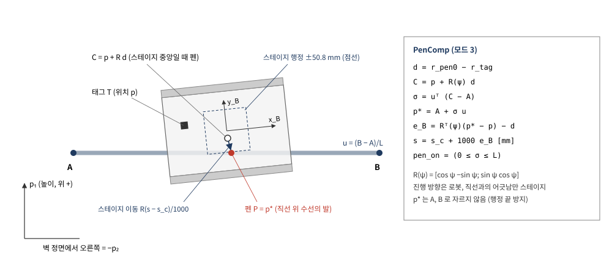

# AVT-3C 벽면 로봇 + Zaber XY 스테이지 직선 마킹 (Simulink ↔ ROS 2, 펜 기구학 보상)

- 작성: 충남대학교 자율운항시스템공학과 윤원근 교수
- 저장소: <https://github.com/wkyouncnu/AVT3C-XY-Stage-Pen>
- 매뉴얼(PDF): [docs/manual/AVT3C_XY_Stage_Pen.pdf](docs/manual/AVT3C_XY_Stage_Pen.pdf)


*그림 1. 시스템 구성*

## 목차

1. [개요](#1-개요)
2. [통신 구조](#2-통신-구조)
3. [제어기 계층 구조](#3-제어기-계층-구조)
4. [알고리즘](#4-알고리즘)
5. [운동모델](#5-운동모델)
6. [Simulink 모델 구성](#6-simulink-모델-구성)
7. [설치](#7-설치)
8. [실행](#8-실행)
9. [프로그램별 입출력](#9-프로그램별-입출력)
10. [검증](#10-검증)
11. [설계 선택 비교](#11-설계-선택-비교)
12. [실장비 적용](#12-실장비-적용)
13. [문제 해결](#13-문제-해결)
14. [확인 필요 사항](#14-확인-필요-사항)

---

## 1. 개요

### 1.1 목적

- 수직 철판 벽에 자석으로 붙는 궤도형 로봇 AVT-3C 위에 Zaber X-LSM100B 두 축 XY 스테이지를 얹고, 스테이지 끝 마커로 벽에 직선 하나를 그음
- 로봇(macro)은 진행과 큰 범위 이동을 맡고, 스테이지(micro)는 직선에서 벗어난 횡오차와 heading 오차를 지움
- 가상 실험 모델과 실기 모델이 같은 ROS 2 토픽 이름·메시지 형식을 쓰므로 시뮬레이션의 제어기를 그대로 실기에 연결함

### 1.2 주요 사양

| 항목 | 값 | 근거 |
|---|---|---|
| 그릴 직선 | A = (0.30, 0.40) m → B = (0.30, −0.20) m, 수평 0.6 m | `XY_setup.m` 2 절 |
| 로봇 | AVT-3C 궤도형, 외형 420 × 343 × 100 mm | CAD STL |
| 스테이지 | Zaber X-LSM100B-E03 × 2 (X 아래 축, Y 위 축), 배치 3안 (펜 = 로봇 중심) | 데이터시트, CAD |
| 스테이지 행정 · 최고속도 | 101.6 mm · 104 mm/s | 데이터시트 |
| 위치 센서 | ZeroKey RTLS 태그 1개 (로봇), 약 20 Hz | 실기 구성 |
| heading 센서 | Xsens IMU `/imu/data` (상대 요각, 철판이라 자력계 사용 불가) | 실기 구성 |
| 제어기 주기 | 0.01 s (100 Hz) | 실기 Simulink 와 같음 |
| 직선 구간 속도 | 30 mm/s (펜 다운 약 19.4 s) | `v_ref` |
| 결과 (기준 조건) | 펜 횡오차 RMS 1.11–1.15 mm, 최대 3.2–3.6 mm | 10 장 |
| 스테이지 없이 로봇만 | 펜 횡오차 RMS 13.7–14.0 mm | 10 장 |

### 1.3 외부 인터페이스

| 구분 | 내용 |
|---|---|
| 제어기 입력 | `/zerokey/position`, `/zerokey/vel`, `/imu/data`, `/stage/pos` |
| 제어기 출력 | `/motor_pwm` (로봇), `/stage/target_pos` (스테이지) |
| 스테이지 노드 | `zaber_stage_node.py` — `/stage/target_pos` → RS-232 `move abs`, `get pos` → `/stage/pos` |
| ROS 2 도메인 | 가상 실험 77, 실기 0 |

### 1.4 저장소 구성

```
├── README.md                 이 문서 (원본)
├── docs/img/                 다이어그램 SVG
├── docs/manual/              README 에서 생성한 PDF
├── 1_시뮬레이션/
│   ├── XY_setup.m            파라미터 (먼저 실행)
│   ├── build_xy_models.m     모델 생성기 — 두 .slx 는 이것으로만 만듦
│   ├── XY_1_pen_sim.slx      가상 실험 (제어기 + 운동모델 + 센서, ROS 2 루프백)
│   ├── XY_2_pen_ros2.slx     실기 (제어기만)
│   ├── XY_run_all.m          설정 → 빌드 → 실행 → 그림 → 동영상
│   ├── XY_compare.m          설계 선택 비교 (11 장), XY_compare_plot.m
│   ├── XY_plot.m, XY_animate_video.m, XY_record_simulink.m
│   ├── img/                  모델 그림, 결과 그래프
│   └── video/                결과 동영상
├── 3_로봇탑재코드/zaber_stage_node.py
└── _tools/                   Simulink 정리·검사 도구 (paint_roles, check_lines, check_flow, check_tags …)
```

---

## 2. 통신 구조

### 2.1 토픽

| 토픽 | 형식 | 발행 → 구독 | 주기 | 내용 |
|---|---|---|---|---|
| `/zerokey/position` | geometry_msgs/PointStamped | 센서 → 제어기 | 20 Hz | 태그 월드 좌표 [m]. x = 벽 수평(왼쪽 +), z = 높이 |
| `/zerokey/vel` | geometry_msgs/TwistStamped | 센서 → 제어기 | 20 Hz | 태그 속도 [m/s] (linear.x, linear.z 사용) |
| `/zerokey/orientation` | geometry_msgs/QuaternionStamped | 센서 → (실기 모델) | 20 Hz | ZeroKey INS 자세. 이 제어기는 사용하지 않음, 실기 모델 호환용 |
| `/imu/data` | sensor_msgs/Imu | 센서 → 제어기 | 100 Hz | orientation 쿼터니언 → 요각 |
| `/stage/pos` | geometry_msgs/PointStamped | 스테이지 노드 → 제어기 | 20 Hz | 스테이지 X, Y [mm] |
| `/motor_pwm` | geometry_msgs/Point | 제어기 → 로봇 | 100 Hz | x = 왼쪽, y = 오른쪽 PWM count (중립 1500 ± 400) |
| `/stage/target_pos` | geometry_msgs/Point | 제어기 → 스테이지 노드 | 100 Hz | 목표 X, Y [mm] (노드가 25 Hz 로 솎아 전송) |
| `/stage/cmd_vel`, `/stage/stop` | Vector3, Empty | 보조 → 스테이지 노드 | 필요 시 | 속도 명령 (워치독 0.5 s), 정지 |

- 가상 실험에서 운동모델·센서·스테이지 모델은 위 토픽을 실제로 발행하고, 제어기는 구독만 함
- 따라서 제어기는 참값(`q_true`, `x_s`)을 보지 못하고 실기와 같은 정보만으로 동작함

### 2.2 좌표 규약

| 기호 | 정의 |
|---|---|
| p₁ | world z, 높이 (천장 +) |
| p₂ | world x, 수평 (벽 정면에서 왼쪽 +) |
| ψ | p₁ 축에서 p₂ 축으로 도는 각 (천장 방향 0, 왼쪽 +90°) |
| 바디 | x_B 전진, y_B 좌측. R(ψ) = [cos ψ −sin ψ; sin ψ cos ψ] 가 바디 → 벽면 |
| 스테이지 | 축 1 = x_B, 축 2 = y_B, 단위 mm, 중앙 s_c = 50.8 mm |

- 실기 Simulink 의 `plane_project` 와 같은 규약

---

## 3. 제어기 계층 구조


*그림 2. 제어기 계층 구조와 단별 신호*

### 3.1 단별 역할

| 단 | 블록 | 입력 | 출력 | 주기 |
|---|---|---|---|---|
| 0 측정 | RosIn → Nav | ZeroKey 위치·속도, IMU 쿼터니언 | `pose` = [p₁; p₂; ψ] | 0.01 s |
| 1 미션 | Guards → ModeChart → Waypoints | `pose` | `mode`, `WP_prev`, `WP_target`, `t_line`, `lineAB` | 0.01 s |
| 2 macro | RobotCtrl → PwmMap → RosOut | `WP_*`, `mode`, `t_line`, `pose`, `stage_pos_meas` | `v_cmd`, `w_cmd` → `/motor_pwm` | 연속 / 0.01 s 발행 |
| 2 micro | PenCtrl → RosOut | `lineAB`, `mode`, `pose` | `stage_target_pos` → `/stage/target_pos`, `pen_on` | 연속 / 0.01 s 발행 |
| 3 내부 루프 | ESC 속도 루프, Zaber 펌웨어 위치 루프 | `/motor_pwm`, `/stage/target_pos` | 궤도 속도, 스테이지 위치 | 장비 내부 |

### 3.2 상태 값

| 이름 | 크기 | 단위 | 위치 | 의미 |
|---|---|---|---|---|
| `pose` | 3 | m, m, rad | Nav 출력 | 측정 태그 위치 [p₁; p₂] + heading ψ |
| `mode` | 1 | – | ModeChart | 1 출발점 이동, 2 회전, 3 직선 추종, 4 정지, 5 종료 |
| `WP_prev`, `WP_target` | 2, 2 | m | Waypoints | 로봇(태그)이 따라갈 선분의 시작·끝 |
| `lineAB` | 4 | m | Waypoints | 펜이 그릴 직선 [A; B] |
| `t_line` | 1 | s | Waypoints | 모드 3 진입 시각 (기준점 진행 시작) |
| `v_cmd`, `w_cmd` | 1, 1 | m/s, rad/s | RobotCtrl | 로봇 속도 명령 |
| `e_cross` | 1 | m | RobotCtrl M3 | 로봇 기준점 대비 바디 횡오차 |
| `motor_pwm` | 2 | count | PwmMap | [왼쪽; 오른쪽] |
| `stage_target_pos` | 2 | mm | PenCtrl | 스테이지 목표 [X; Y] |
| `pen_on` | 1 | – | PenCtrl | 펜 다운 (0 ≤ σ ≤ L) |
| `stage_pos_meas` | 2 | mm | RosIn | `/stage/pos` 측정값 |
| `q_true`, `V_true` | 3, 2 | m, rad / m/s, rad/s | RobotPlant | 참 자세, 참 속도 (평가용, 제어기는 모름) |
| `x_t` | 4 | mm, mm/s | StagePlant | 펌웨어 궤적 상태 |
| `x_s` | 6 | m, m/s, m·s | StagePlant | 스테이지 위치·속도·적분 상태 |
| `pen_true`, `e_pen` | 2, 1 | m | PenTrace | 참 펜 위치, 펜 횡오차 (평가) |
| `pen_nocomp`, `e_nocomp` | 2, 1 | m | PenTrace | 스테이지를 중앙에 고정했을 때의 펜 위치·횡오차 |

### 3.3 미션 상태기계


*그림 3. ModeChart 전이*

| 모드 | 제어 법칙 (6WP_sim · 실기 모델과 같은 식) | 펜 |
|---|---|---|
| 1 Goto_Start | v = K_dist·d·max(0, cos α), ω = K_yaw·α + 0.5 sin α cos α | 올림, 스테이지 중앙 |
| 2 Turning | v = 0, ω = K_yaw·Δθ | 올림 |
| 3 Line_Tracking | 시간 기준점 x_r = WP_prev + v_ref (t − t_line) u, 바디 오차 e = Rᵀ(θ)(x_r − p): v = v_ref cos e_θ + K_px e_x, ω = K_py e_y + K_pθ sin e_θ | 보상, 0 ≤ σ ≤ L 에서 다운 |
| 4 Stop_Destination | 모드 1 식을 끝점에 대해 계속 적용 (d < 0.01 m 에서 ω = 0) | 올림 |

- 로봇이 따라갈 선분 = 펜 직선을 R·d 만큼 평행 이동 + 앞뒤로 `line_pre` 60 mm, `line_post` 40 mm 연장
- 모드 3 에 들어서면 펜 다운 전부터 스테이지를 목표로 보내 시작 과도를 없앰

---

## 4. 알고리즘

### 4.1 펜 기구학 보상



*그림 4. 펜 보상 기하*

$$
s = s_c + 1000\left(R^\top(\psi)\,(p^{\star} - p) - d\right),\qquad p^{\star} = A + \big(u^\top (p + R(\psi)d - A)\big)\,u
$$

| 기호 | 의미 | 값 |
|---|---|---|
| s | 스테이지 목표 [X; Y] | mm |
| s_c | 스테이지 중앙 | 50.8 mm |
| p, ψ | 측정 태그 위치, heading | `pose` |
| d | 태그 → 펜 레버암 (바디) = r_pen0 − r_tag | (0.08, −0.06) m [실측 필요] |
| u | 직선 방향 단위벡터 (B − A)/L | – |
| p* | 스테이지 중앙 펜 위치를 직선에 내린 수선의 발 | – |

- 진행 방향은 로봇이 맡고 스테이지는 직선에서 벗어난 만큼만 지움 → X 축 사용량이 거의 0 (51–52 mm)
- p* 를 A, B 사이로 자르지 않음: 자르면 펜이 A 앞에 있을 때 남은 진행 거리 60 mm 를 스테이지가 메우려 해 행정 끝(95 mm)에 닿음
- 출력 뒤 `Travel` 포화 (0–101.6 mm) 와 `CmdRate` 변화율 제한 (83 mm/s = 0.8 × 최고속도)

### 4.2 선택 기능 (기본 꺼짐)

| 기능 | 위치 | 식 | 파라미터 |
|---|---|---|---|
| ZeroKey 지연 보상 | Nav | p ← p + τ_pred · v_ZeroKey | `tau_pred` (기본 0) |
| 스테이지 중앙 유지 | RobotCtrl M3 | e_c = e_y + K_c e_s + K_ci ∫e_s dt, e_s = (s_Y,meas − s_c)/1000 | `K_c`, `K_ci` (기본 0) |

- 효과는 11 장 비교 참조

---

## 5. 운동모델

### 5.1 로봇 (6WP_sim 운동모델의 벽면판)

| 단계 | 블록 | 식·값 |
|---|---|---|
| ESC 역변환 | EscInv | PWM → 궤도 속도, 데드존 `pwm_dz` = 30 count, 400 count = 0.2 m/s |
| 모터 지연 | TrackLag | 1차 지연 τ_trk = 0.15 s |
| 속도 루프 | PID_v, PID_w | 6WP PID Controller 두 개 (Kp 1500, Ki 15000) |
| 구동력 배분 | Control_allocation | B̃ = [1 1; b/2L −b/2L], \|F\| ≤ F_max = 200 N |
| 동역학 | Dynamics | 6WP 식 (아래 변경점) |
| 기구학 | Kinematics | q̇ = S(q)V + 벽면 외란 (중력 방향 크리프 8 %, heading 요철 ±1.5°, 0.35 Hz) |

6WP_sim Dynamics 에서 바꾼 점

| 번호 | 6WP 원식 | 벽면판 | 이유 |
|---|---|---|---|
| 1 | 바닥 하중 W = mg | 자석 흡착력 N_mag = 400 N | 벽에서 마찰을 만드는 수직력 |
| 2 | 중력 없음 (수평면) | f_g = [−mg; 0; 0] | p₁ = 위 |
| 3 | M_r = μ_t (W/l)(u² − l²/4) | M_r = μ_t (N/l)(l²/4 − u²) | 원식은 u ≈ 0 에서 회전을 돕는 부호 → heading stick-slip (2 Hz) |
| 4 | sign(·) | tanh(·/ε) | 정지 근처 수치 떨림 방지 |

### 5.2 Zaber 스테이지 (데이터시트 + CAD)

| 스펙 (X-LSM100B-E03) | 모델 반영 | 값 |
|---|---|---|
| 행정 | PenCtrl `Travel`, StagePlant `Encoder` 포화 | 0–101.6 mm |
| 최고속도 | ZaberTraj 사다리꼴 궤적 | 104 mm/s |
| 가감속 | ZaberTraj | 500 mm/s² [실측 필요: `get accel`] |
| 추력-속도 곡선 | ZaberServo 추력 한계 (10 점 보간) | 32 N (정지) → 9 N (104 mm/s) |
| 이동 질량 | X 축 = 캐리지 + Y 스테이지 + 펜, Y 축 = 캐리지 + 펜 | 0.55 kg, 0.16 kg |
| 벽면 중력 | 축 방향 성분 m g | X 5.4 N, Y 1.6 N (연속 추력 25 N, 역구동력 24 N 이하) |
| 위치 루프 | 스테퍼 강성 + 펌웨어 보정 | 대역 20 Hz, 감쇠 0.8 [실측 필요] |
| 명령 주기·지연 | CmdHold, CmdDelay | 25 Hz (노드 `cmd_rate`), 10 ms |
| 위치 보고 | `/stage/pos` | 20 Hz |
| 정확도 · 반복정밀도 | 반영하지 않음 | 45 µm · 6 µm (센서 잡음 1 mm 대비 무시) |

### 5.3 센서

| 센서 | 잡음 (1σ) | 지연 | 주기 |
|---|---|---|---|
| ZeroKey 위치 | 1.0 mm | 50 ms [실측 필요] | 20 Hz |
| IMU 요각 | 0.3°, 드리프트 0.02°/s | – | 100 Hz |
| ZeroKey INS 자세 | 0.9° | – | 20 Hz |

---

## 6. Simulink 모델 구성


*그림 5. XY_1_pen_sim 최상위 (윗줄 제어기, 아랫줄 가상 실험장, 맨 아래 평가·기록)*

| 모델 | 구성 | 용도 |
|---|---|---|
| `XY_1_pen_sim.slx` | 제어기 (RosIn, Nav, Mission, RobotCtrl, PwmMap, PenCtrl, RosOut) + 가상 실험장 (PlantRosIn, RobotPlant, StagePlant, Sensors, PlantRosOut) + PenTrace, Logging | 가상 실험 (도메인 77) |
| `XY_2_pen_ros2.slx` | 같은 빌더 함수로 만든 제어기 윗줄만 | 실기 (도메인 0) |

- 모든 계산 코드는 모델 안의 MATLAB Function 블록에 있음 (외부 .m 함수 없음)
- 왼쪽 → 오른쪽 배치: 미션 → 제어 → 배분 → ROS 경계·플랜트 → 측정
- 서브시스템 사이 신호는 포트 옆 Goto/From (선은 수평 직선)
- 블록에는 숫자 대신 파라미터 이름 (`XY_setup.m` 하나만 고치면 됨)
- 제어기는 연속, ode4 고정 스텝 0.005 s. 이산 블록 (센서 ZOH, Nav persistent, 명령 ZOH) 은 Description 에 이유 기재
- 기록은 Bus Creator → ZOH (0.01 s) → To Workspace `log` 하나

| 서브시스템 그림 | 파일 |
|---|---|
| 미션 | `1_시뮬레이션/img/XY_1_pen_sim__Mission.png` |
| 로봇 제어 | `1_시뮬레이션/img/XY_1_pen_sim__RobotCtrl.png`, `__RobotCtrl__M3_Line.png` |
| 펜 보상 | `1_시뮬레이션/img/XY_1_pen_sim__PenCtrl.png` |
| 로봇 운동모델 | `1_시뮬레이션/img/XY_1_pen_sim__RobotPlant.png` |
| 스테이지 모델 | `1_시뮬레이션/img/XY_1_pen_sim__StagePlant.png` |
| 센서 | `1_시뮬레이션/img/XY_1_pen_sim__Sensors.png` |


*그림 6. StagePlant 내부 (명령 ZOH → 지연 → 펌웨어 궤적 → 서보 → 엔코더)*

---

## 7. 설치

### 7.1 요구 사항

| 항목 | 버전 |
|---|---|
| MATLAB / Simulink | R2025a 이상 |
| 툴박스 | ROS Toolbox, Stateflow |
| 실기 NUC | Ubuntu 24.04, ROS 2 Jazzy, Python 3, `zaber-motion` |
| 애니메이션 (선택) | `4_CAD/AVT-3C.stl` (저장소에 포함하지 않음) |

### 7.2 절차

| 단계 | 명령 | 결과 |
|---|---|---|
| 1 | `git clone https://github.com/wkyouncnu/AVT3C-XY-Stage-Pen.git` | 저장소 |
| 2 | MATLAB 에서 `1_시뮬레이션` 으로 이동, `XY_setup` | 경로·파라미터, `ROS_DOMAIN_ID` 77 |
| 3 | `build_xy_models` | 두 .slx 생성, 검사 결과 출력 |
| 4 (NUC) | `pip install zaber-motion` | 스테이지 노드 의존성 |

---

## 8. 실행

| 목적 | 명령 | 소요 |
|---|---|---|
| 전체 (설정 → 빌드 → 실행 → 그림 → 동영상) | `XY_run_all` | 약 3 분 |
| 가상 실험 한 번 | `XY_1_pen_sim_run` | 약 40 s (실시간 1×) |
| 결과 그림만 | `M = XY_plot(out)` | – |
| 설계 선택 비교 | `XY_compare; XY_compare_plot` | 10 경우, 약 8 분 |
| Simulink 실행 화면 녹화 | `XY_record_simulink` | 화면 밖 렌더링 (다른 창이 찍히지 않음) |
| 실기 | 9.3 절 | – |

- 실시간 1× 로 도는 이유: ROS 2 루프백에서 발행·구독 시점이 실기와 같아야 함
- 미션이 끝나면 (모드 5) 자동 정지

---

## 9. 프로그램별 입출력

### 9.1 파라미터 (`XY_setup.m`)

| 절 | 이름 | 값 | 비고 |
|---|---|---|---|
| 1 | `Ts_ctrl`, `Ts_plant` | 0.01, 0.005 s | 제어 주기, 적분 스텝 |
| 2 | `pen_A`, `pen_B` | (0.30, 0.40), (0.30, −0.20) m | 그릴 직선 |
| 3 | `q0` | (0.10, 0.55, 0) | 출발 자세 |
| 4 | `K_dist`, `K_yaw` | 1.0, 2.0 | 모드 1, 2 |
| 4 | `v_ref`, `K_px`, `K_py`, `K_ptheta` | 0.03 m/s, 0.3, 5.0, 1.4 | 모드 3 (실기 ZeroKey 모델 값, 속도만 낮춤) |
| 4 | `K_c`, `K_ci` | 0, 0 | 스테이지 중앙 유지 (선택) |
| 5 | `r_tag`, `r_pen0` | (−0.08, 0.06), (0, 0) m | [실측 필요] |
| 6 | `m_r`, `N_mag`, `mu_l`, `mu_t` | 12 kg, 400 N, 0.05, 0.5 | [실측 필요] |
| 7 | 스테이지 | 5.2 절 | |
| 8 | `zk_*`, `imu_*`, `tau_pred` | 5.3 절, 0 | |

### 9.2 변경 항목

| 변경 | 수정 파일 | 재빌드 |
|---|---|---|
| 게인, 직선, 질량, 센서 잡음 | `XY_setup.m` | 불필요 (다시 `XY_setup`) |
| 블록 구성, 함수 식 | `build_xy_models.m` | `build_xy_models` |
| 스테이지 노드 주기 | `zaber_stage_node.py` 파라미터 `cmd_rate` + `XY_setup` `stage_cmd_Ts` | 모델 재빌드 불필요 |

### 9.3 스테이지 노드 (`zaber_stage_node.py`)

| 파라미터 | 기본값 | 의미 |
|---|---|---|
| `port` | `/dev/ttyUSB0` | RS-232 포트 (115200) |
| `x_device`, `y_device` | 1, 2 | 데이지 체인 주소 |
| `publish_rate` | 20 Hz | `/stage/pos` |
| `cmd_rate` | 25 Hz | `move abs` 전송 주기 (마지막 목표만) |
| `cmd_deadband` | 0.001 mm | 변화가 이보다 작으면 재전송하지 않음 |
| `cmd_timeout` | 0.5 s | `/stage/cmd_vel` 워치독 |
| `home_on_start` | True | 기동 시 원점 복귀 |

- 제어기는 100 Hz 로 목표를 보내지만 시리얼 한 줄(요청+응답)이 수 ms 걸리므로 노드가 25 Hz 로 솎음. 시뮬레이션 `stage_cmd_Ts` = 0.04 s 와 같음

---

## 10. 검증

### 10.1 검증 항목

| 구분 | 실행 | 대상 | 기준 |
|---|---|---|---|
| 모델 구조 | `build_xy_models` | 두 모델 | `check_lines` 7 항목 0, `check_flow` 통과, `check_tags` 0 |
| ROS 루프백 | `XY_1_pen_sim_run` | 토픽 발행·구독 | 미션 모드 1 → 5 완주 |
| 실기 모델 | `update diagram` (도메인 0) | `XY_2_pen_ros2` | 오류 없음 |
| 펜 정확도 | `XY_plot` | 펜 다운 구간 | 횡오차 RMS ≤ 2 mm, 스테이지 포화 없음 |

### 10.2 모델 구조 결과

| 모델 | check_lines | 2회 꺾임 | Goto / From | 판정 |
|---|---|---|---|---|
| XY_1_pen_sim | 0 | 0 | 78 / 123 | 통과 |
| XY_2_pen_ros2 | 0 | 0 | 35 / 60 | 통과 |

### 10.3 가상 실험 결과 (기준 조건)

| 항목 | 값 |
|---|---|
| 모드 전이 | 2 → 2.1 s, 3 → 5.2 s, 4 → 26.6 s, 종료 28.6 s |
| 펜 다운 시간 | 19.2–19.4 s |
| 펜 횡오차 (스테이지 보상) | RMS 1.11–1.15 mm, 최대 3.2–3.6 mm |
| 펜 횡오차 (보상 없음) | RMS 13.7–14.0 mm, 최대 17.3 mm |
| 스테이지 사용 범위 | X 51.2–52.4 mm, Y 58.3–70.2 mm (행정 0–101.6) |

- 실행마다 0.05 mm 내외 차이: ROS 2 DDS 수신 시점 차이


*그림 7. 벽면 궤적 (파랑 목표 직선, 빨강 보상 펜 자국, 회색 보상 없는 펜 자국)*


*그림 8. 펜 횡오차, 스테이지 위치, 모드, 펜 상태*

### 10.4 동영상

| 파일 | 내용 |
|---|---|
| `1_시뮬레이션/video/XY_1_pen_sim.mp4` | 3D 애니메이션 (STL 로봇, 펜 자국) |
| `1_시뮬레이션/video/XY_1_simulink_live.mp4` | Simulink 블록도 + 왼쪽 횡오차 [mm] 그래프 + 3D, 실행 중 녹화 |

---

## 11. 설계 선택 비교

`XY_compare.m` 으로 기준 조건에서 한두 값만 바꿔 10 경우를 같은 ROS 2 루프백 모델로 실행함.


*그림 9. 경우별 펜 횡오차 (왼쪽 스테이지 보상, 오른쪽 같은 주행에서 스테이지를 중앙에 고정했을 때)*

### 11.1 결과

| 경우 | 바꾼 값 | 펜 RMS [mm] | 펜 최대 [mm] | 로봇만 RMS [mm] | 스테이지 Y [mm] |
|---|---|---|---|---|---|
| 기준 | – | 1.11 | 3.21 | 13.96 | 59.0–70.1 |
| 속도 15 mm/s | `v_ref` 0.015 | 1.22 | 4.22 | 14.72 | 59.2–71.5 |
| 속도 60 mm/s | `v_ref` 0.060 | 1.29 | 4.16 | 14.72 | 59.0–70.5 |
| 지연 보상 | `tau_pred` 0.05 s | 1.11 | 3.11 | 14.09 | 58.9–70.2 |
| 60 mm/s + 지연 보상 | 두 값 | 1.27 | 4.13 | 14.73 | 59.3–70.4 |
| 스테이지 느슨 | 대역 2 Hz, 명령 5 Hz | 1.69 | 4.41 | 13.96 | 59.2–71.0 |
| 중앙 유지 | `K_c` 0.5, `K_ci` 0.3 | 1.18 | 5.02 | 3.66 | 45.0–64.9 |
| 지연 보상 + 중앙 유지 | 세 값 | 1.16 | 3.40 | 3.86 | 45.0–62.3 |
| ZeroKey 잡음 0.5 mm | `zk_sigma` 0.0005 | 0.84 | 2.59 | 13.68 | 59.9–69.3 |
| 센서 잡음 0 | ZeroKey·IMU 잡음·드리프트 0 | 0.37 | 0.77 | 13.92 | 60.9–68.1 |


*그림 10. 위: 펜 횡오차 (스테이지 느슨 · 기준 · 센서 잡음 0), 아래: 스테이지 Y (기준 · 중앙 유지)*

### 11.2 해석

| 질문 | 결과 | 근거 |
|---|---|---|
| 주행 속도 | 15–60 mm/s 에서 RMS 1.1–1.3 mm, 차이 작음 | 느리면 heading 요철·드리프트를 오래 겪고, 빠르면 스테이지 추종 부담 증가 |
| 지연 보상 | 효과 없음 (1.11 → 1.11 mm) | 직선 위에서 ZeroKey 지연은 진행 방향 오차가 되고, 펜 보상은 직선에 수직인 성분만 씀 |
| 스테이지 서보를 느슨하게 | 1.11 → 1.69 mm (+52 %) | 대역 2 Hz 는 heading 요철 (0.35, 0.8 Hz) 을 다 따라가지 못함. 20 Hz 일 필요는 없으나 수 Hz 이상 필요 |
| 오차를 정하는 요인 | 센서 | 잡음 절반 → 0.84 mm, 잡음 0 → 0.37 mm. 스테이지·로봇이 아니라 ZeroKey·IMU 정밀도가 상한 |
| 로봇만으로 | 13.7–14.7 mm | 궤도 로봇은 횡방향으로 직접 움직이지 못하고 (회전으로만 고침), 벽면 크리프·요철을 0.5 Hz 대역으로 다 지우지 못함 |
| 중앙 유지 루프 | 펜 RMS 그대로, 로봇 오차 14.0 → 3.7 mm, 스테이지 Y 평균 편차 13.8 → 1.4 mm | 스테이지 편차의 적분이 벽면 크리프로 생긴 정상 편차를 로봇 쪽에서 없앰 → 행정 여유 확보. 진입 과도 최대값은 증가 (5.0 mm) |

### 11.3 정지 후 긋기와 주행 중 긋기

| 구분 | 정지 후 긋기 (구간 약 90 mm 씩 이어 붙임) | 주행 중 긋기 (현재 방식) |
|---|---|---|
| 구간 안 직선도 | 정지 중 크리프·요철 없음, ZeroKey 2 s 평균 시 잡음 1/√40 → 약 0.2 mm (계산값) | RMS 약 1.1 mm (시뮬레이션) |
| 구간 이음매 | 이음매마다 계단. 크기 ≈ √2 × ZeroKey 절대 오차 (편향은 평균으로 줄지 않음) | 없음 |
| 0.6 m 소요 | 정지·출발 7 회 이상 | 연속 19 s |
| 적합한 경우 | 짧은 선 (100 mm 이하), 이음매 허용, 0.5 mm 이하 요구 | 연속 직선, mm 급 요구 |

- 정지 후 긋기는 시뮬레이션으로 확인하지 않음 (계산값). ZeroKey 정지 절대 오차의 실측 필요

### 11.4 결론

- 이중 구동 (macro–micro) 구조 유지: 로봇만 13.7–14.7 mm, 스테이지 보상 1.1 mm
- 스테이지 서보 자체는 Zaber 펌웨어에 맡기고 목표 위치만 25 Hz 로 보내면 충분함. 단, 2 Hz 수준으로 느리면 오차 증가
- 정확도의 상한은 보상 계산에 들어가는 측정값: ZeroKey 잡음, IMU heading, 태그-펜 레버암, 스테이지 축 장착 각도
- 행정 여유를 위해 중앙 유지 루프 (`K_ci` 0.3) 를 실기에서 켜는 것을 권장함. 진입 과도는 모드 3 초기에 적분을 천천히 켜는 방식으로 보완 가능

---

## 12. 실장비 적용

| 단계 | 내용 |
|---|---|
| 1 | NUC 에서 ZeroKey, Xsens, 로봇 브리지 노드 기동 (`ROS_DOMAIN_ID=0`) |
| 2 | NUC 에서 `python3 zaber_stage_node.py --ros-args -p port:=/dev/ttyUSB0` (원점 복귀 후 `/stage/pos` 발행 확인) |
| 3 | MATLAB: `XY_setup; setenv('ROS_DOMAIN_ID', num2str(ros_domain_real))` |
| 4 | `XY_2_pen_ros2.slx` 열고 실행 (`T_run_ros` = 300 s) |
| 5 | 펜 없이 한 번 주행해 `/stage/target_pos` 범위가 10–90 mm 안인지 확인 후 펜 장착 |

- 가상 실험 (도메인 77) 과 실기 (도메인 0) 가 같은 망에 있어도 서로의 `/motor_pwm` 을 받지 않음
- 실기 전 확인할 부호: 스테이지 축 1 이 x_B (전진), 축 2 가 y_B (좌측) 방향으로 증가하는지

---

## 13. 문제 해결

| 증상 | 원인 | 조치 |
|---|---|---|
| 모드 3 시작 때 스테이지 X 가 행정 끝 (95 mm) 근처까지 감 | p* 를 A 로 잘라 남은 진행 거리를 스테이지가 메움 | p* 를 자르지 않는 수선의 발로 변경 |
| heading 2 Hz 떨림, 횡오차 3.6 mm | 6WP 회전 저항 부호 (u² − l²/4) | (l²/4 − u²) 로 수정 |
| Merge 샘플 시간 불일치 오류 | 모드 3 의 연속 Clock 과 다른 모드의 0.01 s | 모드 3 에 Digital Clock (Ts_ctrl) |
| To Workspace 샘플 시간 경고 | 서로 다른 주기 신호를 한 Bus 로 기록 | Bus 뒤 ZOH (0.01 s) |
| 실기 스테이지 명령이 밀림 | 100 Hz `move abs` 가 시리얼 115200 bps 를 포화 | 노드에서 마지막 목표만 25 Hz 로 전송 |
| 시뮬레이션 `/motor_pwm` 이 실제 로봇을 움직일 위험 | 같은 도메인 | 가상 실험 도메인 77 분리 |
| VideoWriter 권한 오류 | 이전 VideoReader 가 파일을 잡고 있음 | `clear` 후 재실행 |
| 실행마다 수치가 조금 다름 | ROS 2 수신 시점 | 정상 (0.05 mm 내외) |

---

## 14. 확인 필요 사항

| 항목 | 현재 설정 | 확인 대상 |
|---|---|---|
| 태그·펜 위치 `r_tag`, `r_pen0` | (−0.08, 0.06), (0, 0) m | 레이저 트래커 실측 |
| 스테이지 축 부호·장착 각도 | 축 1 = x_B, 축 2 = y_B, 0° | 실기 조립 확인 |
| 스테이지 가감속 | 500 mm/s² | `get accel` |
| 스테이지 위치 루프 대역 · 명령 지연 | 20 Hz · 10 ms | 계단 명령 응답 측정 |
| 로봇 질량 · 흡착력 · 마찰 | 12 kg · 400 N · μ_l 0.05, μ_t 0.5 | 실측 |
| ESC 데드존 · 궤도 시정수 · 최대 구동력 | 30 count · 0.15 s · 200 N | 실측 |
| ZeroKey 지연 · 잡음 · 정지 절대 오차 | 50 ms · 1 mm · 미정 | 정지 로그 |
| ZeroKey 태그 수 | 1개 (로봇) | 진행 보고서에는 마커부 + MC 2개로 기재됨. 실제 구성 확인 |
| 벽면 크리프 · heading 요철 | 8 % · ±1.5°, 0.35 Hz | 실기 영상·로그 |
| 펜 홀더 질량 | 0.10 kg | 실측 |

잔여 작업

- 실측값 반영 후 `XY_compare` 재실행
- 중앙 유지 루프의 진입 과도 개선 (적분 서서히 켜기) 후 기본값 결정
- 실기 시험 (`XY_2_pen_ros2`) 결과와 시뮬레이션 대조
- 영문·베트남어 매뉴얼

---

PDF 는 이 README 에서 Chrome 헤드리스 (marked.js) 로 생성함.
