# Robot leo tường AVT-3C + kẻ đường thẳng bằng bàn trượt XY Zaber: Nguyên lý, thiết kế và triển khai (Simulink ↔ ROS 2, bù động học bút)

- Tác giả: GS. Wonkeun Youn, Khoa Kỹ thuật Hệ thống Phương tiện Tự hành, Đại học Quốc gia Chungnam
- Kho mã: <https://github.com/wkyouncnu/AVT3C-XY-Stage-Pen>
- Tài liệu (PDF, tiếng Hàn): [2_docs/manual/AVT3C_XY_Stage_Pen.pdf](2_docs/manual/AVT3C_XY_Stage_Pen.pdf)
- Tài liệu (PDF, tiếng Anh): [2_docs/manual/AVT3C_XY_Stage_Pen_EN.pdf](2_docs/manual/AVT3C_XY_Stage_Pen_EN.pdf)
- Tài liệu (PDF, tiếng Việt): [2_docs/manual/AVT3C_XY_Stage_Pen_VI.pdf](2_docs/manual/AVT3C_XY_Stage_Pen_VI.pdf)
- Bản trích bù động học bút (PDF, tiếng Hàn): [2_docs/manual/AVT3C_XY_Stage_Pen_Control.pdf](2_docs/manual/AVT3C_XY_Stage_Pen_Control.pdf) (Chương 3, Mục 4.1, Chương 6, Mục 8.6, Mục 14.6. Được tạo bởi `2_docs/make_pen_excerpt.py`)
- Bản trích bù động học bút (PDF, tiếng Anh): [2_docs/manual/AVT3C_XY_Stage_Pen_Control_EN.pdf](2_docs/manual/AVT3C_XY_Stage_Pen_Control_EN.pdf)
- Bản trích bù động học bút (PDF, tiếng Việt): [2_docs/manual/AVT3C_XY_Stage_Pen_Control_VI.pdf](2_docs/manual/AVT3C_XY_Stage_Pen_Control_VI.pdf)
- Tài liệu bàn trượt (Zaber): [5_references/manuals/X-LSM-E-Manual.pdf](5_references/manuals/X-LSM-E-Manual.pdf), bảng thông số [5_references/manuals/X-LSM-E-Datasheet.pdf](5_references/manuals/X-LSM-E-Datasheet.pdf). Bài báo tham khảo: [5_references/README_VI.md](5_references/README_VI.md)

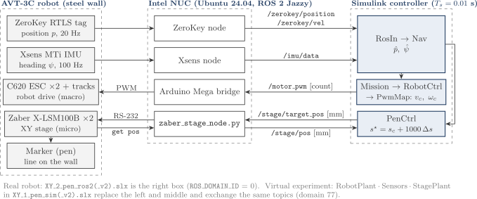

*Hình 1. Cấu hình hệ thống. Trái: thiết bị trên robot; giữa: các nút ROS 2 trên NUC; phải: bộ điều khiển Simulink*

## Tóm tắt

Tài liệu này giải quyết bài toán gắn một bàn trượt XY hai trục lên AVT-3C, một robot bánh xích di chuyển nhờ lực hút từ trên tường thép thẳng đứng, và vẽ một đường thẳng nằm ngang dài 1.2 m trên tường bằng bút dạ ở đầu bàn trượt. Robot bánh xích không thể di chuyển ngang, bị trượt trên bề mặt tường và chịu dao động hướng; do đó đường thẳng do riêng robot vẽ có sai số ngang RMS 14.84 mm trong mô phỏng. Tài liệu mô tả một cấu trúc vĩ mô–vi mô, trong đó robot đảm nhận việc di chuyển và các chuyển động lớn, còn bàn trượt chỉ loại bỏ độ lệch khỏi đường thẳng. Lệnh bàn trượt được tính bằng cách nghịch đảo quan hệ động học từ tư thế robot đo được (bù động học bút). Vì vị trí bút không được đo trực tiếp, độ chính xác do cảm biến quyết định; trong cùng mô phỏng, sai số ngang của bút giảm xuống RMS 1.17–1.20 mm. Nguồn sai số lớn nhất là nhiễu vị trí ZeroKey. Gắn hai thẻ định vị (tag) lên thân robot với bút nằm giữa chúng giảm sai số xuống 0.84 mm trong một mô phỏng gần đúng. Vì bàn trượt là sản phẩm thương mại có servo vị trí bên trong không thể sửa đổi, toàn bộ thiết kế chỉ dựa trên lệnh vị trí và giá trị đọc vị trí.

## Mục lục

- **Phần I. Nguyên lý**
    1. [Giới thiệu](#1-giới-thiệu)
    2. [Hệ thống và tín hiệu](#2-hệ-thống-và-tín-hiệu)
    3. [Hệ tọa độ và ma trận quay](#3-hệ-tọa-độ-và-ma-trận-quay)
    4. [Phát biểu bài toán điều khiển](#4-phát-biểu-bài-toán-điều-khiển)
    5. [Mức vĩ mô: điều khiển robot](#5-mức-vĩ-mô-điều-khiển-robot)
    6. [Mức vi mô: Bù động học bút](#6-mức-vi-mô-bù-động-học-bút)
    7. [Sai số đo và bố trí cảm biến](#7-sai-số-đo-và-bố-trí-cảm-biến)
- **Phần II. Dẫn giải chi tiết**
    8. [Mô hình toán học (dẫn giải chi tiết)](#8-mô-hình-toán-học-dẫn-giải-chi-tiết)
- **Phần III. Triển khai**
    9. [Tổng quan triển khai](#9-tổng-quan-triển-khai)
    10. [Kiến trúc truyền thông](#10-kiến-trúc-truyền-thông)
    11. [Phân cấp bộ điều khiển](#11-phân-cấp-bộ-điều-khiển)
    12. [Mô hình chuyển động](#12-mô-hình-chuyển-động)
    13. [Cấu trúc mô hình Simulink](#13-cấu-trúc-mô-hình-simulink)
    14. [Phương trình và nguyên lý của từng hàm Simulink](#14-phương-trình-và-nguyên-lý-của-từng-hàm-simulink)
    15. [Cài đặt](#15-cài-đặt)
    16. [Chạy chương trình](#16-chạy-chương-trình)
    17. [Đầu vào và đầu ra của từng chương trình](#17-đầu-vào-và-đầu-ra-của-từng-chương-trình)
- **Phần IV. Kiểm chứng**
    18. [Kiểm chứng](#18-kiểm-chứng)
    19. [Tổng hợp kết quả](#19-tổng-hợp-kết-quả)
    20. [So sánh các phương án thiết kế](#20-so-sánh-các-phương-án-thiết-kế)
- **Phần V. Triển khai trên robot thật**
    21. [Triển khai trên phần cứng thật](#21-triển-khai-trên-phần-cứng-thật)
    22. [Quy trình triển khai trên phần cứng và danh mục kiểm tra](#22-quy-trình-triển-khai-trên-phần-cứng-và-danh-mục-kiểm-tra)
    23. [Xử lý sự cố](#23-xử-lý-sự-cố)
    24. [Các mục cần xác nhận](#24-các-mục-cần-xác-nhận)
    25. [Kết luận](#25-kết-luận)
- [Tài liệu tham khảo](#tài-liệu-tham-khảo)

---

# Phần I. Nguyên lý

## 1. Giới thiệu

### 1.1 Phát biểu vấn đề

Việc vẽ đường lấy dấu trên các tấm thép lớn thẳng đứng, chẳng hạn các block ở xưởng đóng tàu, từ trước đến nay do công nhân đứng trên thang hoặc xe nâng người thực hiện bằng thước dây và dây bật phấn. Để robot leo tường đảm nhận công việc này, robot phải đặt đường thẳng với độ chính xác cỡ milimét trong khi di chuyển vài mét. Hai yêu cầu này khác nhau về bản chất. Chuyển động trong phạm vi lớn phù hợp với cơ cấu chấp hành mạnh và chậm, còn định vị chính xác cỡ milimét phù hợp với cơ cấu chấp hành nhanh có phạm vi hẹp.

AVT-3C là robot bánh xích (skid-steer) bám vào tấm thép bằng xích từ. Robot bánh xích đổi hướng nhờ chênh lệch tốc độ giữa xích trái và xích phải và không thể di chuyển trực tiếp theo phương ngang của thân. Ràng buộc này được gọi là ràng buộc không holonom (nonholonomic constraint). Robot đã lệch sang ngang 1 cm khỏi đường thẳng không thể trượt ngang trở lại 1 cm đó; nó phải quay, tiến xiên, rồi chỉnh thẳng hướng trở lại. Trong quá trình này robot đi được vài chục centimét, nên tốc độ giảm sai số ngang về cơ bản là chậm.

Bề mặt tường làm bài toán khó hơn. Vì trọng lực tác dụng hướng xuống dọc theo tường, xích từ bị trượt nhẹ xuống dưới khi di chuyển (trượt (creep)). Độ gồ ghề của xích giữa xích và tấm thép gây dao động hướng 1–2°. Khi đưa các nhiễu này vào mô phỏng, sai số ngang khi bám đường thẳng của robot là RMS 23.6 mm, và sai số ngang của đường được vẽ bằng bút gắn cố định vào robot là RMS 14.84 mm, cực đại 19.6 mm (Chương 18).

### 1.2 Cách tiếp cận: cấu trúc vĩ mô–vi mô

Lời giải cho bài toán này giống cách con người viết. Cánh tay di chuyển bàn tay rộng trên trang giấy, còn các ngón tay tinh chỉnh đầu bút. Ngay cả khi chuyển động của cánh tay không chính xác, nét chữ vẫn đúng miễn là các ngón tay bù lại sai số đó.

Trong hệ thống này, cánh tay là robot và các ngón tay là bàn trượt XY gồm hai trục Zaber X-LSM100B. Bàn trượt có hành trình hẹp 101.6 mm nhưng nhanh, với tốc độ cực đại 104 mm/s, và độ lặp lại 6 µm. Robot đưa bút đến gần đường thẳng và tiến bút dọc theo đường, trong khi bàn trượt di chuyển bút theo hướng ngược lại đúng bằng lượng mà robot lệch khỏi đường thẳng tại thời điểm đó. Cách phân chia vai trò này được gọi là cấu trúc vĩ mô–vi mô.

| Hạng mục | Robot (vĩ mô) | Bàn trượt (vi mô) |
|---|---|---|
| Phạm vi | Toàn bộ tường (vài m) | ±50.8 mm |
| Bậc tự do | Tốc độ tiến $v$, tốc độ quay $\omega$ (không có chuyển động ngang) | Hai phương, X và Y của thân |
| Tốc độ | Hằng số thời gian hội tụ sai số ngang xấp xỉ 8.5 s (Mục 5.2) | Servo vị trí vài–20 Hz |
| Nhiệm vụ | Di chuyển dọc đường thẳng, đến điểm bắt đầu, căn chỉnh hướng | Độ lệch khỏi đường thẳng (dịch chuyển bút do sai số ngang + sai số hướng) |
| Lệnh | `/motor_pwm` (PWM động cơ trái/phải) | `/stage/target_pos` (vị trí [mm]) |

### 1.3 Bố cục tài liệu

Chương 2 tóm tắt những gì bộ điều khiển đo và những gì nó ra lệnh. Chương 3 định nghĩa các hệ tọa độ và ma trận quay, và Chương 4 phát biểu bài toán điều khiển bằng phương trình. Chương 5 dẫn giải điều khiển phía robot (vĩ mô), và Chương 6 dẫn giải bù bút phía bàn trượt (vi mô). Các Mục 6.2–6.7 lần lượt xem xét từng biến của mã bù bút, chia thành hình trong hệ tọa độ thân, hình trong hệ tọa độ tường, hình kết hợp hai hệ tọa độ và hình ở tỉ lệ bàn trượt, và đặt mỗi phương trình trong cùng mục với hình minh họa nó. Chương 7 trình bày cách sai số đo lan truyền thành sai số bút và cách bố trí thẻ định vị (tag) ZeroKey. Phần I (Nguyên lý) kết thúc tại đây.

Phần II (Chương 8) dẫn giải lại cùng nội dung theo từng phương trình và tập hợp bảng ký hiệu, kiểm tra dấu và các điểm khác biệt so với bài báo gốc dưới dạng gạch đầu dòng. Phần III (Chương 9–17) trình bày thông số kỹ thuật, các topic ROS 2, phân cấp bộ điều khiển, mô hình chuyển động, cấu trúc mô hình Simulink và phương trình của từng khối hàm (Chương 14), cài đặt, chạy chương trình và tham số. Phần IV (Chương 18–20) trình bày kết quả thí nghiệm ảo và so sánh các lựa chọn thiết kế, và Phần V (Chương 21–24) trình bày quy trình triển khai trên robot thật, xử lý sự cố và các mục cần xác nhận. Chương 25 kết luận. Chương 1–7 và Chương 8 trình bày cùng một chủ đề hai lần, dưới dạng văn xuôi và dạng gạch đầu dòng; cả hai được giữ lại vì chúng chứa các hình và phép kiểm tra số khác nhau.

---

## 2. Hệ thống và tín hiệu

### 2.1 Thiết bị

| Thiết bị | Vai trò | Kết nối |
|---|---|---|
| AVT-3C | Robot bánh xích từ, kích thước ngoài 420 × 343 × 100 mm | Arduino Mega → hai ESC C620 → động cơ xích trái/phải |
| Zaber X-LSM100B-E03 × 2 | Bàn trượt XY. Trục X ở dưới, trục Y gắn bên trên. Bút dạ gắn trên con trượt Y | RS-232 trực tiếp đến NUC (115200 bps) |
| 1 thẻ định vị (tag) ZeroKey RTLS | Vị trí 3-D của một điểm trên robot | Các anchor → nút ZeroKey |
| IMU Xsens MTi | Quaternion tư thế, tốc độ góc | USB → nút Xsens |
| Intel NUC | ROS 2 Jazzy. Chạy các nút cảm biến, bàn trượt và cầu nối robot | – |
| Bộ điều khiển Simulink | Toàn bộ luật điều khiển trong tài liệu này | Chỉ giao tiếp với thiết bị qua các topic ROS 2 |

### 2.2 Đầu vào: những gì bộ điều khiển đo

Bộ điều khiển chỉ nhận thông tin từ bốn topic. Hiểu chính xác điều này là điểm xuất phát để hiểu thuật toán.

| Topic | Đại lượng đo | Đơn vị · tần số | Sử dụng trong bộ điều khiển |
|---|---|---|---|
| `/zerokey/position` | Tọa độ thế giới $(x, y, z)$ của một điểm thẻ định vị trên robot | m, 20 Hz, nhiễu xấp xỉ 1 mm, trễ xấp xỉ 50 ms | Vị trí trên tường trong Nav $\hat p = [s_x x;\ z]$ ($s_x$ = `zk_xsign`) |
| `/zerokey/vel` | Vận tốc của cùng thẻ định vị | m/s, 20 Hz | Bù trễ (mặc định tắt), vòng PI trong của phiên bản 2 |
| `/imu/data` | Quaternion tư thế (phiên bản 2 có thêm gyro $z$) | –, 100 Hz | heading $\hat\psi$ (phiên bản 2: tốc độ yaw $r$) |
| `/stage/pos` | Vị trí hiện tại của cả hai trục bàn trượt | mm, 20 Hz | Không dùng trong cấu hình mặc định (tính năng tùy chọn và giám sát) |

Có ba điểm cần lưu ý. Thứ nhất, điểm do ZeroKey đo không phải tâm robot cũng không phải bút mà là một điểm thẻ định vị duy nhất. Thẻ định vị nằm cách tâm robot $r_{tag} = (-0.08,\ 0.06)$ m. Thứ hai, trên tường thép từ kế vô dụng, nên góc yaw của IMU không phải là phương vị tuyệt đối. Nav lấy yaw của mẫu đầu tiên làm 0 và cộng hướng ban đầu $\psi_0$ để có yaw tương đối. Do đó độ trôi tích lũy theo thời gian. Thứ ba, không có cảm biến nào đo vị trí đầu bút. Vị trí bút là đại lượng được tính theo động học từ vị trí thẻ định vị, hướng và vị trí bàn trượt. Thực tế này là lý do bù bút ở Chương 6 có cấu trúc truyền thẳng (feedforward), và là lý do ở Chương 7 sai số cảm biến trở thành cận trên của sai số bút.

### 2.3 Đầu ra: những gì bộ điều khiển ra lệnh

| Topic | Lệnh | Đơn vị | Bên nhận |
|---|---|---|---|
| `/motor_pwm` | $[u_L;\ u_R]$ độ rộng xung động cơ trái/phải | count (= µs), 1500 dừng, 1100–1900 | Cầu nối Arduino → ESC |
| `/stage/target_pos` | $[s_X^{\star};\ s_Y^{\star}]$ vị trí đích của bàn trượt | mm, 0–101.6 | `zaber_stage_node.py` → `move abs` |

Tổng cộng có bốn lệnh. Tuy nhiên, hai giá trị PWM trái/phải rốt cuộc quyết định hai bậc tự do của robot là tốc độ tiến $v$ và tốc độ quay $\omega$, nên các đầu vào độc lập mà bộ điều khiển xử lý là bốn đại lượng $(v,\ \omega,\ s_X,\ s_Y)$. Đối tượng cần điều khiển là hai bậc tự do của một điểm duy nhất, đầu bút $P = (P_1,\ P_2)$ trên tường. Vì số đầu vào nhiều hơn số đầu ra, có vô số tổ hợp đầu vào tạo ra cùng một quỹ đạo bút, và cách phân chia phần dư thừa này là cốt lõi của thiết kế. Việc phân chia vai trò ở Mục 1.2 là câu trả lời.

### 2.4 Luồng tín hiệu trong một chu kỳ (10 ms)

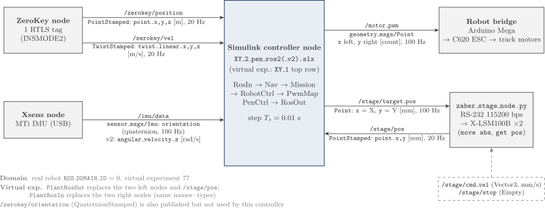

*Hình 2. Các nút và topic ROS 2 (kiểu, trường, đơn vị, tần số)*

Cứ mỗi 10 ms, bộ điều khiển Simulink thực hiện lần lượt các bước sau.

1. RosIn đọc giá trị mới nhất của bốn topic. Vì ZeroKey chạy ở 20 Hz, cùng một giá trị đến trong năm chu kỳ.
2. Nav chuyển vị trí thẻ định vị và hướng thành `pose` trong hệ tọa độ tường $= [\hat x;\ \hat y;\ \hat\psi]$.
3. Mission xác định giai đoạn (chế độ) hiện tại và xuất đoạn thẳng để robot bám theo cùng đường bút.
4. RobotCtrl tính $(v_c,\ \omega_c)$ theo luật phù hợp với chế độ, và PwmMap chuyển nó thành PWM trái/phải.
5. PenCtrl tính đích bàn trượt $s^{\star}$ từ cùng `pose`.
6. RosOut phát `/motor_pwm` và `/stage/target_pos`.

Nút bàn trượt chỉ lưu giá trị cuối cùng trong số các đích đến với tần số 100 Hz và gửi lệnh nối tiếp `move abs` ở 25 Hz. Một dòng lệnh nối tiếp mất vài ms, nên gửi tất cả ở 100 Hz sẽ khiến các lệnh bị dồn ứ.

### 2.5 Bốn tệp Simulink

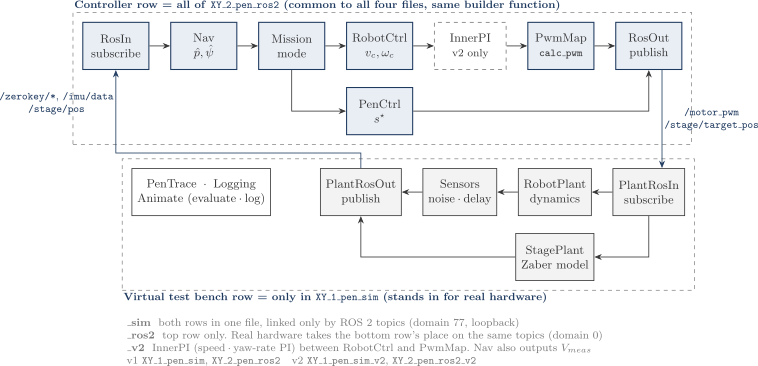

*Hình 3. Quan hệ giữa bốn tệp*

Bốn tệp được phân chia theo hai tiêu chí. Tiêu chí thứ nhất là môi trường thử nghiệm. `XY_1_pen_sim`, có tên kết thúc bằng `_sim`, là mô hình thí nghiệm ảo chứa, bên dưới bộ điều khiển, một robot ảo (RobotPlant), các cảm biến ảo (Sensors) và một bàn trượt ảo (StagePlant). Thiết bị ảo phát và đăng ký các topic ROS 2 có tên và kiểu hoàn toàn giống thiết bị thật, và bộ điều khiển với thiết bị ảo không nối với nhau bằng đường nối mà chỉ giao tiếp qua topic. `XY_2_pen_ros2`, có tên kết thúc bằng `_ros2`, chỉ chứa hàng bộ điều khiển được dựng bởi cùng hàm bộ tạo mô hình, và các nút trên NUC thật thay thế cho thiết bị ảo. Do đó bộ điều khiển đã được kiểm chứng trong thí nghiệm ảo được nối với robot thật mà không thay đổi một ký tự nào. Hai mô hình dùng các ROS domain khác nhau (ảo 77, thật 0) để `/motor_pwm` từ thí nghiệm ảo không làm di chuyển robot thật trên cùng mạng.

Tiêu chí thứ hai là phiên bản. Phiên bản 1 chuyển lệnh vận tốc vòng ngoài $(v_c,\ \omega_c)$ trực tiếp thành PWM chỉ bằng phép co giãn tỉ lệ. Phiên bản 2 (`_v2`) chèn vào giữa hai vòng PI trong, giống hệt các vòng của mô hình Xsens thật. Một vòng làm cho tốc độ tiến thực $u_B$, đo bằng vận tốc ZeroKey, bằng $v_c$; vòng còn lại làm cho tốc độ yaw $r$, đo bằng gyro, bằng $\omega_c$. Các vòng PI trong chỉ làm robot chuyển động đúng như lệnh và không thay đổi độ chính xác của bút. Trong thí nghiệm ảo, RMS của bút là 1.17–1.20 mm với phiên bản 1 và 1.21–1.24 mm với phiên bản 2.

---

## 3. Hệ tọa độ và ma trận quay

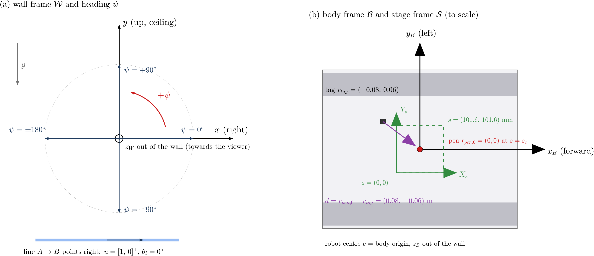

*Hình 4. (a) Hệ tọa độ tường và hướng, (b) hệ tọa độ thân và hệ tọa độ bàn trượt*

### 3.1 Ba hệ tọa độ

Hệ tọa độ tường $\mathcal W$ gắn cố định với tường. Nhìn tường từ phía trước, $x$ hướng sang phải (nằm ngang), $y$ hướng lên trên (về phía trần), và $z$ hướng ra khỏi tường. Đây là hệ tọa độ thuận tay phải như trong ROS REP-103, và vì $z$ cùng hướng với trục $z_B$ của thân robot, góc ngược chiều kim đồng hồ từ $x$ đến $y$ là hướng dương. `plane_project` trong Simulink của robot thật dùng $p_1$ cho độ cao và $p_2$ cho phương ngang hướng sang trái, liên hệ với tọa độ của tài liệu này bởi $x = -p_2$, $y = p_1$, $\psi = \psi_{old} + 90^{\circ}$. Hệ tọa độ thân $\mathcal B$ gắn với robot và chuyển động cùng robot; $x_B$ hướng về phía trước và $y_B$ hướng sang trái robot. Hệ tọa độ bàn trượt $\mathcal S$ song song với các trục thân, có gốc tại vị trí gốc (home) của bàn trượt (một đầu hành trình), và có đơn vị mm.

Hướng $\psi$ là góc đo ngược chiều kim đồng hồ từ trục $x$ đến trục $x_B$. Khi robot hướng sang phải $\psi = 0$, khi hướng lên trần $+90^{\circ}$, và khi hướng sang trái $180^{\circ}$. Đường thẳng trong tài liệu này đi từ $A = (-0.70,\ 0.30)$ m đến $B = (0.50,\ 0.30)$ m, dài 1.2 m sang phải ở độ cao 0.30 m, nên hướng đường thẳng là $\theta_l = 0^{\circ}$.

### 3.2 Ma trận quay

Ma trận biến đổi một vectơ $a_B$ viết trong tọa độ thân thành tọa độ tường là ma trận quay.

$$
R(\psi) = \begin{bmatrix} \cos\psi & -\sin\psi \cr \sin\psi & \cos\psi \end{bmatrix} = \begin{bmatrix} x_B & y_B \end{bmatrix}, \qquad a_W = R(\psi)\thinspace a_B, \qquad a_B = R^{\top}(\psi)\thinspace a_W \qquad (1)
$$

| Ký hiệu | Cách đọc | Ý nghĩa |
|---|---|---|
| $R(\psi)$ | R psi | Phép quay thân → tường. Cột thứ nhất là $x_B$ viết trong tọa độ tường, cột thứ hai là $y_B$ |
| $R^{\top}(\psi)$ | R chuyển vị | Tường → thân. Ma trận quay là ma trận trực giao nên nghịch đảo của nó là chuyển vị |
| $a_W,\ a_B$ | – | Các thành phần của cùng một mũi tên viết trong tọa độ tường và tọa độ thân |

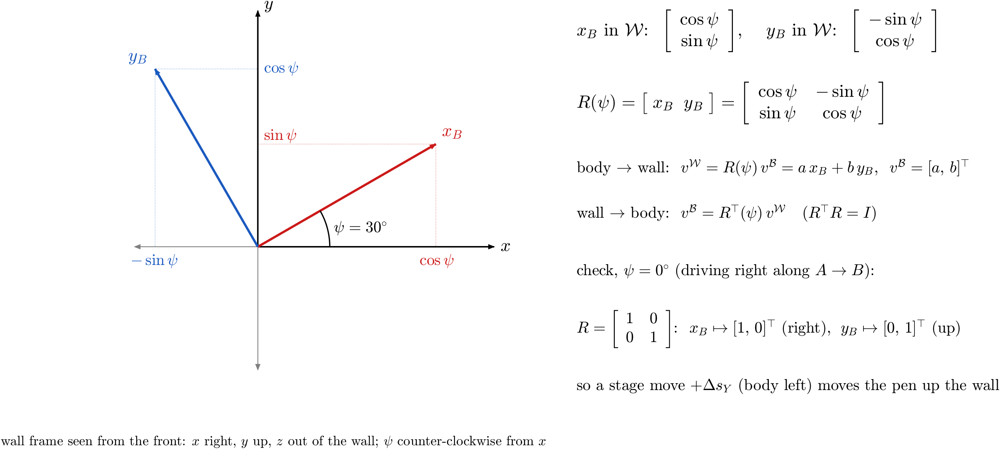

*Hình 5. Các cột của ma trận quay là các trục thân viết trong tọa độ tường*

Cột thứ nhất là $x_B$ vì khi thay vectơ thân $a_B = (1,\ 0)$, tức vectơ đơn vị theo phương $x_B$, thì $R a_B$ bằng cột thứ nhất. Ví dụ, tại $\psi = 0$, khi robot hướng sang phải, $R = I$, và tại $\psi = 90^{\circ}$, khi robot hướng lên trần, $R = [\thinspace 0\ \ {-1};\ 1\ \ 0\thinspace]$. Tại $\psi = 0$ cột thứ nhất $(1,\ 0)$ là phương $x$, tức sang phải trên tường, đúng là hướng phía trước của robot. Cột thứ hai $(0,\ 1)$ là phương $y$, tức hướng lên. Bên trái của robot hướng sang phải là phía trên, nên điều này cũng đúng. Ở tư thế này, di chuyển trục Y của bàn trượt theo chiều + sẽ di chuyển bút lên trên tường. Sự tương ứng này được dùng trực tiếp để hiểu các dấu trong Chương 6.

### 3.3 Cánh tay đòn

Vectơ từ thẻ định vị đến "bút khi bàn trượt ở giữa hành trình", viết trong tọa độ thân, được gọi là cánh tay đòn $d$.

$$
d = r_{pen0} - r_{tag} = (0,\ 0) - (-0.08,\ 0.06) = (0.08,\ -0.06)\ \mathrm{m} \qquad (2)
$$

Vì $d$ gắn cố định với robot nên nó là hằng số trong tọa độ thân, nhưng trong tọa độ tường nó trở thành $R(\psi)\thinspace d$, có hướng thay đổi theo hướng robot. Nếu hướng được biết sai thì $R(\hat\psi)\thinspace d$ sai, và độ chênh lệch đó trực tiếp trở thành sai số vị trí bút (Chương 7).

---

## 4. Phát biểu bài toán điều khiển

### 4.1 Vị trí đầu bút

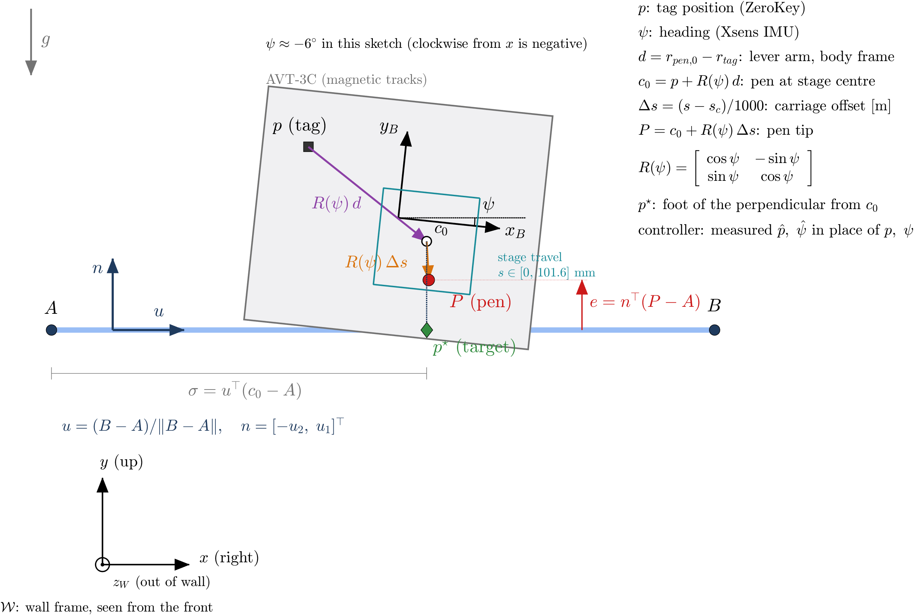

*Hình 6. Hệ tọa độ tường và hình học bù bút (phóng to, không theo tỉ lệ)*

Đầu bút $P$ là điểm nhận được bằng cách xuất phát từ vị trí thẻ định vị $p$, cộng cánh tay đòn $d$ và độ dịch chuyển con trượt của bàn trượt $\Delta s$ trong tọa độ thân, rồi quay kết quả sang hệ tọa độ tường.

$$
P = p + R(\psi)\thinspace (d + \Delta s), \qquad \Delta s = \frac{s - s_c}{1000}\ [\mathrm{m}] \qquad (3)
$$

| Ký hiệu | Ý nghĩa | Đơn vị |
|---|---|---|
| $p$ | Vị trí thẻ định vị (tường) | m |
| $\psi$ | heading | rad |
| $d$ | Cánh tay đòn thẻ định vị → bút ở giữa (thân) | m |
| $s$ | Vị trí bàn trượt (tọa độ Zaber, vị trí gốc (home) = 0) | mm |
| $s_c$ | Giữa hành trình, 50.8 mm | mm |
| $\Delta s$ | Độ dịch chuyển con trượt so với vị trí giữa (thân) | m |

### 4.2 Mục tiêu

Bút nằm trên đường thẳng $AB$ có nghĩa là khoảng cách của bút theo phương pháp tuyến với đường thẳng, tức sai số ngang, bằng 0.

$$
e(t) = n^{\top}\big(P(t) - A\big) = 0, \qquad u = \frac{B - A}{\lVert B - A\rVert}, \quad n = J u, \quad J = \begin{bmatrix} 0 & -1 \cr 1 & 0 \end{bmatrix} \qquad (4)
$$

$u$ là vectơ đơn vị dọc theo đường thẳng, và $n$ là pháp tuyến nhận được bằng cách quay $u$ ngược chiều kim đồng hồ 90° (phía trái của đường thẳng; hướng lên đối với đường này). Dọc theo đường thẳng, bút chỉ cần đi từ $A$ đến $B$, nên không cần lịch trình thời gian chính xác. Nghĩa là đại lượng duy nhất cần điều khiển là sai số ngang $e$, còn việc di chuyển là một điều kiện lỏng "chỉ cần cuối cùng đến được điểm cuối".

### 4.3 Chuyển động của hai cơ cấu chấp hành

Chuyển động của tâm robot $c$ và hướng như sau (nhiễu và sự dịch chuyển tâm quay được trình bày ở Mục 8.2).

$$
\dot c = v \begin{bmatrix} \cos\psi \cr \sin\psi \end{bmatrix}, \qquad \dot\psi = \omega \qquad (5)
$$

Việc không có vận tốc ngang trong PT (5) chính là ràng buộc không holonom. Robot chỉ chuyển động theo phương $x_B$, và vị trí ngang của nó chỉ thay đổi khi thay đổi hướng. Ngược lại, bàn trượt di chuyển X và Y của thân một cách độc lập và nhanh, nhưng không thể vượt quá $\lvert\Delta s_i\rvert \le 50.8$ mm.

### 4.4 Cơ sở của việc phân chia vai trò

Xét đồng thời các PT (3)–(5), có hai cách giảm sai số ngang $e$: robot quay và trở về đường thẳng, hoặc bàn trượt di chuyển bút về phía đường thẳng. Hệ thống này phân chia hai cách như sau.

| Thành phần | Giao cho | Lý do |
|---|---|---|
| Di chuyển dọc đường thẳng (1.2 m) | Robot $v$ | Không thể thực hiện với hành trình bàn trượt 101.6 mm |
| Thành phần chậm của sai số ngang (trung bình, vài cm) | Robot $\omega$ | Giữ bàn trượt làm việc gần giữa hành trình |
| Thành phần nhanh của sai số ngang (độ gồ ghề của xích 0.35 Hz, trượt (creep), nhiễu) | Bàn trượt $\Delta s$ | Sự hội tụ ngang của robot chậm, vài giây |
| Dịch chuyển bút do sai số hướng tạo ra qua cánh tay đòn | Bàn trượt $\Delta s$ | Bút là một điểm nên hướng không quan trọng, chỉ vị trí cần khớp |

Vì bút là một điểm nên nó không có "hướng". Do đó bản thân hướng robot không phải là mục tiêu điều khiển; nó chỉ có ý nghĩa thông qua con đường ảnh hưởng đến vị trí bút qua cánh tay đòn. Ngay cả khi hướng robot lệch khỏi đường thẳng 3°, đường vẫn được vẽ thẳng miễn là bàn trượt di chuyển bút một lượng tương ứng (ví dụ số ở Mục 6.7).

---

## 5. Mức vĩ mô: điều khiển robot

### 5.1 Các giai đoạn nhiệm vụ và quay tại chỗ

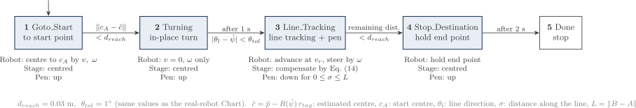

*Hình 7. Các giai đoạn nhiệm vụ (Stateflow ModeChart)*

Nhiệm vụ được chia thành năm giai đoạn, và máy trạng thái Stateflow ModeChart chuyển đổi giữa chúng. Lúc bắt đầu, robot ở $(-0.85,\ 0.10)$ m, cách xa đường thẳng, hướng lên trần ($\psi_0 = 90^{\circ}$).

Ở chế độ 1 (Goto_Start), robot di chuyển đến điểm bắt đầu phù hợp để bắt đầu đường thẳng. Đích ở đây không phải thẻ định vị mà là điểm bắt đầu $c_A$ của tâm robot. Vì phép quay tại chỗ ở giai đoạn tiếp theo quay quanh tâm robot, tâm phải được căn chỉnh trước khi quay để thẻ định vị đến được điểm bắt đầu đã định sau khi quay. Nếu robot dẫn đường theo thẻ định vị, thẻ định vị sẽ vạch một cung tròn bán kính 0.1 m trong khi quay, và điểm bắt đầu đường thẳng sẽ lệch khoảng 11 cm.

Ở chế độ 2 (Turning), robot quay tại chỗ với tốc độ tiến bằng không để căn hướng theo hướng đường thẳng $0^{\circ}$. Phép quay tại chỗ chỉ được dùng trong giai đoạn này, và bút chưa được sử dụng. Khi sai số nằm trong 1° hơn 1 s, nhiệm vụ chuyển sang giai đoạn tiếp theo.

Ở chế độ 3 (Line_Tracking), robot di chuyển dọc đường thẳng với tốc độ 30 mm/s trong khi bàn trượt đồng thời thực hiện bù bút. Lệnh tốc độ quay $\omega_c$ cũng được phát trong giai đoạn này, nhưng đó không phải là quay tại chỗ; đó là lái để hiệu chỉnh dần hướng trong khi di chuyển. Robot lái trong khi di chuyển, và bàn trượt loại bỏ độ lệch vẫn còn lại. Đây là câu trả lời cho câu hỏi "hệ thống vừa quay vừa điều khiển bàn trượt phải không?".

Ở chế độ 4 (Stop_Destination), robot dừng tại điểm cuối, và 2 s sau mô phỏng kết thúc ở chế độ 5. Trong chế độ 3, bút chỉ được đánh giá là hạ bút khi đích bút nằm giữa $A$ và $B$. Robot thật chưa có cơ cấu nâng bút, nên việc xác định khoảng này chỉ dùng cho ghi log.

Đoạn thẳng mà robot bám theo không trùng với đường bút. Để bút nằm trên đường thẳng khi bàn trượt ở giữa, thẻ định vị phải bám theo một đường song song lệch khỏi đường thẳng một lượng $-R(\theta_l)\thinspace d$. Ngoài ra, robot bắt đầu sớm hơn 60 mm để ổn định trước khi bút đến $A$, và đi quá điểm cuối 40 mm.

$$
r_A = A - R(\theta_l)\thinspace d - 0.06\thinspace u, \qquad r_B = B - R(\theta_l)\thinspace d + 0.04\thinspace u, \qquad c_A = r_A - R(\theta_l)\thinspace r_{tag} \qquad (6)
$$

### 5.2 Luật bám đường thẳng

Điểm tham chiếu $x_r$ của chế độ 3 di chuyển dọc đoạn thẳng với tốc độ không đổi $v_r$ theo thời gian. Robot xét độ chênh lệch giữa nó và điểm tham chiếu này trong tọa độ thân.

$$
x_r(t) = r_A + v_r\thinspace (t - t_{line})\thinspace u, \qquad
\begin{bmatrix} e_x \cr e_y \end{bmatrix} = R^{\top}(\hat\psi)\thinspace (x_r - \hat p), \qquad
e_\theta = \mathrm{wrap}(\theta_l - \hat\psi) \qquad (7)
$$

$$
v_c = v_r \cos e_\theta + k_x\thinspace e_x, \qquad \omega_c = k_y\thinspace e_y + k_\psi \sin e_\theta \qquad (8)
$$

$e_x$ là khoảng cách điểm tham chiếu nằm phía trước robot, và $e_y$ là khoảng cách điểm tham chiếu nằm bên trái robot. Robot có thể giảm trực tiếp sai số dọc $e_x$ bằng tốc độ tiến, nhưng không thể giảm trực tiếp sai số ngang $e_y$. Do đó $e_y$ đi vào lệnh quay $\omega_c$. Nếu điểm tham chiếu ở bên trái ($e_y > 0$), robot quay trái, và sai số ngang giảm dần khi robot tiến với hướng đã lệch.

Lý do quá trình này chậm trở nên rõ ràng khi tuyến tính hóa các phương trình gần đường thẳng. Gọi $y_l$ là vị trí ngang của robot đo về phía trái đường thẳng và $\phi = \psi - \theta_l$ là độ chênh hướng so với đường thẳng; khi đó từ PT (5), $\dot y_l = v\sin\phi \approx v_r\phi$ và $\dot\phi = \omega$. Với sai số nhỏ $e_y \approx -y_l$ và $e_\theta \approx -\phi$, nên PT (8) trở thành $\omega = -k_y y_l - k_\psi\phi$, và vòng kín như sau.

$$
\ddot y_l + k_\psi\thinspace \dot y_l + v_r k_y\thinspace y_l = 0, \qquad
\lambda = \frac{-k_\psi \pm \sqrt{k_\psi^2 - 4 v_r k_y}}{2} \qquad (9)
$$

| Đại lượng | Cách tính | Kết quả |
|---|---|---|
| $v_r k_y$ | 0.03 × 5.0 | 0.15 s⁻² |
| Nghiệm $\lambda$ | $(-1.4 \pm \sqrt{1.96 - 0.60})/2$ | $-0.117$, $-1.283$ s⁻¹ |
| Hằng số thời gian của nghiệm chậm | 1/0.117 | 8.5 s |

Vì hằng số thời gian của nghiệm chậm là 8.5 s, robot chỉ giảm được khoảng 63 % độ lệch ngang sau 8.5 s. Trong khoảng thời gian đó robot đi được khoảng 25 cm. Vì tốc độ di chuyển $v_r$ nhân vào hệ số khuếch đại vòng, robot di chuyển càng chậm thì sai số ngang giảm càng chậm. Đây không phải là vấn đề có thể giải quyết bằng cách tăng hệ số khuếch đại. Tăng gấp đôi $k_y$ làm giảm RMS của robot từ 23.6 mm xuống 17.1 mm, nhưng hướng dao động nhiều hơn và RMS của bút tăng từ 1.19 mm lên 1.32 mm (Mục 18.5). Đây là lý do độ chính xác của bút được giao cho bàn trượt chứ không phải cho robot.

### 5.3 Từ lệnh vận tốc đến động cơ

`calc_pwm` trong PwmMap dùng nguyên hàm của Simulink robot thật. Trên robot thật, đầu ra của vòng PI trong $\bar V,\ \bar W \in [-0.5,\ 0.5]$ đi vào hàm này, nên phiên bản 1 chuẩn hóa các lệnh vận tốc về cùng khoảng trước khi đưa vào.

$$
\bar V = \frac{v_c}{2 v_{full}}, \quad \bar W = \frac{\omega_c}{2\omega_{full}}, \qquad
T(\bar V) = d_v\tanh\frac{\bar V}{0.02} + (400 - d_v)\frac{\bar V}{0.5} \qquad (10)
$$

$$
u_L = 1500 + T(\bar V) - T_s(\bar W), \qquad u_R = 1500 - \big(T(\bar V) + T_s(\bar W)\big) \qquad (11)
$$

Số hạng thứ nhất của $T$ là phép bù nghịch đảo nhảy như một bậc $d_v$ = 47 count gần 0 để vượt qua vùng chết của ESC (khoảng PWM nhỏ mà động cơ không quay), và số hạng thứ hai lấp đầy khoảng còn lại một cách tuyến tính. Thành phần quay $T_s$ được trừ ở bên trái và cộng ở bên phải để tạo chênh lệch tốc độ trái/phải. Động cơ phải được lắp đối xứng gương, nên dấu của PWM phải bị đảo ngược.

Trên robot thật, ESC nhận PWM và điều khiển tốc độ động cơ. RobotPlant của thí nghiệm ảo mô hình hóa quá trình này theo thứ tự: ánh xạ nghịch đảo ESC, trễ bậc nhất 0.15 s, PI tốc độ, phân phối lực kéo và động lực học xích (Mục 14.4).

---

## 6. Mức vi mô: Bù động học bút

### 6.1 Vì sao cần bù

Dù bộ điều khiển robot ở Chương 5 hoạt động tốt đến đâu, sai số ngang của robot vẫn còn vài cm. Nếu bàn trượt được cố định ở giữa, bút sẽ đi theo mọi dao động của robot, và sai số ngang của đường được vẽ là 14.84 mm RMS. Sai số này có ba nguyên nhân. Thứ nhất, robot trôi ngang ra khỏi đường thẳng (trượt (creep), hội tụ ngang chậm). Thứ hai, khi hướng dao động, bút bị dịch ngang qua cánh tay đòn $d$; mức dịch này vào khoảng 1.4 mm cho mỗi 1° hướng (Mục 8.6.5). Thứ ba, khi robot tiến tới theo một góc nghiêng, bút cũng di chuyển theo góc nghiêng đó. Cả ba nguyên nhân đều là những đại lượng tính được khi đã biết "robot hiện đang ở đâu và hướng về phía nào", nên bàn trượt chỉ cần đưa bút ngược lại đúng một lượng như vậy. Đó chính là bù động học bút.

### 6.2 Ký hiệu và biến trong mã

Bù bút gồm vài dòng mã MATLAB trong khối Simulink PenComp. Các phương trình và hình vẽ trong chương này đều dùng chung một bộ ký hiệu, và tên biến trong mã được ánh xạ sang các ký hiệu đó một lần duy nhất trong bảng dưới đây. Hình vẽ và phần lời văn chỉ dùng ký hiệu toán học, không dùng tên trong mã.

| Ký hiệu | Biến trong mã | Hệ tọa độ | Đơn vị | Ý nghĩa | Dấu hiệu trên hình |
|---|---|---|---|---|---|
| $\hat p$ | `pT` = `pose(1:2)` | hệ tọa độ tường $\mathcal W$ | m | Vị trí thẻ định vị (tag) do ZeroKey đo được | hình vuông đen |
| $\hat\psi$ | `pose(3)` | – | rad | Hướng do IMU đo được (ngược chiều kim đồng hồ tính từ trục $x$) | – |
| $R(\hat\psi)$ | `R` | thân → tường | – | Ma trận quay một mũi tên trong hệ thân thành mũi tên trong hệ tường | các trục $x_B$, $y_B$ màu xám |
| $d$ | `pen_d` | hệ tọa độ thân $\mathcal B$ | m | Cánh tay đòn từ thẻ định vị đến bút khi bàn trượt ở giữa; là hằng số do cách lắp đặt quy định | mũi tên tím |
| $c_0$ | `pc` | tường | m | Điểm bút chạm tới khi bàn trượt ở giữa, $\hat p + R(\hat\psi)\thinspace d$ | hình tròn trắng |
| $A$, $B$, $L$ | `lineAB`, `L` | tường | m | Hai đầu mút và chiều dài của đường thẳng cần vẽ | các chấm xanh đậm, đường xanh lam |
| $u$, $n$ | `u` | tường | – | Vectơ đơn vị dọc đường thẳng, pháp tuyến $n = Ju$ (hướng lên là +) | các mũi tên xanh đậm |
| $\sigma$ | `sigma` | – | m | Khoảng cách dọc đường thẳng của $c_0$ | đường kích thước |
| $e_0$ | – | – | m | Sai số ngang khi bàn trượt ở giữa, $n^{\top}(c_0 - A)$ | – |
| $p^{\star}$ | `p_des` | tường | m | Mục tiêu của bút; chân đường vuông góc hạ từ $c_0$ xuống đường thẳng | hình thoi xanh lá |
| $\Delta s$ | `e_b` | thân | m | Lượng mà bàn trượt phải dịch bút khỏi vị trí giữa | mũi tên cam |
| $s_c$ | `stage_c` | bàn trượt | mm | Số đọc thang Zaber tại vị trí giữa của bàn trượt (50.8) | dấu cộng đen |
| $s^{\star}$ | `s_cmd` | bàn trượt | mm | Lệnh vị trí gửi tới Zaber | hình tròn đỏ |
| $P$ | – | tường | m | Đầu bút thực tế | hình tròn đỏ |

```matlab
A = lineAB(1:2);  B = lineAB(3:4);
L = norm(B - A);  u = (B - A) / max(L, 1e-9);
pT = pose(1:2);
R  = [cos(pose(3)) -sin(pose(3)); sin(pose(3)) cos(pose(3))];
pc = pT + R * pen_d;                 % c0
sigma = dot(u, pc - A);              % sigma
pen_on = 0;
s_cmd = [stage_c; stage_c];
if round(mode) == 3
    p_des = A + sigma * u;           % p*
    e_b = R' * (p_des - pT) - pen_d; % Delta s [m]
    s_cmd = stage_c + 1000 * e_b;    % s* [mm]
    pen_on = double(sigma >= 0 && sigma <= L);
end
```

Mọi giá trị số trong chương này đều thuộc về cùng một thời điểm. Trong lúc bám đường thẳng, $\hat p = (-200.0,\ 345.0)$ mm và $\hat\psi = 3^{\circ}$, và đường thẳng đi từ $A = (-700,\ 300)$ mm đến $B = (500,\ 300)$ mm. Bộ điều khiển tính toán nội bộ theo m, nhưng để dễ đọc, các giá trị trên hình và trong lời văn được ghi theo mm. Mọi hình vẽ đều được vẽ đúng tỉ lệ.

| Hình | Hệ tọa độ được quan sát | Điều chỉ hình này cho thấy |
|---|---|---|
| Hình 8 | Thân (nhìn khi ngồi trên robot) | $d$, $\Delta s$ và tam giác mũi tên |
| Hình 9 | Tường (nhìn thẳng vào tường) | $u$, $n$, $\sigma$, $c_0$, $p^{\star}$, $e_0$ |
| Hình 10 | Hai hệ tọa độ đặt cạnh nhau | Cách $R^{\top}(\hat\psi)$ thay đổi thang đo dùng để đọc cùng một mũi tên |
| Hình 11 | Bàn trượt (thang Zaber) | $\times 1000$ và $+\thinspace s_c$ |
| Hình 12 | Trình tự tính toán | Hệ tọa độ và đơn vị của từng bước |
| Hình 13 | Bốn hình trên gộp vào một trang | Toàn bộ các bước tính toán và lệnh cuối cùng |

### 6.3 Hệ tọa độ thân: Phương trình vị trí bút và tam giác mũi tên

Vị trí đầu bút được cho bởi PT (3). Khi con trượt của bàn trượt được dịch đi $\Delta s$ khỏi vị trí giữa, bút nằm tại mũi tên thân $d + \Delta s$ tính từ thẻ định vị. Khi vị trí trên tường $p^{\star}$ mà bút phải tới đã được xác định, giải phương trình này theo $\Delta s$ sẽ cho chuyển động của con trượt.

$$
p^{\star} = \hat p + R(\hat\psi)\thinspace (d + \Delta s)
\quad\Longrightarrow\quad
\underbrace{d}_{\text{tím}} + \underbrace{\Delta s}_{\text{cam}} = \underbrace{R^{\top}(\hat\psi)\thinspace (p^{\star} - \hat p)}_{\text{xanh lá}}
\quad\Longrightarrow\quad
\Delta s = R^{\top}(\hat\psi)\thinspace (p^{\star} - \hat p) - d \qquad (12)
$$

Vì $R$ là ma trận trực giao, nhân hai vế với $R^{\top}$ sẽ giải được phương trình ngay. Các giá trị đo được $\hat p$, $\hat\psi$ được sử dụng vì phép đo là tất cả những gì bộ điều khiển biết. Đẳng thức ở giữa của PT (12) là một tam giác tạo bởi ba mũi tên trong hệ tọa độ thân, và Hình 8 minh họa tam giác đó.

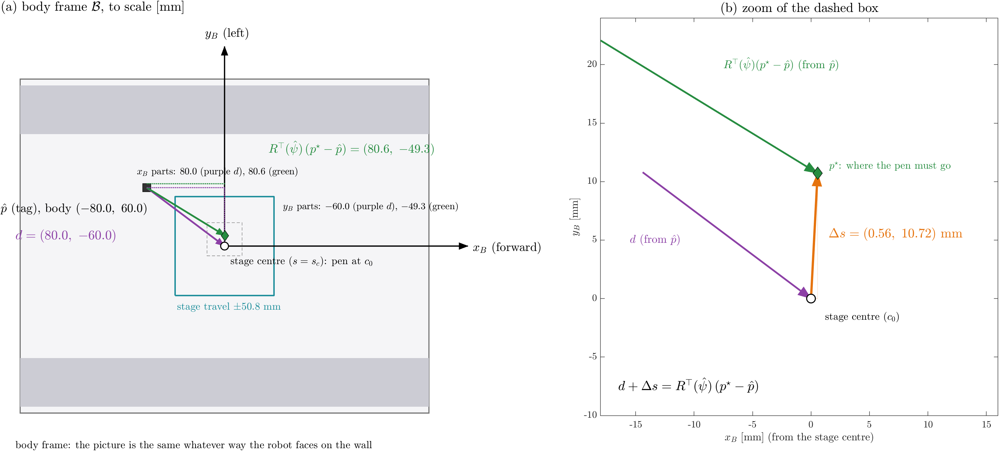

*Hình 8. PT (12) nhìn trong hệ tọa độ thân. (a) Toàn bộ robot (đúng tỉ lệ), (b) phóng to vùng giữa bàn trượt*

Hình 8 là góc nhìn từ phía trên robot. Vì hệ tọa độ thân quay cùng robot, khung xe, thẻ định vị và bàn trượt luôn chiếm cùng một vị trí trong hình này, bất kể robot hướng về phía nào trên tường. Trục ngang là hướng tiến $x_B$, trục đứng là phía bên trái của robot $y_B$.

| Trên hình | Ký hiệu | Giá trị [mm] (thành phần thân) | Ý nghĩa |
|---|---|---|---|
| hình vuông đen | $\hat p$ | thân $(-80.0,\ 60.0)$ | Điểm ZeroKey thực sự đo; không phải tâm robot, cũng không phải bút |
| hình tròn trắng | $c_0$ | thân $(0,\ 0)$ | Bút khi bàn trượt ở giữa ($s = s_c$) |
| hình vuông xanh ngọc | hành trình bàn trượt | $\pm 50.8$ | Phạm vi bút có thể di chuyển so với thân |
| mũi tên tím | $d$ | $(80.0,\ -60.0)$ | Từ $\hat p$ đến $c_0$; là hằng số, bộ điều khiển không thể thay đổi |
| mũi tên xanh lá | $R^{\top}(\hat\psi)\thinspace (p^{\star} - \hat p)$ | $(80.6,\ -49.3)$ | Từ $\hat p$ đến mục tiêu của bút; do phép đo và đường thẳng quyết định, thay đổi ở mỗi chu kỳ |
| hình thoi xanh lá | $p^{\star}$ | thân $(0.56,\ 10.72)$ | Nơi bút phải tới |
| mũi tên cam | $\Delta s$ | $(0.56,\ 10.72)$ | Từ $c_0$ đến $p^{\star}$; lượng bàn trượt dịch bút |

Có hai đường đi từ $\hat p$ đến mục tiêu của bút: đi thẳng theo mũi tên xanh lá, hoặc đi theo mũi tên tím đến vị trí giữa bàn trượt rồi theo mũi tên cam đến mục tiêu của bút. Vì hai đường đi kết thúc tại cùng một điểm, PT (12) được thỏa mãn. Nói cách khác, $\Delta s$ là "mũi tên cần đi trừ đi mũi tên đã gắn sẵn trên robot". Các đường nét đứt trong Hình 8(a) biểu diễn riêng các thành phần của hai mũi tên.

| Thành phần | tím $d$ | xanh lá $R^{\top}(\hat\psi)(p^{\star} - \hat p)$ | hiệu $= \Delta s$ |
|---|---|---|---|
| $x_B$ (hướng tiến) | 80.0 | 80.6 | 0.56 |
| $y_B$ (bên trái) | $-60.0$ | $-49.3$ | 10.72 |

Phép trừ được thực hiện trong hệ tọa độ thân vì $d$ là đại lượng cho trong hệ tọa độ thân, và hai trục bàn trượt $X_s$, $Y_s$ cũng gắn với các trục thân $x_B$, $y_B$. Các mũi tên chỉ có thể cộng hoặc trừ theo từng thành phần khi chúng được viết trong cùng một hệ tọa độ. Đây là lý do mũi tên trong hệ tường $p^{\star} - \hat p$ trước hết phải được chuyển sang hệ tọa độ thân, việc do $R^{\top}(\hat\psi)$ đảm nhận (Mục 6.5). Câu hỏi còn lại là đặt $p^{\star}$ ở đâu, điều này được quyết định trong hệ tọa độ tường (Mục 6.4).

### 6.4 Hệ tọa độ tường: Mục tiêu của bút $p^{\star}$

Như đã thấy ở Mục 4.2, điểm trên đường thẳng mà bút cần có mặt không được quy định trước. Vị trí dọc đường thẳng do robot quyết định khi tiến tới, và bàn trượt chỉ cần loại bỏ độ lệch khỏi đường thẳng. Do đó, mục tiêu là chân đường vuông góc hạ xuống đường thẳng từ $c_0$, tức vị trí bút khi bàn trượt ở giữa.

$$
c_0 = \hat p + R(\hat\psi)\thinspace d, \qquad \sigma = u^{\top}(c_0 - A), \qquad e_0 = n^{\top}(c_0 - A), \qquad p^{\star} = A + \sigma u = c_0 - e_0\thinspace n \qquad (13)
$$

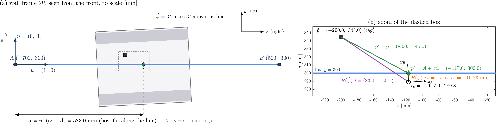

*Hình 9. PT (13) nhìn trong hệ tọa độ tường. (a) Toàn bộ đường thẳng và khoảng cách dọc đường thẳng $\sigma$ (đúng tỉ lệ), (b) phóng to khung nét đứt*

Hình 9 cho thấy bức tường khi nhìn thẳng vào. $x$ hướng sang phải, $y$ hướng lên trên, và trọng lực $g$ tác dụng theo hướng $-y$. Robot hướng dọc theo đường thẳng (sang phải) với mũi xe ngóc lên trên $3^{\circ}$.

| Trên hình | Ký hiệu | Giá trị [mm] (thành phần tường) | Ý nghĩa |
|---|---|---|---|
| đường xanh lam, các chấm xanh đậm | $A$, $B$ | $(-700,\ 300)$, $(500,\ 300)$ | Đường thẳng cần vẽ, $L = 1200$ |
| mũi tên ngang tại $A$ | $u$ | $(1,\ 0)$ | Vectơ đơn vị dọc đường thẳng, $(B - A)/L$ |
| mũi tên đứng tại $A$ | $n = Ju$ | $(0,\ 1)$ | Pháp tuyến của đường thẳng; hướng đo sai số ngang (hướng lên là +) |
| hình vuông đen | $\hat p$ | $(-200.0,\ 345.0)$ | Giá trị đo của ZeroKey |
| mũi tên tím (b) | $R(\hat\psi)\thinspace d$ | $(83.0,\ -55.7)$ | $d$ của Hình 8 được quay sang hệ tọa độ tường |
| hình tròn trắng | $c_0$ | $(-117.0,\ 289.3)$ | Điểm bút chạm tới khi bàn trượt ở giữa |
| đường kích thước phía dưới | $\sigma$ | 583.0 | Khoảng cách từ $A$ đến $c_0$ đo dọc đường thẳng; bút đã đi được bao xa dọc đường thẳng |
| – | $e_0$ | $-10.73$ | $c_0$ nằm thấp hơn đường thẳng 10.73 mm |
| hình thoi xanh lá | $p^{\star}$ | $(-117.0,\ 300.0)$ | Điểm trên đường thẳng có cùng vị trí dọc đường thẳng với $c_0$ |
| mũi tên xanh lá (b) | $p^{\star} - \hat p$ | $(83.0,\ -45.0)$ | Thành phần tường của mũi tên xanh lá trong Hình 8 |
| mũi tên cam (b) | $R(\hat\psi)\thinspace \Delta s = -e_0\thinspace n$ | $(0.00,\ 10.73)$ | Thành phần tường của mũi tên cam trong Hình 8 |

$\sigma$ là tích vô hướng với $u$, tức độ dài hình chiếu (bóng) của mũi tên $c_0 - A$ lên phương dọc đường thẳng. Tương tự, $e_0$ là độ dài hình chiếu (bóng) lên pháp tuyến $n$. Vì $p^{\star}$ là điểm thu được khi chỉ loại bỏ thành phần pháp tuyến khỏi $c_0$, bàn trượt chỉ di chuyển vuông góc với đường thẳng và chỉ bằng độ lớn của sai số ngang. Lý do của sự phân công này là hành trình. Bút đã đi được bao xa dọc đường thẳng ($\sigma$) là phần việc của robot khi tiến tới, nên bàn trượt không can thiệp vào phương đó. Nếu $p^{\star}$ được đặt tại một điểm cụ thể trên đường thẳng (ví dụ một điểm tham chiếu di chuyển theo thời gian, hoặc $A$), bàn trượt sẽ cố hấp thụ cả sai số dọc đường thẳng vài cm của robot, và hành trình 101.6 mm sẽ không đủ. Thực tế, khi một phiên bản ban đầu kẹp $p^{\star}$ về $A$, trục X của bàn trượt đã chạy tới khoảng 95 mm ngay khi bắt đầu chế độ 3.

Điều kiện để hạ bút là $0 \le \sigma \le L$ (`pen_on` trong mã). Trong ví dụ này $0 \le 583.0 \le 1200$, nên bút được hạ xuống.

### 6.5 $R^{\top}(\hat\psi)$ liên kết hai hệ tọa độ

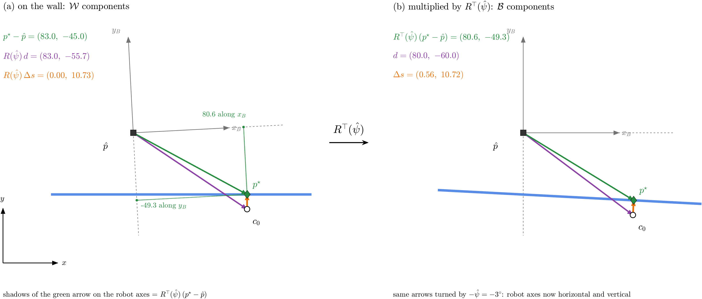

*Hình 10. Đọc cùng ba mũi tên dưới dạng (a) thành phần tường và (b) thành phần thân. Mũi tên ở giữa $R^{\top}(\hat\psi)$ chuyển (a) thành (b)*

Hai khung của Hình 10 vẽ cùng ba mũi tên; chỉ thang đo là khác nhau. (a) được đọc trên thang tường ($x$ sang phải, $y$ lên trên), như Hình 9(b), còn (b) được đọc trên thang robot ($x_B$ hướng tiến, $y_B$ bên trái), như Hình 8(b). Vì (b) là (a) quay đi $-\hat\psi = -3^{\circ}$, các trục robot trở thành nằm ngang và thẳng đứng, còn đường thẳng trông như bị nghiêng $3^{\circ}$.

| Mũi tên | (a) Thành phần tường [mm] | (b) Thành phần thân [mm] | Phép chuyển |
|---|---|---|---|
| xanh lá: $\hat p \to p^{\star}$ | $p^{\star} - \hat p = (83.0,\ -45.0)$ | $(80.6,\ -49.3)$ | $R^{\top}(\hat\psi)(p^{\star} - \hat p)$ |
| tím: $\hat p \to c_0$ | $R(\hat\psi)\thinspace d = (83.0,\ -55.7)$ | $d = (80.0,\ -60.0)$ | $R^{\top}R\thinspace d = d$ |
| cam: $c_0 \to p^{\star}$ | $R(\hat\psi)\thinspace \Delta s = (0.00,\ 10.73)$ | $\Delta s = (0.56,\ 10.72)$ | $R^{\top}R\thinspace \Delta s = \Delta s$ |

Tác dụng của $R^{\top}(\hat\psi)$ có thể thấy qua các đường nét đứt xanh lá trong Hình 10(a). Hạ các đường vuông góc từ đầu mũi tên xanh lá xuống các trục robot $x_B$, $y_B$ sẽ cho độ dài hình chiếu trên các trục lần lượt là 80.6 mm và $-49.3$ mm. Như đã thấy ở Mục 3.2, hai cột của $R$ là $x_B = (\cos\hat\psi,\ \sin\hat\psi)$ và $y_B = (-\sin\hat\psi,\ \cos\hat\psi)$ viết trong hệ tọa độ tường, nên hai hàng của $R^{\top}$ là $x_B^{\top}$, $y_B^{\top}$, và tích với mỗi hàng chính là độ dài hình chiếu.

$$
R^{\top}(\hat\psi)\thinspace (p^{\star} - \hat p) =
\begin{bmatrix} x_B^{\top}(p^{\star} - \hat p) \cr y_B^{\top}(p^{\star} - \hat p) \end{bmatrix}
= \begin{bmatrix} 83.0\cos 3^{\circ} - 45.0\sin 3^{\circ} \cr -83.0\sin 3^{\circ} - 45.0\cos 3^{\circ} \end{bmatrix}
= \begin{bmatrix} 80.6 \cr -49.3 \end{bmatrix}\ \mathrm{mm} \qquad (14)
$$

Tóm lại, PT (12) được đọc theo ba bước.

| Bước | Phép tính | Trên hình |
|---|---|---|
| 1 | $p^{\star} - \hat p$ | Đo mũi tên xanh lá của Hình 9(b) trên thang tường |
| 2 | $R^{\top}(\hat\psi)(\cdot)$ | Đo lại cùng mũi tên đó trên thang robot (Hình 10(a) → (b)) |
| 3 | $-\thinspace d$ | Trừ đi mũi tên tím đã gắn sẵn trên robot (Hình 8) |

Cũng có thể thu được kết quả này một cách ngắn gọn hơn. Vì $c_0 = \hat p + R(\hat\psi)\thinspace d$, PT (12) tương đương với $\Delta s = R^{\top}(\hat\psi)(p^{\star} - c_0)$, và thay $p^{\star} - c_0 = -e_0\thinspace n$ từ PT (13) vào sẽ cho dạng đơn giản sau.

$$
\Delta s = -e_0\thinspace R^{\top}(\hat\psi)\thinspace n = -e_0 \begin{bmatrix} \sin(\hat\psi - \theta_l) \cr \cos(\hat\psi - \theta_l) \end{bmatrix} \qquad (15)
$$

Nghĩa là, $\Delta s$ là mũi tên cam $(0.00,\ 10.73)$ mm của Hình 9(b) được đọc lại trên thang robot, $10.73\thinspace (\sin 3^{\circ},\ \cos 3^{\circ}) = (0.56,\ 10.72)$ mm. Khi robot song song với đường thẳng ($\hat\psi = \theta_l$), $\Delta s = (0,\ -e_0)$; tức là chỉ trục Y di chuyển, ngược chiều với sai số ngang và với cùng độ lớn. Khi robot nghiêng 3°, trục X cũng di chuyển một lượng $-e_0\sin 3^{\circ}$, nhờ đó bút được dịch vuông góc với đường thẳng trên tường chứ không theo trục Y đang bị nghiêng. Trong thí nghiệm ảo, trục X hầu như không di chuyển (51.0–53.8 mm) trong khi trục Y loại bỏ sai số ngang (61.3–72.2 mm), phù hợp với phương trình này. Đoạn mã tính trực tiếp từ $\hat p$ mà không đi qua $c_0$ chỉ là cùng một phương trình được viết theo thứ tự khác.

### 6.6 Từ $\Delta s$ đến lệnh Zaber: 1000 và $s_c$

$\Delta s$ trong các PT (12)–(15) là một vectơ trong hệ tọa độ thân, tính theo m. Tuy nhiên, firmware Zaber và topic `/stage/target_pos` dùng mm, và gốc của chúng là một đầu của hành trình (vị trí gốc (home)). Vì vậy, lệnh bàn trượt còn phải qua thêm hai bước.

$$
s^{\star} = s_c + 1000\thinspace \Delta s \quad [\mathrm{mm}], \qquad s_c = 50.8\ \mathrm{mm} \qquad (16)
$$

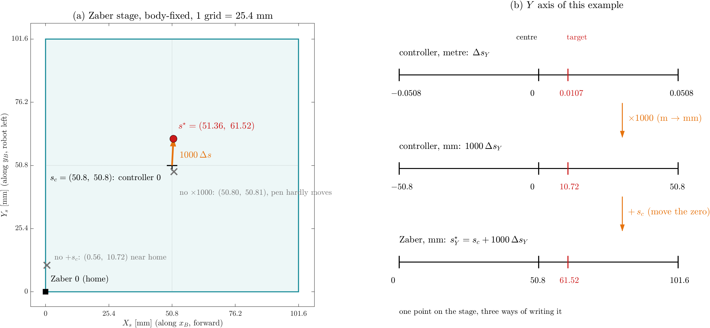

*Hình 11. PT (16). (a) Điểm lệnh trên bàn trượt Zaber lắp trên robot, (b) ba cách ghi cho cùng một điểm trên trục Y*

Hình 11(a) phóng to hình vuông xanh ngọc (bàn trượt) của Hình 8. Trục ngang $X_s$ theo hướng $x_B$, trục đứng $Y_s$ theo hướng $y_B$, và góc dưới bên trái là điểm 0 của Zaber (vị trí gốc (home)).

| Phép toán | Vì sao cần | Điều gì xảy ra nếu bỏ qua |
|---|---|---|
| $\times 1000$ | Bộ điều khiển tính mọi độ dài nội bộ theo đơn vị SI là m và chỉ chuyển sang mm tại giao diện với bàn trượt ($1\ \mathrm{m} = 1000\ \mathrm{mm}$) | Gửi 0.0107 khiến Zaber hiểu là 0.0107 mm, nên bút hầu như không di chuyển (dấu × xám ở giữa Hình 11(a)) |
| $+\thinspace s_c$ | $\Delta s = 0$ trong bộ điều khiển là vị trí giữa bàn trượt, còn điểm 0 của Zaber là vị trí gốc (home) (mép của hành trình) | Gửi 10.72 sẽ đưa con trượt về gần vị trí gốc, thấp hơn vị trí giữa 40 mm (dấu × xám ở góc dưới bên trái Hình 11(a)) |

Hình 11(b) ghi cùng một điểm trên trục Y theo ba thang đo. Giá trị 0.0107 trên thang m của bộ điều khiển trở thành 10.72 trên thang mm của bộ điều khiển sau khi nhân với 1000, và thành 61.52 trên thang Zaber sau khi cộng 50.8. Các điểm giữa (0, 0, 50.8) và các điểm đầu mút ($\pm 0.0508$ m, $\pm 50.8$ mm, 0 và 101.6 mm) của ba thang đo là những điểm trùng nhau. $s_c$ chuyển thành con số Zaber thiết kế "bắt đầu với bàn trượt ở giữa và giữ khoảng dự trữ $\pm 50.8$ mm ở mỗi phía". Cũng vì lý do đó, $s^{\star} = (s_c,\ s_c)$ ngoài chế độ 3, nên bàn trượt chờ ở vị trí giữa khi không vẽ đường thẳng. Ngược lại, khi tính vị trí bút (PenTrace, dùng để đánh giá), $s_c$ được trừ đi và kết quả được chia cho 1000, như trong PT (3).

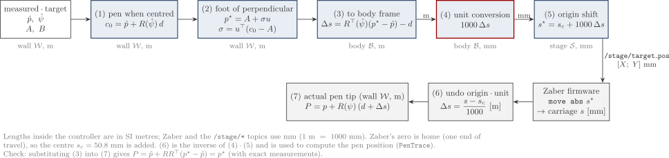

*Hình 12. Trình tự tính toán của PenComp cùng hệ tọa độ và đơn vị của từng bước*

Hình 12 trình bày trình tự tính toán của các PT (12)–(16) dưới dạng các khối. Quá trình bắt đầu từ các đại lượng trong hệ tọa độ tường theo m ($\hat p$, $c_0$, $p^{\star}$), chuyển sang hệ tọa độ thân sau khi qua $R^{\top}$, và cuối cùng chuyển sang thang mm của bàn trượt sau khi qua $\times 1000$ và $+\thinspace s_c$.

### 6.7 Tổng hợp ví dụ số

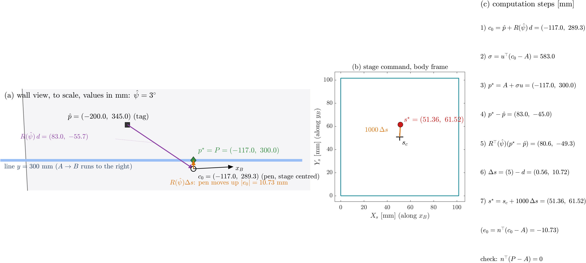

*Hình 13. Tổng hợp ví dụ số về bù bút (mm). (a) Tường, (b) lệnh bàn trượt, (c) các bước tính toán*

Hình 13 gộp nội dung của các Hình 8–11 vào một trang. Đó là thời điểm trong lúc bám đường thẳng khi các giá trị đo là $\hat p = (-200.0,\ 345.0)$ mm và $\hat\psi = 3^{\circ}$, với mũi robot hướng cao hơn phương đường thẳng $\theta_l = 0^{\circ}$ một góc 3°. Phép tính tiến hành theo thứ tự sau.

| Bước | Mã | Phương trình | Giá trị trong ví dụ này [mm] | Trên hình |
|---|---|---|---|---|
| 1 | `pc = pT + R*pen_d` | $c_0 = \hat p + R(\hat\psi)\thinspace d$ | $(-200.0,\ 345.0) + (83.0,\ -55.7) = (-117.0,\ 289.3)$ | Hình 9(b) hình tròn trắng |
| 2 | `sigma = dot(u, pc - A)` | $\sigma = u^{\top}(c_0 - A)$ | 583.0 | Hình 9(a) đường kích thước |
| – | – | $e_0 = n^{\top}(c_0 - A)$ | $-10.73$ (bút nằm dưới đường thẳng) | Hình 9(b) |
| 3 | `p_des = A + sigma*u` | $p^{\star} = A + \sigma u$ | $(-117.0,\ 300.0)$ | Hình 9(b) hình thoi xanh lá |
| 4 | `p_des - pT` | $p^{\star} - \hat p$ | $(83.0,\ -45.0)$ | Hình 10(a) mũi tên xanh lá |
| 5 | `R'*(p_des - pT)` | $R^{\top}(\hat\psi)(p^{\star} - \hat p)$ | $(80.6,\ -49.3)$ | Hình 10(b), Hình 8 mũi tên xanh lá |
| 6 | `e_b = ... - pen_d` | $\Delta s$ | $(80.6,\ -49.3) - (80.0,\ -60.0) = (0.56,\ 10.72)$ | Hình 8(b) mũi tên cam |
| 7 | `s_cmd = stage_c + 1000*e_b` | $s^{\star} = s_c + 1000\thinspace \Delta s$ | $(51.36,\ 61.52)$ | Hình 11(a) hình tròn đỏ |
| 8 | `pen_on` | $0 \le \sigma \le L$ | 1 (hạ bút) | Hình 9(a) |

Kiểm tra bằng PT (15) cho $-e_0\thinspace (\sin 3^{\circ},\ \cos 3^{\circ}) = 10.73\thinspace (0.0523,\ 0.9986) = (0.56,\ 10.72)$ mm, trùng với bước 6. Kết quả được kiểm chứng như sau.

| Mục kiểm tra | Phép tính | Kết quả |
|---|---|---|
| Chuyển động trục Y | $61.52 - 50.8$ | 10.72 mm. Ở tư thế này $y_B$ hướng gần như thẳng lên trên, nên bút di chuyển lên trên tường |
| Chuyển động trục X | $51.36 - 50.8$ | 0.56 mm. "Lên trên tường" và "bên trái robot" lệch nhau $3^{\circ}$, nên bút cũng phải được dịch về phía trước một lượng $10.73\sin 3^{\circ}$ để đi thẳng lên trên |
| Đầu bút | $P = \hat p + R(\hat\psi)\thinspace (d + \Delta s)$ | $(-117.0,\ 300.0) = p^{\star}$ |
| Sai số ngang | $n^{\top}(P - A)$ | 0. Vì $c_0$ nằm dưới đường thẳng 10.73 mm, bút rơi đúng vào $p^{\star}$, tức là nằm trên đường thẳng |
| Phương dọc đường thẳng | $u^{\top}(P - c_0)$ | 0. Bàn trượt không dịch bút dọc đường thẳng |

### 6.8 Ràng buộc của bàn trượt thương mại

Bàn trượt Zaber là sản phẩm thương mại, có vòng servo vị trí nội bộ (truyền động bước và hiệu chỉnh bằng encoder) do firmware thực thi, và luật điều khiển của nó không thể thay đổi từ bên ngoài. Từ bên ngoài, chỉ có thể gửi vị trí mục tiêu (`move abs`), đọc vị trí hiện tại (`get pos`), và thay đổi các thiết lập như tốc độ tối đa (`maxspeed`) và gia tốc (`accel`). Ràng buộc này được phản ánh trong thiết kế như sau.

| Quyết định thiết kế | Liên hệ với ràng buộc |
|---|---|
| Đầu ra của bù bút là vị trí $s^{\star}$ | Vì chỉ có thể ra lệnh vị trí, phép bù được xây dựng dưới dạng bù động học tính vị trí, không phải vận tốc hay lực |
| Không thiết kế vòng vị trí riêng cho bàn trượt | Độ chính xác servo của firmware 45 µm và độ lặp lại 6 µm nhỏ hơn nhiễu cảm biến 1 mm trên 20 lần, nên có thể giả thiết bàn trượt nằm đúng vị trí được ra lệnh |
| Lệnh được bão hòa và giới hạn tốc độ thay đổi trước | Các khối `Travel` (0–101.6 mm) và `CmdRate` (83 mm/s) của PenCtrl chỉ gửi lệnh nằm trong giới hạn firmware, tránh việc lệnh bị cắt bên trong firmware |
| Node giảm mẫu và gửi ở 25 Hz | Do thời gian truyền thông nối tiếp, không thể gửi hết các lệnh 100 Hz |
| `/stage/pos` không được dùng trong tính toán bù | Phép bù là truyền thẳng (feedforward), giả thiết bàn trượt đạt tới vị trí được ra lệnh. Vị trí đọc được dùng để giám sát, đánh giá và cho chức năng tùy chọn giữ bàn trượt ở giữa (Mục 8.10) |
| StagePlant của thí nghiệm ảo mô hình hóa firmware như một hộp đen | Biên dạng hình thang (104 mm/s, 500 mm/s²) + servo vị trí 20 Hz + đường cong lực đẩy–tốc độ + trọng lực trên tường. Cấu trúc bên trong firmware chưa được biết, nên được để là [cần đo thực tế] |

Bàn trượt có đủ nhanh hay không có thể được đánh giá bằng cách so sánh với tốc độ của các nhiễu từ robot. Nhiễu nhanh nhất, độ gồ ghề của xích, có tần số 0.35 Hz với biên độ 1.5°, và làm bút rung khoảng 2 mm qua cánh tay đòn 0.08 m. Tốc độ bàn trượt cần để loại bỏ nhiễu này là $2\pi \times 0.35 \times 2 \approx 4.4$ mm/s, chỉ bằng 4 % tốc độ tối đa 104 mm/s. Thực tế, khi hạ băng thông servo bàn trượt từ 20 Hz xuống 2 Hz và tần số lệnh từ 25 Hz xuống 5 Hz, RMS của bút vẫn không đổi ở mức 1.17–1.20 mm (Chương 20). Với tốc độ di chuyển 30 mm/s, tốc độ bàn trượt không phải là điểm nghẽn.

---

## 7. Sai số đo và bố trí cảm biến

### 7.1 Lan truyền sai số đo

Phép bù ở Chương 6 không đo bút; nó tính vị trí bút từ tư thế robot đo được, nên bút lệch khỏi đường thẳng đúng bằng lượng mà phép đo bị sai. Định nghĩa sai số đo vị trí là $\delta p = \hat p - p$ và sai số đo hướng là $\delta\psi = \hat\psi - \psi$, sai số ngang của bút ở bậc một như sau (các PT (39)–(41)).

$$
e \approx -\thinspace n^{\top}\delta p \thickspace -\thickspace \ell_u\thinspace \delta\psi, \qquad \ell_u = u^{\top}R(\psi)(d + \Delta s) \approx 0.08\ \mathrm{m} \qquad (17)
$$

$$
\sigma_e^2 \approx \sigma_p^2 + \ell_u^2\left(\sigma_\psi^2 + \frac{(\dot b_\psi T)^2}{3}\right) = 1.0^2 + 0.42^2 + 0.63^2\ \mathrm{mm}^2, \qquad \sigma_e \approx 1.25\ \mathrm{mm} \qquad (18)
$$

Với sai số vị trí, thành phần vuông góc với đường thẳng trở thành sai số bút một cách trực tiếp; với sai số hướng, nó được nhân với thành phần dọc đường thẳng $\ell_u$ của cánh tay đòn để trở thành sai số bút. RMS bút mô phỏng 1.17–1.20 mm có cùng độ lớn với dự đoán này. Trong các mô phỏng loại bỏ lần lượt từng yếu tố, đặt nhiễu ZeroKey bằng 0 cho mức giảm lớn nhất, xuống 0.74 mm, và khi mọi cảm biến đều lý tưởng thì còn lại 0.41 mm. Phần 0.41 mm còn lại là sai số không do cảm biến, phát sinh từ độ gồ ghề của xích, trượt (creep) và động lực học bàn trượt. Kết quả rằng chỉ đặt nhiễu hoặc độ trôi của IMU bằng 0 lại làm sai số tăng lên 1.28 mm hiện vẫn chưa được giải thích (Mục 18.5).

Kết luận rất rõ ràng. Yếu tố quyết định độ chính xác của hệ thống này không phải là luật điều khiển hay bàn trượt mà là cảm biến, đặc biệt là nhiễu vị trí của ZeroKey.

### 7.2 Bố trí thẻ định vị ZeroKey

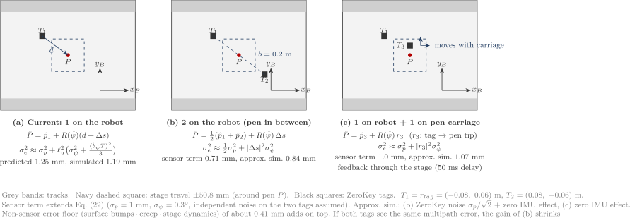

*Hình 14. Ba phương án bố trí thẻ định vị ZeroKey (robot nhìn từ trên xuống, hệ tọa độ thân)*

Vì ZeroKey là yếu tố chi phối, phương án thêm một thẻ định vị nữa được xem xét. Có ba ứng viên.

(a) Cấu hình hiện tại có một thẻ định vị $T_1$ duy nhất trên robot. Cả nhiễu thẻ $\sigma_p$ lẫn tích sai số hướng × cánh tay đòn đều đi vào ước lượng vị trí bút.

(b) Thẻ định vị thứ hai $T_2$ được lắp trên thân robot sao cho bút nằm đúng chính giữa hai thẻ. Trong bố trí hiện tại, $T_2 = -r_{tag} = (0.08,\ -0.06)$ m. Khi ba điểm trên một vật rắn nằm trên cùng một đường thẳng, vị trí điểm giữa là trung bình của hai điểm còn lại, không phụ thuộc vào hướng.

$$
c_0 = \tfrac12(p_1 + p_2) \quad\Rightarrow\quad \hat P = \tfrac12(\hat p_1 + \hat p_2) + R(\hat\psi)\thinspace \Delta s, \qquad \sigma_e^2 \approx \tfrac12\sigma_p^2 + \lvert\Delta s\rvert^2\sigma_\psi^2 \qquad (19)
$$

Nếu nhiễu của hai thẻ độc lập, phương sai của giá trị trung bình giảm một nửa, và sai số hướng chỉ nhân với độ dịch của con trượt $\lvert\Delta s\rvert \approx$ 15 mm, thu nhỏ còn 0.1 mm hoặc ít hơn. Nghĩa là, ảnh hưởng của độ trôi hướng gần như biến mất. Ngoài ra, hướng có thể được tính trực tiếp từ đường cơ sở $b = 0.2$ m nối hai thẻ. Nhiễu của nó, $\sqrt2\thinspace \sigma_p/b \approx 0.41^{\circ}$, lớn hơn nhiễu của IMU, nhưng vì không có độ trôi nên có thể kết hợp với IMU trong một bộ lọc bù (complementary filter) để loại bỏ độ trôi.

(c) Thẻ định vị thứ hai $T_3$ được lắp trên con trượt của bàn trượt (cạnh bút). Vì nó đo vị trí bút gần như trực tiếp, ưu điểm là sai số hiệu chuẩn cánh tay đòn, sai số bàn trượt và sai số tư thế robot đều đi vào phép đo. Tuy nhiên, nhiễu thẻ $\sigma_p$ vẫn giữ nguyên, và ngay khi bàn trượt được điều khiển theo vị trí bút đo được, một vòng phản hồi chứa độ trễ 50 ms được hình thành, đòi hỏi phải thiết kế vòng điều khiển. Khối lượng của thẻ cộng thêm vào khối lượng chuyển động của con trượt Y (0.16 kg), và tín hiệu vô tuyến có thể bị che chắn gần bút đánh dấu (marker) và tường.

Các dự đoán và mô phỏng gần đúng cho ba phương án như sau. Các mô phỏng gần đúng không thực sự thêm thẻ vào mô hình mà thay bằng các điều kiện tương đương: với (b), nhiễu ZeroKey được đặt bằng $\sigma_p/\sqrt2$ và ảnh hưởng của IMU qua cánh tay đòn được loại bỏ; với (c), chỉ loại bỏ ảnh hưởng của IMU. Mỗi trường hợp được chạy hai lần, và chênh lệch giữa hai lần chạy là 0.01 mm hoặc nhỏ hơn.

| Phương án | Dự đoán thành phần cảm biến | Dự đoán bao gồm sai số không do cảm biến 0.41 mm | RMS bút mô phỏng gần đúng | Giá trị cực đại của bút |
|---|---|---|---|---|
| (a) 1 thẻ trên robot (hiện tại) | 1.25 mm | 1.31 mm | 1.19 mm | 3.9 mm |
| (b) 2 thẻ trên robot, bút ở giữa | 0.71 mm | 0.82 mm | 0.84 mm | 2.5 mm |
| (c) 1 thẻ trên robot + 1 thẻ trên con trượt | 1.0 mm | 1.08 mm | 1.07 mm | 3.3 mm |

(b) chính xác nhất, và vì không tạo ra vòng phản hồi mới ở phía bàn trượt nên cũng đơn giản khi triển khai. Do đó, thẻ định vị thứ hai nên được lắp trên thân robot, với bút nằm đúng chính giữa hai thẻ, thay vì lắp trên bút. Thẻ định vị trên bút (con trượt) phù hợp hơn cho việc hiệu chuẩn cánh tay đòn $d$ hoặc kiểm chứng kết quả. Tuy nhiên, phép so sánh này dựa trên giả thiết rằng nhiễu của hai thẻ độc lập. Nếu hai thẻ ở gần nhau và chịu cùng một sai số đa đường (multipath), lợi ích của (b) sẽ giảm, vì vậy trước hết cần đo tương quan nhiễu trên robot thật với cả hai thẻ đứng yên. Nếu bút không nằm đúng chính giữa, thay cho giá trị trung bình của PT (19) sẽ dùng trung bình có trọng số $(1-\lambda)\hat p_1 + \lambda\hat p_2$, với phương sai $((1-\lambda)^2 + \lambda^2)\thinspace \sigma_p^2$. Để dùng tính năng này cần thêm đầu vào thẻ định vị thứ hai cho Nav và PenComp (mô hình hiện tại có một thẻ định vị).

---

# Phần II. Dẫn giải chi tiết

## 8. Mô hình toán học (dẫn giải chi tiết)

- Mô hình chuyển động theo động lực học xe bánh xích của Zou et al. (2018) [1]; cấu trúc điều khiển theo dạng vòng động học ngoài + vòng tốc độ trong của Zou [1] và Sabiha et al. (2022) [2]
- Các phần thay đổi do lực hút lên tường, trọng lực, lỗi dấu trong các phương trình của bài báo gốc, và các luật điều khiển của mô hình 6WP_sim và mô hình robot thật được nêu trong từng mục
- Đánh số phương trình liên tục trong toàn tài liệu. Các phương trình của chương này dẫn giải lại theo dạng báo cáo những giải thích của các Chương 1–7; phương trình cuối cùng, PT (45), được dùng trong Mục 21.2

*(Cùng hình: Hình 6)*

- Cấu trúc điều khiển và đơn vị tín hiệu: Hình 15

### 8.0 Cách đọc Hình 6

| Trong hình | Ý nghĩa |
|---|---|
| Các trục ở góc dưới bên trái | Hệ tọa độ tường $\mathcal{W}$. Hình nhìn tường từ phía trước, nên $x$ hướng sang phải, $y$ hướng lên và $z_W$ hướng ra khỏi trang (⊙) |
| Phương ngang | Phía phải của hình là $+x$. Đường thẳng $A \to B$ chạy theo hướng $+x$ |
| Hình chữ nhật xám, $x_B$, $y_B$ | Thân robot và các trục thân. Robot trong hình này ở $\psi \approx -6^{\circ}$ (hướng sang phải, mũi hơi chúc xuống) |
| Hình vuông đen $p$ | Thẻ định vị (tag) ZeroKey. Điểm đo được là điểm này, không phải tâm robot |
| Mũi tên tím $R(\psi)\thinspace d$ | Cánh tay đòn từ thẻ định vị đến "bút khi bàn trượt ở giữa" $c_0$ (hình tròn trắng), biểu diễn trong tọa độ tường |
| Hình chữ nhật nét đứt xanh lá | Hành trình bàn trượt (tâm tại $c_0$, song song với các trục thân) |
| Mũi tên cam $R(\psi)\thinspace \Delta s$ | Độ dịch chuyển của bút trên tường do chuyển động của con trượt |
| Hình tròn đỏ $P$ | Đầu bút thực tế |
| Hình thoi xanh đậm $p^{\star}$ | Chân đường vuông góc từ $c_0$ xuống đường thẳng = mục tiêu của bút |
| Mũi tên đỏ $e$ | Sai số ngang của bút. Khoảng cách đến đường thẳng đo theo hướng $n$ (hướng lên) |
| Tỉ lệ | Cánh tay đòn và bàn trượt được phóng to cho dễ đọc. Tỉ lệ thực ở Hình 4 (b) và Hình 13 (a) |

- Hình 6 thể hiện trạng thái trung gian khi bút chưa tới đường thẳng ($P \ne p^{\star}$). Sau khi bù xong, $P = p^{\star}$

### 8.1 Các hệ tọa độ

| Hệ tọa độ | Gốc | Các trục (thuận tay phải) | Đơn vị | Dùng cho |
|---|---|---|---|---|
| Tường $\mathcal{W}$ | Gốc ZeroKey (điểm cố định trên tường) | $x$ sang phải (nhìn từ phía trước tường), $y$ hướng lên (trần), $z_W$ hướng ra khỏi tường (về phía người nhìn) | m | Vị trí thẻ định vị $p$, đường thẳng $A$·$B$, bút $P$ |
| Thân $\mathcal{B}$ | Tâm robot $c$ | $x_B$ hướng về phía trước, $y_B$ sang trái (so với robot), $z_B$ hướng ra khỏi tường | m | Thẻ định vị $r_{tag}$, bút $r_{pen,0}$, cánh tay đòn $d$ |
| Bàn trượt $\mathcal{S}$ | Góc của hành trình ($s = (0,0)$) | $X_s \parallel x_B$, $Y_s \parallel y_B$ | mm | Lệnh bàn trượt $s$, tâm $s_c = (50.8, 50.8)$ |

*(Cùng hình: Hình 4)*

- Quy tắc tay phải: $x \times y = z_W$ (hướng ra khỏi tường). Thân cũng vậy, $x_B \times y_B = z_B$ (hướng ra khỏi tường). Khi robot bám trên tường, $z_B = z_W$, nên góc yaw của IMU và $\psi$ có cùng chiều quay
- Giống mặt phẳng trong giáo trình với $x$ nằm ngang hướng sang phải và $y$ thẳng đứng hướng lên, nên ma trận quay cũng có dạng như trong giáo trình (Mục 8.1.2), và tọa độ màn hình của các hình trùng với tọa độ tường (`XY_plot`, `XY_animate`)
- Cùng dạng với quy ước ROS REP-103 (thân: x về phía trước, y sang trái, z hướng lên; hệ thế giới là hệ thuận tay phải có z cùng phía)
- Các trục bàn trượt song song với các trục thân, chỉ khác gốc: $\Delta s = (s - s_c)/1000$ là một vectơ trong tọa độ thân [m]

#### 8.1.1 Góc hướng $\psi$

- Định nghĩa: góc từ trục $x$ đến trục $x_B$ đo quanh $z_W$. Ngược chiều kim đồng hồ khi nhìn từ phía trước tường là $+$
- Miền giá trị: $(-\pi, \pi]$; hiệu góc luôn được đưa về miền này bằng $\mathrm{wrap}(\cdot)$

| $\psi$ | Hướng của $x_B$ (phía trước robot) | Hướng của $y_B$ (bên trái robot) | Trong nhiệm vụ này |
|---|---|---|---|
| $0^{\circ}$ | Phải | Lên | Góc hướng khi bám đường thẳng (chế độ 3) |
| $+90^{\circ}$ | Lên (trần) | Trái | Tư thế xuất phát ($\psi_0$) |
| $-90^{\circ}$ | Xuống | Phải | – |
| $\pm 180^{\circ}$ | Trái | Xuống | – |

- Đường thẳng cần vẽ $A = (-0.70,\ 0.30) \to B = (0.50,\ 0.30)$: $u = (B - A)/\lVert B - A\rVert = [1,\ 0]^{\top}$ (sang phải), góc đường thẳng $\theta_l = \mathrm{atan2}(u_2, u_1) = 0^{\circ}$, pháp tuyến $n = Ju = [0,\ 1]^{\top}$ (hướng lên)
- Do đó khi bám đường thẳng, bên trái robot ($y_B$) hướng về phía trần, và tăng $Y_s$ của bàn trượt làm bút dịch lên trên

#### 8.1.2 Dẫn giải ma trận quay

$x_B$ là vectơ đơn vị nhận được khi quay trục $x$ ngược chiều kim đồng hồ một góc $\psi$, và $y_B$ là $x_B$ quay thêm $+90^{\circ}$.

$$
x_B^{\mathcal{W}} = \begin{bmatrix} \cos\psi \cr \sin\psi \end{bmatrix}, \qquad
y_B^{\mathcal{W}} = \begin{bmatrix} \cos(\psi + 90^{\circ}) \cr \sin(\psi + 90^{\circ}) \end{bmatrix} = \begin{bmatrix} -\sin\psi \cr \cos\psi \end{bmatrix}
$$

Vectơ $v^{\mathcal{B}} = [a,\ b]^{\top}$ trong tọa độ thân có nghĩa là "$a$ về phía trước, $b$ sang trái", nên trong tọa độ tường nó là tổng của hai vectơ trục.

$$
v^{\mathcal{W}} = a\thinspace x_B^{\mathcal{W}} + b\thinspace y_B^{\mathcal{W}}
= \underbrace{\begin{bmatrix} x_B^{\mathcal{W}} & y_B^{\mathcal{W}} \end{bmatrix}}_{R(\psi)} \begin{bmatrix} a \cr b \end{bmatrix},
\qquad
R(\psi) = \begin{bmatrix} \cos\psi & -\sin\psi \cr \sin\psi & \cos\psi \end{bmatrix}, \qquad
J = R(90^{\circ}) = \begin{bmatrix} 0 & -1 \cr 1 & 0 \end{bmatrix} \qquad (20)
$$

*(Cùng hình: Hình 5)*

| Tính chất | Phương trình | Dùng cho |
|---|---|---|
| Thân → tường | $v^{\mathcal{W}} = R(\psi)\thinspace v^{\mathcal{B}}$ | Cánh tay đòn $R d$, độ dịch chuyển con trượt $R\thinspace \Delta s$ (PT (32)) |
| Tường → thân | $v^{\mathcal{B}} = R^{\top}(\psi)\thinspace v^{\mathcal{W}}$ ($R^{\top}R = I$, $\det R = 1$) | Lệnh bàn trượt $\Delta s$ (PT (33)), sai số thân $e_x, e_y$ (PT (30a)) |
| Hợp góc | $R(\alpha)R(\beta) = R(\alpha + \beta)$, $R^{\top}(\psi) = R(-\psi)$ | $R^{\top}(\psi)\thinspace n = R(\theta_l + 90^{\circ} - \psi)\thinspace e_1$ trong PT (34) |
| Đạo hàm | $\dot R = \dot\psi\thinspace \partial R/\partial\psi = \omega\thinspace J R$ | Lan truyền sai số (PT (39)) |
| Quay $+90^{\circ}$ | $J v$ = $v$ quay sang trái, $J^{\top}J = I$, $J^2 = -I$ | Pháp tuyến trái của đường thẳng $n = Ju$ |

Kiểm tra ($\psi = 0^{\circ}$, khi bám đường thẳng / $\psi = 90^{\circ}$, tư thế xuất phát)

$$
R(0^{\circ}) = I:\quad
R\begin{bmatrix} 1 \cr 0 \end{bmatrix} = \begin{bmatrix} 1 \cr 0 \end{bmatrix}\ (\text{phía trước} = \text{phải}), \qquad
R(90^{\circ}) = \begin{bmatrix} 0 & -1 \cr 1 & 0 \end{bmatrix}:\quad
R\begin{bmatrix} 1 \cr 0 \end{bmatrix} = \begin{bmatrix} 0 \cr 1 \end{bmatrix}\ (\text{phía trước} = \text{lên})
$$

- Khi bám đường thẳng, con trượt dịch 1 mm sang trái thân ($\Delta s_Y = +0.001$) làm bút trên tường dịch lên 1 mm ($+y$)
- Các trục thân và trục tường gần như song song, nên $R \approx I$ khi bám đường thẳng; $R$ chỉ hiệu chỉnh độ nghiêng vài độ do sai số góc hướng

#### 8.1.3 Ký hiệu

| Ký hiệu | Cách đọc | Định nghĩa | Đơn vị |
|---|---|---|---|
| $x,\ y$ | x, y | Tọa độ tường. $x$ = phương ngang (dương sang phải khi nhìn từ phía trước tường), $y$ = độ cao (dương về phía trần) | m |
| $\psi$ | psi | Góc hướng. Góc từ trục $x$ đến trục $x_B$ (phải là 0, ngược chiều kim đồng hồ là +) | rad |
| $R(\psi)$ | R của psi | Ma trận quay thân → tường (PT (20)). $\dot R = \omega J R$ | – |
| $c$ | c | Vị trí tâm robot | m |
| $p$ | p | Vị trí thẻ định vị ZeroKey $p = c + R(\psi)\thinspace r_{tag}$ (PT (21a)) | m |
| $r_{tag},\ r_{pen,0}$ | – | Vị trí thẻ định vị trong tọa độ thân, vị trí bút khi bàn trượt ở giữa | $(-0.08,\ 0.06)$, $(0,\ 0)$ m |
| $q = [c^{\top},\ \psi]^{\top}$ | q | Tư thế robot | m, rad |
| $V = [v,\ \omega]^{\top}$ | V | Tốc độ tiến, tốc độ góc yaw | m/s, rad/s |
| $A,\ B$ | A, B | Điểm đầu và điểm cuối của đường thẳng cần vẽ | m |
| $u,\ n$ | u, n | Vectơ đơn vị chỉ hướng đường thẳng $u = (B-A)/\lVert B-A\rVert$, pháp tuyến $n = Ju$ | – |
| $d$ | d | Cánh tay đòn thẻ định vị → bút (thân) $d = r_{pen,0} - r_{tag}$ | m |
| $s,\ s_c$ | s | Vị trí bàn trượt [X; Y], tâm 50.8 mm | mm |
| $\Delta s$ | delta s | Độ dịch chuyển con trượt $(s - s_c)/1000$ | m |
| $P$ | P hoa | Vị trí đầu bút | m |
| $e$ | e | Sai số ngang của bút $e = n^{\top}(P - A)$ | m |

### 8.2 Động học robot bánh xích

$$
\dot q = S(q)\thinspace V + w(t), \qquad
S(q) = \begin{bmatrix} \cos\psi & u_c \sin\psi \cr \sin\psi & -u_c\cos\psi \cr 0 & 1 \end{bmatrix} \qquad (21)
$$

$$
w(t) = \begin{bmatrix} -k_s\thinspace \lvert v\rvert \cr 0 \cr \dot\psi_w(t) \end{bmatrix}, \qquad
\psi_w(t) = a_w \sin(2\pi f_w t) + \tfrac{1}{2} a_w \sin(2\pi\thinspace 2.3 f_w t + 1) \qquad (22)
$$

| Ký hiệu | Định nghĩa | Giá trị |
|---|---|---|
| $u_c$ | Độ dịch dọc của tâm quay tức thời (ICR). Zou [1] PT (34) $u_c = -\mathrm{sgn}(\omega)\thinspace R_t \sin\alpha$, $R_t = \lvert v/\omega\rvert$ | 0 khi $\alpha = 0$ |
| $\alpha$ | Góc trượt | `alpha_s` = 0 |
| $k_s$ | Trượt (creep) của xích từ tính: trượt theo hướng trọng lực tỉ lệ với tốc độ di chuyển | 0.08 [cần đo thực tế] |
| $a_w,\ f_w$ | Biên độ và tần số dao động góc hướng do độ gồ ghề của xích | 1.5°, 0.35 Hz [cần đo thực tế] |

- PT (21) có cùng dạng với $S(q)$ trong Zou [1] các PT (37)–(39) và Sabiha [2] các PT (36)–(37) (thành phần thứ ba viết là $\psi$)
- PT (22) là nhiễu do tường, không có trong bài báo gốc. Khác với mặt đất bằng, trọng lực nằm trong mặt phẳng di chuyển, và số hạng này phản ánh việc xích bị đẩy dần xuống dưới theo thời gian

Điểm tích phân và thẻ định vị (sửa đổi 2026-11-11)

$$
\dot c = \text{các thành phần vị trí của PT (21)}, \qquad
p = c + R(\psi)\thinspace r_{tag}, \qquad
\dot p = \dot c + \omega\thinspace J R(\psi)\thinspace r_{tag} \qquad (21a)
$$

| Hạng mục | Phiên bản trước | Phiên bản hiện tại |
|---|---|---|
| Trạng thái tích phân của `RobotPlant` | Điểm thẻ định vị $p$ (thẻ định vị là tâm quay) | Tâm robot $c$ (giống 6WP_sim gốc), giá trị đầu `q0c` |
| Đầu ra `q_true` | Tư thế thẻ định vị | Tư thế thẻ định vị (khối `TagPoint` chuyển đổi bằng PT (21a)) |
| Vận tốc ZeroKey (`ZkVel`) | $v\thinspace [\cos\psi,\ \sin\psi]^{\top}$ | $\dot p$ của PT (21a) (gồm cả thành phần quay) |
| Thẻ định vị khi quay tại chỗ | Gần như đứng yên | Cung tròn bán kính $\lVert r_{tag}\rVert$ = 0.1 m (giống robot thật) |

- Bù bút (các PT (32)–(34)) chỉ dùng các giá trị đo được $\hat p,\ \hat\psi$ và $d$, nên không bị ảnh hưởng bởi sửa đổi này
- Ngay sau sửa đổi, sai số bút tăng lên RMS 3.46 mm, cực đại 25.9 mm. Sau khi chế độ 1 đặt thẻ định vị tại điểm xuất phát, lần quay khoảng 70° ở chế độ 2 làm thẻ định vị lệch khỏi đường thẳng khoảng 11 cm, và bút được hạ xuống trong khi góc hướng vẫn còn dao động tới −115° do chế độ 3 đang hiệu chỉnh độ lệch này. Hiện tượng tương tự xảy ra trên robot thật
- Biện pháp khắc phục: chế độ 1 đưa ước lượng tâm robot $\hat c = \hat p - R(\hat\psi)\thinspace r_{tag}$, thay vì thẻ định vị, tới tâm xuất phát $c_A = r_A - R(\theta_l)\thinspace r_{tag}$ (Mục 8.5). Sau khi quay, thẻ định vị đến đúng điểm xuất phát $r_A$ → độ cao thẻ định vị khi bắt đầu chế độ 3 $y$ = 0.343 m (mục tiêu 0.360 m). 17 mm còn lại là độ trượt (creep) trong lúc quay, giảm từ khoảng 110 mm trước sửa đổi
- Kết quả sau khắc phục ở Mục 18.3 (RMS bút 1.17–1.20 mm)

### 8.3 Động lực học (phiên bản trên tường)

Động lực học rút gọn của hai bài báo (Zou PT (33b), Sabiha PT (29)) được bổ sung lực hút lên tường và trọng lực. Thành phần vận tốc thứ hai viết là $L\omega$ để nhất quán thứ nguyên.

$$
\tilde M\thinspace \dot\nu + \tilde C\thinspace \nu + S^{\top}(f_1 + f_2) = \tilde B\thinspace \tau + S^{\top} f_g, \qquad
\nu = \begin{bmatrix} v \cr L\omega \end{bmatrix},\quad \tau = \begin{bmatrix} F_r \cr F_l \end{bmatrix} \qquad (23)
$$

$$
\tilde M = S^{\top} M S = m\begin{bmatrix} 1 & 0 \cr 0 & 1 + u_c^2/L^2 \end{bmatrix}, \quad
\tilde C = S^{\top} M \dot S, \quad
\tilde B = \begin{bmatrix} 1 & 1 \cr b/2L & -b/2L \end{bmatrix}, \quad
L = \sqrt{(l^2 + b^2)/12} \qquad (24)
$$

$$
f_1 = \mu_l N \begin{bmatrix} \cos\psi \cr \sin\psi \cr 0 \end{bmatrix} \tanh\negthinspace \frac{v}{\varepsilon_v}, \qquad
f_2 = \begin{bmatrix} F_y \sin\psi \cr -F_y\cos\psi \cr M_r / L \end{bmatrix}, \qquad
f_g = \begin{bmatrix} 0 \cr -m g \cr 0 \end{bmatrix} \qquad (25)
$$

$$
F_y = 2\mu_t \frac{N}{l}\thinspace u_c \tanh\negthinspace \frac{\omega}{\varepsilon_\omega}, \qquad
M_r = \mu_t \frac{N}{l}\left(\frac{l^2}{4} - u_c^2\right) \tanh\negthinspace \frac{\omega}{\varepsilon_\omega} \qquad (26)
$$

| Ký hiệu | Định nghĩa | Giá trị |
|---|---|---|
| $m$ | Khối lượng robot (gồm cả bàn trượt) | 12 kg [cần đo thực tế] |
| $l,\ b$ | Chiều dài tiếp xúc của xích, khoảng cách giữa tâm xích trái và phải | 0.30 m, 0.28 m |
| $L$ | Bán kính quán tính ($\sqrt{I/m}$ của tấm chữ nhật) | 0.118 m |
| $N$ | Lực hút từ (vuông góc với tường) | 400 N [cần đo thực tế] |
| $\mu_l,\ \mu_t$ | Hệ số cản lăn, hệ số ma sát trượt ngang | 0.05, 0.5 [cần đo thực tế] |
| $F_r,\ F_l$ | Lực kéo của xích phải và trái, $\lvert F\rvert \le F_{max}$ | $F_{max}$ = 200 N |
| $\varepsilon_v,\ \varepsilon_\omega$ | Độ rộng của hàm $\tanh$ thay cho $\mathrm{sgn}(\cdot)$ | 0.005 m/s, 0.01 rad/s |

Khác biệt so với các phương trình của bài báo gốc

| STT | Bài báo gốc | Mô hình này | Lý do |
|---|---|---|---|
| 1 | Tải pháp tuyến $W = mg$ (Zou các PT (24)–(27)) | Lực hút $N$ | Trên tường, lực pháp tuyến sinh ra ma sát là lực hút từ, không phải trọng lực |
| 2 | Không có số hạng trọng lực | $f_g$ (PT (25)) | Mặt phẳng di chuyển thẳng đứng, nên trọng lực nằm trong mặt phẳng chuyển động |
| 3 | $M_r = \mathrm{sgn}(\omega)\thinspace \mu_t \frac{W}{l}\left(u_c^2 - \frac{l^2}{4}\right)$ (Zou PT (27), Sabiha PT (24)) | $\frac{l^2}{4} - u_c^2$ | Với phương trình gốc, khi $\lvert u_c\rvert < l/2$, $M_r$ có dấu ngược với $\omega$, nên mô-men cản quay lại hỗ trợ việc quay. Được sửa để dấu phù hợp với độ lớn $\mu_t W l / 4$ của Wong ($u_c = 0$) |
| 4 | $\upsilon = [v,\ \dot\theta]^{\top}$ (Zou PT (19), Sabiha PT (18)) | $\nu = [v,\ L\omega]^{\top}$ | Với $q_3 = L\theta$, thành phần thứ hai phải là $L\dot\theta$ để hàng thứ ba $[0\ \ 1]$ của $S$ và số hạng $u_c\sin\psi/L$ ở hàng thứ nhất nhất quán thứ nguyên |
| 5 | $M = (F_l + F_r)\thinspace b/2$ (Sabiha PT (23)) | $(F_l - F_r)\thinspace b/2$ | Lỗi đánh máy. PT (26c) và $\bar B$ của cùng bài báo dùng hiệu |
| 6 | $\mathrm{sgn}(\cdot)$ | $\tanh(\cdot/\varepsilon)$ | Ngăn dao động số (chatter) gần trạng thái đứng yên |

Bước tích phân số

- Gần $\omega = 0$, độ dốc của mô-men cản quay $\partial M_r/\partial\omega = \mu_t N l / (4\varepsilon_\omega)$ = 1500 N·m·s; chia cho quán tính yaw $mL^2$ = 0.168 kg·m², trị riêng $\lambda \approx 8.9\times10^{3}\ \mathrm{s^{-1}}$
- So với điều kiện ổn định $\lvert\lambda h\rvert \lesssim 2.8$ của RK4 bước cố định (ode4), $h$ = 5 ms cho $\lambda h$ = 44 → $\omega$ dao động số (xác nhận ở Mục 18.5)
- Với $h$ = 0.5 ms, $\lambda h$ = 4.5 vẫn vượt tiêu chí tuyến tính, nhưng độ dốc chỉ lớn khi $\lvert\omega\rvert < \varepsilon_\omega$, nên dao động biến mất. Chênh lệch giữa $\int\omega\thinspace dt$ và $\Delta\psi$ trong phạm vi 2.5° (đo được)

### 8.4 Hệ truyền động và vòng tốc độ trong

$(v_c, \omega_c)$ do bộ điều khiển xuất ra được chuyển thành PWM và gửi đến ESC, và bộ PI tốc độ bên trong mô hình chuyển động tạo ra lực kéo của xích.

$$
\bar V = \mathrm{sat}_{0.5}\negthinspace \left(\frac{v_c}{2v_{full}}\right), \quad
\bar W = \mathrm{sat}_{0.5}\negthinspace \left(\frac{\omega_c}{2\omega_{full}}\right), \quad
\begin{aligned}
u_L &= 1500 + T(\bar V) - T_s(\bar W) \cr
u_R &= 1500 - T(\bar V) - T_s(\bar W)
\end{aligned} \qquad (27)
$$

$$
T(\bar V) = d_v \tanh\negthinspace \frac{\bar V}{0.02} + (400 - d_v)\thinspace \frac{\bar V}{0.5}, \qquad
T_s(\bar W) = d_\omega \tanh\negthinspace \frac{\bar W}{0.10} + (400 - d_\omega)\thinspace \frac{\bar W}{0.5} \qquad (28)
$$

$$
\tau_X = K_{P,v}\thinspace e_v + K_{I,v}\negthinspace \int e_v\thinspace dt, \quad
\tau_N = K_{P,\omega}\thinspace L e_\omega + K_{I,\omega}\negthinspace \int L e_\omega\thinspace dt, \quad
\tau = \tilde B^{-1}\begin{bmatrix} \tau_X \cr \tau_N \end{bmatrix} \qquad (29)
$$

| Ký hiệu | Định nghĩa | Giá trị |
|---|---|---|
| $v_{full},\ \omega_{full}$ | Tốc độ tại PWM 400 count | 0.20 m/s, 1.37 rad/s |
| $d_v,\ d_\omega$ | Bù ngược vùng chết của `calc_pwm` trên robot thật | 47, 20 count |
| $u_L,\ u_R$ | `/motor_pwm` [x; y] (gồm cả đảo chiều động cơ phải), 1100–1900 | count |
| $e_v,\ e_\omega$ | Hiệu giữa lệnh tốc độ xích do ESC đặt và tốc độ thực | m/s, rad/s |
| $K_{P,v},\ K_{I,v},\ K_{P,\omega},\ K_{I,\omega}$ | PI tốc độ (hai khối PID Controller của 6WP_sim) | 1500, 15000, 1500, 15000 |

- ESC được mô hình hóa với vùng chết 30 count và khâu trễ bậc nhất $\tau_{trk}$ = 0.15 s
- PT (29) chỉ giữ phần PI của computed torque + PID trong Zou [1] PT (42). Không dùng mô hình ngược ($\tilde M\dot\nu_c + \tilde C\nu_c + \tilde f$)
- Bộ điều khiển của robot thật (`Tracked_UGV_ZeroKey_XsensIMU`) đặt hai bộ PI tại vị trí này (tốc độ $K_P$ 0.15, $K_I$ 0.8, tốc độ góc yaw $K_P$ 1.5, $K_I$ 1.5, đầu ra ±0.5). Khác biệt ở Mục 21.1

### 8.5 Vòng ngoài (luật điều khiển theo chế độ)

Chế độ 3 (bám đường thẳng). Bám theo một điểm tham chiếu biến thiên theo thời gian bằng các sai số trong hệ tọa độ thân.

$$
x_r(t) = W_{prev} + v_r\thinspace (t - t_{line})\thinspace u_r, \qquad
\begin{bmatrix} e_x \cr e_y \end{bmatrix} = R^{\top}(\psi)\thinspace (x_r - p), \qquad
e_\theta = \mathrm{wrap}(\theta_r - \psi) \qquad (30a)
$$

$$
v_c = v_r \cos e_\theta + k_x e_x, \qquad
\omega_c = k_y e_y + k_\psi \sin e_\theta \qquad (30b)
$$

Chế độ 1 (đến điểm xuất phát), chế độ 4 (dừng tại điểm cuối). Luật dạng tọa độ cực.

$$
\rho = \lVert W - p\rVert, \quad
\alpha = \mathrm{wrap}\negthinspace \left(\mathrm{atan2}(W - p) - \psi\right), \quad
v_c = k_\rho\thinspace \rho \max(0, \cos\alpha), \quad
\omega_c = k_\alpha\thinspace \alpha + \tfrac{1}{2}\sin\alpha\cos\alpha \qquad (31)
$$

Chế độ 2 (căn chỉnh góc hướng). $v_c = 0$, $\omega_c = k_\alpha\thinspace \mathrm{wrap}(\theta_r - \psi)$. Trong mọi chế độ $\lvert v_c\rvert \le v_{max}$, $\lvert\omega_c\rvert \le \omega_{max}$.

| Ký hiệu | Định nghĩa | Giá trị (tên trong `XY_setup.m`) |
|---|---|---|
| $W_{prev},\ W$ | Điểm đầu và điểm mục tiêu của đoạn đường robot | `WP_prev`, `WP_target` |
| $u_r,\ \theta_r$ | Hướng của đoạn đường robot, góc của nó | – |
| $v_r$ | Tốc độ trên đoạn thẳng | 0.03 m/s (`v_ref`) |
| $k_x,\ k_y,\ k_\psi$ | Hệ số khuếch đại dọc đường, ngang đường, góc hướng | 0.3 s⁻¹, 5.0 rad m⁻¹ s⁻¹, 1.4 s⁻¹ (`K_px`, `K_py`, `K_ptheta`) |
| $k_\rho,\ k_\alpha$ | Hệ số khuếch đại khoảng cách và hướng | 1.0 s⁻¹, 2.0 s⁻¹ (`K_dist`, `K_yaw`) |
| $v_{max},\ \omega_{max}$ | Giới hạn lệnh | 0.20 m/s, 45 °/s |

- PT (30b) là dạng Kanayama (Zou PT (38), Sabiha PT (40)) $\omega_c = \omega_r + v_r\thinspace [k_y' e_y + k_\theta \sin e_\theta]$ với $\omega_r = 0$ (đường thẳng) và $v_r$ được gộp vào các hệ số khuếch đại. $k_y = v_r k_y'$, $k_\psi = v_r k_\theta$
- Điểm tham chiếu dựa theo thời gian, nên nếu robot chậm hoặc nhanh hơn, $e_x$ điều chỉnh $v_c$ (xem chênh lệch tốc độ ở Mục 18.5)
- PT (31) ở chế độ 1 được tính với ước lượng tâm $\hat c = \hat p - R(\hat\psi)\thinspace r_{tag}$ và tâm xuất phát $c_A = r_A - R(\theta_l)\thinspace r_{tag}$ thay cho thẻ định vị $\hat p$, và điều kiện chuyển `dist_start` cũng dùng $\lVert c_A - \hat c\rVert$. Cùng ý nghĩa với việc 6WP_sim gốc đưa tâm tới điểm mục tiêu; bảo đảm thẻ định vị đến $r_A$ sau lần quay tại chỗ ở chế độ 2 (Mục 8.2). Các chế độ 3·4 vẫn lấy thẻ định vị làm tham chiếu
### 8.6 Bù động học bút (dẫn giải)

Vị trí đầu bút là tổng của thẻ định vị (tag), cánh tay đòn và độ dịch chuyển của con trượt.

$$
P = p + R(\psi)\thinspace (d + \Delta s) = c_0 + R(\psi)\thinspace \Delta s, \qquad c_0 = p + R(\psi)\thinspace d \qquad (32)
$$

- $c_0$ là vị trí bút khi bàn trượt ở giữa
- Mục tiêu: giữ bút trên đường thẳng, còn chuyển động tiến dọc đường thẳng để robot đảm nhận → đích của bút được đặt tại chân đường vuông góc hạ từ $c_0$ xuống đường thẳng

$$
p^{\star} = A + \sigma\thinspace u, \quad \sigma = u^{\top}(c_0 - A)
\quad\Rightarrow\quad
P = p^{\star}
\ \Leftrightarrow\quad
\Delta s = R^{\top}(\psi)\thinspace (p^{\star} - p) - d,
\qquad
s^{\star} = s_c + 1000\thinspace \Delta s \qquad (33)
$$

Với sai số ngang khi không bù $e_0 = n^{\top}(c_0 - A)$, khi đó $p^{\star} - c_0 = -e_0\thinspace n$, do đó

$$
\Delta s = -e_0\thinspace R^{\top}(\psi)\thinspace n = -e_0 \begin{bmatrix} \sin(\psi - \theta_l) \cr \cos(\psi - \theta_l) \end{bmatrix},
\qquad u = \begin{bmatrix}\cos\theta_l \cr \sin\theta_l\end{bmatrix} \qquad (34)
$$

- Bàn trượt chỉ dịch chuyển một lượng $e_0$, theo hướng do độ lệch góc $\psi - \theta_l$ giữa robot và đường thẳng quyết định
- Vì $\lvert\psi - \theta_l\rvert$ nhỏ, trục X (hướng di chuyển) gần như không dịch chuyển, chỉ $\lvert e_0\sin(\psi-\theta_l)\rvert$, còn trục Y khử gần như toàn bộ $e_0$. Phù hợp với dải sử dụng mô phỏng X 51.0–53.8 mm, Y 61.4–72.2 mm
- $p^{\star}$ không bị giới hạn trong $[A, B]$. Nếu giới hạn, khi bút ở phía trước A, bàn trượt sẽ cố bù khoảng cách tại vùng $\sigma < 0$ và trục X chạm cuối hành trình

$$
\mathrm{pen}_{\mathrm{on}} = \mathbb{1}\left[\thinspace 0 \le \sigma \le \lVert B - A\rVert\thinspace \right], \qquad
s^{\star} \leftarrow \mathrm{rate}_{83\thinspace \mathrm{mm/s}}\negthinspace \left(\mathrm{sat}_{[0,\thinspace 101.6]}(s^{\star})\right) \qquad (35)
$$

#### 8.6.1 Ý nghĩa từng bước của các PT (32)–(33)

*(Cùng hình: Hình 12)*

- 1000 là hệ số đổi đơn vị. Độ dài trong bộ điều khiển tính bằng m, còn firmware Zaber và các topic `/stage/*` dùng mm, nên $\Delta s$ [m] × 1000 = [mm]
- $s_c$ = 50.8 mm là phép dời gốc. Giá trị 0 của Zaber là vị trí gốc (home) (một đầu hành trình), còn $\Delta s = 0$ là giữa hành trình, do đó cần cộng thêm

| Bước | Phương trình | Hệ tọa độ | Ý nghĩa |
|---|---|---|---|
| 1 | $R(\hat\psi)\thinspace d$ | thân → tường | Cánh tay đòn gắn cố định với thân (thẻ định vị → bút) được xoay theo hướng hiện tại thành véc-tơ trong hệ tọa độ tường |
| 2 | $c_0 = \hat p + R(\hat\psi)\thinspace d$ | tường | Điểm trên tường mà bút chạm khi bàn trượt ở giữa |
| 3 | $\sigma = u^{\top}(c_0 - A)$ | tường | Thành phần dọc đường thẳng của $c_0$ = khoảng cách dọc đường thẳng. Cũng dùng cho kết luận hạ bút (PT (35)) |
| 4 | $e_0 = n^{\top}(c_0 - A)$ | tường | Sai số ngang của bút khi không có bàn trượt (dấu: + về phía $n$) |
| 5 | $p^{\star} = A + \sigma u$ | tường | Chân đường vuông góc từ $c_0$ xuống đường thẳng. Đích chỉ hiệu chỉnh theo phương ngang, giữ nguyên hướng di chuyển |
| 6 | $p^{\star} - \hat p$ | tường | Véc-tơ từ thẻ định vị đến đích của bút |
| 7 | $R^{\top}(\hat\psi)\thinspace (p^{\star} - \hat p)$ | tường → thân | Cùng véc-tơ đó trong tọa độ thân. Vị trí trên thân mà bút cần đạt tới |
| 8 | $\Delta s = (7) - d$ | thân | Lượng bút cần dịch chuyển từ vị trí giữa ($d$) = độ dịch chuyển của con trượt [m] |
| 9 | $s^{\star} = s_c + 1000\thinspace \Delta s$ | bàn trượt | Tọa độ bàn trượt [mm]. Gốc ở mép, do đó cộng thêm điểm giữa $s_c$ |

- Kiểm tra: thay bước 8 vào PT (32) được $P = \hat p + R(d + \Delta s) = \hat p + R R^{\top}(p^{\star} - \hat p) = p^{\star}$
- Lý do chọn chân đường vuông góc: vị trí bút dọc đường thẳng ($u$) do robot quyết định. Nếu bàn trượt cũng cố khớp theo phương dọc đường thẳng, nó sẽ phải bù sai số di chuyển của robot cỡ vài cm, vượt quá hành trình (±50.8 mm)

#### 8.6.2 Ví dụ số

Một thời điểm trong quá trình bám đường thẳng. Giá trị đo được $\hat p = (-200.0,\ 345.0)$ mm, $\hat\psi = 3^{\circ}$ (mũi robot nghiêng lên $3^{\circ}$ so với góc đường thẳng $0^{\circ}$). Cùng thời điểm và cùng giá trị như Mục 6.7 (mm)

*(Cùng hình: Hình 13)*

| Đại lượng | Tính toán | Giá trị [mm] |
|---|---|---|
| $R(\hat\psi)$ | $\cos 3^{\circ} = 0.9986$, $\sin 3^{\circ} = 0.0523$ | $[\thinspace 0.9986\ \ {-0.0523};\ 0.0523\ \ 0.9986\thinspace]$ |
| $R\thinspace d$ | $d = (80.0,\ -60.0)$ | $(83.0,\ -55.7)$ |
| $c_0$ | $\hat p + R d$ | $(-117.0,\ 289.3)$ |
| $\sigma$ | $u^{\top}(c_0 - A) = -117.0 - (-700)$ | 583.0 (nằm trong khoảng hạ bút $0 \le \sigma \le 1200$) |
| $e_0$ | $n^{\top}(c_0 - A) = 289.3 - 300$ | $-10.73$ (bút nằm dưới đường thẳng 10.73 mm) |
| $p^{\star}$ | $A + \sigma u$ | $(-117.0,\ 300.0)$ |
| $p^{\star} - \hat p$ | – | $(83.0,\ -45.0)$ |
| $R^{\top}(p^{\star} - \hat p)$ | – | $(80.6,\ -49.3)$ |
| $\Delta s$ | $(80.6 - 80.0,\ -49.3 + 60.0)$ | $(0.56,\ 10.72)$ |
| Kiểm tra PT (34) | $-e_0\thinspace [\sin 3^{\circ},\ \cos 3^{\circ}]$ | $(0.56,\ 10.72)$, khớp |
| $s^{\star}$ | $50.8 + 1000\thinspace \Delta s$ ($\Delta s$ tính bằng m) | $(51.36,\ 61.52)$ |
| $P$ | $\hat p + R(d + \Delta s)$ | $(-117.0,\ 300.0) = p^{\star}$ |

- Bàn trượt dịch chuyển 10.72 mm theo Y (bên trái thân = phía trên tường), nâng bút lên đường thẳng. Trục X chỉ dịch chuyển 0.56 mm (thành phần do nghiêng $3^{\circ}$)
- Cùng độ lớn và hướng với dải sử dụng bàn trượt trong thí nghiệm ảo (X 51.0–53.8 mm, Y 61.3–72.2 mm)

#### 8.6.3 Kiểm tra dấu

Tham chiếu $\theta_l = 0^{\circ}$ (đường thẳng hướng sang phải). $\Delta s = -e_0\thinspace [\sin(\psi - \theta_l),\ \cos(\psi - \theta_l)]^{\top}$.

| Tình huống | $\psi - \theta_l$ | $e_0$ | $\Delta s_X$ | $\Delta s_Y$ | Hướng chuyển động của bút trên tường | Kết luận |
|---|---|---|---|---|---|---|
| Bút dưới đường thẳng, robot song song | $0$ | $< 0$ | 0 | $+\lvert e_0\rvert$ | $y_B$ = lên | về phía đường thẳng |
| Bút trên đường thẳng, robot song song | $0$ | $> 0$ | 0 | $-\lvert e_0\rvert$ | $-y_B$ = xuống | về phía đường thẳng |
| Bút dưới đường thẳng, mũi nghiêng lên $3^{\circ}$ | $+3^{\circ}$ | $< 0$ | $+0.05\lvert e_0\rvert$ | $+\lvert e_0\rvert$ | $y_B$ nghiêng $3^{\circ}$, nên thêm một chút X để nâng theo phương thẳng đứng | về phía đường thẳng |
| Bút dưới đường thẳng, robot đi ngược ($B \to A$) | $180^{\circ}$ | $< 0$ | 0 | $-\lvert e_0\rvert$ | $y_B$ = xuống, nên $-y_B$ = lên | về phía đường thẳng |

- Trong mọi trường hợp, bút chuyển động theo hướng $-e_0\thinspace n$, tức là về phía đường thẳng. Khi hướng thay đổi, phương trình tự động chuyển đổi giữa các trục

#### 8.6.4 Ánh xạ từ phương trình sang mã Simulink (`PenCtrl/PenComp`)

| Phương trình | PenComp trong `build_xy_models.m` |
|---|---|
| $u = (B - A)/\lVert B - A\rVert$ | `u = (B - A) / max(L, 1e-9);` |
| $R(\hat\psi)$ (PT (20)) | `R = [cos(pose(3)) -sin(pose(3)); sin(pose(3)) cos(pose(3))];` |
| $c_0 = \hat p + R d$ | `pc = pT + R * pen_d;` |
| $\sigma = u^{\top}(c_0 - A)$ | `sigma = dot(u, pc - A);` |
| $p^{\star} = A + \sigma u$ | `p_des = A + sigma * u;` |
| $\Delta s = R^{\top}(p^{\star} - \hat p) - d$ | `e_b = R' * (p_des - pT) - pen_d;` |
| $s^{\star} = s_c + 1000\thinspace \Delta s$ | `s_cmd = stage_c + 1000 * e_b;` |
| pen_on (PT (35)) | `pen_on = double(sigma >= 0 && sigma <= L);` |
| Các chế độ khác 3 | `s_cmd = [stage_c; stage_c]` (bàn trượt ở giữa, nhấc bút) |

- `pose` = $[\hat x;\ \hat y;\ \hat\psi]$ (đầu ra Nav, hệ tọa độ tường), `pen_d` = $d$, `stage_c` = $s_c$ (`XY_setup.m`)
- Bão hòa và giới hạn tốc độ thay đổi của PT (35) được hiện thực bằng các khối `PenCtrl/Travel` (Saturation, 0–`stage_travel`) và `PenCtrl/CmdRate` (Rate Limiter, ±`stage_vcmd`) đặt sau đầu ra PenComp

#### 8.6.5 Ảnh hưởng của sai số hướng

Vì bộ bù dùng $\hat\psi$, sai số hướng $\delta\psi$ làm bút lệch khỏi đường thẳng một lượng $\ell_u\thinspace \delta\psi$ (PT (40)).

| $\delta\psi$ | Sai số bút (tư thế của ví dụ số, tính chính xác) | Xấp xỉ bậc nhất $\ell_u\thinspace \delta\psi$, $\ell_u$ = 0.083 m |
|---|---|---|
| $1^{\circ}$ | 1.46 mm | 1.45 mm |
| $3^{\circ}$ | 4.25 mm | 4.35 mm |

- Sai số vị trí truyền vào bút theo tỉ lệ 1 : 1; sai số hướng truyền vào sau khi nhân với độ dài cánh tay đòn. Giảm thành phần dọc đường thẳng của cánh tay đòn $\ell_u \approx d_x$ (đặt bút cùng vị trí trước–sau với thẻ định vị) sẽ giảm độ nhạy với hướng

### 8.7 Mô hình bàn trượt

Mỗi trục được mô hình hóa như một servo vị trí đặt sau bộ tạo quỹ đạo hình thang của firmware Zaber.

$$
m_i\thinspace \ddot x_i + c_s\thinspace \dot x_i = \mathrm{sat}_{F_{max}(\dot x_i)}\negthinspace \left(K_{P,i} e_i + K_{D,i}\thinspace \dot e_i + K_{I,i}\negthinspace \int e_i\thinspace dt\right) - m_i\thinspace g_{B,i}(\psi), \qquad i \in \lbrace X, Y\rbrace \qquad (36)
$$

$$
K_{P,i} = m_i\thinspace \omega_{n,s}^2, \quad K_{D,i} = 2\zeta_s m_i\thinspace \omega_{n,s}, \quad K_{I,i} = K_{P,i}\thinspace \omega_{n,s}/5, \quad
g_B(\psi) = R^{\top}(\psi)\begin{bmatrix} 0 \cr -g \end{bmatrix} \qquad (37)
$$

| Ký hiệu | Định nghĩa | Giá trị |
|---|---|---|
| $m_X,\ m_Y$ | Trục X = con trượt + bàn trượt Y + bút, trục Y = con trượt + bút | 0.55 kg, 0.16 kg |
| $e_i$ | Hiệu giữa đầu ra bộ tạo quỹ đạo và vị trí con trượt | m |
| $F_{max}(\dot x)$ | Đường cong lực đẩy–tốc độ theo datasheet (nội suy 10 điểm) | 32 N → 9 N |
| $\omega_{n,s},\ \zeta_s$ | Băng thông gộp độ cứng động cơ bước và hiệu chỉnh của firmware, hệ số cản | 2π·20 rad/s, 0.8 [cần đo thực tế] |
| $c_s$ | Ma sát nhớt | 2.0 N·s/m |

### 8.8 Mô hình đo

$$
\hat p(t_k) = p(t_k - \tau_{zk}) + \eta_p, \quad \eta_p \sim \mathcal{N}(0, \sigma_p^2 I), \qquad
\hat\psi(t) = \psi(t) + \eta_\psi + \dot b_\psi\thinspace t, \quad \eta_\psi \sim \mathcal{N}(0, \sigma_\psi^2) \qquad (38)
$$

| Ký hiệu | Định nghĩa | Giá trị |
|---|---|---|
| $\sigma_p,\ \tau_{zk}$ | Nhiễu vị trí, độ trễ của ZeroKey (20 Hz) | 1.0 mm, 50 ms [cần đo thực tế] |
| $\sigma_\psi,\ \dot b_\psi$ | Nhiễu yaw, độ trôi của Xsens (100 Hz, không dùng từ kế do tấm thép) | 0.3°, 0.02 °/s |

### 8.9 Lan truyền sai số và ngân sách sai số

Bộ bù giải PT (33) với các giá trị đo được $\hat p,\ \hat\psi$, nên $\hat p + R(\hat\psi)(d + \Delta s)$ nằm trên đường thẳng. Khai triển bậc nhất của hiệu so với bút thực:

$$
P = \underbrace{\hat p + R(\hat\psi)(d + \Delta s)}_{\text{trên đường thẳng}} - \delta p + \big(R(\psi) - R(\hat\psi)\big)(d + \Delta s),
\qquad R(\psi) - R(\hat\psi) \approx -\delta\psi\thinspace J R(\psi) \qquad (39)
$$

$$
e = n^{\top}(P - A) \approx -\thinspace n^{\top}\delta p \thickspace -\thickspace \delta\psi\thickspace \ell_u, \qquad
\ell_u = u^{\top} R(\psi)\thinspace (d + \Delta s) \qquad (40)
$$

- $\delta p = \hat p - p$, $\delta\psi = \hat\psi - \psi$. Vì $n = Ju$ và $J^{\top}J = I$, sử dụng $n^{\top}J = u^{\top}J^{\top}J = u^{\top}$
- Ở phiên bản trước, số hạng thứ hai của PT (40) mang dấu $+$ (viết nhầm $n^{\top}J = -u^{\top}$). Đã sửa sau khi xác nhận rằng, tại tư thế của ví dụ số với $\delta\psi = +1^{\circ}$, giá trị tính trực tiếp $e = -1.44$ mm khớp với $-\delta\psi\thinspace \ell_u$. Phương sai PT (41) không bị ảnh hưởng vì lấy bình phương
- Sai số vị trí chỉ đóng góp thành phần pháp tuyến với đường thẳng; sai số hướng trở thành sai số bút sau khi nhân với thành phần dọc đường thẳng của cánh tay đòn $\ell_u$. Trong bố trí hiện tại $\ell_u \approx d_x$ = 0.08 m

$$
\sigma_e^2 \approx \sigma_p^2 + \ell_u^2\thinspace \sigma_\psi^2 + \ell_u^2\thinspace \frac{(\dot b_\psi T)^2}{3}
= (1.0)^2 + (0.42)^2 + (0.63)^2\ \mathrm{mm}^2
\ \Rightarrow\ \sigma_e \approx 1.25\ \mathrm{mm} \qquad (41)
$$

- $T$ = 39.3 s (thời gian hạ bút). Số hạng trôi là RMS của sai số tăng tuyến tính từ 0 đến $\dot b_\psi T$
- Cùng độ lớn với RMS mô phỏng 1.17–1.20 mm (phiên bản hiện tại; phiên bản trước 1.17–1.61 mm). Kết quả mô phỏng khi lần lượt đặt từng số hạng bằng 0: bảng trong Mục 18.5

### 8.10 Tính năng tùy chọn (mặc định tắt)

| Tính năng | Vị trí | Phương trình | Tham số |
|---|---|---|---|
| Bù trễ ZeroKey | Nav | $\hat p \leftarrow \hat p + \tau_{pred}\thinspace \hat{\dot p}$ | `tau_pred` (mặc định 0) |
| Giữ bàn trượt ở giữa | RobotCtrl M3 | $e_y \leftarrow e_y + k_c e_s + k_{ci}\int e_s\thinspace dt$, $e_s = (s_{Y,meas} - s_c)/1000$ | `K_c`, `K_ci` (mặc định 0) |

- Hiệu quả: xem so sánh trong Chương 20

### 8.11 Tài liệu tham khảo

- Các tài liệu tham khảo [1]–[5] được tập hợp ở cuối tài liệu

---

# Phần III. Triển khai

## 9. Tổng quan triển khai

### 9.1 Mục đích

- Bàn trượt XY hai trục Zaber X-LSM100B gắn trên AVT-3C, một robot bánh xích bám từ tính vào tường thép thẳng đứng; vẽ một đường thẳng duy nhất trên tường bằng bút dạ đặt ở đầu bàn trượt
- Robot (vĩ mô) đảm nhận việc tiến tới và chuyển động phạm vi lớn; bàn trượt (vi mô) loại bỏ sai số ngang và sai số hướng so với đường thẳng
- Mô hình thí nghiệm ảo và mô hình robot thật dùng cùng tên topic và định dạng thông điệp ROS 2, nên bộ điều khiển mô phỏng kết nối trực tiếp với robot thật

### 9.2 Thông số chính

| Hạng mục | Giá trị | Căn cứ |
|---|---|---|
| Đường cần vẽ | A = (−0.70, 0.30) m → B = (0.50, 0.30) m, nằm ngang 1.2 m (hệ tọa độ tường: x sang phải, y lên trên) | `XY_setup.m` Mục 2 |
| Robot | AVT-3C bánh xích, kích thước ngoài 420 × 343 × 100 mm | CAD STL |
| Bàn trượt | Zaber X-LSM100B-E03 × 2 (X trục dưới, Y trục trên), phương án bố trí 3 (bút = tâm robot) | Datasheet, CAD |
| Hành trình · tốc độ tối đa của bàn trượt | 101.6 mm · 104 mm/s | Datasheet |
| Cảm biến vị trí | Một thẻ định vị (tag) ZeroKey RTLS (robot), khoảng 20 Hz | Cấu hình robot thật |
| Cảm biến hướng | Xsens IMU `/imu/data` (yaw tương đối; từ kế không dùng được trên tấm thép) | Cấu hình robot thật |
| Tần số bộ điều khiển · bước tích phân mô hình đối tượng | 0.01 s (100 Hz) · 0.5 ms | Giống Simulink robot thật · Mục 8.3 |
| Tốc độ trên đoạn thẳng | 30 mm/s (hạ bút khoảng 39.3 s) | `v_ref` |
| Kết quả (điều kiện cơ sở) | RMS sai số ngang của bút 1.17–1.20 mm, tối đa 3.9 mm | Chương 18 |
| Chỉ robot, không có bàn trượt | RMS sai số ngang của bút 14.84 mm, tối đa 19.6 mm | Chương 18 |

### 9.3 Giao tiếp bên ngoài

| Hạng mục | Nội dung |
|---|---|
| Đầu vào bộ điều khiển | `/zerokey/position`, `/zerokey/vel`, `/imu/data`, `/stage/pos` |
| Đầu ra bộ điều khiển | `/motor_pwm` (robot), `/stage/target_pos` (bàn trượt) |
| Node bàn trượt | `zaber_stage_node.py` — `/stage/target_pos` → RS-232 `move abs`, `get pos` → `/stage/pos` |
| Miền ROS 2 | Thí nghiệm ảo 77, robot thật 0 |

### 9.4 Bố cục kho mã

- Mỗi thư mục có hướng dẫn bằng tiếng Hàn, tiếng Anh và tiếng Việt (`README_KO.md`, `README.md`, `README_VI.md`).

```
├── README_KO.md              Bản gốc tiếng Hàn
├── README.md                 Bản tiếng Anh (cùng số chương, số phương trình và số hình)
├── README_VI.md              Tài liệu này (bản tiếng Việt, cùng số; dùng sơ đồ tiếng Anh)
├── 1_simulation/             Mô hình Simulink và script cho thí nghiệm ảo và robot thật (chú thích tiếng Hàn và tiếng Anh)
│   ├── XY_setup.m            Tham số (chạy trước tiên)
│   ├── build_xy_models.m     Bộ tạo mô hình — hai tệp .slx chỉ được tạo bởi tệp này
│   ├── XY_1_pen_sim.slx      Thí nghiệm ảo (bộ điều khiển + mô hình đối tượng + cảm biến, vòng lặp ROS 2 nội bộ)
│   ├── XY_2_pen_ros2.slx     Robot thật (chỉ bộ điều khiển)
│   ├── XY_1_pen_sim_v2.slx, XY_2_pen_ros2_v2.slx   Phiên bản 2: bao gồm vòng PI trong của robot thật (Mục 21.2)
│   ├── XY_run_all.m          Thiết lập → dựng → chạy → hình → video
│   ├── XY_compare.m          So sánh lựa chọn thiết kế (Chương 20), XY_compare_plot.m
│   ├── XY_animate.m          Bảng hiển thị thời gian thực khi nhấn nút Run, XY_stop.m (StopFcn: hình kết quả)
│   ├── XY_record_live.m      Video bảng hiển thị (phát lại log sau khi chạy, kết xuất ngoài màn hình)
│   ├── XY_plot.m             Hình kết quả
│   ├── img/                  Hình mô hình, đồ thị kết quả
│   └── video/                Video kết quả
├── 2_docs/
│   ├── img/                  SVG sơ đồ (bản tiếng Anh: *_en.svg), PNG hình phương trình (src/make_fig_math.m, hình bù bút src/make_fig_pen.m)
│   ├── manual/               PDF tạo từ README_KO, README và README_VI (tài liệu đầy đủ và bản trích điều khiển bút, mỗi loại có bản tiếng Hàn, tiếng Anh và tiếng Việt)
│   └── make_pen_excerpt.py   Tạo trích đoạn điều khiển bút
├── 3_robot_code/zaber_stage_node.py   Node bàn trượt chạy trên NUC (RS-232)
├── 4_CAD/AVT-3C.stl          STL hình dạng ngoài robot (420 × 343 × 100 mm, dùng cho hoạt ảnh)
├── 5_references/
│   ├── manuals/              Hướng dẫn sử dụng và datasheet Zaber X-LSM-E (PDF)
│   └── README_VI.md          Bài báo tham khảo (DOI). PDF bài báo không có trong kho mã vì lý do bản quyền
└── _tools/                   Công cụ sắp xếp và kiểm tra Simulink (paint_roles, check_lines, check_flow, check_tags …)
```

---

## 10. Kiến trúc truyền thông

### 10.1 Topic

*(Cùng hình: Hình 2)*

| Topic | Kiểu | Phát → nhận | Tần số | Nội dung |
|---|---|---|---|---|
| `/zerokey/position` | geometry_msgs/PointStamped | Cảm biến → bộ điều khiển | 20 Hz | Tọa độ thế giới của thẻ định vị [m]. x = phương ngang của tường (hướng theo `zk_xsign`), y = pháp tuyến tường, z = độ cao |
| `/zerokey/vel` | geometry_msgs/TwistStamped | Cảm biến → bộ điều khiển | 20 Hz | Vận tốc thẻ định vị [m/s] (dùng linear.x, linear.z) |
| `/zerokey/orientation` | geometry_msgs/QuaternionStamped | Cảm biến → (mô hình robot thật) | 20 Hz | Tư thế ZeroKey INS. Bộ điều khiển này không dùng; để tương thích với mô hình robot thật |
| `/imu/data` | sensor_msgs/Imu | Cảm biến → bộ điều khiển | 100 Hz | quaternion orientation → yaw |
| `/stage/pos` | geometry_msgs/PointStamped | Node bàn trượt → bộ điều khiển | 20 Hz | X, Y của bàn trượt [mm] |
| `/motor_pwm` | geometry_msgs/Point | Bộ điều khiển → robot | 100 Hz | x = trái, y = phải, giá trị PWM count (trung tính 1500 ± 400) |
| `/stage/target_pos` | geometry_msgs/Point | Bộ điều khiển → node bàn trượt | 100 Hz | X, Y mục tiêu [mm] (node giảm tần số xuống 25 Hz để truyền) |
| `/stage/cmd_vel`, `/stage/stop` | Vector3, Empty | Phụ trợ → node bàn trượt | Khi cần | Lệnh vận tốc (watchdog 0.5 s), dừng |

Ánh xạ trường và đơn vị (tên tín hiệu và đơn vị bên trong Simulink)

| Topic · trường | Tín hiệu Simulink (hộp) | Kích thước · đơn vị | Ý nghĩa bên trong bộ điều khiển |
|---|---|---|---|
| `/zerokey/position` `point.x, y, z` | `zerokey_position` (RosIn) | 3, m | Được Nav chuyển sang hệ tọa độ tường $\hat p = [\pm x;\ z]$ = [phương ngang (phải +); độ cao] (dấu `zk_xsign`). Không dùng `y` (pháp tuyến tường) |
| `/zerokey/vel` `twist.linear.x, y, z` | `zerokey_vel` (RosIn) | 3, m/s | Chỉ dùng cho bù trễ (`tau_pred` > 0) và $u_B$ của phiên bản 2 |
| `/imu/data` `orientation.w, x, y, z` | `imu_quat` (phiên bản 1), `imu_data(1:4)` (phiên bản 2) | 4, – | Yaw $\mathrm{atan2}(2(q_wq_z + q_xq_y),\ 1 - 2(q_y^2 + q_z^2))$, tương đối so với mẫu đầu tiên + $\psi_0$ |
| `/imu/data` `angular_velocity.z` | `imu_data(5)` (chỉ phiên bản 2) | 1, rad/s | Phản hồi PI tốc độ yaw $r$ của phiên bản 2 |
| `/stage/pos` `point.x, y` | `stage_pos_meas` (RosIn) | 2, mm | Chỉ dùng cho giữ bàn trượt ở giữa (`K_c`, `K_ci` > 0). Bù bút ở thiết lập mặc định không dùng |
| `/motor_pwm` `x, y` | `motor_pwm` (PwmMap) | 2, count (= µs) | [trái; phải], 1500 dừng, 1100–1900. Bên phải đảo dấu |
| `/stage/target_pos` `x, y` | `stage_target_pos` (PenCtrl) | 2, mm | [X; Y], X = trục $x_B$ (tiến), Y = trục $y_B$ (trái), 0–101.6 |

- Trong thí nghiệm ảo, mô hình đối tượng, mô hình cảm biến và mô hình bàn trượt thực sự phát các topic trên; bộ điều khiển chỉ nhận
- Do đó bộ điều khiển không bao giờ thấy giá trị thật (`q_true`, `x_s`) và chỉ hoạt động dựa trên cùng thông tin như trên robot thật
- Tín hiệu hạ bút `pen_on` không được phát (dùng để ghi log và đánh giá). Không có cơ cấu hay topic nâng bút, nên thời điểm bút dạ chạm tường trên robot thật phải được xác nhận (Chương 24)

### 10.2 Quy ước tọa độ

| Ký hiệu | Định nghĩa |
|---|---|
| x | Phương ngang của tường, dương sang phải khi nhìn vào tường (= `zk_xsign` × ZeroKey x) |
| y | Độ cao trên tường, dương về phía trần (= ZeroKey z) |
| z | Hướng ra khỏi tường (cùng hướng với z_B của robot). Hệ tọa độ thuận tay phải với x × y = z |
| ψ | Góc từ trục x về phía trục y (phải 0, trần +90°, ngược chiều kim đồng hồ +) |
| Thân | x_B tiến, y_B trái, z_B ra khỏi tường. R(ψ) = [cos ψ −sin ψ; sin ψ cos ψ] ánh xạ hệ tọa độ thân → hệ tọa độ tường |
| Bàn trượt | Trục 1 = x_B, trục 2 = y_B, đơn vị mm, tâm s_c = 50.8 mm |

- Dạng ROS REP-103: thân x tiến, y trái, z lên (trên tường là ra khỏi tường); hệ thế giới là hệ thuận tay phải với z cùng phía với z của robot. Tương đương với bản đồ tường đặt phẳng như mặt sàn
- Quan hệ với phiên bản trước (Simulink robot thật `plane_project`: p₁ lên, p₂ trái, hướng trần ψ = 0): x = −p₂, y = p₁, ψ = ψ_prev + 90°. Các phương trình điều khiển không đổi; chỉ các con số thay đổi (thay đổi ngày 2026-11-13)
- Hướng của trục x thế giới ZeroKey được đặt bởi `zk_xsign`. Mặc định −1 (dương sang trái khi nhìn vào tường, giả thiết của `plane_project`). Đặt +1 nếu hiệu chuẩn tại hiện trường đặt x sang phải [cần xác nhận tại hiện trường]

---

## 11. Phân cấp bộ điều khiển

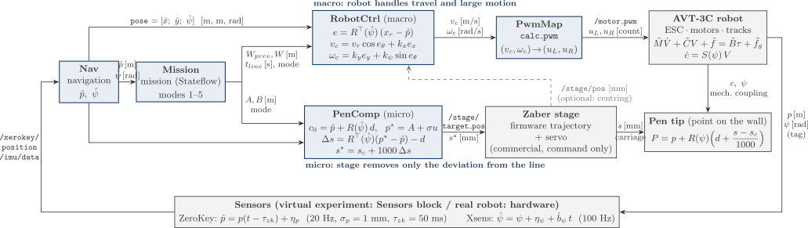

*Hình 15. Cấu trúc điều khiển và đơn vị tín hiệu (trên: vòng vĩ mô của robot, dưới: vòng vi mô của bàn trượt, dưới cùng: phản hồi đo)*

| Trong hình vẽ | Đầu vào → đầu ra (đơn vị) | Ý nghĩa |
|---|---|---|
| Nav | Vị trí ZeroKey [m], quaternion IMU → $\hat p$ [m], $\hat\psi$ [rad] | Vị trí thẻ định vị và hướng đo được. Toàn bộ trạng thái robot mà bộ điều khiển biết |
| Mission | $\hat p,\ \hat\psi$ → chế độ, $W_{prev},\ W$ [m], $t_{line}$ [s], $A,\ B$ [m] | Quyết định làm gì và khi nào (đến điểm bắt đầu → quay → đường thẳng → dừng) |
| RobotCtrl | Điểm tham chiếu $x_r$ [m], $\hat p,\ \hat\psi$ → $v_c$ [m/s], $\omega_c$ [rad/s] | Vòng ngoài khiến robot bám theo đường thẳng (PT (30)) |
| PwmMap | $v_c,\ \omega_c$ → $u_L,\ u_R$ [count] | `calc_pwm` của robot thật. Chuyển lệnh vận tốc thành độ rộng xung ESC (các PT (27)–(28)) |
| Robot AVT-3C | $u_L,\ u_R$ → tâm $c$ [m], $\psi$ [rad] | Vòng tốc độ ESC + động lực học xích. RobotPlant trong thí nghiệm ảo |
| PenComp | $\hat p,\ \hat\psi,\ A,\ B$ → $s^{\star}$ [mm] | Tính mục tiêu bàn trượt sao cho bút nằm trên đường thẳng (PT (33)) |
| Bàn trượt Zaber | $s^{\star}$ [mm] → $s$ [mm] | Firmware thương mại bám vị trí. Từ bên ngoài chỉ có thể gửi lệnh vị trí và đọc vị trí |
| Đầu bút | $c,\ \psi,\ s$ → $P$ [m] | Vị trí bút dạ trên tường. Bộ điều khiển không đo (đánh giá bằng PenTrace) |
| Cảm biến | $p,\ \psi$ → $\hat p,\ \hat\psi$ | Phép đo có thêm nhiễu, trễ và trôi. Giới hạn trên của độ chính xác bút (Mục 18.5) |

### 11.1 Vai trò của từng tầng

| Tầng | Khối | Đầu vào | Đầu ra | Tần số |
|---|---|---|---|---|
| 0 đo lường | RosIn → Nav | Vị trí và vận tốc ZeroKey, quaternion IMU | `pose` = [x; y; ψ] (hệ tọa độ tường) | 0.01 s |
| 1 nhiệm vụ | Guards → ModeChart → Waypoints | `pose` | `mode`, `WP_prev`, `WP_target`, `t_line`, `lineAB` | 0.01 s |
| 2 vĩ mô | RobotCtrl → PwmMap → RosOut | `WP_*`, `mode`, `t_line`, `pose`, `stage_pos_meas` | `v_cmd`, `w_cmd` → `/motor_pwm` | Liên tục / phát 0.01 s |
| 2 vi mô | PenCtrl → RosOut | `lineAB`, `mode`, `pose` | `stage_target_pos` → `/stage/target_pos`, `pen_on` | Liên tục / phát 0.01 s |
| 3 vòng trong | Vòng tốc độ ESC, vòng vị trí firmware Zaber | `/motor_pwm`, `/stage/target_pos` | Tốc độ xích, vị trí bàn trượt | Bên trong thiết bị |

### 11.2 Các giá trị trạng thái

| Tên | Kích thước | Đơn vị | Vị trí | Ý nghĩa |
|---|---|---|---|---|
| `pose` | 3 | m, m, rad | Đầu ra Nav | Vị trí thẻ định vị đo được [x; y] (hệ tọa độ tường) + hướng ψ |
| `mode` | 1 | – | ModeChart | 1 đến điểm bắt đầu, 2 quay, 3 bám đường thẳng, 4 dừng, 5 kết thúc |
| `WP_prev`, `WP_target` | 2, 2 | m | Waypoints | Điểm đầu và điểm cuối của đoạn mà robot (thẻ định vị) bám theo |
| `lineAB` | 4 | m | Waypoints | Đường thẳng bút vẽ [A; B] |
| `t_line` | 1 | s | Waypoints | Thời điểm vào chế độ 3 (bắt đầu tiến điểm tham chiếu) |
| `v_cmd`, `w_cmd` | 1, 1 | m/s, rad/s | RobotCtrl | Lệnh vận tốc robot |
| `e_cross` | 1 | m | RobotCtrl M3 | Sai số ngang trong hệ tọa độ thân so với điểm tham chiếu của robot |
| `motor_pwm` | 2 | count | PwmMap | [trái; phải] |
| `stage_target_pos` | 2 | mm | PenCtrl | Mục tiêu bàn trượt [X; Y] |
| `pen_on` | 1 | – | PenCtrl | Hạ bút (0 ≤ σ ≤ L) |
| `stage_pos_meas` | 2 | mm | RosIn | Phép đo `/stage/pos` |
| `q_true`, `V_true` | 3, 2 | m, rad / m/s, rad/s | RobotPlant | Tư thế thật, vận tốc thật (dùng để đánh giá; bộ điều khiển không biết) |
| `x_t` | 4 | mm, mm/s | StagePlant | Trạng thái quỹ đạo firmware |
| `x_s` | 6 | m, m/s, m·s | StagePlant | Vị trí, vận tốc và trạng thái tích phân của bàn trượt |
| `pen_true`, `e_pen` | 2, 1 | m | PenTrace | Vị trí bút thật, sai số ngang của bút (đánh giá) |
| `pen_nocomp`, `e_nocomp` | 2, 1 | m | PenTrace | Vị trí bút và sai số ngang khi bàn trượt cố định ở tâm |

### 11.3 Máy trạng thái nhiệm vụ

*(Cùng hình: Hình 7)*

| Chế độ | Luật điều khiển (cùng phương trình với 6WP_sim và mô hình robot thật) | Bút |
|---|---|---|
| 1 Goto_Start | v = K_dist·d·max(0, cos α), ω = K_yaw·α + 0.5 sin α cos α | Nâng, bàn trượt ở giữa |
| 2 Turning | v = 0, ω = K_yaw·Δθ | Nâng |
| 3 Line_Tracking | Điểm tham chiếu theo thời gian x_r = WP_prev + v_ref (t − t_line) u, sai số trong hệ tọa độ thân e = Rᵀ(θ)(x_r − p): v = v_ref cos e_θ + K_px e_x, ω = K_py e_y + K_pθ sin e_θ | Có bù, hạ khi 0 ≤ σ ≤ L |
| 4 Stop_Destination | Áp dụng liên tục phương trình chế độ 1 hướng về điểm cuối (ω = 0 khi d < 0.01 m) | Nâng |

- Đoạn mà robot bám theo = đường của bút tịnh tiến song song một lượng R·d + kéo dài thêm `line_pre` 60 mm phía trước và `line_post` 40 mm phía sau
- Khi vào chế độ 3, bàn trượt được đưa đến mục tiêu trước khi hạ bút, loại bỏ quá độ lúc bắt đầu

---

## 12. Mô hình chuyển động

### 12.1 Robot (phiên bản trên tường của mô hình đối tượng 6WP_sim)

| Khâu | Khối | Phương trình · giá trị |
|---|---|---|
| Nghịch đảo ESC | EscInv | PWM → tốc độ xích, vùng chết `pwm_dz` = 30 count, 400 count = 0.2 m/s |
| Trễ động cơ | TrackLag | Khâu trễ bậc nhất τ_trk = 0.15 s |
| Vòng tốc độ | PID_v, PID_w | Cùng vị trí với hai PID Controller của 6WP, hệ số khuếch đại được tỷ lệ theo kích thước AVT-3C (Kp 1500, Ki 15000) |
| Phân bổ lực kéo | Control_allocation | B̃ = [1 1; b/2L −b/2L], \|F\| ≤ F_max = 200 N |
| Động lực học | Dynamics | Phiên bản trên tường của các phương trình 6WP (Mục 8.3) |
| Động học | Kinematics | q̇ = S(q)V + nhiễu loạn của tường (trượt (creep) 8 % theo hướng trọng lực, độ không phẳng hướng ±1.5°, 0.35 Hz) |
| Tích phân | ode4 bước cố định | `Ts_plant` = 0.5 ms (với 5 ms, ω dao động về mặt số học do hàm tanh của ma sát quay) |

- Phương trình và các thay đổi so với bài báo gốc: các Mục 4.2–8.4
- Khối Dynamics của 6WP_sim cài đặt nguyên các phương trình của Zou [1], nên hiệu chỉnh dấu (M_r) ở Mục 8.3 cũng áp dụng cho 6WP gốc

So sánh với 6WP_sim gốc (`2_시뮬레이션_simulink/6WP_sim/Tracked_UGV_PID_Control_Scenario_6wp_sim.slx`) (mã khối và tham số được đọc trực tiếp từ mô hình và so sánh)

| Hạng mục | 6WP_sim gốc | Mô hình này `RobotPlant` | Giống nhau |
|---|---|---|---|
| Chuỗi khối | Sai số tốc độ → 2 PID → Control allocation → Dynamics → tích phân → Kinematics → tích phân | Thêm nghịch đảo ESC · trễ động cơ ở phía trước; phần còn lại của chuỗi giống nhau | Cùng cấu trúc |
| `compute_u`, `Control_allocation` | $u = -\mathrm{sgn}(\omega) R_t \sin\alpha$, $\tilde B = [1\ 1;\ b/2L\ \ {-b/2L}]$ | Cùng phương trình | Giống |
| Dynamics $\tilde M,\ \tilde C,\ S,\ \dot S$ và đạo hàm $V$ | Dạng của các PT (23)–(24) | Cùng phương trình | Giống |
| Kích thước xe (Bảng 1) | $m$ 3700 kg, $l$ 5.0 m, $b$ 1.1 m | 12 kg, 0.30 m, 0.28 m | Khác (AVT-3C) |
| Lực pháp tuyến ma sát | $W = mg$ (mặt đất) | Lực hút từ $N$ = 400 N | Khác (tường) |
| Số hạng trọng lực | Không có | $f_g = [0,\ -mg,\ 0]^{\top}$ | Thêm vào |
| Mô-men cản quay $M_r$ | $\mathrm{sgn}(\omega)(u^2 - l^2/4)$ | $\tanh(\omega/\varepsilon)(l^2/4 - u^2)$ | Đã hiệu chỉnh dấu (Mục 8.3, Bảng mục 3) |
| $\mathrm{sgn}(\cdot)$ | Giữ nguyên | $\tanh(\cdot/\varepsilon)$ | Ngăn rung số (chatter) |
| PID tốc độ | P 150000, I 0, D 0 (điều khiển P) | P 1500, I 15000 (PI) | Khác (khối lượng 1/300, loại bỏ sai số xác lập) |
| Động học | $\dot q = S(q)V$, trạng thái = tâm robot, ký hiệu $q_3 = L\theta$ | Cùng phương trình + nhiễu loạn của tường (trượt (creep), độ không phẳng), trạng thái = tâm robot, $q_3 = \psi$ | Giống + nhiễu loạn |
| Điểm tích phân | Tâm robot | Tâm robot (điểm thẻ định vị trước bản sửa ngày 2026-11-11) | Giống |
| Đầu ra | Tư thế tâm $q$ | Tư thế thẻ định vị (`TagPoint`, PT (21a)) | Khớp với vị trí cảm biến |

- Số hạng $(u/L)\sin\theta$ ở hai hàng đầu của Kinematics gốc không nhất quán về thứ nguyên khi thành phần vận tốc thứ hai là $\omega$, nhưng không có ảnh hưởng khi $\alpha = 0$ ($u = 0$). Mô hình này viết thành $u\thinspace \omega\sin\psi$ (PT (21))

### 12.2 Bàn trượt Zaber (datasheet + CAD)

| Thông số (X-LSM100B-E03) | Phản ánh trong mô hình | Giá trị |
|---|---|---|
| Hành trình | PenCtrl `Travel`, bão hòa `Encoder` của StagePlant | 0–101.6 mm |
| Tốc độ tối đa | Quỹ đạo hình thang ZaberTraj | 104 mm/s |
| Gia tốc/giảm tốc | ZaberTraj | 500 mm/s² [cần đo thực tế: `get accel`] |
| Đường cong lực đẩy–tốc độ | Giới hạn lực đẩy ZaberServo (nội suy 10 điểm) | 32 N (stall) → 9 N (104 mm/s) |
| Khối lượng chuyển động | Trục X = con trượt + bàn trượt Y + bút, trục Y = con trượt + bút | 0.55 kg, 0.16 kg |
| Trọng lực trên tường | Thành phần dọc trục m g | X 5.4 N, Y 1.6 N (nhỏ hơn lực đẩy liên tục 25 N và lực back-drive 24 N) |
| Vòng vị trí | Độ cứng động cơ bước + hiệu chỉnh firmware | Băng thông 20 Hz, hệ số tắt dần 0.8 [cần đo thực tế] |
| Tần số lệnh · trễ | CmdHold, CmdDelay | 25 Hz (node `cmd_rate`), 10 ms |
| Báo cáo vị trí | `/stage/pos` | 20 Hz |
| Độ chính xác · độ lặp lại | Không phản ánh | 45 µm · 6 µm (không đáng kể so với nhiễu cảm biến 1 mm) |

### 12.3 Cảm biến

| Cảm biến | Nhiễu (1σ) | Trễ | Tần số |
|---|---|---|---|
| Vị trí ZeroKey | 1.0 mm | 50 ms [cần đo thực tế] | 20 Hz |
| Yaw IMU | 0.3°, trôi 0.02°/s | – | 100 Hz |
| Tư thế ZeroKey INS | 0.9° | – | 20 Hz |

---

## 13. Cấu trúc mô hình Simulink

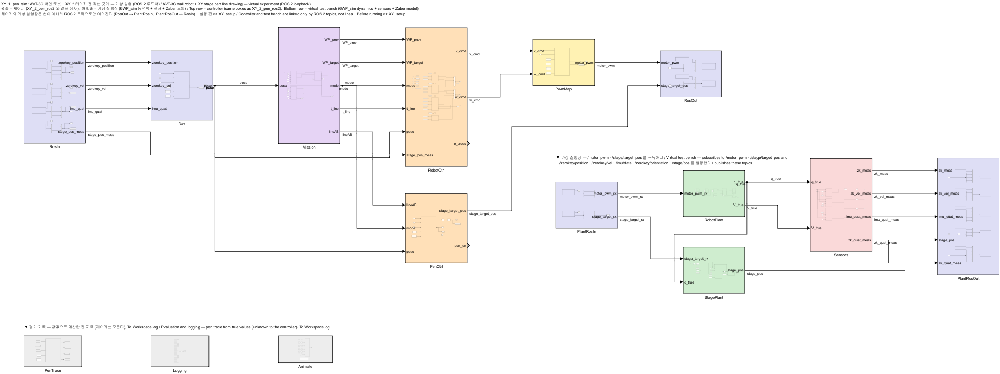

*Hình 16. Mức cao nhất của XY_1_pen_sim (hàng trên: bộ điều khiển, dưới phải: bàn thử ảo, dưới trái: đánh giá, ghi log và hiển thị thời gian thực)*

*(Cùng hình: Hình 3)*

| Tệp | Hàng bộ điều khiển | Hàng bàn thử ảo | Vòng PI trong | Miền ROS | Mục đích |
|---|---|---|---|---|---|
| `XY_1_pen_sim.slx` | Có | Có (RobotPlant, Sensors, StagePlant, PlantRosIn/Out) + PenTrace, Logging, Animate | Không | 77 | Thí nghiệm ảo phiên bản 1 |
| `XY_2_pen_ros2.slx` | Có | Không (thay bằng thiết bị thật) | Không | 0 | Robot thật phiên bản 1 |
| `XY_1_pen_sim_v2.slx` | Có | Có | InnerPI | 77 | Thí nghiệm ảo phiên bản 2 |
| `XY_2_pen_ros2_v2.slx` | Có | Không | InnerPI | 0 | Robot thật phiên bản 2 |

| Hạng mục | Khác biệt giữa `_sim` và `_ros2` | Khác biệt giữa phiên bản 1 và phiên bản 2 |
|---|---|---|
| Điểm khác | `_sim` gắn robot ảo, cảm biến và bàn trượt ảo vào cùng bộ điều khiển. `_ros2` chỉ có bộ điều khiển và trao đổi topic với thiết bị thật | Phiên bản 2 đặt cùng bộ PI tốc độ và tốc độ yaw như mô hình Xsens của robot thật vào giữa `RobotCtrl` và `PwmMap` (Mục 21.2) |
| Phương trình bộ điều khiển | Giống nhau (cùng hàm của bộ tạo mô hình) | Vòng ngoài và bù bút giống nhau. Chỉ khác ở chỗ đầu vào `PwmMap` là lệnh vận tốc (phiên bản 1) hay đầu ra PI (phiên bản 2) |
| Đầu vào bổ sung | – | `angular_velocity.z` của `/imu/data`, đầu ra Nav $V_{meas} = [u_B;\ r]$ |
| Thời gian chạy | `_sim` dừng khi nhiệm vụ kết thúc (`T_run` 70 s) | Giống |
| Kết quả (thí nghiệm ảo) | – | RMS bút phiên bản 1 1.17–1.20 mm, phiên bản 2 1.21–1.24 mm |

- Toàn bộ mã tính toán nằm trong các khối MATLAB Function bên trong mô hình (không có hàm .m bên ngoài)
- Bố cục trái → phải: dẫn đường (định vị) (RosIn, Nav) → nhiệm vụ → điều khiển → phân bổ → biên ROS và đối tượng → đo lường
- Tín hiệu giữa các hộp được nối trực tiếp bằng đường (tên tín hiệu ghi trên đường). Các hộp được căn theo độ cao cổng của hộp phía trước để các đường là đường thẳng nằm ngang
- Bên trong các subsystem cũng nối bằng đường (bố cục phân lớp Simulink). Goto/From chỉ dùng trong hai trường hợp
  - Các điểm lấy tín hiệu cho ghi log và đánh giá (tín hiệu được Logging, PenTrace, Animate lấy ra)
  - Bên trong RobotCtrl, nơi bốn hộp chế độ dùng chung các đầu vào
- Bộ điều khiển và bàn thử ảo chỉ được nối qua các topic ROS 2, không qua đường (RosOut → PlantRosIn, PlantRosOut → RosIn)
- Các khối dùng tên tham số thay vì con số (chỉ cần sửa `XY_setup.m`)
- Bộ điều khiển liên tục, ode4 bước cố định 0.0005 s (`Ts_plant`). Các khối rời rạc (ZOH cảm biến, persistent của Nav, ZOH lệnh) ghi rõ lý do trong Description
- Ghi log qua một Bus Creator duy nhất → ZOH (0.01 s) → To Workspace `log`

| Hình subsystem | Tệp |
|---|---|
| Nhiệm vụ | `1_simulation/img/XY_1_pen_sim__Mission.png` |
| Điều khiển robot | `1_simulation/img/XY_1_pen_sim__RobotCtrl.png`, `__RobotCtrl__M3_Line.png` |
| Bù bút | `1_simulation/img/XY_1_pen_sim__PenCtrl.png` |
| Mô hình đối tượng robot | `1_simulation/img/XY_1_pen_sim__RobotPlant.png` |
| Mô hình bàn trượt | `1_simulation/img/XY_1_pen_sim__StagePlant.png` |
| Cảm biến | `1_simulation/img/XY_1_pen_sim__Sensors.png` |

Đầu vào/đầu ra của từng khối MATLAB Function (phần đầu mã của mỗi khối có chú thích với nội dung giống hệt nhau bằng tiếng Hàn và tiếng Anh)

| Khối (hộp) | Đầu vào (đơn vị) | Đầu ra (đơn vị) | Phương trình | Căn cứ |
|---|---|---|---|---|
| NavFcn (Nav) | Vị trí ZeroKey [m], vận tốc [m/s], quaternion IMU, $\psi_0$ [rad], $\tau_{pred}$ [s], `zk_xsign` | `pose` = $[\hat x;\ \hat y;\ \hat\psi]$ [m, m, rad] (phiên bản 2: + $V_{meas}$ [m/s, rad/s]) | $\hat p = [\pm x_{zk};\ z_{zk}]$, $\hat\psi = \mathrm{yaw} - \mathrm{yaw}_0 + \psi_0$ | `plane_project` của robot thật ở dạng REP-103 |
| Guards (Mission) | `pose`, $A,\ B,\ d$, `line_pre`, `line_post`, $r_{tag}$ [m] | `dist_start` [m], `th_err` [rad], `along_rem` [m] | $\lVert c_A - \hat c\rVert$, $\mathrm{wrap}(\theta_l - \hat\psi)$, $u^{\top}(r_B - \hat p)$ | Chart của robot thật |
| ModeChart (Mission) | Ba giá trị trên, thời gian $t$ [s] | `mode`, `t_line` [s] | Hình 7 | Chart của 6WP_sim |
| Waypoints (Mission) | `mode`, hình học đường thẳng [m] | `WP_prev`, `WP_target`, `lineAB` [m] | $r_A = A - R(\theta_l)d - u\thinspace \ell_{pre}$, $c_A = r_A - R(\theta_l) r_{tag}$ | Mục 8.5 |
| Fcn1 Goto_Start (RobotCtrl) | `WP_target` [m], `pose` | $v$ [m/s], $\omega$ [rad/s] | PT (31), dựa trên tâm | 6WP_sim |
| Fcn2 Turning | `WP_prev`, `WP_target`, `pose` | $v = 0$, $\omega$ [rad/s] | $\omega = k_\alpha\thinspace \mathrm{wrap}(\theta_l - \hat\psi)$ | 6WP_sim |
| Fcn3 Line_Tracking | Đoạn thẳng [m], `t_line` [s], `pose`, `/stage/pos` [mm] | $v$ [m/s], $\omega$ [rad/s], `e_cross` [m] | PT (30) (+ giữ bàn trượt ở giữa theo Mục 8.10) | 6WP_sim, hệ số khuếch đại của robot thật |
| Fcn4 Stop_Destination | `WP_target`, `pose` | $v$, $\omega$ | PT (31) | 6WP_sim |
| SpeedErr (InnerPI, phiên bản 2) | $v_c$ [m/s], $\omega_c$ [rad/s], $V_{meas}$, `mode` | $e_v$ [m/s], $e_\omega$ [rad/s], reset | PT (45) | Mô hình Xsens của robot thật |
| calc_pwm (PwmMap) | Phiên bản 1 $v_c,\ \omega_c$ / phiên bản 2 $\bar V,\ \bar W$ [–] | `motor_pwm` [count] | Các PT (27)–(28) | MATLAB Function6 của robot thật |
| PenComp (PenCtrl) | `lineAB` [m], `mode`, `pose`, $d$ [m], $s_c$ [mm] | $s^{\star}$ [mm], `pen_on`, $\sigma$ [m] | Các PT (32)–(35), Hình 12 | Mục 8.6 |
| EscInv (RobotPlant) | `motor_pwm` [count] | Lệnh tốc độ xích [m/s] | Vùng chết 30 count, 400 count = 0.2 m/s | Giả thiết [cần đo thực tế] |
| SpeedErr (RobotPlant) | Tốc độ xích [m/s], $V$ | $e_v$, $L e_\omega$ [m/s] | $v_c = (v_L + v_R)/2$, $\omega_c = (v_R - v_L)/B$ | 6WP_sim |
| Control_allocation | $\tau_X$, $\tau_N$ [N] | $F_r,\ F_l$ [N] | $\tilde B^{-1}[\tau_X;\ \tau_N]$ | 6WP_sim |
| compute_u | $V$, $\alpha$ [rad] | $u$ [m] | $u = -\mathrm{sgn}(\omega) R_t\sin\alpha$ | 6WP_sim |
| Dynamics | $q$, $V$, $u$, $\dot u$, $F_r,\ F_l$ | $\dot V$ [m/s², rad/s²] | Các PT (23)–(26) | Mục 8.3 |
| Kinematics | $V$, $q$, $u$, $t$ | $\dot q$ (tâm) [m/s, m/s, rad/s] | PT (21) + nhiễu loạn của tường | Mục 8.2 |
| TagPoint | Tư thế tâm $q_c$, $r_{tag}$ | `q_true` (thẻ định vị) | PT (21a) | Mục 8.2 |
| ZkWorld, ZkVel, ImuQuat, ZkQuat (Sensors) | `q_true`, `V_true`, nhiễu | Giá trị topic [m], [m/s], quaternion | PT (38) | Mục 12.3 |
| ZaberTraj (StagePlant) | $s^{\star}$ [mm] | Quỹ đạo [mm, mm/s] | Hình thang (104 mm/s, 500 mm/s²) | Datasheet |
| ZaberServo | Quỹ đạo, trạng thái con trượt, `q_true` | Gia tốc [m/s²] | Các PT (36)–(37) | Mục 8.7 |
| Encoder | Vị trí con trượt [m] | `stage_pos` [mm] | $1000\thinspace x$, bão hòa 0–101.6 | `get pos` |
| PenTraceFcn (đánh giá) | `q_true`, `stage_pos` [mm] | Vị trí bút thật [m], sai số ngang [m] | $P = p + R(\psi)(d + (s - s_c)/1000)$ | Hình 12 (6)–(7) |

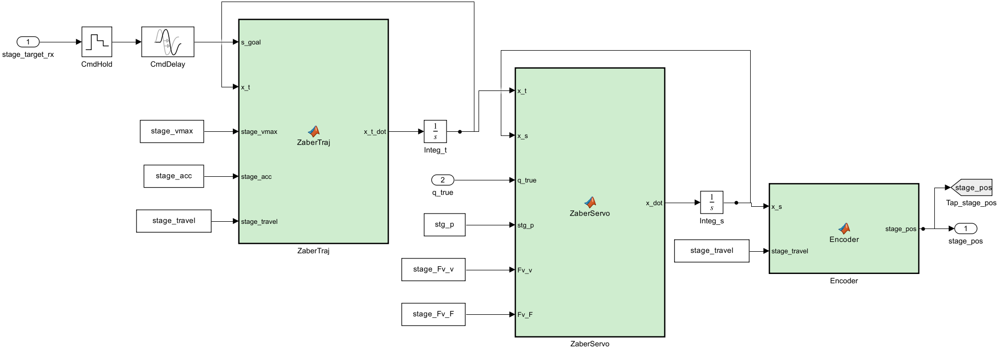

*Hình 17. Bên trong StagePlant (ZOH lệnh → trễ → quỹ đạo firmware → servo → encoder)*

---

## 14. Phương trình và nguyên lý của từng hàm Simulink

Toàn bộ tính toán nằm trong các khối MATLAB Function bên trong mô hình, và phần đầu mã của mỗi khối ghi rõ đầu vào, đầu ra, đơn vị và nguyên lý với nội dung giống hệt nhau bằng tiếng Hàn và tiếng Anh. Các khối được tóm tắt dưới đây theo thứ tự dòng tín hiệu.

### 14.1 Nav (dẫn đường)

| Đầu vào | Đầu ra |
|---|---|
| `zerokey_position` [m], `zerokey_vel` [m/s], `imu_quat`, `psi0` [rad], `tau_pred` [s], `zk_xsign` | `pose` = $[\hat x;\ \hat y;\ \hat\psi]$ [m, m, rad] (phiên bản 2: + `V_meas`) |

$$
\hat p = \begin{bmatrix} z \cr x \end{bmatrix}, \qquad
\mathrm{yaw} = \mathrm{atan2}\big(2(q_w q_z + q_x q_y),\ 1 - 2(q_y^2 + q_z^2)\big), \qquad
\hat\psi = \mathrm{wrap}(\mathrm{yaw} - \mathrm{yaw}_0 + \psi_0) \qquad (42)
$$

Trong tọa độ thế giới ZeroKey, $z$ là độ cao và $x$ là phương ngang của tường, nên tọa độ trong hệ tọa độ tường là $[s_x x;\ z]$. $s_x$ (`zk_xsign`) bằng $-1$ (mặc định) nếu $x$ của ZeroKey dương về bên trái khi nhìn vào tường, và bằng $+1$ nếu dương về bên phải. Thành phần pháp tuyến tường $y$ bị loại bỏ. Góc yaw được trích từ quaternion bằng công thức chuẩn, và yaw $\mathrm{yaw}_0$ của mẫu hợp lệ đầu tiên được lưu lại rồi trừ đi để thu được yaw tương đối. Vì khối này phải ghi nhớ giá trị trước đó, nó là khối rời rạc (0.01 s). Phiên bản 2 xuất thêm vận tốc tiến trong hệ tọa độ thân $u_B = \dot x\cos\hat\psi + \dot y\sin\hat\psi$ và tốc độ con quay $r$ dưới dạng `V_meas`.

### 14.2 Mission (Guards → ModeChart → Waypoints)

Guards tạo ra ba giá trị dùng làm điều kiện chuyển: khoảng cách đến tâm điểm bắt đầu $\lVert c_A - \hat c\rVert$ (trong đó $\hat c = \hat p - R(\hat\psi) r_{tag}$ là tâm ước lượng), sai số hướng đường thẳng $\mathrm{wrap}(\theta_l - \hat\psi)$, và khoảng cách dọc đường thẳng còn lại đến điểm cuối $u^{\top}(r_B - \hat p)$ (tất cả tính bằng m hoặc rad). ModeChart dùng các giá trị này để xét các chuyển trạng thái của Hình 7 và ghi lại thời điểm $t_{line}$ vào chế độ 3. Waypoints xuất ra đoạn mà robot bám theo tùy theo chế độ. Mục tiêu ở chế độ 1 là tâm điểm bắt đầu $c_A$; sau đó là đoạn của thẻ định vị $r_A \to r_B$ (PT (6)). Đường của bút `lineAB` = $[A;\ B]$ được chuyển cho PenCtrl.

### 14.3 RobotCtrl (bốn hộp theo chế độ + Merge)

Mỗi chế độ kích hoạt một Enabled Subsystem, và Merge chỉ chuyển tiếp đầu ra của hộp đang được kích hoạt. Tất cả đầu ra là $v$ [m/s] và $\omega$ [rad/s], bão hòa ở $\lvert v\rvert \le 0.2$ m/s và $\lvert\omega\rvert \le 45$ °/s.

Các chế độ 1 và 4 dùng luật trong tọa độ cực. Từ khoảng cách đến mục tiêu $\rho$ và sai số phương vị $\alpha$, luật này xuất ra

$$
v = k_\rho\thinspace \rho\thinspace \max(0,\ \cos\alpha), \qquad \omega = k_\alpha\thinspace \alpha + \tfrac12\sin\alpha\cos\alpha \qquad (43)
$$

Nhờ $\max(0,\ \cos\alpha)$, robot chỉ quay mà không tiến khi phương vị lệch quá 90°, và di chuyển nhanh hơn khi hướng càng thẳng hàng. Chế độ 1 lái tâm đến mục tiêu, còn chế độ 4 lái thẻ định vị. Chế độ 2 quay tại chỗ với $v = 0$, $\omega = k_\alpha\thinspace \mathrm{wrap}(\theta_l - \hat\psi)$. Chế độ 3 tuân theo các PT (7)–(8). Khi bật tùy chọn giữ bàn trượt ở giữa ($K_c,\ K_{ci} > 0$), độ lệch Y của `/stage/pos`, $e_s = (s_Y - s_c)/1000$ [m], được cộng vào sai số ngang để robot dịch về phía bút và bàn trượt hoạt động ở giữa hành trình.

### 14.4 InnerPI (chỉ phiên bản 2)

$$
e_v = v_c - u_B, \quad e_\omega = \omega_c - g_\omega r, \qquad
\bar V = \mathrm{sat}_{[0,\thinspace 0.5]}\Big(K_{P,v} e_v + K_{I,v}\sum e_v T_s\Big), \quad
\bar W = \mathrm{sat}_{[-0.5,\thinspace 0.5]}\Big(K_{P,\omega} e_\omega + K_{I,\omega}\sum e_\omega T_s\Big) \qquad (44)
$$

Đây là bộ PI rời rạc giống như trong mô hình Xsens của robot thật (Forward Euler, 0.01 s, kẹp tích phân). Dùng nguyên giá trị của robot thật gây ra hai vấn đề. Hệ số tỷ lệ con quay $g_\omega = 0.1443$ không nhất quán về đơn vị với lệnh rad/s và làm ω dao động, nên được đặt bằng 1; và giá trị tích phân mang sang khi đổi chế độ gây ra chuyển động tiến trong lúc quay, nên các khâu tích phân được reset khi chuyển chế độ. Việc xác nhận nguồn gốc vẫn còn tồn đọng (Mục 21.2).

### 14.5 PwmMap (`calc_pwm`)

Đầu vào là $v_c$ [m/s], $\omega_c$ [rad/s] ở phiên bản 1 ($\bar V,\ \bar W$ [–] ở phiên bản 2), và đầu ra là `motor_pwm` [count]. Ánh xạ được cho bởi các PT (10)–(11) và đã được giải thích ở Mục 5.3.

### 14.6 PenCtrl (PenComp → Travel → CmdRate)

Đầu vào là `lineAB` [m], `mode`, `pose`, và các hằng số $d$ [m] và $s_c$ [mm]. Đầu ra là $s^{\star}$ [mm], `pen_on` và $\sigma$ [m]. Phép tính được cho bởi các PT (12)–(16) và đã được giải thích ở Chương 6. Ngoài chế độ 3, bàn trượt được giữ ở tâm ($s_c$). Khác với điều kiện hạ bút $0 \le \sigma \le L$, việc bù bắt đầu ngay tại thời điểm vào chế độ 3; bàn trượt được đưa đến mục tiêu trước khi hạ bút nhằm loại bỏ quá độ lúc bắt đầu (15.8 mm). Khối `Travel` phía sau cắt lệnh trong khoảng 0–101.6 mm, và `CmdRate` giới hạn tốc độ thay đổi ở 83 mm/s.

### 14.7 RobotPlant (robot ảo, chỉ `_sim`)

| Khối | Đầu vào → đầu ra | Phương trình và nguyên lý |
|---|---|---|
| EscInv | PWM [count] → lệnh tốc độ xích [m/s] | Hoàn tác việc đảo dấu bên phải, trừ vùng chết 30 count, rồi tỷ lệ sao cho 400 count bằng 0.2 m/s. Là giả thiết về hành vi ESC [cần đo thực tế] |
| TrackLag | → [m/s] | Khâu trễ bậc nhất với hằng số thời gian 0.15 s. Độ dốc ESC và đáp ứng động cơ |
| SpeedErr | Tốc độ xích, $V$ → $e_v$, $L e_\omega$ [m/s] | $v_c = (v_L + v_R)/2$, $\omega_c = (v_R - v_L)/B$. Như trong 6WP, thành phần thứ hai có đơn vị $L\omega$ |
| PID_v, PID_w | → $\tau_X$, $\tau_N$ [N] | PI tốc độ (1500, 15000). Thay thế vòng tốc độ ESC của robot thật |
| Control_allocation | → $F_r,\ F_l$ [N] | Giải $[\tau_X;\ \tau_N] = \tilde B [F_r;\ F_l]$, $\tilde B = [1\ \ 1;\ b/2L\ \ {-b/2L}]$ và cắt ở ±200 N |
| compute_u | $V$ → $u$ [m] | Độ dịch dọc của tâm quay tức thời (ICR). Bằng không với giá trị mặc định $\alpha = 0$ |
| Dynamics | Lực, trạng thái → $\dot V$ | Động lực học xe bánh xích Zou (2018) $\tilde M\dot\nu + \tilde C\nu + S^{\top}(f_1 + f_2) = \tilde B\tau + S^{\top}f_g$. Phiên bản trên tường: lực pháp tuyến = nam châm 400 N, trọng lực $f_g = [0;\ -mg;\ 0]$, mô-men cản quay đã hiệu chỉnh dấu, sgn → tanh |
| Kinematics | $V$ → $\dot q$ của tâm | PT (5) + nhiễu loạn của tường (trượt (creep): xuống dưới bằng 8 % tốc độ di chuyển, độ không phẳng: 0.35 Hz, 1.5°) |
| TagPoint | Tư thế tâm → tư thế thẻ định vị `q_true` | $p = c + R(\psi) r_{tag}$. Tích phân tại tâm; cảm biến nhìn thấy thẻ định vị |

### 14.8 Sensors và StagePlant (cảm biến và bàn trượt ảo, chỉ `_sim`)

Sensors thêm nhiễu, trễ và tần số lấy mẫu vào giá trị thật để tạo ra giá trị topic như của robot thật. ZkWorld chuyển vị trí trong hệ tọa độ tường sang tọa độ thế giới $[s_x x;\ y_{wall};\ y]$, thêm nhiễu 1 mm, và xuất ra với trễ 50 ms ở 20 Hz. ZkVel xuất vận tốc thẻ định vị $\dot p = v[\cos\psi;\ \sin\psi] + \omega J R r_{tag}$ trong tọa độ thế giới. ImuQuat thêm nhiễu 0.3° và trôi 0.02 °/s vào hướng rồi chuyển thành quaternion $[\cos(\psi/2);\ 0;\ 0;\ \sin(\psi/2)]$.

StagePlant là mô hình coi firmware Zaber như một hộp đen. Sau ZOH lệnh (25 Hz) và trễ nối tiếp (10 ms), ZaberTraj tạo quỹ đạo hình thang (giá trị nhỏ hơn giữa tốc độ $\sqrt{2a\lvert e\rvert}$ mà con trượt vẫn có thể dừng trong khoảng cách còn lại và tốc độ tối đa), và ZaberServo bám quỹ đạo bằng một servo vị trí 20 Hz có tính đến khối lượng con trượt (X 0.55 kg, Y 0.16 kg), đường cong lực đẩy–tốc độ (32 N → 9 N), và thành phần dọc trục của trọng lực trên tường $R^{\top}(\psi)[0;\ -g]$. Encoder chuyển vị trí sang mm và xuất ra dưới dạng `/stage/pos`.

### 14.9 PenTrace (đánh giá, bộ điều khiển không biết)

Từ tư thế thật của thẻ định vị và vị trí encoder, vị trí bút thực tế $P = p + R(\psi)(d + (s - s_c)/1000)$ và sai số ngang $e = n^{\top}(P - A)$ được tính. Vị trí bút và sai số ngang lẽ ra phát sinh trong cùng lần chạy nếu bàn trượt cố định ở tâm cũng được tính, để có thể so sánh hiệu quả của việc bù.

---

## 15. Cài đặt

### 15.1 Yêu cầu

| Hạng mục | Phiên bản |
|---|---|
| MATLAB / Simulink | R2025a trở lên |
| Toolbox | ROS Toolbox, Stateflow |
| NUC của robot thật | Ubuntu 24.04, ROS 2 Jazzy, Python 3, `zaber-motion` |
| Hoạt hình (tùy chọn) | `4_CAD/AVT-3C.stl` (có trong kho mã; nếu thiếu sẽ vẽ bằng hộp) |

### 15.2 Quy trình

| Bước | Lệnh | Kết quả |
|---|---|---|
| 1 | `git clone https://github.com/wkyouncnu/AVT3C-XY-Stage-Pen.git` | Kho mã |
| 2 | Trong MATLAB, chuyển đến `1_simulation`, `XY_setup` | Đường dẫn và tham số, `ROS_DOMAIN_ID` 77 |
| 3 | `build_xy_models` | Tạo hai tệp .slx, in kết quả kiểm tra |
| 4 (NUC) | `pip install zaber-motion` | Thư viện phụ thuộc của node bàn trượt |

---

## 16. Chạy chương trình

| Mục đích | Lệnh | Thời gian |
|---|---|---|
| Trực tiếp trong Simulink | Sau `XY_setup`, mở `XY_1_pen_sim.slx` và nhấn nút Run | 48 s mô phỏng trong khoảng 15–17 s. Bảng hiển thị trong lúc chạy, hai hình kết quả khi kết thúc |
| Toàn bộ (thiết lập → dựng → chạy → hình → video) | `XY_run_all` | Khoảng 4 phút |
| Một thí nghiệm ảo | `XY_1_pen_sim_run` | Khoảng 20 s + video khoảng 100 s (bỏ qua nếu `make_video = 0`) |
| Chỉ hình kết quả | `M = XY_plot(out)` | – |
| Video bảng hiển thị | `XY_record_live(out)` hoặc `XY_record_live` | Khoảng 100 s → `video/XY_1_live_view.mp4` |
| So sánh lựa chọn thiết kế | `XY_compare; XY_compare_plot` | 10 trường hợp, khoảng 3–4 phút |
| Robot thật | Chương 21 | – |

- Thí nghiệm ảo chạy với `PacingRate` 4 (tối đa gấp 4 lần thời gian thực). Thứ tự phát/nhận của các topic vòng lặp ROS 2 nội bộ được bảo toàn; các con số thay đổi đôi chút giữa các lần chạy (Mục 18.5)
- Mô hình robot thật chạy ở thời gian thực 1×
- Tự động dừng khi nhiệm vụ kết thúc (chế độ 5)

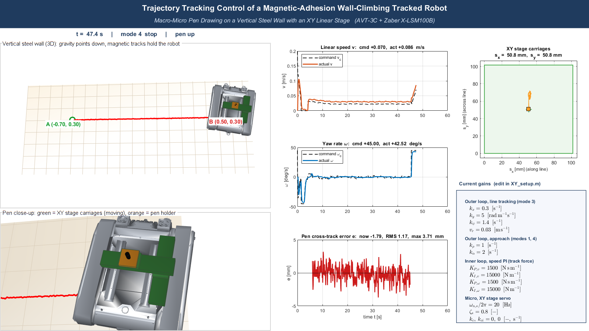

*Hình 18. Bảng hiển thị thời gian thực (trái: tường 3D và cận cảnh bút, giữa: lệnh v và ω so với thực tế và sai số ngang của bút, phải: con trượt của bàn trượt và hệ số khuếch đại hiện tại)*

Hành vi khi chạy bằng nút Run

| Hạng mục | Nội dung |
|---|---|
| Bảng hiển thị | Hộp Animate → `XY_animate.m`. Mỗi đầu vào có một Zero-Order Hold (`anim_Ts` = 0.2 s) nên hàm chỉ được gọi mỗi 0.2 s |
| Nội dung bảng hiển thị | Tường 3D (robot STL, hướng trọng lực, đường mục tiêu, vết bút), cận cảnh bút, $v_c$ so với $v$ [m/s], $\omega_c$ so với $\omega$ [deg/s], sai số ngang của bút [mm] (hiện tại, RMS, tối đa), vị trí con trượt của bàn trượt [mm], hệ số khuếch đại hiện tại (ký hiệu LaTeX, ký hiệu của các Mục 4.4–8.7) |
| Tắt | `animate = 0` rồi nhấn Run lại. Khuyến nghị cho các lần chạy lặp như tìm hệ số khuếch đại (chênh lệch tốc độ nhỏ) |
| Sau khi kết thúc | StopFcn `XY_stop.m` chuyển `log` vào `out.log` và chạy `XY_plot(out)` → quỹ đạo trên tường, hình đáp ứng thời gian, RMS trong Command Window |
| Video | `XY_record_live(out)`: đưa log trở lại `XY_animate` với khoảng 0.1 s và kết xuất một cửa sổ hình duy nhất ngoài màn hình (`print -RGBImage`), 20 fps (tốc độ 2×). Không phải chụp màn hình, nên các cửa sổ khác không bị ghi lại |
| Chạy bằng script | Tắt cả hai tính năng bằng `XY_batch = 1`, `animate = 0`; dùng giá trị trả về của `sim(..., 'ReturnWorkspaceOutputs','on')` |

---

## 17. Đầu vào và đầu ra của từng chương trình

### 17.1 Tham số (`XY_setup.m`)

| Mục | Tên | Giá trị | Ghi chú |
|---|---|---|---|
| 1 | `Ts_ctrl`, `Ts_plant` | 0.01, 0.0005 s | Tần số điều khiển, bước tích phân (Mục 8.3) |
| 2 | `pen_A`, `pen_B` | (−0.70, 0.30), (0.50, 0.30) m | Đường cần vẽ (1.2 m) |
| 3 | `q0` | (−0.85, 0.10, 90°) | Tư thế ban đầu (hướng về trần). `psi0` = 90° |
| 4 | `K_dist`, `K_yaw` | 1.0, 2.0 | Các chế độ 1, 2 |
| 4 | `v_ref`, `K_px`, `K_py`, `K_ptheta` | 0.03 m/s, 0.3, 5.0, 1.4 | Chế độ 3 (giá trị của mô hình ZeroKey robot thật, chỉ hạ tốc độ) |
| 4 | `K_c`, `K_ci` | 0, 0 | Giữ bàn trượt ở giữa (tùy chọn) |
| 5 | `r_tag`, `r_pen0` | (−0.08, 0.06), (0, 0) m | [cần đo thực tế] |
| 6 | `m_r`, `N_mag`, `mu_l`, `mu_t` | 12 kg, 400 N, 0.05, 0.5 | [cần đo thực tế] |
| 7 | Bàn trượt | Mục 12.2 | |
| 8 | `zk_*`, `imu_*`, `tau_pred` | Mục 12.3, 0 | |
| 9 | `animate`, `anim_Ts`, `XY_batch` | 1, 0.2 s, 0 | Bật bảng hiển thị, tần số cập nhật, cờ chạy bằng script |
| 10 | `Kin_Pv`, `Kin_Iv`, `Kin_Pw`, `Kin_Iw`, `w_fb_gain`, `inner_reset` | 0.15, 0.8, 1.5, 1.5, 1.0, 1 | Vòng PI trong của phiên bản 2 (Mục 21.2); phiên bản 1 không đọc |

### 17.2 Các mục thay đổi

| Thay đổi | Tệp cần sửa | Dựng lại |
|---|---|---|
| Hệ số khuếch đại, đường thẳng, khối lượng, nhiễu cảm biến | `XY_setup.m` | Không cần (chạy lại `XY_setup`) |
| Cấu trúc khối, phương trình hàm | `build_xy_models.m` | `build_xy_models` |
| Tần số node bàn trượt | Tham số `cmd_rate` của `zaber_stage_node.py` + `stage_cmd_Ts` của `XY_setup` | Không cần dựng lại mô hình |

### 17.3 Node bàn trượt (`zaber_stage_node.py`)

| Tham số | Mặc định | Ý nghĩa |
|---|---|---|
| `port` | `/dev/ttyUSB0` | Cổng RS-232 (115200) |
| `x_device`, `y_device` | 1, 2 | Địa chỉ daisy chain |
| `publish_rate` | 20 Hz | `/stage/pos` |
| `cmd_rate` | 25 Hz | Tần số truyền `move abs` (chỉ mục tiêu mới nhất) |
| `cmd_deadband` | 0.001 mm | Không truyền lại nếu thay đổi nhỏ hơn giá trị này |
| `cmd_timeout` | 0.5 s | Watchdog của `/stage/cmd_vel` |
| `home_on_start` | True | Trở về vị trí gốc (home) khi khởi động |

- Bộ điều khiển gửi mục tiêu ở 100 Hz, nhưng một giao dịch nối tiếp (yêu cầu + phản hồi) mất vài ms, nên node giảm tần số xuống 25 Hz. Giống với `stage_cmd_Ts` = 0.04 s trong mô phỏng

---

# Phần IV. Kiểm chứng

## 18. Kiểm chứng

### 18.1 Các hạng mục kiểm chứng

| Hạng mục | Chạy | Đối tượng | Tiêu chí |
|---|---|---|---|
| Cấu trúc mô hình | `build_xy_models` | Cả hai mô hình | `check_flow` 0, `check_tags` 0, `check_lines` chồng lấn·đi xuyên·đường chéo·chồng khối 0 |
| Vòng lặp ROS (loopback) | `XY_1_pen_sim_run` | Xuất bản·đăng ký topic | Chế độ nhiệm vụ 1 → 5 hoàn tất |
| Mô hình robot thật | `update diagram` (domain 0) | `XY_2_pen_ros2` | Không có lỗi |
| Độ chính xác của bút | `XY_plot` | Khoảng hạ bút | RMS sai số ngang ≤ 2 mm, bàn trượt không bão hòa |

### 18.2 Kết quả cấu trúc mô hình

| Mô hình | check_flow | check_tags | Chồng lấn·đi xuyên·đường chéo·chồng khối | Từ 3 điểm gập trở lên | Goto / From |
|---|---|---|---|---|---|
| XY_1_pen_sim | 0 | 0 | 0 | 10 | 26 / 49 |
| XY_2_pen_ros2 | 0 | 0 | 0 | 2 | 19 / 29 |

- Các đường có từ 3 điểm gập trở lên: phản hồi của khâu tích phân bên trong mô hình chuyển động (các đường đưa V, q, x_t, x_s về các khối phía trước) và các kết nối dài ở mức gốc (pose, q_true, stage_target_pos)
- Số From tăng từ 44 → 49 do số tín hiệu được hộp Animate lấy ra (v_cmd, w_cmd, V_true, mode, e_pen) tăng lên
- Một chỗ đi xuyên bên trong RobotPlant, nơi đường compute_u → Dynamics lướt qua hằng số dist_p, đã được loại bỏ bằng cách dời hằng số trong bộ tạo mô hình
- Phiên bản trước (kết nối Goto/From, 78 / 123) có giá trị 0 ở hạng mục này, nhưng luồng tín hiệu không hiển thị thành đường nối, nên đã đổi sang kết nối bằng đường. Các đường phản hồi không được giấu lại sau Goto/From

### 18.3 Kết quả thí nghiệm ảo (cơ sở)

| Hạng mục | Giá trị |
|---|---|
| Đường thẳng | A (−0.70, 0.30) → B (0.50, 0.30) m, 1.2 m, 30 mm/s |
| Chuyển chế độ | 2 → 1.5 s, 3 → 4.1 s, 4 → 45.4 s, kết thúc 47.4 s |
| Thời gian hạ bút | 39.1 s |
| Sai số ngang của bút (bù bằng bàn trượt) | RMS 1.17–1.20 mm, lớn nhất 3.9 mm (4 lần chạy) |
| Sai số ngang của bút (không bù, cùng lần chạy) | RMS 14.84 mm, lớn nhất 19.6 mm |
| Sai số ngang tại điểm tham chiếu của robot `e_cross` (chế độ 3) | RMS 23.6 mm |
| Phạm vi bàn trượt đã dùng | X 51.0–53.8 mm, Y 61.4–72.2 mm (hành trình 0–101.6) |

- Cả hai trục đều chuyển động. X (hướng tiến) gần như cố định trong dải 2.8 mm; Y (pháp tuyến của đường thẳng) loại bỏ sai số ngang (PT (34))
- Giá trị khác nhau giữa các lần chạy (Mục 18.5)

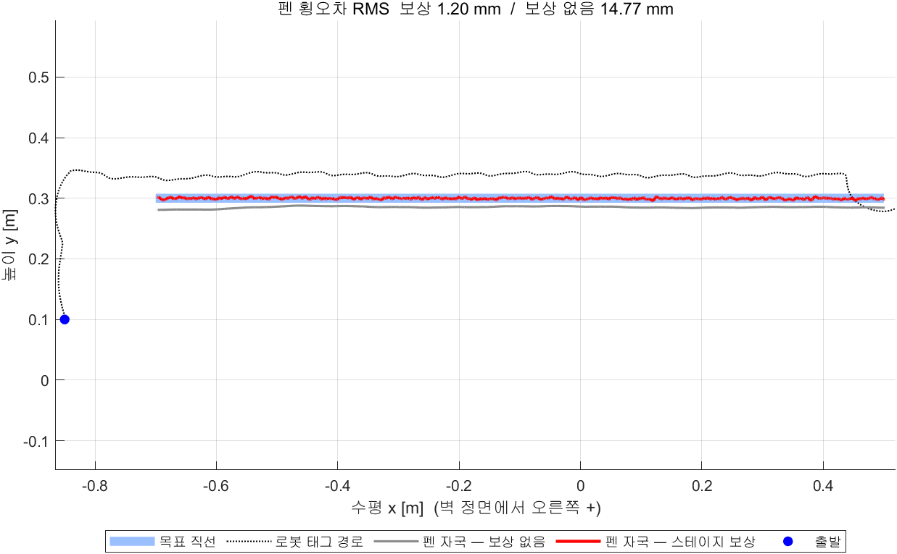

*Hình 19. Quỹ đạo trên tường (xanh dương: đường mục tiêu, đỏ: vết bút có bù, xám: vết bút khi không bù, nét đứt: đường đi của thẻ định vị (tag) trên robot)*

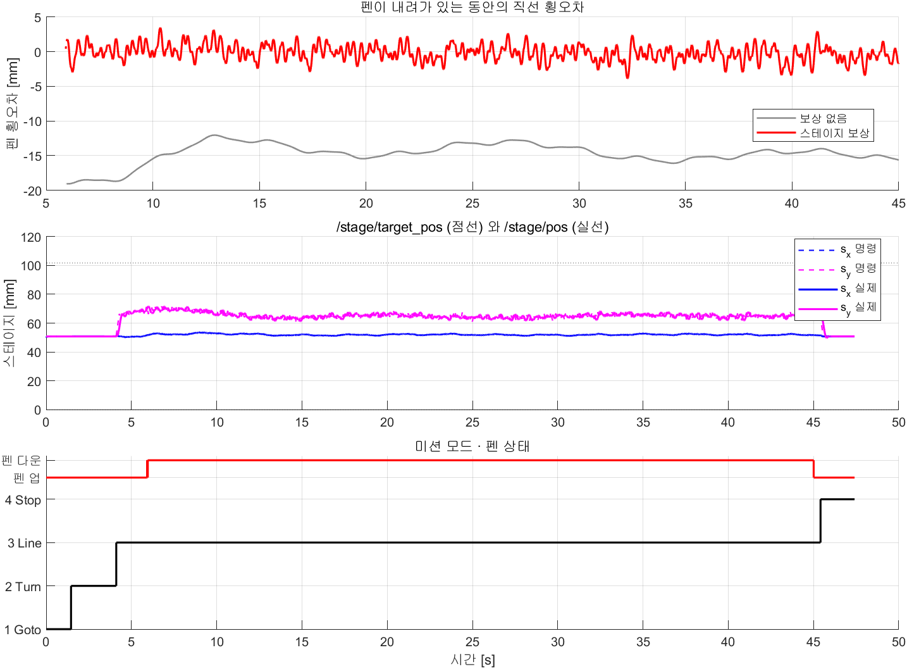

*Hình 20. Sai số ngang của bút, vị trí bàn trượt, chế độ, trạng thái bút*

### 18.4 Video

| Tệp | Nội dung |
|---|---|
| `1_simulation/video/XY_1_live_view.mp4` | Bảng điều khiển của Hình 18, 1600 × 900, 20 fps, 23.9 s (ghi bằng mô hình đối tượng của phiên bản trước, 47.8 s mô phỏng ở tốc độ 2×) |

- Tạo bằng `XY_record_live`. Phát lại log + kết xuất ngoài màn hình, nên các cửa sổ khác·ứng dụng nhắn tin không bị ghi lại trong lúc quay

### 18.5 Chẩn đoán các vòng trong và nguồn sai số

Kết quả kiểm tra các vòng trong và các hệ số khuếch đại bằng giá trị lệnh so với giá trị thực trên bảng điều khiển (giữa Hình 18). Tất cả các bảng là giá trị chạy lại ngày 2026-11-11 với mô hình đối tượng sau hiệu chỉnh ở Mục 8.2 (`1_simulation/logs/gain_sweep_a.mat`, `gain_sweep_b.mat`, `error_budget.mat`).

Dao động vận tốc góc yaw (2 lần chạy mỗi trường hợp)

| Hạng mục | Bước tích phân 5 ms | 0.5 ms (hiện tại) |
|---|---|---|
| RMS sai số bám ω (khi hạ bút) | 6.3 deg/s | 1.4 deg/s |
| RMS của bút | 1.19–1.20 mm | 1.18–1.20 mm |
| Mức khớp giữa $\int\omega\thinspace dt$ và $\Delta\psi$ (kiểm tra ở phiên bản trước) | Không khớp (dao động số) | Trong phạm vi 2.5° |
| Nguyên nhân | Bước lớn so với độ dốc của mô-men cản quay $\tanh(\omega/\varepsilon_\omega)$ ($\lambda h \approx 44$, Mục 8.3) | – |

- Dao động là vấn đề tích phân số, không phải vấn đề hệ số khuếch đại. RMS của bút vẫn như nhau ngay cả ở 5 ms (tần số dao động hầu như không xuất hiện trong phép đo góc hướng nằm trong dải bù của bàn trượt)

Thay đổi hệ số khuếch đại (3 lần chạy mỗi trường hợp, chênh lệch RMS của bút giữa 3 lần chạy không quá 0.02 mm)

| Trường hợp | RMS bút [mm] | Lớn nhất bút [mm] | RMS robot [mm] | Bàn trượt Y [mm] |
|---|---|---|---|---|
| Cơ sở | 1.19 ± 0.01 | 3.9 | 23.6 | 61.3–72.2 |
| $k_y$ × 0.5 | 1.19 | 3.8 | 38.2 | 68.4–90.0 |
| $k_y$ × 2 | 1.32 | 4.3 | 17.1 | 44.6–69.4 |
| $k_\psi$ × 0.5 | 1.41 | 4.3 | 21.5 | 37.3–72.3 |
| $k_\psi$ × 2 | 1.19 | 3.8 | 37.7 | 67.2–89.8 |
| Toàn bộ vòng PI trong × 0.5 | 1.21 | 3.9 | 24.0 | 58.3–73.2 |
| Toàn bộ vòng PI trong × 2 | 1.19 | 3.8 | 23.4 | 61.4–71.3 |
| Nhiễu ZeroKey 0 (để so sánh) | 0.74 | 2.3 | 23.6 | 62.5–71.7 |

- Sai số ngang của robot thay đổi mạnh theo hệ số khuếch đại, 17–38 mm; sai số ngang của bút chỉ thay đổi trong khoảng 1.19–1.41 mm
- Giữ robot chặt hơn ($k_y$ × 2) hoặc nới lỏng góc hướng ($k_\psi$ × 0.5) làm góc hướng dao động nhiều hơn, tăng sai số bút thêm 0.13–0.22 mm. Ngược lại ($k_y$ × 0.5, $k_\psi$ × 2) giữ nguyên sai số bút nhưng đẩy bàn trượt Y lên đến 90 mm (cách đầu hành trình 101.6 mm là 11.6 mm)
- Hệ số khuếch đại hiện tại ($k_y$ 5.0, $k_\psi$ 1.4): điểm cân bằng giữa sai số bút và dự trữ hành trình. Hệ số của vòng PI trong không có ảnh hưởng
- Bảng so sánh hệ số khuếch đại (vòng ngoài)

| Nguồn | Dọc đường | Ngang đường | góc hướng | Ghi chú |
|---|---|---|---|---|
| Mô hình này (giá trị trong mô hình ZeroKey của robot thật) | $k_x$ 0.3 | $k_y$ 5.0 | $k_\psi$ 1.4 | $v_r$ được gộp vào hệ số khuếch đại, PT (30b) |
| Zou [1] PT (38) | $k_x$ 12 | $k_y$ 6.3 | $k_\theta$ 3.3 | Xe mặt đất, nhân với $v_r$, PID trong 36 / 30 / 16 |
| Sabiha [2] (backstepping tối ưu + SMC) | 5.2 | 3.7 | 2.1 | $K_1$ 5.4, $K_2$ 7.3, $\rho$ 9.5 |

- Các giá trị trong bài báo được tối ưu cho chạy trên mặt đất·khối lượng khác, nên không chuyển trực tiếp sang được

Ngân sách sai số (mô phỏng chỉ đặt một yếu tố bằng 0, 2 lần chạy mỗi trường hợp, RMS của bút)

| Trường hợp | RMS bút [mm] | Dự đoán của PT (41) |
|---|---|---|
| Cơ sở | 1.19 | Tổng 1.25 |
| Nhiễu ZeroKey 0 | 0.74 | Loại bỏ $\sigma_p$ = 1.0 → 0.76 |
| Nhiễu IMU 0 | 1.28 | Loại bỏ $\ell_u\sigma_\psi$ = 0.42 → 1.18 |
| Trôi IMU 0 | 1.27–1.28 | Loại bỏ $\ell_u \dot b_\psi T/\sqrt3$ = 0.63 → 1.08 |
| Độ gồ ghề của xích theo góc hướng 0 | 1.10 | – |
| Trượt (creep) 0 | 1.18 (RMS robot 6.1 mm) | – |
| Toàn bộ cảm biến lý tưởng | 0.41 | Còn lại: trễ bám của bàn trượt và độ gồ ghề của xích |
| Cảm biến lý tưởng + độ gồ ghề của xích 0 | 0.12 | – |

- Yếu tố chi phối: nhiễu vị trí ZeroKey. Chỉ loại bỏ yếu tố này đã cho 1.19 → 0.74 mm, khớp với dự đoán của PT (41) (0.76 mm)
- Ngược lại, loại bỏ nhiễu·trôi IMU làm sai số tăng lên 1.28 mm. PT (41) giả thiết các thành phần sai số độc lập với nhau, nhưng trong lần chạy đơn này, độ lệch góc hướng chậm do trôi sinh ra dường như đã triệt tiêu một phần các độ lệch khác (đáp ứng của robot với độ gồ ghề của xích·trượt (creep)). Cần xác nhận bằng các lần chạy lặp lại với seed khác nhau (Chương 24)
- Trượt (creep) gây sai số cho robot (23.6 → 6.1 mm) nhưng bàn trượt loại bỏ được, nên hầu như không ảnh hưởng đến sai số bút
- Muốn chính xác hơn cần giảm nhiễu vị trí ZeroKey chứ không phải thay đổi hệ số khuếch đại (lấy trung bình khi đứng yên, bộ lọc, 2 thẻ định vị (tag)). Giảm nhiễu một nửa cho 0.89 mm (Mục 20.1)

Độ lệch xác lập của vòng vận tốc

- Trung bình trong khoảng hạ bút: lệnh $v_c$ 0.0228 m/s, thực tế $v$ 0.0308 m/s (phiên bản hiện tại)
- Nguyên nhân: chênh lệch giữa vùng chết bù ngược PWM của bộ điều khiển $d_v$ = 47 count và vùng chết ESC của mô hình chuyển động 30 count. Ánh xạ PWM vòng hở đẩy quá mạnh, và vòng ngoài $k_x e_x$ giảm lệnh để khớp với điểm tham chiếu theo thời gian
- Lệnh ω tăng lên 45 deg/s ở cuối chế độ 4: hành vi bình thường của luật chế độ 4 quay về phía điểm cuối (PT (31))

Giá trị khác nhau giữa các lần chạy

- Ở phiên bản hiện tại, chênh lệch RMS của bút qua 3 lần lặp cùng điều kiện không quá 0.02 mm (cơ sở 1.17–1.20 mm)
- Ở phiên bản trước (mô hình đối tượng tích phân theo thẻ định vị (tag)), giá trị dao động mạnh, 1.17–1.61 mm. Chế độ 1 tham chiếu theo thẻ định vị và đáp ứng quay dường như nhạy với thời điểm nhận ROS 2 (chưa xác nhận nguyên nhân)

---

## 19. Tổng hợp kết quả

Đường thẳng 1.2 m, 30 mm/s, thí nghiệm ảo (XY_1_pen_sim, ROS 2 loopback), chênh lệch giữa các lần chạy lặp cùng điều kiện không quá 0.02 mm.

| Hạng mục | Giá trị |
|---|---|
| Sai số ngang của bút (bù bằng bàn trượt) | RMS 1.17–1.20 mm, lớn nhất 3.9 mm |
| Sai số ngang của bút (bàn trượt cố định ở giữa) | RMS 14.84 mm, lớn nhất 19.6 mm |
| Sai số ngang của robot (chế độ 3) | RMS 23.6 mm |
| Phạm vi bàn trượt đã dùng | X 51.0–53.8 mm, Y 61.3–72.2 mm (hành trình 0–101.6 mm) |
| Phiên bản 2 (vòng PI trong) | RMS bút 1.21–1.24 mm |
| Loại bỏ toàn bộ nhiễu cảm biến | 0.41 mm |
| Chỉ loại bỏ nhiễu ZeroKey | 0.74 mm |
| Xấp xỉ 2 thẻ định vị (tag) (b) | 0.84 mm |

*(Cùng hình: Hình 19)*

Robot tiến lên trong khi lệch khỏi đường thẳng vài centimet, nhưng bút vẫn nằm trên đường thẳng ở mức 1 mm. Khoảng chênh giữa vết xám và vết đỏ trong Hình 19 là phần việc do bàn trượt thực hiện.

---

## 20. So sánh các phương án thiết kế

Dùng `XY_compare.m`, chạy 10 trường hợp trên cùng mô hình ROS 2 loopback, mỗi trường hợp thay đổi một hoặc hai giá trị so với cơ sở (đường thẳng 1.2 m, 30 mm/s). Mỗi trường hợp chạy một lần. Vì chênh lệch RMS của bút qua các lần lặp cùng điều kiện không quá 0.02 mm (Mục 18.5), các chênh lệch từ 0.05 mm trở lên được coi là thực.

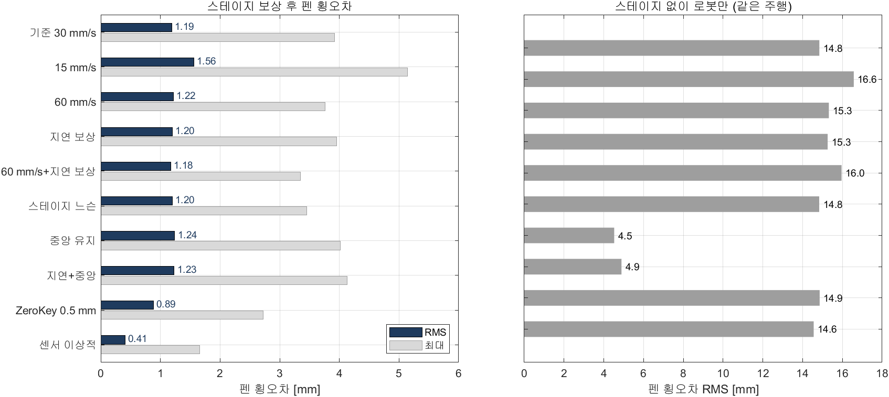

*Hình 21. Sai số ngang của bút theo từng trường hợp (trái: bù bằng bàn trượt, phải: bàn trượt cố định ở giữa trong cùng lần chạy)*

### 20.1 Kết quả

| Trường hợp | Giá trị thay đổi | RMS bút [mm] | Lớn nhất bút [mm] | RMS chỉ robot [mm] | Bàn trượt Y [mm] |
|---|---|---|---|---|---|
| Cơ sở | – | 1.19 | 3.92 | 14.84 | 61.4–72.2 |
| Tốc độ 15 mm/s | `v_ref` 0.015 (hạ bút 79.3 s) | 1.56 | 5.14 | 16.57 | 61.8–70.2 |
| Tốc độ 60 mm/s | `v_ref` 0.060 (hạ bút 19.4 s) | 1.22 | 3.76 | 15.32 | 58.9–75.8 |
| 60 mm/s + bù trễ | `v_ref` 0.060, `tau_pred` 0.05 s | 1.18 | 3.35 | 15.96 | 58.8–78.3 |
| Bù trễ | `tau_pred` 0.05 s | 1.20 | 3.96 | 15.26 | 61.7–75.2 |
| Bàn trượt lỏng | Băng thông 2 Hz, lệnh 5 Hz | 1.20 | 3.46 | 14.83 | 61.1–72.0 |
| Giữ bàn trượt ở giữa | `K_c` 0.5, `K_ci` 0.3 | 1.24 | 4.02 | 4.52 | 43.2–70.9 |
| Bù trễ + giữ bàn trượt ở giữa | Ba giá trị | 1.23 | 4.13 | 4.89 | 42.6–73.4 |
| Nhiễu ZeroKey 0.5 mm | `zk_sigma` 0.0005 | 0.89 | 2.72 | 14.86 | 62.1–72.2 |
| Nhiễu cảm biến 0 | Nhiễu ZeroKey·IMU·trôi 0 | 0.41 | 1.66 | 14.56 | 62.7–71.3 |

- Giá trị chạy lại ngày 2026-11-11 sau hiệu chỉnh ở Mục 8.2 (điểm tích phân = tâm, chế độ 1 = tham chiếu theo tâm). Chênh lệch lớn nhất so với phiên bản trước: bàn trượt lỏng (1.73 → 1.20 mm)

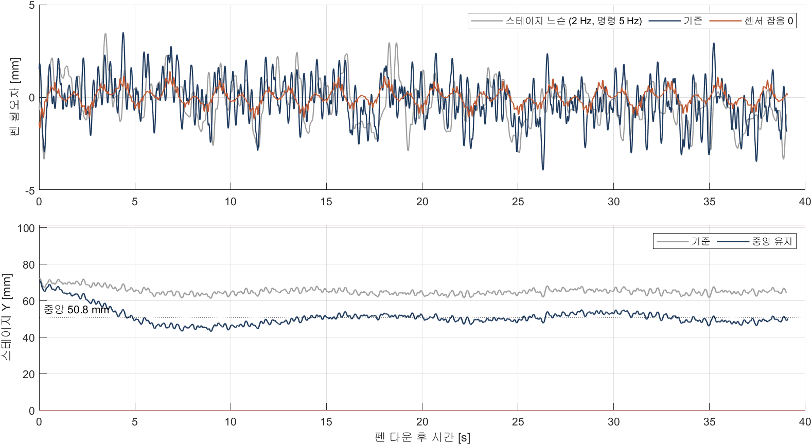

*Hình 22. Trên: sai số ngang của bút (bàn trượt lỏng · cơ sở · nhiễu cảm biến 0), dưới: bàn trượt Y (cơ sở · giữ bàn trượt ở giữa)*

### 20.2 Diễn giải

| Hạng mục | Kết quả | Cơ sở |
|---|---|---|
| Tốc độ chạy | 1.2 mm ở 30–60 mm/s, 1.6 mm ở 15 mm/s | Khi chạy chậm, thời gian hạ bút dài và độ trôi góc hướng tích lũy (thành phần $\dot b_\psi T$ của PT (41)) |
| Bù trễ | Không khác biệt (1.19 → 1.20 mm, nằm trong biến động giữa các lần chạy) | Trên đường thẳng, trễ ZeroKey trở thành sai số dọc đường, còn bù bút chỉ dùng thành phần pháp tuyến của đường thẳng ($n^{\top}\delta p$ của PT (40)) |
| Nới lỏng servo bàn trượt | 1.19 → 1.17–1.20 mm (3 lần lặp), phiên bản trước 1.73 mm | Không ảnh hưởng. Ngay cả với băng thông 2 Hz, lệnh 5 Hz, việc bù độ gồ ghề của xích theo góc hướng (0.35, 0.8 Hz) vẫn đủ. Giá trị 1.73 mm của phiên bản trước có cùng độ lớn với biến động lớn giữa các lần chạy của phiên bản trước (1.17–1.61 mm) |
| Yếu tố quyết định sai số | Cảm biến | Nhiễu giảm một nửa → 0.89 mm, nhiễu 0 → 0.41 mm |
| Chỉ robot | 14.6–16.6 mm | Robot xích không thể di chuyển ngang trực tiếp (chỉ hiệu chỉnh bằng cách quay) và không loại bỏ hoàn toàn được trượt (creep) trên tường·độ gồ ghề của xích |
| Vòng giữ bàn trượt ở giữa | RMS bút không đổi, sai số robot 14.8 → 4.5 mm, phạm vi bàn trượt Y dịch về phía tâm (50.8 mm) | Tích phân độ lệch bàn trượt loại bỏ, ở phía robot, độ lệch xác lập do trượt (creep) trên tường → đảm bảo dự trữ hành trình |

### 20.3 Vẽ sau khi dừng so với vẽ trong khi chạy

| Hạng mục | Vẽ sau khi dừng (nối các đoạn khoảng 90 mm) | Vẽ trong khi chạy (phương pháp hiện tại) |
|---|---|---|
| Độ thẳng trong một đoạn | Không có trượt (creep)·độ gồ ghề của xích khi đứng yên; với lấy trung bình ZeroKey 2 s, nhiễu 1/√40 → khoảng 0.2 mm (giá trị tính toán) | RMS khoảng 1.2 mm (mô phỏng) |
| Mối nối giữa các đoạn | Có bậc ở mọi mối nối. Độ lớn ≈ √2 × sai số tuyệt đối ZeroKey (độ lệch không giảm khi lấy trung bình) | Không có |
| Thời gian cho 1.2 m | Từ 14 lần dừng·khởi động trở lên | Liên tục 39 s |
| Trường hợp phù hợp | Đường ngắn (không quá 100 mm), chấp nhận mối nối, yêu cầu không quá 0.5 mm | Đường thẳng liên tục, yêu cầu mức mm |

- Vẽ sau khi dừng chưa được kiểm chứng bằng mô phỏng (giá trị tính toán). Cần đo sai số tuyệt đối khi đứng yên của ZeroKey

### 20.4 Kết luận

- Giữ cấu trúc dẫn động kép (vĩ mô–vi mô): chỉ robot 14.6–16.6 mm, bù bằng bàn trượt 1.2 mm
- Giao bản thân servo bàn trượt cho firmware Zaber và chỉ gửi vị trí mục tiêu ở 25 Hz là đủ. Sai số bút không tăng ngay cả khi hạ xuống băng thông 2 Hz, lệnh 5 Hz (Mục 20.2)
- Giới hạn trên của độ chính xác: các phép đo đi vào tính toán bù — nhiễu ZeroKey, góc hướng IMU và cánh tay đòn, góc lắp trục bàn trượt. Hệ số khuếch đại điều khiển không thay đổi giới hạn trên (Mục 18.5)
- Khuyến nghị bật vòng giữ bàn trượt ở giữa (`K_ci` 0.3) trên robot thật để có dự trữ hành trình

---

# Phần V. Triển khai trên robot thật

## 21. Triển khai trên phần cứng thật

| Bước | Nội dung |
|---|---|
| 1 | Khởi động các node ZeroKey, Xsens và cầu nối robot trên NUC (`ROS_DOMAIN_ID=0`) |
| 2 | Trên NUC, `python3 zaber_stage_node.py --ros-args -p port:=/dev/ttyUSB0` (xác nhận `/stage/pos` được xuất bản sau khi về vị trí gốc (home)) |
| 3 | MATLAB: `XY_setup; setenv('ROS_DOMAIN_ID', num2str(ros_domain_real))` |
| 4 | Mở và chạy `XY_2_pen_ros2.slx` (`T_run_ros` = 300 s) |
| 5 | Chạy một lần không có bút, xác nhận phạm vi `/stage/target_pos` nằm trong 10–90 mm, sau đó lắp bút |

- Ngay cả khi thí nghiệm ảo (domain 77) và robot thật (domain 0) ở trên cùng một mạng, không bên nào nhận `/motor_pwm` của bên kia
- Các dấu cần kiểm tra trước khi chạy robot thật: trục 1 của bàn trượt có tăng theo hướng x_B (phía trước) và trục 2 theo hướng y_B (bên trái) hay không

### 21.1 Phạm vi dùng bộ điều khiển mô phỏng trên robot thật

`XY_2_pen_ros2` dựng hàng bộ điều khiển phía trên của thí nghiệm ảo bằng cùng các hàm của bộ tạo mô hình, nên topic·phương trình·hệ số khuếch đại là như nhau.

| Hạng mục | Thí nghiệm ảo (XY_1) | Robot thật (XY_2) | Trạng thái |
|---|---|---|---|
| Vị trí | `/zerokey/position` (mô hình chuyển động + nhiễu được xuất bản) | Node ZeroKey | Như nhau |
| Vận tốc | `/zerokey/vel` | Node ZeroKey | Như nhau (chỉ dùng khi bật bù trễ) |
| góc hướng | `/imu/data` orientation → yaw tương đối | Node Xsens | Như nhau |
| Vị trí bàn trượt | `/stage/pos` (do StagePlant xuất bản) | `zaber_stage_node.py` | Như nhau (chỉ dùng khi bật giữ bàn trượt ở giữa) |
| Lệnh robot | `/motor_pwm` | Cầu nối Arduino | Như nhau |
| Lệnh bàn trượt | `/stage/target_pos` | `zaber_stage_node.py` → RS-232 `move abs` | Như nhau |
| Vòng PI trong trước `calc_pwm` | Phiên bản 1 không có, phiên bản 2 có (Mục 21.2) | Có trong mô hình Xsens của robot thật | Như nhau ở phiên bản 2 |

- Mô hình ZeroKey + Xsens của robot thật (`Tracked_UGV_ZeroKey_XsensIMU`) đặt hai bộ PI trước `calc_pwm`
  - Vận tốc: $K_P$ 0.15, $K_I$ 0.8, đầu ra [0, 0.5], phản hồi = vận tốc thân từ ZeroKey
  - Vận tốc góc yaw: $K_P$ 1.5, $K_I$ 1.5, đầu ra ±0.5, phản hồi = 0.1443 × gyro z của IMU
- Mô hình XY phiên bản 1 gửi $(v_c, \omega_c)$ qua ánh xạ PWM vòng hở (các PT (27)–(28)) mà không có các bộ PI này. Vòng ngoài đã bù độ lệch vận tốc (Mục 18.5), nên độ chính xác của bút không bị ảnh hưởng
- `/zerokey/orientation`, được mô hình robot thật sử dụng, không được dùng trong bộ điều khiển XY (góc hướng lấy từ Xsens)

### 21.2 Mô hình phiên bản 2 (có vòng PI trong)

Giữ nguyên mô hình phiên bản 1; dựng một mô hình riêng có vòng PI trong của mô hình Xsens trên robot thật.

| Tệp | Nội dung |
|---|---|
| `XY_1_pen_sim_v2.slx` | Thí nghiệm ảo phiên bản 2 (ROS 2 loopback, domain 77) |
| `XY_2_pen_ros2_v2.slx` | Robot thật phiên bản 2 (chỉ bộ điều khiển, domain 0) |
| Tạo | `XY_setup; build_xy_models([1 2], 2)` (phiên bản 1 với `build_xy_models` không thay đổi) |

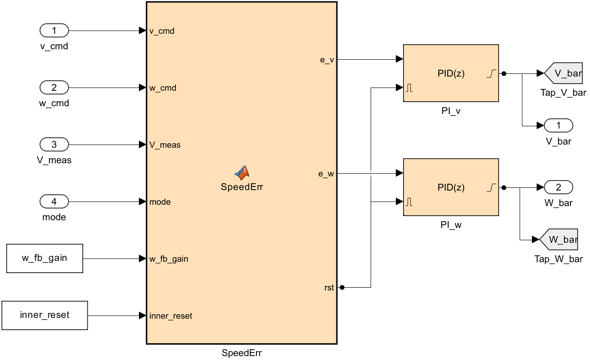

*Hình 23. Hộp InnerPI của phiên bản 2 (tính sai số → hai bộ PI rời rạc, đặt lại tích phân khi chuyển chế độ)*

Các hộp thay đổi so với phiên bản 1

| Hộp | Nội dung phiên bản 2 |
|---|---|
| RosIn | Đọc thêm `angular_velocity.z` từ `/imu/data` → `imu_data` = [quaternion; gyro z] |
| Nav | Xuất thêm `V_meas` = [$u_B$; $r$]. $u_B = \dot x\cos\psi + \dot y\sin\psi$ (vận tốc ZeroKey, cùng phương trình với `transform_state` của robot thật), $r$ = gyro z |
| InnerPI (hộp mới) | PT (45) dưới đây |
| PwmMap | Đầu ra PI $\bar V, \bar W$ đưa trực tiếp vào `calc_pwm` của robot thật (không chuẩn hóa vận tốc theo PT (27)) |
| Sensors · PlantRosOut | Tư thế và gyro z (vận tốc góc thực + nhiễu 0.1°/s) được xuất bản cùng nhau trong một thông điệp IMU |

$$
\bar V = \mathrm{sat}_{[0,\thinspace 0.5]}\negthinspace \Big(K_{P,v}^{in} e_v + K_{I,v}^{in}\negthinspace \sum e_v\thinspace T_s\Big),\ e_v = v_c - u_B, \qquad
\bar W = \mathrm{sat}_{[-0.5,\thinspace 0.5]}\negthinspace \Big(K_{P,\omega}^{in} e_\omega + K_{I,\omega}^{in}\negthinspace \sum e_\omega\thinspace T_s\Big),\ e_\omega = \omega_c - g_\omega\thinspace r \qquad (45)
$$

| Ký hiệu | Định nghĩa | Giá trị (`XY_setup.m` mục 10) |
|---|---|---|
| $K_{P,v}^{in},\ K_{I,v}^{in}$ | PI vận tốc | 0.15, 0.8 (`Kin_Pv`, `Kin_Iv`, như robot thật) |
| $K_{P,\omega}^{in},\ K_{I,\omega}^{in}$ | PI vận tốc góc yaw | 1.5, 1.5 (`Kin_Pw`, `Kin_Iw`, như robot thật) |
| $T_s$ | Chu kỳ PI rời rạc (Forward Euler, kẹp tích phân) | 0.01 s (như robot thật) |
| $g_\omega$ | Hệ số tỉ lệ phản hồi gyro | 1.0 (`w_fb_gain`). Mô hình robot thật 0.1443 |
| Đặt lại | Cả hai khâu tích phân được đặt về 0 tại mẫu mà chế độ thay đổi | `inner_reset` = 1 (không có trong mô hình robot thật) |

Kết quả (đường thẳng 1.2 m, 30 mm/s, mô hình đối tượng sau hiệu chỉnh ở Mục 8.2, 3 lần chạy mỗi trường hợp. Chênh lệch RMS của bút giữa 3 lần chạy không quá 0.02 mm)

| Trường hợp | RMS bút [mm] | Lớn nhất bút [mm] | RMS robot [mm] | Bàn trượt Y [mm] | Vận tốc lệnh / thực tế [m/s] | RMS sai số bám ω [deg/s] |
|---|---|---|---|---|---|---|
| Phiên bản 1 (không có vòng PI trong) | 1.17–1.20 | 3.9 | 23.6 | 61.3–72.2 | 0.0228 / 0.0308 | 1.4 |
| Phiên bản 2 mặc định ($g_\omega$ = 1, đặt lại) | 1.21–1.24 | 3.7 | 22.6 | 63.5–70.9 | 0.0312 / 0.0312 | 1.7 |
| Phiên bản 2, $g_\omega$ = 0.1443 (giá trị robot thật), đặt lại | 1.41–1.44 | 4.7–5.0 | 22.3 | 62.9–70.5 | 0.0310 / 0.0309 | 5.4 |
| Phiên bản 2, $g_\omega$ = 1, không đặt lại (như robot thật) | 1.22 | 3.7 | 20.6 | 33.0–70.8 | 0.0312 / 0.0306 | 1.6 |
| Phiên bản 2, $g_\omega$ = 0.1443, không đặt lại | 1.43 | 4.6–4.7 | 20.1 | 52.1–70.6 | 0.0308 / 0.0305 | 5.4 |

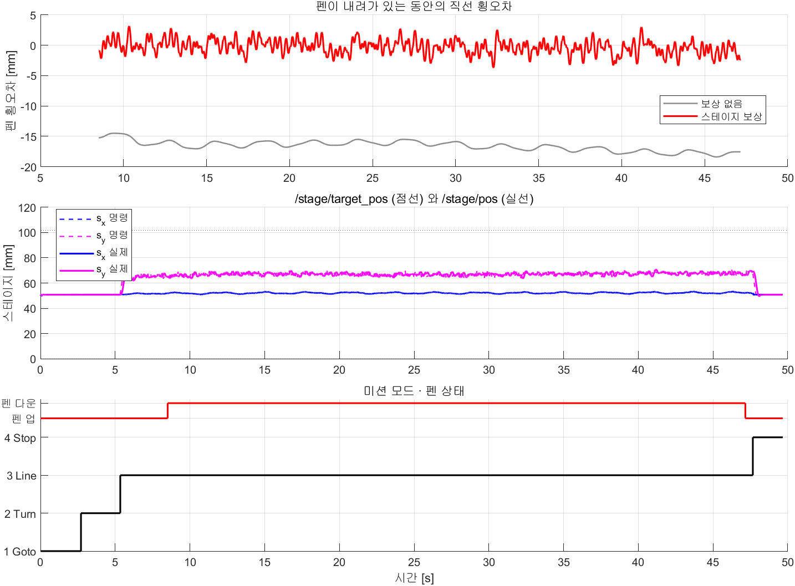

*Hình 24. Sai số ngang của bút, vị trí bàn trượt và chế độ với thiết lập mặc định của phiên bản 2*

Diễn giải

- Thiết lập mặc định của phiên bản 2: độ chính xác của bút ở cùng mức với phiên bản 1, và độ lệch giữa vận tốc lệnh và vận tốc thực tế (phiên bản 1: 0.0228 so với 0.0308 m/s) được loại bỏ
- Giới hạn trên của độ chính xác bút vẫn do cảm biến quyết định (Mục 18.5). Vòng PI trong chỉ làm robot chuyển động đúng theo lệnh; nó không làm giảm sai số bút
- Các vấn đề khi dùng nguyên các giá trị của mô hình robot thật

| Vấn đề | Nguyên nhân | Kết quả ở phiên bản hiện tại | Xử lý ở phiên bản 2 |
|---|---|---|---|
| ω dao động nhiều hơn lệnh (RMS sai số bám ω 5.4 so với 1.7 deg/s, RMS bút +0.2 mm) | Phản hồi 0.1443 × gyro z không khớp đơn vị với lệnh rad/s, nên tích phân tích lũy cho đến khi ω ≈ 6.9 ω_c → vòng ngoài lại giảm xuống, gây dao động | Tái hiện được | $g_\omega$ = 1 |
| Tích phân PI vận tốc còn lại sau khi chuyển chế độ, làm robot tiến lên ngay cả khi đang quay | Giới hạn dưới đầu ra PI vận tốc là 0 và không có feedforward, nên giá trị tích phân vẫn còn ngay cả khi $v_c$ = 0 | Ở phiên bản trước (tích phân theo thẻ định vị, chế độ 1 tham chiếu theo thẻ định vị), điểm bắt đầu lệch 100 mm và bàn trượt Y bão hòa ở 0 mm (RMS bút 7.47 mm). Ở phiên bản hiện tại, bàn trượt Y nhỏ nhất 33 mm, không bão hòa (RMS bút 1.22 mm) | Đặt lại tích phân khi chuyển chế độ (`inner_reset`). Giữ lại để có dự trữ hành trình (Y nhỏ nhất 33 → 63 mm) |

- Ảnh hưởng của việc không đặt lại giảm đi dường như là do chế độ 1 chuyển sang tham chiếu theo tâm, làm thay đổi vận tốc ở cuối chế độ 1 và độ thay đổi vị trí khi quay. Trên robot thật, cần kiểm tra qua `V_meas(1)` xem robot có tiến lên trong chế độ 2 hay không
- Nguồn gốc của 0.1443 cần xác nhận: node IMU của robot thật có xuất `angular_velocity` theo đơn vị khác rad/s hay không, hoặc có ý đồ khác (ví dụ chuyển sang hiệu vận tốc xích với $b/2$)
- Trình tự thử nghiệm phiên bản 2 trên robot thật: chạy không có bút với `XY_2_pen_ros2_v2` và kiểm tra log `V_meas`, `V_bar`, `W_bar` → quy trình như phiên bản 1 (Chương 21)

---

## 22. Quy trình triển khai trên phần cứng và danh mục kiểm tra

Bộ điều khiển mô phỏng kết nối trực tiếp với robot thật, nhưng các giá trị sau đây là giả thiết của mô phỏng và phải được xác nhận trước khi vận hành robot thật. Đặc biệt, nếu sai dấu hoặc sai đơn vị, phép bù sẽ làm sai số tăng gấp đôi thay vì giảm.

| Thứ tự | Kiểm tra | Phương pháp | Nếu sai |
|---|---|---|---|
| 1 | Dấu các trục bàn trượt: X tăng về phía $x_B$ (phía trước), Y về phía $y_B$ (bên trái) | Khi robot đứng yên, gửi (60, 50.8) và (50.8, 60) tới `/stage/target_pos` và kiểm tra hướng của con trượt | Bút rời xa đường thẳng |
| 2 | Vị trí thẻ định vị $r_{tag}$, vị trí bút $r_{pen0}$ | Laser tracker hoặc thước | Bút vẽ thành cung khi góc hướng thay đổi |
| 3 | Góc hướng tham chiếu $\psi_0$ và chiều quay của IMU | Bắt đầu hướng lên trần ($\psi_0 = 90^{\circ}$), quay ngược chiều kim đồng hồ khi nhìn từ phía trước tường và kiểm tra $\hat\psi$ tăng | Nếu chiều quay ngược, chế độ 2 phân kỳ |
| 4 | Các trục ZeroKey (z hướng lên +, hướng x → `zk_xsign`) | Di chuyển robot sang phải khi nhìn từ phía trước tường và kiểm tra x trong `/zerokey/position` tăng/giảm: giảm → $-1$, tăng → $+1$ | Robot di chuyển ngang theo chiều ngược lại |
| 5 | Nhiễu·trễ ZeroKey | Log đứng yên 1 phút, độ lệch chuẩn và độ trễ | Ngân sách sai số của Chương 7 thay đổi |
| 6 | Vùng chết ESC, `v_full` | Đo tốc độ chạy ở PWM không đổi | Chế độ 1·4 chậm hoặc giật (ít ảnh hưởng đến độ chính xác của bút) |
| 7 | Chạy không có bút | `/stage/target_pos` có nằm trong 10–90 mm hay không | Bão hòa ở đầu hành trình |
| 8 | Nhấc bút | Quyết định thời điểm đặt bút dạ lên tường | Vẽ cả vào các đoạn kéo dài trước và sau đường thẳng |
| 9 | Phiên bản 2: đơn vị gyro | `angular_velocity.z` có phải là rad/s hay không (nguồn gốc của 0.1443) | ω dao động |

---

## 23. Xử lý sự cố

| Triệu chứng | Nguyên nhân | Xử lý |
|---|---|---|
| Ở đầu chế độ 3, bàn trượt X đi gần đầu hành trình (95 mm) | p* bị kẹp về A, nên bàn trượt bù phần khoảng cách dọc đường còn lại | Đổi p* thành chân đường vuông góc không bị kẹp |
| Góc hướng dao động 2 Hz, sai số ngang 3.6 mm | Dấu mô-men cản quay 6WP (u² − l²/4) | Sửa thành (l²/4 − u²) |
| Lỗi không khớp sample time ở Merge | Clock liên tục của chế độ 3 so với 0.01 s của các chế độ khác | Digital Clock (Ts_ctrl) trong chế độ 3 |
| Cảnh báo sample time ở To Workspace | Các tín hiệu có chu kỳ khác nhau được ghi trong một Bus | ZOH (0.01 s) sau Bus |
| Lệnh bàn trượt trên robot thật bị trễ | `move abs` 100 Hz làm bão hòa đường nối tiếp 115200 bps | Node chỉ gửi mục tiêu mới nhất ở 25 Hz |
| Nguy cơ `/motor_pwm` của mô phỏng làm robot thật chuyển động | Cùng domain | Tách thí nghiệm ảo sang domain 77 |
| Lỗi quyền truy cập VideoWriter | Một VideoReader trước đó còn giữ tệp | Chạy lại sau `clear` |
| Giá trị khác nhau giữa các lần chạy | Thời điểm nhận ROS 2 | Bình thường. Ở phiên bản hiện tại, chênh lệch giữa các lần lặp không quá 0.02 mm (RMS bút 1.17–1.20 mm) |
| Chạy bảng điều khiển rất chậm (113 s cho 48 s) | Các đầu vào của MATLAB Function Animate là liên tục, nên hàm vẽ được gọi ở mỗi bước 0.5 ms | Zero-Order Hold trên mỗi đầu vào (`anim_Ts` 0.2 s) |
| ω dao động mạnh (sai số bám 6 deg/s) | Bước tích phân 5 ms lớn so với tanh của mô-men cản quay | `Ts_plant` 0.5 ms (Mục 8.3) |
| Lỗi biến trong khi chạy `XY_compare` | `r`, `s` còn lại trong base workspace xung đột với biến của script | `clear r s` sau `XY_setup` |
| Các cửa sổ khác bị ghi vào video | Phương pháp chụp màn hình | Đổi sang kết xuất ngoài màn hình (`print -RGBImage`). Không quay lại chụp màn hình |

---

## 24. Các mục cần xác nhận

| Hạng mục | Thiết lập hiện tại | Điều cần kiểm tra |
|---|---|---|
| Vị trí thẻ định vị·bút `r_tag`, `r_pen0` | (−0.08, 0.06), (0, 0) m | Đo bằng laser tracker |
| Dấu các trục bàn trượt·góc lắp | Trục 1 = x_B, trục 2 = y_B, 0° | Kiểm tra lắp ráp trên robot thật |
| Hướng x thế giới của ZeroKey `zk_xsign` | −1 (bên trái là + khi nhìn từ phía trước tường, giả thiết `plane_project` của robot thật) | Đẩy robot sang phải bằng tay và kiểm tra x của `/zerokey/position` tăng/giảm. +1 nếu tăng |
| Gia tốc/giảm tốc bàn trượt | 500 mm/s² | `get accel` |
| Băng thông vòng vị trí bàn trượt · độ trễ lệnh | 20 Hz · 10 ms | Đo đáp ứng với lệnh bậc thang |
| Khối lượng robot · lực hút từ · ma sát | 12 kg · 400 N · μ_l 0.05, μ_t 0.5 | Đo |
| Vùng chết ESC · hằng số thời gian xích · lực kéo lớn nhất | 30 count · 0.15 s · 200 N | Đo |
| Độ trễ · nhiễu · sai số tuyệt đối khi đứng yên của ZeroKey | 50 ms · 1 mm · chưa xác định | Log đứng yên |
| Số thẻ định vị (tag) ZeroKey | 1 (robot) | Báo cáo tiến độ ghi bộ đánh dấu + 2 MC. Cần xác nhận cấu hình thực tế. So sánh cách bố trí ở Chương 7 (2 thẻ trên thân robot với bút ở giữa: mô phỏng xấp xỉ 0.84 mm) |
| Nhấc bút | Không có thiết bị·topic (`pen_on` chỉ để ghi log) | Đặt bút dạ lên tường khi nào và bằng cách nào |
| Trượt (creep) trên tường · độ gồ ghề của xích theo góc hướng | 8 % · ±1.5°, 0.35 Hz | Video·log của robot thật |
| Khối lượng giá giữ bút | 0.10 kg | Đo |

Công việc còn lại

- Chạy lại `XY_compare` sau khi áp dụng các giá trị đo được
- Quyết định giá trị mặc định sau khi cải thiện quá độ lúc vào của vòng giữ bàn trượt ở giữa (bật tích phân từ từ)
- So sánh kết quả thử nghiệm robot thật (`XY_2_pen_ros2`) với mô phỏng
- Xác nhận nguồn gốc của hệ số tỉ lệ phản hồi gyro 0.1443 trong mô hình Xsens của robot thật; thử nghiệm phiên bản 2 trên robot thật (`XY_2_pen_ros2_v2`) (Mục 21.2)
- Xem xét các cách giảm nhiễu vị trí ZeroKey (yếu tố chi phối, ngân sách sai số ở Mục 18.5): bộ lọc, lấy trung bình khi đứng yên, 2 thẻ định vị (tag)
- Xác nhận nguyên nhân sai số bút tăng khi loại bỏ nhiễu·trôi IMU (chạy lặp lại với seed khác nhau, Mục 18.5)
- Các bản hướng dẫn tiếng Anh·tiếng Việt


---

## 25. Kết luận

Robot xích bám tường không thể di chuyển sang ngang và bị trượt trên tường, nên chỉ riêng robot không thể vẽ đường thẳng ở mức milimet. Cấu trúc trình bày trong tài liệu này chấp nhận giới hạn đó, giao chuyển động tiến dọc đường và các chuyển động lớn cho robot, còn các độ lệch khỏi đường thẳng cho bàn trượt XY nhanh, hành trình ngắn. Lệnh bàn trượt thu được bằng cách nghịch đảo phương trình vị trí bút dùng vị trí thẻ định vị và góc hướng đo được, và nhờ đặt mục tiêu tại chân đường vuông góc, bàn trượt chỉ loại bỏ sai số ngang. Servo vị trí của bàn trượt thương mại không thể thay đổi, nhưng độ chính xác của nó tốt hơn nhiều so với cảm biến và tốc độ yêu cầu chỉ bằng vài phần trăm tốc độ cực đại, nên chỉ cần lệnh vị trí là đủ. Sai số còn lại do cảm biến quyết định, và thành phần lớn nhất trong đó, nhiễu ZeroKey, có thể giảm bằng cách gắn thêm một thẻ định vị (tag) trên thân robot sao cho bút nằm giữa hai thẻ.

---

## Tài liệu tham khảo

1. T. Zou, J. Angeles, F. Hassani, "Dynamic modeling and trajectory tracking control of unmanned tracked vehicles," *Robotics and Autonomous Systems*, vol. 110, pp. 102–111, 2018. doi:10.1016/j.robot.2018.09.008
2. A. D. Sabiha, M. A. Kamel, E. Said, W. M. Hussein, "ROS-based trajectory tracking control for autonomous tracked vehicle using optimized backstepping and sliding mode control," *Robotics and Autonomous Systems*, vol. 152, 104058, 2022. doi:10.1016/j.robot.2022.104058
3. Y. Kanayama, Y. Kimura, F. Miyazaki, T. Noguchi, "A stable tracking control method for an autonomous mobile robot," *Proc. IEEE ICRA*, pp. 384–389, 1990. doi:10.1109/ROBOT.1990.126006
4. A. Sharon, N. Hogan, D. E. Hardt, "The macro/micro manipulator: An improved architecture for robot control," *Robotics and Computer-Integrated Manufacturing*, vol. 10, no. 3, pp. 209–222, 1993. doi:10.1016/0736-5845(93)90056-P
5. J. Y. Wong, *Theory of Ground Vehicles*, 4th ed., Wiley, 2008 (mô-men cản quay $\mu_t W l/4$)

---

Tệp PDF được tạo từ README_VI.md bằng Chrome headless (marked.js).
