# 자석 흡착 궤도 로봇과 XY 스테이지를 이용한 벽면 직선 마킹: 원리와 설계 해설

- 작성: 충남대학교 자율운항시스템공학과 윤원근 교수
- 저장소: <https://github.com/wkyouncnu/AVT3C-XY-Stage-Pen>
- 짝 문서: 사용·검증 매뉴얼 [README.md](README.md) ([PDF](docs/manual/AVT3C_XY_Stage_Pen.pdf)). 식 번호 "README 식 (n)" 은 그 문서의 번호이다.

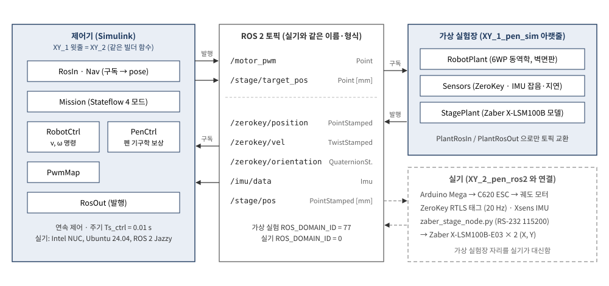

*그림 1. 시스템 구성. 왼쪽 로봇 위 장비, 가운데 NUC 의 ROS 2 노드, 오른쪽 Simulink 제어기*

## 초록

수직 철판 벽에 자석으로 붙어 움직이는 궤도 로봇 AVT-3C 위에 두 축 XY 스테이지를 얹고, 스테이지 끝의 마커로 벽에 길이 1.2 m 의 수평 직선을 긋는 문제를 다룬다. 궤도 로봇은 옆으로 움직일 수 없고 벽면에서 미끄러지며 heading 이 흔들리므로, 로봇만으로 그은 선은 시뮬레이션에서 횡오차 RMS 14.84 mm 를 보인다. 이 문서는 로봇이 진행과 큰 이동을 맡고 스테이지가 직선과의 어긋남만 지우는 거시–미시(macro–micro) 구조를 설명한다. 스테이지 명령은 측정된 로봇 자세로부터 기구학 관계를 거꾸로 풀어 얻는다(펜 기구학 보상). 펜 위치를 직접 측정하지 않으므로 정확도는 센서가 정하며, 같은 시뮬레이션에서 펜 횡오차는 RMS 1.17–1.20 mm 로 줄어든다. 오차의 가장 큰 원인은 ZeroKey 위치 잡음이다. 태그를 로봇 몸체에 펜을 가운데 두고 두 개 달면 근사 시뮬레이션에서 0.84 mm 까지 줄어든다. 스테이지는 내부 위치 서보를 바꿀 수 없는 상용품이므로, 설계 전체를 위치 명령과 위치 읽기만으로 구성하였다.

---

## 1. 서론

### 1.1 풀어야 할 문제

조선소 블록처럼 넓은 수직 철판에 표시선을 긋는 일은 사람이 사다리나 고소 작업대 위에서 줄자와 먹줄로 해 왔다. 벽에 붙어 움직이는 로봇이 이 일을 대신하려면, 로봇이 수 m 를 이동하면서도 선의 위치를 mm 수준으로 맞춰야 한다. 이 두 요구는 서로 성격이 다르다. 큰 범위의 이동에는 힘이 크고 느린 구동기가 맞고, mm 수준의 정밀 위치에는 범위가 좁고 빠른 구동기가 맞는다.

AVT-3C 는 자석 궤도로 철판에 붙는 궤도형(skid-steer) 로봇이다. 궤도 로봇은 좌우 궤도의 속도 차로 방향을 바꾸며, 차체 옆 방향으로는 직접 움직이지 못한다. 이런 구속을 비홀로노믹(nonholonomic) 구속이라 한다. 직선에서 옆으로 1 cm 벗어난 로봇은 그 1 cm 를 옆으로 미끄러져 돌아올 수 없고, 방향을 틀어 비스듬히 전진한 뒤 다시 방향을 바로잡아야 한다. 그 사이에 로봇은 수십 cm 를 진행하므로, 옆 방향 오차를 줄이는 속도는 근본적으로 느리다.

벽면은 이 문제를 더 어렵게 한다. 중력이 벽면 아래쪽으로 작용하므로 자석 궤도는 진행하는 동안 조금씩 아래로 미끄러진다(크리프). 궤도와 철판 사이의 요철은 heading 을 1–2° 흔든다. 시뮬레이션에서 이 외란을 넣으면 로봇의 직선 추종 횡오차는 RMS 23.6 mm 이고, 펜을 로봇에 고정한 채로 그은 선의 횡오차는 RMS 14.84 mm, 최대 19.6 mm 이다(README 10 장).

### 1.2 접근: 거시–미시 구조

이 문제의 해법은 사람이 글씨를 쓰는 방식과 닮았다. 팔은 종이 위에서 손을 크게 옮기고, 손가락은 펜 끝을 미세하게 조정한다. 팔의 움직임이 정확하지 않아도 손가락이 그 오차를 메우면 글씨는 바르게 써진다.

이 시스템에서 팔은 로봇이고 손가락은 Zaber X-LSM100B 두 축으로 된 XY 스테이지이다. 스테이지는 행정이 101.6 mm 로 좁지만, 최고속도 104 mm/s 로 빠르고 반복정밀도는 6 µm 이다. 로봇은 펜을 직선 근처로 데려가고 직선을 따라 진행시키며, 스테이지는 그 순간 로봇이 직선에서 벗어난 만큼만 펜을 반대로 옮긴다. 이 역할 분담을 거시–미시(macro–micro) 구조라 한다.

| 구분 | 로봇 (macro) | 스테이지 (micro) |
|---|---|---|
| 범위 | 벽 전체 (수 m) | ±50.8 mm |
| 자유도 | 전진 속도 $v$, 회전 속도 $\omega$ (옆으로 못 감) | 바디 좌표 X, Y 두 방향 |
| 빠르기 | 횡오차 수렴 시정수 약 8.5 s (5.2 절) | 위치 서보 수–20 Hz |
| 맡는 일 | 직선 방향 진행, 출발점 이동, 방향 맞추기 | 직선과의 어긋남 (횡오차 + heading 오차에 의한 펜 이동) |
| 명령 | `/motor_pwm` (좌우 모터 PWM) | `/stage/target_pos` (위치 [mm]) |

### 1.3 문서의 구성

2 장은 제어기가 무엇을 측정하고 무엇을 명령하는지를 정리한다. 3 장은 좌표계와 회전행렬을, 4 장은 제어 문제를 식으로 정의한다. 5 장은 로봇 쪽(거시) 제어를, 6 장은 스테이지 쪽(미시) 펜 보상을 유도한다. 7 장은 측정 오차가 펜 오차로 전파되는 과정과 ZeroKey 태그 배치를 다룬다. 8 장은 Simulink 모델의 함수 블록마다 수식과 원리를 정리하고, 9–10 장은 결과와 실기 적용 절차를 정리한다.

---

## 2. 시스템과 신호

### 2.1 장비

| 장비 | 역할 | 연결 |
|---|---|---|
| AVT-3C | 자석 궤도 로봇, 외형 420 × 343 × 100 mm | Arduino Mega → C620 ESC 두 개 → 좌우 궤도 모터 |
| Zaber X-LSM100B-E03 × 2 | XY 스테이지. X 축이 아래, Y 축이 그 위에 얹힘. Y 캐리지에 마커 | NUC 에 RS-232 직결 (115200 bps) |
| ZeroKey RTLS 태그 1 개 | 로봇 위 한 점의 3 차원 위치 | 앵커 → ZeroKey 노드 |
| Xsens MTi IMU | 자세 쿼터니언, 각속도 | USB → Xsens 노드 |
| Intel NUC | ROS 2 Jazzy. 센서·스테이지·로봇 브리지 노드 실행 | – |
| Simulink 제어기 | 이 문서의 제어 법칙 전부 | ROS 2 토픽으로만 장비와 통신 |

### 2.2 입력: 제어기는 무엇을 측정하는가

제어기가 받는 정보는 네 개의 토픽뿐이다. 이 점을 정확히 이해하는 것이 알고리즘 이해의 출발점이다.

| 토픽 | 측정하는 것 | 단위 · 주기 | 제어기에서 쓰는 곳 |
|---|---|---|---|
| `/zerokey/position` | 로봇에 붙은 태그 한 점의 월드 좌표 $(x, y, z)$ | m, 20 Hz, 잡음 약 1 mm, 지연 약 50 ms | Nav 에서 벽면 위치 $\hat p = [s_x x;\ z]$ ($s_x$ = `zk_xsign`) |
| `/zerokey/vel` | 같은 태그의 속도 | m/s, 20 Hz | 지연 보상 (기본 꺼짐), 2 판 내부 PI |
| `/imu/data` | 자세 쿼터니언 (2 판은 자이로 $z$ 도) | –, 100 Hz | heading $\hat\psi$ (2 판: 요 각속도 $r$) |
| `/stage/pos` | 스테이지 두 축의 현재 위치 | mm, 20 Hz | 기본 설정에서는 쓰지 않음 (선택 기능·감시용) |

여기서 세 가지를 짚어 둔다. 첫째, ZeroKey 가 측정하는 점은 로봇 중심도 펜도 아닌 태그 한 점이다. 태그는 로봇 중심에서 $r_{tag} = (-0.08,\ 0.06)$ m 떨어져 있다. 둘째, 철판 벽 위에서는 자력계가 쓸모없으므로 IMU 의 요각은 절대 방위가 아니다. Nav 는 첫 샘플의 요각을 0 으로 잡고 출발 heading $\psi_0$ 를 더해 상대 요각을 쓴다. 따라서 시간이 지나면 드리프트가 쌓인다. 셋째, 펜 끝의 위치는 아무 센서도 측정하지 않는다. 펜 위치는 태그 위치, heading, 스테이지 위치로부터 기구학으로 계산되는 양이다. 이 사실이 6 장의 펜 보상이 앞먹임(feedforward) 구조가 되는 이유이고, 7 장에서 센서 오차가 펜 오차의 상한이 되는 이유이다.

### 2.3 출력: 제어기는 무엇을 명령하는가

| 토픽 | 명령 | 단위 | 받는 쪽 |
|---|---|---|---|
| `/motor_pwm` | $[u_L;\ u_R]$ 좌우 모터 펄스 폭 | count (= µs), 1500 정지, 1100–1900 | Arduino 브리지 → ESC |
| `/stage/target_pos` | $[s_X^{\star};\ s_Y^{\star}]$ 스테이지 목표 위치 | mm, 0–101.6 | `zaber_stage_node.py` → `move abs` |

명령은 모두 네 개이다. 그러나 좌우 PWM 두 개는 결국 로봇의 전진 속도 $v$ 와 회전 속도 $\omega$ 두 자유도를 정하므로, 제어기가 다루는 독립 입력은 $(v,\ \omega,\ s_X,\ s_Y)$ 네 개이다. 제어하려는 대상은 벽 위 펜 끝 한 점 $P = (P_1,\ P_2)$ 의 두 자유도이다. 입력이 출력보다 많으므로 같은 펜 궤적을 만드는 입력 조합은 무수히 많고, 이 여유를 어떻게 나눌지가 설계의 핵심이다. 1.2 절의 역할 분담이 그 답이다.

### 2.4 한 주기 (10 ms) 동안의 신호 흐름

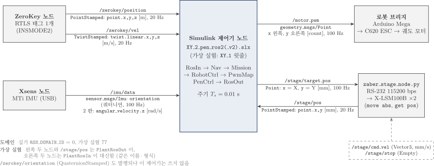

*그림 2. ROS 2 노드와 토픽 (형식, 필드, 단위, 주기)*

Simulink 제어기는 10 ms 마다 다음을 순서대로 한다.

1. RosIn 이 네 토픽의 최신 값을 읽는다. ZeroKey 는 20 Hz 이므로 다섯 주기 동안 같은 값이 들어온다.
2. Nav 가 태그 위치와 heading 을 벽면 좌표 `pose` $= [\hat x;\ \hat y;\ \hat\psi]$ 로 만든다.
3. Mission 이 지금 어느 단계(모드)인지 정하고, 로봇이 따라갈 선분과 펜 직선을 낸다.
4. RobotCtrl 가 모드에 맞는 법칙으로 $(v_c,\ \omega_c)$ 를 계산하고, PwmMap 이 이를 좌우 PWM 으로 바꾼다.
5. PenCtrl 이 같은 `pose` 로 스테이지 목표 $s^{\star}$ 를 계산한다.
6. RosOut 이 `/motor_pwm` 과 `/stage/target_pos` 를 발행한다.

스테이지 노드는 100 Hz 로 들어오는 목표 중 마지막 값만 기억했다가 25 Hz 로 시리얼 `move abs` 를 보낸다. 시리얼 한 줄에 수 ms 가 걸리므로 100 Hz 로 모두 보내면 명령이 밀리기 때문이다.

### 2.5 Simulink 파일 네 개

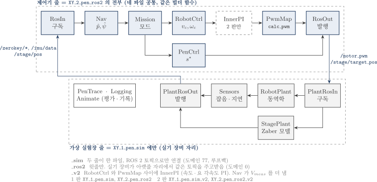

*그림 3. 네 파일의 관계*

네 파일은 두 가지 기준으로 나뉜다. 첫째 기준은 실험장이다. 이름이 `_sim` 으로 끝나는 `XY_1_pen_sim` 은 제어기 아래에 가상 로봇(RobotPlant), 가상 센서(Sensors), 가상 스테이지(StagePlant)를 함께 담은 가상 실험 모델이다. 가상 장비는 실기 장비와 똑같은 이름·형식의 ROS 2 토픽을 발행하고 구독하며, 제어기와 가상 장비는 선으로 연결되지 않고 오직 토픽으로만 대화한다. 이름이 `_ros2` 로 끝나는 `XY_2_pen_ros2` 는 같은 빌더 함수로 만든 제어기 줄만 담고 있으며, 실제 NUC 의 노드들이 가상 장비 자리를 대신한다. 따라서 가상 실험에서 검증한 제어기가 글자 하나 바꾸지 않고 실기에 연결된다. 두 모델은 ROS 도메인(가상 77, 실기 0)을 달리하여, 가상 실험의 `/motor_pwm` 이 같은 망의 실제 로봇을 움직이지 않게 한다.

둘째 기준은 판이다. 1 판은 바깥 루프의 속도 명령 $(v_c,\ \omega_c)$ 를 비율만 맞춰 곧바로 PWM 으로 바꾼다. 2 판(`_v2`)은 그 사이에 실기 Xsens 모델과 같은 내부 PI 두 개를 둔다. 하나는 ZeroKey 속도로 잰 실제 전진 속도 $u_B$ 를 $v_c$ 에 맞추고, 다른 하나는 자이로로 잰 요 각속도 $r$ 을 $\omega_c$ 에 맞춘다. 내부 PI 는 로봇이 명령대로 움직이게 해 줄 뿐 펜 정확도를 바꾸지 않는다. 가상 실험에서 펜 RMS 는 1 판 1.17–1.20 mm, 2 판 1.21–1.24 mm 이다.

---

## 3. 좌표계와 회전행렬

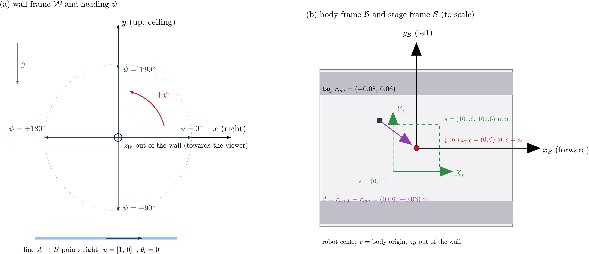

*그림 4. (a) 벽면 좌표계와 heading, (b) 바디·스테이지 좌표계*

### 3.1 세 좌표계

벽면 좌표계 $\mathcal W$ 는 벽에 고정되어 있다. 벽을 정면에서 볼 때 $x$ 는 오른쪽(수평), $y$ 는 위(천장 방향), $z$ 는 벽 바깥이다. ROS REP-103 과 같은 오른손 좌표계이며, $z$ 가 로봇 바디의 $z_B$ 와 같은 방향이므로 $x$ 에서 $y$ 로 돌리는 반시계 각이 양의 heading 이 된다. 실기 Simulink 의 `plane_project` 는 높이를 $p_1$, 왼쪽 수평을 $p_2$ 로 두었으며 이 문서의 좌표와는 $x = -p_2$, $y = p_1$, $\psi = \psi_{old} + 90^{\circ}$ 의 관계가 있다. 바디 좌표계 $\mathcal B$ 는 로봇에 붙어 함께 움직이며 $x_B$ 가 전진, $y_B$ 가 로봇의 왼쪽이다. 스테이지 좌표계 $\mathcal S$ 는 바디 축과 평행하고 원점이 스테이지의 홈(행정 한쪽 끝)이며 단위가 mm 이다.

heading $\psi$ 는 $x$ 축에서 $x_B$ 축까지 반시계로 잰 각이다. 로봇이 오른쪽을 보면 $\psi = 0$, 천장을 보면 $+90^{\circ}$, 왼쪽을 보면 $180^{\circ}$ 이다. 이 문서의 직선은 $A = (-0.70,\ 0.30)$ m 에서 $B = (0.50,\ 0.30)$ m 로, 높이 0.30 m 에서 오른쪽으로 1.2 m 이므로 직선 방향은 $\theta_l = 0^{\circ}$ 이다.

### 3.2 회전행렬

바디 좌표로 쓴 벡터 $a_B$ 를 벽면 좌표로 옮기는 행렬이 회전행렬이다.

$$
R(\psi) = \begin{bmatrix} \cos\psi & -\sin\psi \\ \sin\psi & \cos\psi \end{bmatrix} = \begin{bmatrix} x_B & y_B \end{bmatrix}, \qquad a_W = R(\psi)\,a_B, \qquad a_B = R^{\top}(\psi)\,a_W \tag{1}
$$

| 기호 | 읽는 법 | 의미 |
|---|---|---|
| $R(\psi)$ | 알 프사이 | 바디 → 벽면 회전. 첫 열은 벽면 좌표로 쓴 $x_B$, 둘째 열은 $y_B$ |
| $R^{\top}(\psi)$ | 알 트랜스포즈 | 벽면 → 바디. 회전행렬은 직교행렬이므로 역행렬이 전치행렬 |
| $a_W,\ a_B$ | – | 같은 화살표를 벽면 좌표, 바디 좌표로 쓴 성분 |

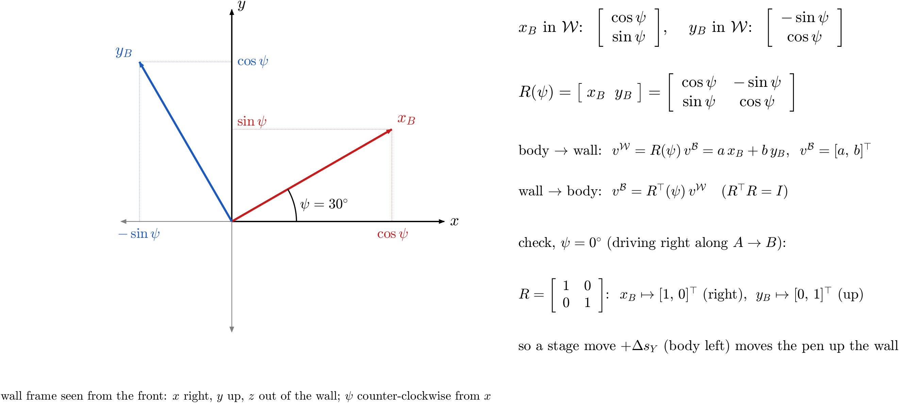

*그림 5. 회전행렬의 열은 벽면 좌표로 쓴 바디 축이다*

첫 열이 $x_B$ 인 이유는 바디 벡터 $a_B = (1,\ 0)$, 즉 $x_B$ 방향 단위 벡터를 넣으면 $R a_B$ 가 첫 열이 되기 때문이다. 예를 들어 로봇이 오른쪽을 보는 $\psi = 0$ 에서 $R = I$ 이고, 천장을 보는 $\psi = 90^{\circ}$ 에서 $R = \begin{bmatrix} 0 & -1 \\ 1 & 0 \end{bmatrix}$ 이다. $\psi = 0$ 에서 첫 열 $(1,\ 0)$ 은 $x$ 방향, 즉 벽에서 오른쪽이므로 로봇의 전진 방향이 맞다. 둘째 열 $(0,\ 1)$ 은 $y$ 방향, 즉 위쪽이다. 오른쪽을 보는 로봇의 왼쪽은 위쪽이므로 이것도 맞다. 이 자세에서 스테이지 Y 축을 + 로 움직이면 펜은 벽에서 위로 올라간다. 이 대응은 6 장의 부호를 이해하는 데 그대로 쓰인다.

### 3.3 레버암

태그에서 "스테이지가 행정 가운데 있을 때의 펜" 까지의 벡터를 바디 좌표로 쓴 것을 레버암 $d$ 라 한다.

$$
d = r_{pen0} - r_{tag} = (0,\ 0) - (-0.08,\ 0.06) = (0.08,\ -0.06)\ \mathrm{m} \tag{2}
$$

$d$ 는 로봇에 고정된 값이므로 바디 좌표에서는 상수이지만, 벽면 좌표에서는 $R(\psi)\,d$ 로 heading 에 따라 방향이 바뀐다. heading 을 틀리게 알면 $R(\hat\psi)\,d$ 가 틀리고, 그 차이가 곧 펜 위치 오차가 된다(7 장).

---

## 4. 제어 문제의 정식화

### 4.1 펜 끝의 위치

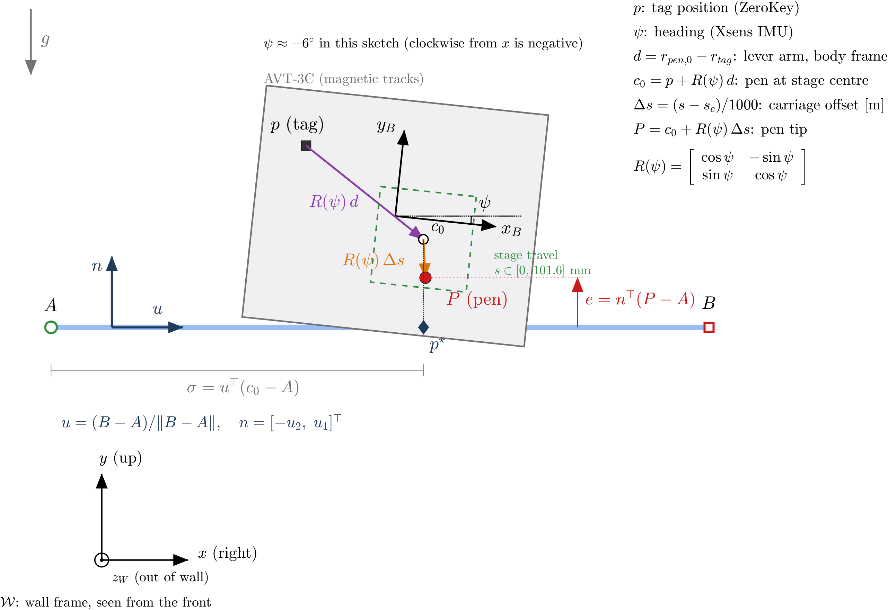

*그림 6. 벽면 좌표계와 펜 보상 기하 (확대, 축척 아님)*

펜 끝 $P$ 는 태그 위치 $p$ 에서 출발해 레버암 $d$ 와 스테이지 캐리지 이동 $\Delta s$ 를 바디 좌표에서 더한 뒤 벽면으로 돌린 점이다.

$$
P = p + R(\psi)\,(d + \Delta s), \qquad \Delta s = \frac{s - s_c}{1000}\ [\mathrm{m}] \tag{3}
$$

| 기호 | 의미 | 단위 |
|---|---|---|
| $p$ | 태그 위치 (벽면) | m |
| $\psi$ | heading | rad |
| $d$ | 태그 → 중앙 펜 레버암 (바디) | m |
| $s$ | 스테이지 위치 (Zaber 좌표, 홈 = 0) | mm |
| $s_c$ | 행정 가운데, 50.8 mm | mm |
| $\Delta s$ | 가운데로부터의 캐리지 이동 (바디) | m |

### 4.2 목표

펜이 직선 $AB$ 위에 있다는 것은 펜의 직선 법선 방향 거리, 즉 횡오차가 0 이라는 뜻이다.

$$
e(t) = n^{\top}\big(P(t) - A\big) = 0, \qquad u = \frac{B - A}{\lVert B - A\rVert}, \quad n = J u, \quad J = \begin{bmatrix} 0 & -1 \\ 1 & 0 \end{bmatrix} \tag{4}
$$

$u$ 는 직선 방향 단위 벡터, $n$ 은 $u$ 를 반시계로 90° 돌린 법선(직선의 왼쪽, 이 직선에서는 위쪽)이다. 직선 방향으로는 펜이 $A$ 에서 $B$ 까지 지나가기만 하면 되므로 정확한 시각표는 요구하지 않는다. 즉 제어해야 할 것은 횡오차 $e$ 하나이고, 진행은 "언젠가 끝까지 가면 되는" 느슨한 조건이다.

### 4.3 두 구동기의 운동

로봇 중심 $c$ 와 heading 의 운동은 다음과 같다(외란과 회전 중심 이동은 README 4.2 절).

$$
\dot c = v \begin{bmatrix} \cos\psi \\ \sin\psi \end{bmatrix}, \qquad \dot\psi = \omega \tag{5}
$$

식 (5) 에 옆 방향 속도가 없다는 것이 비홀로노믹 구속이다. 로봇은 $x_B$ 방향으로만 움직이고 옆 방향 위치는 heading 을 바꿔야만 바뀐다. 반면 스테이지는 바디 좌표의 X, Y 를 독립적으로, 빠르게 움직이지만 $\lvert\Delta s_i\rvert \le 50.8$ mm 를 넘을 수 없다.

### 4.4 역할 분담의 근거

식 (3)–(5) 를 함께 보면 횡오차 $e$ 를 줄이는 방법은 두 가지이다. 로봇이 방향을 틀어 직선으로 돌아오거나, 스테이지가 펜을 직선 쪽으로 옮기는 것이다. 이 시스템은 둘을 다음과 같이 나눈다.

| 성분 | 담당 | 이유 |
|---|---|---|
| 직선 방향 진행 (1.2 m) | 로봇 $v$ | 스테이지 행정 101.6 mm 로는 불가능 |
| 횡오차의 느린 성분 (평균, 수 cm) | 로봇 $\omega$ | 스테이지가 행정 가운데에서 일하게 함 |
| 횡오차의 빠른 성분 (요철 0.35 Hz, 크리프, 잡음) | 스테이지 $\Delta s$ | 로봇의 횡방향 수렴이 수 초로 느림 |
| heading 오차가 레버암으로 만드는 펜 이동 | 스테이지 $\Delta s$ | 펜은 점이므로 방향은 상관없고 위치만 맞추면 됨 |

펜은 점이므로 펜의 "방향" 이라는 것은 없다. 따라서 heading 은 그 자체로 제어 목표가 아니며, 레버암을 통해 펜 위치에 영향을 주는 경로로만 의미가 있다. 로봇의 heading 이 직선과 3° 어긋나 있어도 스테이지가 그만큼 펜을 옮기면 선은 곧게 그어진다(6.4 절의 수치 예).

---

## 5. 거시 수준: 로봇 제어

### 5.1 임무 단계와 제자리 회전

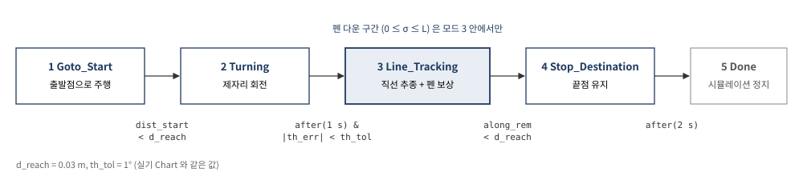

*그림 7. 임무 단계 (Stateflow ModeChart)*

임무는 다섯 단계로 나뉘고 Stateflow 상태기계 ModeChart 가 단계를 바꾼다. 출발할 때 로봇은 직선에서 떨어진 곳 $(-0.85,\ 0.10)$ m 에서 천장을 보고 있다($\psi_0 = 90^{\circ}$).

모드 1(Goto_Start)에서 로봇은 직선을 시작하기 좋은 출발점으로 간다. 이때 목표는 태그가 아니라 로봇 중심의 출발점 $c_A$ 이다. 다음 단계의 제자리 회전은 로봇 중심을 축으로 돌기 때문에, 회전 뒤 태그가 정해진 출발점에 오려면 회전 전에 중심을 맞춰 두어야 한다. 태그 기준으로 가면 회전하는 동안 태그가 반경 0.1 m 원호를 그려 직선 시작점이 약 11 cm 어긋난다.

모드 2(Turning)에서 로봇은 전진 속도 0 으로 제자리에서 돌아 heading 을 직선 방향 $0^{\circ}$ 에 맞춘다. 제자리 회전은 이 단계에서만 쓰이며 펜은 아직 쓰지 않는다. 오차가 1° 이내로 1 s 이상 유지되면 다음 단계로 간다.

모드 3(Line_Tracking)에서 로봇은 30 mm/s 로 직선을 따라 진행하고, 동시에 스테이지가 펜 보상을 한다. 이 단계에도 회전 속도 명령 $\omega_c$ 가 나오지만 그것은 제자리 회전이 아니라 진행하면서 방향을 조금씩 바로잡는 조향이다. 로봇은 진행하면서 조향하고, 스테이지는 그래도 남는 어긋남을 지운다. 이것이 "회전도 하고 스테이지도 제어하는가" 라는 질문에 대한 답이다.

모드 4(Stop_Destination)에서 로봇은 끝점에 서고, 2 s 뒤 모드 5 에서 시뮬레이션이 끝난다. 펜은 모드 3 안에서 펜 목표가 $A$ 와 $B$ 사이에 있을 때만 내리는 것으로 평가한다. 실기에는 아직 펜 승강 장치가 없으므로 이 구간 판정은 기록용이다.

로봇이 따라가는 선분은 펜 직선과 같은 선이 아니다. 스테이지가 가운데 있을 때 펜이 직선 위에 오려면 태그는 직선에서 $-R(\theta_l)\,d$ 만큼 떨어진 평행선을 따라가야 한다. 또 펜이 $A$ 에 닿기 전에 로봇이 안정되도록 앞쪽으로 60 mm, 끝을 지나 40 mm 더 간다.

$$
r_A = A - R(\theta_l)\,d - 0.06\,u, \qquad r_B = B - R(\theta_l)\,d + 0.04\,u, \qquad c_A = r_A - R(\theta_l)\,r_{tag} \tag{6}
$$

### 5.2 직선 추종 법칙

모드 3 의 기준점 $x_r$ 은 시간에 따라 선분 위를 일정한 속도 $v_r$ 로 움직인다. 로봇은 이 기준점과의 차이를 바디 좌표로 본다.

$$
x_r(t) = r_A + v_r\,(t - t_{line})\,u, \qquad
\begin{bmatrix} e_x \\ e_y \end{bmatrix} = R^{\top}(\hat\psi)\,(x_r - \hat p), \qquad
e_\theta = \mathrm{wrap}(\theta_l - \hat\psi) \tag{7}
$$

$$
v_c = v_r \cos e_\theta + k_x\,e_x, \qquad \omega_c = k_y\,e_y + k_\psi \sin e_\theta \tag{8}
$$

$e_x$ 는 기준점이 로봇 앞쪽으로 얼마나 앞서 있는가이고, $e_y$ 는 기준점이 로봇 왼쪽으로 얼마나 떨어져 있는가이다. 로봇은 앞뒤 오차 $e_x$ 는 전진 속도로 직접 줄일 수 있지만, 옆 오차 $e_y$ 는 직접 줄일 수 없다. 그래서 $e_y$ 는 회전 명령 $\omega_c$ 로 들어간다. 기준점이 왼쪽에 있으면($e_y > 0$) 왼쪽으로 돌고, 방향이 틀어진 채로 전진하면서 옆 오차가 줄어든다.

이 과정이 왜 느린지는 직선 근처에서 식을 선형화하면 보인다. 직선에서 왼쪽으로 잰 로봇의 옆 위치를 $y_l$, 직선과의 방향 차를 $\phi = \psi - \theta_l$ 라 하면, 식 (5) 로부터 $\dot y_l = v\sin\phi \approx v_r\phi$, $\dot\phi = \omega$ 이다. 작은 오차에서 $e_y \approx -y_l$, $e_\theta \approx -\phi$ 이므로 식 (8) 은 $\omega = -k_y y_l - k_\psi\phi$ 가 되고, 닫힌 루프는 다음과 같다.

$$
\ddot y_l + k_\psi\,\dot y_l + v_r k_y\,y_l = 0, \qquad
\lambda = \frac{-k_\psi \pm \sqrt{k_\psi^2 - 4 v_r k_y}}{2} \tag{9}
$$

| 값 | 계산 | 결과 |
|---|---|---|
| $v_r k_y$ | 0.03 × 5.0 | 0.15 s⁻² |
| 근 $\lambda$ | $(-1.4 \pm \sqrt{1.96 - 0.60})/2$ | $-0.117$, $-1.283$ s⁻¹ |
| 느린 근의 시정수 | 1/0.117 | 8.5 s |

느린 근의 시정수가 8.5 s 이므로 로봇은 옆으로 벗어난 오차를 8.5 s 에 걸쳐서야 약 63 % 줄인다. 그 사이 로봇은 약 25 cm 를 진행한다. 진행 속도 $v_r$ 이 루프 이득에 곱해져 있으므로 천천히 갈수록 옆 오차는 더 느리게 줄어든다. 이것은 게인을 키워 해결할 수 있는 문제가 아니다. $k_y$ 를 두 배로 하면 로봇 RMS 는 23.6 mm 에서 17.1 mm 로 줄지만 heading 이 더 흔들려 펜 RMS 가 1.19 mm 에서 1.32 mm 로 늘어난다(README 10.5 절). 펜 정확도를 로봇에 맡기지 않고 스테이지에 맡기는 이유가 여기에 있다.

### 5.3 속도 명령에서 모터까지

PwmMap 의 `calc_pwm` 은 실기 Simulink 의 함수를 그대로 쓴다. 실기에서는 내부 PI 출력 $\bar V,\ \bar W \in [-0.5,\ 0.5]$ 가 이 함수에 들어가므로, 1 판은 속도 명령을 같은 범위로 정규화하여 넣는다.

$$
\bar V = \frac{v_c}{2 v_{full}}, \quad \bar W = \frac{\omega_c}{2\omega_{full}}, \qquad
T(\bar V) = d_v\tanh\frac{\bar V}{0.02} + (400 - d_v)\frac{\bar V}{0.5} \tag{10}
$$

$$
u_L = 1500 + T(\bar V) - T_s(\bar W), \qquad u_R = 1500 - \big(T(\bar V) + T_s(\bar W)\big) \tag{11}
$$

$T$ 의 첫 항은 0 근처에서 $d_v$ = 47 count 만큼 계단처럼 뛰어 ESC 의 데드존(작은 PWM 에서 모터가 돌지 않는 구간)을 건너뛰게 하는 역보상이고, 둘째 항은 나머지 범위를 선형으로 채운다. 회전 성분 $T_s$ 는 왼쪽에서 빼고 오른쪽에 더해 좌우 속도 차를 만든다. 오른쪽 모터는 거울 대칭으로 달려 있으므로 오른쪽 PWM 은 부호를 뒤집는다.

실기에서는 ESC 가 PWM 을 받아 모터 속도를 제어한다. 가상 실험의 RobotPlant 는 이 과정을 ESC 역변환, 0.15 s 1 차 지연, 속도 PI, 구동력 배분, 궤도 동역학의 순서로 모델링한다(8.4 절).

---

## 6. 미시 수준: 펜 기구학 보상

### 6.1 보상이 필요한 이유

5 장의 로봇 제어가 아무리 잘 되어도 로봇의 횡오차는 수 cm 이다. 스테이지를 가운데에 고정하면 펜은 로봇을 따라 그대로 흔들리고, 그은 선의 횡오차는 RMS 14.84 mm 이다. 이 오차의 원인은 세 가지이다. 첫째, 로봇이 직선에서 옆으로 벗어난다(크리프, 느린 횡방향 수렴). 둘째, heading 이 흔들리면 레버암 $d$ 를 통해 펜이 옆으로 움직인다. heading 1° 마다 약 1.4 mm 이다(README 4.6.5 절). 셋째, 로봇이 비스듬히 진행하는 동안 펜도 비스듬히 지나간다. 세 원인 모두 "지금 로봇이 어디에 어떤 방향으로 있는가" 를 알면 계산할 수 있는 양이므로, 스테이지가 그만큼 펜을 반대로 옮기면 된다. 이것이 펜 기구학 보상이다.

### 6.2 유도

식 (3) 에서 펜이 가야 할 벽면 위치 $p^{\star}$ 가 정해지면, 필요한 캐리지 이동은 식 (3) 을 $\Delta s$ 에 대해 풀어 얻는다.

$$
p^{\star} = \hat p + R(\hat\psi)\,(d + \Delta s)
\quad\Longrightarrow\quad
\Delta s = R^{\top}(\hat\psi)\,(p^{\star} - \hat p) - d \tag{12}
$$

$R$ 이 직교행렬이므로 양변에 $R^{\top}$ 을 곱하면 바로 풀린다. 측정값 $\hat p,\ \hat\psi$ 를 쓰는 이유는 제어기가 아는 것이 측정값뿐이기 때문이다.

남은 문제는 $p^{\star}$ 를 어디로 둘 것인가이다. 펜이 직선 위의 어느 점에 있어야 하는지는 4.2 절에서 보았듯 정해져 있지 않다. 직선 방향 위치는 로봇이 진행하며 정하고, 스테이지는 직선과의 어긋남만 지우면 된다. 그러므로 스테이지가 가운데일 때의 펜 위치 $c_0$ 에서 직선에 수선을 내린 발을 목표로 한다.

$$
c_0 = \hat p + R(\hat\psi)\,d, \qquad \sigma = u^{\top}(c_0 - A), \qquad p^{\star} = A + \sigma u \tag{13}
$$

$\sigma$ 는 $c_0$ 의 직선 방향 위치, 곧 직선 위 진행 거리이다. $p^{\star}$ 는 $c_0$ 와 직선 방향 위치가 같고 횡오차만 0 인 점이다. 이렇게 하면 스테이지는 직선에 수직한 방향으로만, 횡오차의 크기만큼만 움직인다. 만약 $p^{\star}$ 를 직선 위의 특정 점(예를 들어 시간에 따라 움직이는 기준점)으로 두면, 로봇의 진행 오차 수 cm 까지 스테이지가 메우려 해서 행정이 모자란다. 실제로 초기 판에서 $p^{\star}$ 를 $A$ 로 자르자 모드 3 시작 때 스테이지 X 가 95 mm 근처까지 갔다.

식 (12) 에 $p^{\star} - c_0 = -e_0\,n$ ($e_0$ 는 보상 없는 횡오차) 을 넣으면 다음 간단한 형태가 나온다.

$$
\Delta s = -e_0\,R^{\top}(\hat\psi)\,n = -e_0 \begin{bmatrix} \sin(\hat\psi - \theta_l) \\ \cos(\hat\psi - \theta_l) \end{bmatrix} \tag{14}
$$

로봇이 직선과 나란하면($\hat\psi = \theta_l$) $\Delta s = (0,\ -e_0)$ 이다. 즉 Y 축만 횡오차만큼 반대로 움직인다. 로봇이 3° 기울어 있으면 X 축이 $e_0\sin 3^{\circ}$ 만큼 함께 움직여, 기울어진 Y 축 대신 벽에 수직한 방향으로 펜을 옮긴다. 가상 실험에서 X 축은 51.0–53.8 mm 로 거의 움직이지 않고 Y 축이 61.3–72.2 mm 로 횡오차를 지운 것이 이 식과 맞는다.

### 6.3 1000 과 $s_c$ 의 의미

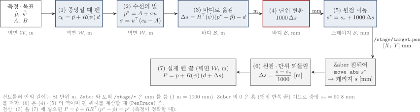

*그림 8. PenComp 계산 순서와 각 단계의 좌표계·단위*

식 (12) 의 $\Delta s$ 는 바디 좌표의 m 단위 벡터이다. 그런데 Zaber 펌웨어와 `/stage/target_pos` 토픽은 mm 를 쓰고, 원점이 행정의 한쪽 끝(홈)이다. 그래서 스테이지 명령은 두 단계를 더 거친다.

$$
s^{\star} = s_c + 1000\,\Delta s \quad [\mathrm{mm}], \qquad s_c = 50.8\ \mathrm{mm} \tag{15}
$$

1000 은 m 를 mm 로 바꾸는 단위 변환 계수이다($1\ \mathrm{m} = 1000\ \mathrm{mm}$). 제어기 안에서는 모든 길이를 SI 단위인 m 로 계산하고, 스테이지와 주고받는 경계에서만 mm 로 바꾼다. $s_c$ 는 원점 이동이다. 제어기의 $\Delta s = 0$ 은 "스테이지 가운데" 를 뜻하지만 Zaber 의 0 은 "홈 쪽 끝" 이므로, 가운데 위치 50.8 mm 를 더해야 같은 지점을 가리킨다. 반대로 펜 위치를 계산할 때(평가용 PenTrace)는 식 (3) 처럼 $s_c$ 를 빼고 1000 으로 나눈다. 예를 들어 Y 축 명령 61.52 mm 는 가운데에서 10.72 mm, 즉 0.01072 m 왼쪽이다.

### 6.4 수치 예

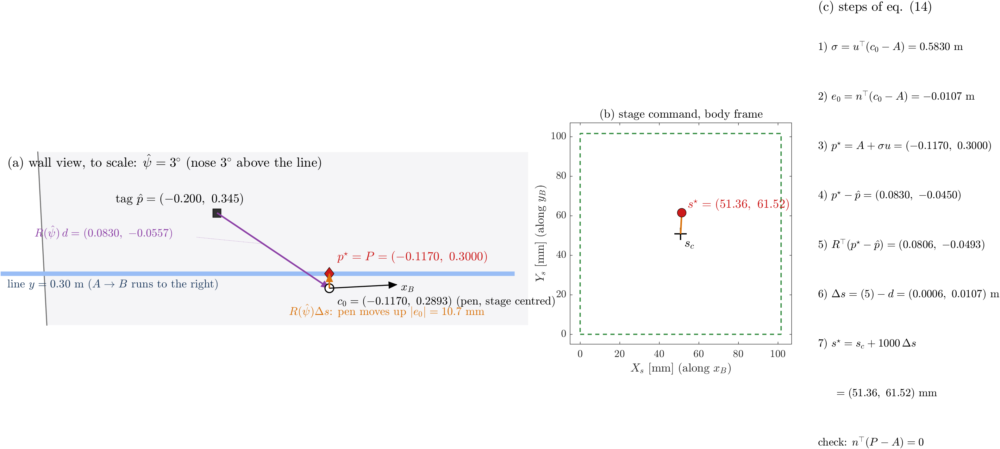

*그림 9. 펜 보상 수치 예. (a) 벽면, (b) 스테이지 명령, (c) 계산 순서*

직선 추종 중 측정 $\hat p = (-0.200,\ 0.345)$ m, $\hat\psi = 3^{\circ}$ 인 순간을 보자. 로봇은 직선 방향 $0^{\circ}$ 보다 코가 3° 위를 향한다. 레버암을 벽면으로 돌리면 $R d = (0.0830,\ -0.0557)$ m 이고, 스테이지 가운데일 때의 펜은 $c_0 = (-0.1170,\ 0.2893)$ m 이다. 직선의 높이는 0.30 m 이므로 펜은 직선보다 10.7 mm 아래에 있다($e_0 = -0.0107$ m). 수선의 발은 $p^{\star} = (-0.1170,\ 0.3000)$ m 이다. 식 (12) 로 계산하면 $\Delta s = (0.0006,\ 0.0107)$ m 이고, 식 (14) 의 $-e_0[\sin 3^{\circ},\ \cos 3^{\circ}] = (0.00056,\ 0.01069)$ m 와 같다. 스테이지 명령은 $s^{\star} = (51.36,\ 61.52)$ mm 이다. 오른쪽을 보는 로봇의 $y_B$ 는 위쪽이므로, Y 축이 10.7 mm 늘어나면 펜이 위로 10.7 mm 올라가 직선에 놓인다.

### 6.5 상용 스테이지라는 제약

Zaber 스테이지는 내부 위치 서보(스테퍼 구동과 엔코더 보정)를 펌웨어가 수행하는 상용품이며, 외부에서는 그 제어 법칙을 바꿀 수 없다. 외부에서 할 수 있는 일은 목표 위치를 보내는 것(`move abs`), 현재 위치를 읽는 것(`get pos`), 최고속도(`maxspeed`)와 가감속(`accel`) 같은 설정값을 바꾸는 것뿐이다. 이 제약은 설계에 다음과 같이 반영되었다.

| 설계 결정 | 제약과의 관계 |
|---|---|
| 펜 보상의 출력은 위치 $s^{\star}$ 이다 | 위치 명령만 줄 수 있으므로, 속도·힘이 아니라 위치를 계산하는 기구학 보상으로 만들었다 |
| 스테이지 위치 루프를 따로 설계하지 않는다 | 펌웨어 서보의 정확도 45 µm, 반복정밀도 6 µm 는 센서 잡음 1 mm 보다 20 배 이상 작아, 명령한 위치에 있다고 보아도 된다 |
| 명령을 미리 포화·속도 제한한다 | PenCtrl 의 `Travel` (0–101.6 mm) 과 `CmdRate` (83 mm/s) 블록이 펌웨어 한계 안의 명령만 보내, 펌웨어 안에서 명령이 잘리는 일을 막는다 |
| 노드가 25 Hz 로 솎아 보낸다 | 시리얼 통신 시간 때문에 100 Hz 를 모두 보낼 수 없다 |
| `/stage/pos` 는 보상 계산에 쓰지 않는다 | 보상은 명령한 위치에 스테이지가 간다는 가정의 앞먹임이다. 읽은 위치는 감시, 평가, 선택 기능인 중앙 유지(README 4.10 절)에 쓴다 |
| 가상 실험의 StagePlant 는 펌웨어를 블랙박스로 모델링한다 | 사다리꼴 궤적(104 mm/s, 500 mm/s²) + 20 Hz 위치 서보 + 추력-속도 곡선 + 벽면 중력. 펌웨어 내부 구조는 모르므로 [실측 필요] 로 남긴다 |

스테이지가 충분히 빠른지는 로봇 외란의 빠르기와 비교하면 알 수 있다. 가장 빠른 외란인 궤도 요철은 0.35 Hz, 진폭 1.5° 이고, 레버암 0.08 m 에서 펜을 약 2 mm 흔든다. 이를 지우는 데 필요한 스테이지 속도는 $2\pi \times 0.35 \times 2 \approx 4.4$ mm/s 로, 최고속도 104 mm/s 의 4 % 에 불과하다. 실제로 스테이지 서보 대역을 20 Hz 에서 2 Hz 로, 명령 주기를 25 Hz 에서 5 Hz 로 낮춰도 펜 RMS 는 1.17–1.20 mm 로 같았다(README 11 장). 30 mm/s 진행에서는 스테이지의 빠르기가 병목이 아니다.

---

## 7. 측정 오차와 센서 배치

### 7.1 측정 오차의 전파

6 장의 보상은 펜을 측정하지 않고 측정된 로봇 자세로 펜 위치를 계산하므로, 측정이 틀린 만큼 펜이 직선에서 벗어난다. 위치 측정 오차를 $\delta p = \hat p - p$, heading 측정 오차를 $\delta\psi = \hat\psi - \psi$ 라 하면, 1 차 근사로 펜 횡오차는 다음과 같다(README 식 (20)–(22)).

$$
e \approx -\,n^{\top}\delta p \;-\; \ell_u\,\delta\psi, \qquad \ell_u = u^{\top}R(\psi)(d + \Delta s) \approx 0.08\ \mathrm{m} \tag{16}
$$

$$
\sigma_e^2 \approx \sigma_p^2 + \ell_u^2\left(\sigma_\psi^2 + \frac{(\dot b_\psi T)^2}{3}\right) = 1.0^2 + 0.42^2 + 0.63^2\ \mathrm{mm}^2, \qquad \sigma_e \approx 1.25\ \mathrm{mm} \tag{17}
$$

위치 오차는 직선 법선 성분이 그대로 펜 오차가 되고, heading 오차는 레버암의 직선 방향 성분 $\ell_u$ 를 곱해 펜 오차가 된다. 시뮬레이션의 펜 RMS 1.17–1.20 mm 는 이 예측과 같은 크기이다. 각 요인을 하나씩 없앤 시뮬레이션에서 ZeroKey 잡음을 0 으로 두면 0.74 mm 로 가장 크게 줄었고, 모든 센서를 이상적으로 두면 0.41 mm 가 남았다. 남은 0.41 mm 는 요철·크리프와 스테이지 동특성에서 오는 센서 외 오차이다. IMU 잡음이나 드리프트만 0 으로 두었을 때 오히려 1.28 mm 로 커진 결과는 아직 원인을 확인하지 못했다(README 10.5 절).

결론은 분명하다. 이 시스템의 정확도를 정하는 것은 제어 법칙이나 스테이지가 아니라 센서, 특히 ZeroKey 위치 잡음이다.

### 7.2 ZeroKey 태그 배치

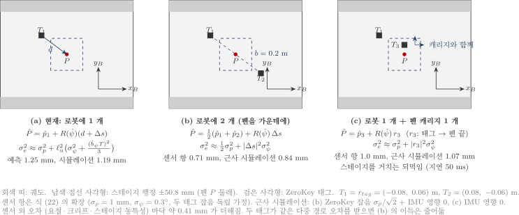

*그림 10. ZeroKey 태그 배치 세 안 (위에서 본 로봇, 바디 좌표)*

지배 요인이 ZeroKey 이므로 태그를 하나 더 다는 것을 검토한다. 후보는 세 가지이다.

(a) 현재 구성은 로봇에 태그 하나 $T_1$ 이다. 펜 위치 추정에 태그 잡음 $\sigma_p$ 와 heading 오차 × 레버암이 모두 들어간다.

(b) 로봇 몸체에 두 번째 태그 $T_2$ 를 펜이 두 태그의 한가운데에 오도록 단다. 현재 배치에서는 $T_2 = -r_{tag} = (0.08,\ -0.06)$ m 이다. 강체 위 세 점이 한 직선 위에 있으면, 가운데 점의 위치는 heading 과 무관하게 두 점의 평균이다.

$$
c_0 = \tfrac12(p_1 + p_2) \quad\Rightarrow\quad \hat P = \tfrac12(\hat p_1 + \hat p_2) + R(\hat\psi)\,\Delta s, \qquad \sigma_e^2 \approx \tfrac12\sigma_p^2 + \lvert\Delta s\rvert^2\sigma_\psi^2 \tag{18}
$$

두 태그의 잡음이 독립이면 평균의 분산은 절반이 되고, heading 오차는 캐리지 이동 $\lvert\Delta s\rvert \approx$ 15 mm 에만 곱해지므로 0.1 mm 이하로 작아진다. 즉 heading 드리프트의 영향이 거의 사라진다. 더불어 두 태그를 잇는 기선 $b = 0.2$ m 로부터 heading 을 직접 얻을 수 있다. 그 잡음은 $\sqrt2\,\sigma_p/b \approx 0.41^{\circ}$ 로 IMU 보다 크지만 드리프트가 없으므로, IMU 와 상보 필터로 섞어 드리프트를 지우는 데 쓸 수 있다.

(c) 두 번째 태그 $T_3$ 를 스테이지 캐리지(펜 옆)에 단다. 펜 위치를 거의 직접 측정하므로 레버암 보정 오차, 스테이지 오차, 로봇 자세 오차가 모두 측정에 들어간다는 장점이 있다. 그러나 태그 잡음 $\sigma_p$ 가 그대로 남고, 측정한 펜 위치로 스테이지를 움직이는 순간 50 ms 지연을 품은 되먹임 루프가 생겨 루프 설계가 필요하다. 태그 무게가 Y 캐리지의 이동 질량(0.16 kg)에 더해지고, 마커와 벽 가까이에서 전파가 가려질 수도 있다.

세 안의 예측과 근사 시뮬레이션은 다음과 같다. 근사 시뮬레이션은 모델에 태그를 실제로 추가한 것이 아니라 등가 조건으로 바꾼 것이다. (b) 는 ZeroKey 잡음을 $\sigma_p/\sqrt2$ 로 하고 레버암을 통한 IMU 영향을 없앴으며, (c) 는 IMU 영향만 없앴다. 경우마다 2 회 실행하였고 두 실행의 차이는 0.01 mm 이하이다.

| 안 | 센서 항 예측 | 센서 외 오차 0.41 mm 포함 예측 | 근사 시뮬레이션 펜 RMS | 펜 최대 |
|---|---|---|---|---|
| (a) 로봇 1 개 (현재) | 1.25 mm | 1.31 mm | 1.19 mm | 3.9 mm |
| (b) 로봇 2 개, 펜을 가운데에 | 0.71 mm | 0.82 mm | 0.84 mm | 2.5 mm |
| (c) 로봇 1 개 + 캐리지 1 개 | 1.0 mm | 1.08 mm | 1.07 mm | 3.3 mm |

(b) 가 가장 정확하고 스테이지 쪽에 새로운 되먹임 루프를 만들지 않으므로 구현도 간단하다. 따라서 두 번째 태그는 펜 위가 아니라 로봇 몸체에, 펜을 두 태그 사이 한가운데에 두도록 다는 것이 낫다. 펜 위(캐리지) 태그는 레버암 $d$ 의 보정이나 결과 검증용으로 쓰는 것이 알맞다. 다만 이 비교는 두 태그의 잡음이 독립이라는 가정에 기댄다. 두 태그가 가까이 붙어 같은 다중 경로 오차를 받으면 (b) 의 이득은 줄어들므로, 실기에서 두 태그를 정지시켜 놓고 잡음의 상관을 먼저 재야 한다. 펜이 정확히 가운데가 아니면 식 (18) 의 평균 대신 가중 평균 $(1-\lambda)\hat p_1 + \lambda\hat p_2$ 를 쓰고, 그 분산은 $((1-\lambda)^2 + \lambda^2)\,\sigma_p^2$ 이다. 이 기능을 쓰려면 Nav 와 PenComp 에 두 번째 태그 입력을 추가해야 한다(현재 모델은 태그 1 개).

---

## 8. Simulink 함수별 수식과 원리

모든 계산은 모델 안의 MATLAB Function 블록에 있으며, 각 블록 코드 머리에 입력·출력·단위·원리가 한국어와 영어로 같은 내용으로 적혀 있다. 아래는 신호가 흐르는 순서대로 정리한 것이다.

### 8.1 Nav (항법)

| 입력 | 출력 |
|---|---|
| `zerokey_position` [m], `zerokey_vel` [m/s], `imu_quat`, `psi0` [rad], `tau_pred` [s], `zk_xsign` | `pose` = $[\hat x;\ \hat y;\ \hat\psi]$ [m, m, rad] (2 판: + `V_meas`) |

$$
\hat p = \begin{bmatrix} z \\ x \end{bmatrix}, \qquad
\mathrm{yaw} = \mathrm{atan2}\big(2(q_w q_z + q_x q_y),\ 1 - 2(q_y^2 + q_z^2)\big), \qquad
\hat\psi = \mathrm{wrap}(\mathrm{yaw} - \mathrm{yaw}_0 + \psi_0) \tag{19}
$$

ZeroKey 월드 좌표에서 $z$ 는 높이, $x$ 는 벽 수평이므로 벽면 좌표는 $[s_x x;\ z]$ 이다. $s_x$ (`zk_xsign`) 는 ZeroKey $x$ 가 벽 정면에서 왼쪽 + 이면 $-1$(기본), 오른쪽 + 이면 $+1$ 이다. 벽 법선 성분 $y$ 는 버린다. 쿼터니언의 요각은 표준 공식으로 꺼내고, 첫 유효 샘플의 요각 $\mathrm{yaw}_0$ 를 기억해 빼서 상대 요각으로 만든다. 이 블록은 이전 값을 기억해야 하므로 이산 블록(0.01 s)이다. 2 판은 바디 전진 속도 $u_B = \dot x\cos\hat\psi + \dot y\sin\hat\psi$ 와 자이로 $r$ 을 `V_meas` 로 더 낸다.

### 8.2 Mission (Guards → ModeChart → Waypoints)

Guards 는 전이 조건에 쓸 세 값을 만든다. 출발 중심까지의 거리 $\lVert c_A - \hat c\rVert$ (여기서 $\hat c = \hat p - R(\hat\psi) r_{tag}$ 는 추정 중심), 직선 방향 오차 $\mathrm{wrap}(\theta_l - \hat\psi)$, 끝점까지 남은 진행 거리 $u^{\top}(r_B - \hat p)$ 이다(모두 m 또는 rad). ModeChart 는 이 값으로 그림 7 의 전이를 판정하고 모드 3 에 들어간 시각 $t_{line}$ 을 기록한다. Waypoints 는 모드에 따라 로봇이 따라갈 선분을 낸다. 모드 1 의 목표는 출발 중심 $c_A$, 그 뒤로는 태그 선분 $r_A \to r_B$ 이다(식 (6)). 펜 직선 `lineAB` = $[A;\ B]$ 는 PenCtrl 로 간다.

### 8.3 RobotCtrl (모드별 상자 네 개 + Merge)

모드마다 Enabled Subsystem 하나가 켜지고 Merge 가 켜진 상자의 출력만 내보낸다. 출력은 모두 $v$ [m/s], $\omega$ [rad/s] 이고 $\lvert v\rvert \le 0.2$ m/s, $\lvert\omega\rvert \le 45$ °/s 로 포화된다.

모드 1·4 는 극좌표형 법칙을 쓴다. 목표까지의 거리 $\rho$ 와 방위 오차 $\alpha$ 로

$$
v = k_\rho\,\rho\,\max(0,\ \cos\alpha), \qquad \omega = k_\alpha\,\alpha + \tfrac12\sin\alpha\cos\alpha \tag{20}
$$

를 낸다. $\max(0,\ \cos\alpha)$ 때문에 방위가 90° 넘게 틀리면 전진하지 않고 돌기만 하며, 방향이 맞을수록 빨리 간다. 모드 1 은 중심, 모드 4 는 태그를 목표로 보낸다. 모드 2 는 $v = 0$, $\omega = k_\alpha\,\mathrm{wrap}(\theta_l - \hat\psi)$ 로 제자리 회전한다. 모드 3 은 식 (7)–(8) 이다. 선택 기능인 스테이지 중앙 유지($K_c,\ K_{ci} > 0$)를 켜면, `/stage/pos` 의 Y 편차 $e_s = (s_Y - s_c)/1000$ [m] 를 횡오차에 더해 로봇이 펜 쪽으로 다가가게 하고 스테이지가 행정 가운데에서 일하게 한다.

### 8.4 InnerPI (2 판만)

$$
e_v = v_c - u_B, \quad e_\omega = \omega_c - g_\omega r, \qquad
\bar V = \mathrm{sat}_{[0,\,0.5]}\Big(K_{P,v} e_v + K_{I,v}\sum e_v T_s\Big), \quad
\bar W = \mathrm{sat}_{[-0.5,\,0.5]}\Big(K_{P,\omega} e_\omega + K_{I,\omega}\sum e_\omega T_s\Big) \tag{21}
$$

실기 Xsens 모델과 같은 이산 PI(Forward Euler, 0.01 s, 적분 clamping)이다. 실기 값 그대로 쓰면 두 문제가 있다. 자이로 배율 $g_\omega = 0.1443$ 은 rad/s 명령과 단위가 맞지 않아 ω 가 흔들리므로 1 로 두었고, 모드가 바뀔 때 적분값이 남아 회전 중 전진하므로 모드 전환 시 적분기를 리셋한다. 출처 확인이 남아 있다(README 12.2 절).

### 8.5 PwmMap (`calc_pwm`)

입력 1 판 $v_c$ [m/s], $\omega_c$ [rad/s] (2 판 $\bar V,\ \bar W$ [–]), 출력 `motor_pwm` [count]. 식 (10)–(11) 이며 5.3 절에서 설명하였다.

### 8.6 PenCtrl (PenComp → Travel → CmdRate)

입력 `lineAB` [m], `mode`, `pose`, 상수 $d$ [m], $s_c$ [mm]. 출력 $s^{\star}$ [mm], `pen_on`, $\sigma$ [m]. 식 (12)–(15) 이며 6 장에서 설명하였다. 모드 3 이 아닐 때는 스테이지를 가운데($s_c$)에 둔다. 펜 다운 판정 $0 \le \sigma \le L$ 과 달리 보상은 모드 3 에 들어서는 순간 시작하는데, 펜을 내리기 전에 스테이지를 미리 목표로 보내 두어 시작 과도(15.8 mm)를 없애기 위함이다. 뒤의 `Travel` 은 0–101.6 mm 로 자르고, `CmdRate` 는 변화율을 83 mm/s 로 제한한다.

### 8.7 RobotPlant (가상 로봇, `_sim` 만)

| 블록 | 입력 → 출력 | 식과 원리 |
|---|---|---|
| EscInv | PWM [count] → 궤도 속도 명령 [m/s] | 오른쪽 반전을 되돌리고, 데드존 30 count 를 뺀 뒤 400 count 가 0.2 m/s 가 되도록 비례. ESC 의 동작을 가정한 것 [실측 필요] |
| TrackLag | → [m/s] | 시정수 0.15 s 1 차 지연. ESC 램프와 모터 응답 |
| SpeedErr | 궤도 속도, $V$ → $e_v$, $L e_\omega$ [m/s] | $v_c = (v_L + v_R)/2$, $\omega_c = (v_R - v_L)/B$. 6WP 와 같이 둘째 성분은 $L\omega$ 단위 |
| PID_v, PID_w | → $\tau_X$, $\tau_N$ [N] | 속도 PI (1500, 15000). 실기 ESC 의 속도 루프 자리 |
| Control_allocation | → $F_r,\ F_l$ [N] | $[\tau_X;\ \tau_N] = \tilde B [F_r;\ F_l]$, $\tilde B = [1\ \ 1;\ b/2L\ \ {-b/2L}]$ 를 풀고 ±200 N 으로 자름 |
| compute_u | $V$ → $u$ [m] | 회전 중심(ICR)의 길이 방향 이동. 기본 $\alpha = 0$ 이면 0 |
| Dynamics | 힘, 상태 → $\dot V$ | Zou (2018) 궤도차량 동역학 $\tilde M\dot\nu + \tilde C\nu + S^{\top}(f_1 + f_2) = \tilde B\tau + S^{\top}f_g$. 벽면판: 수직력 = 자석 400 N, 중력 $f_g = [0;\ -mg;\ 0]$, 회전 저항 부호 수정, sgn → tanh |
| Kinematics | $V$ → 중심 $\dot q$ | 식 (5) + 벽면 외란 (크리프: 이동 속도의 8 % 만큼 아래로, 요철: 0.35 Hz, 1.5°) |
| TagPoint | 중심 자세 → 태그 자세 `q_true` | $p = c + R(\psi) r_{tag}$. 적분은 중심, 센서는 태그를 본다 |

### 8.8 Sensors 와 StagePlant (가상 센서·스테이지, `_sim` 만)

Sensors 는 참값에 잡음·지연·주기를 더해 실기 토픽 값을 만든다. ZkWorld 는 벽면 위치를 월드 좌표 $[s_x x;\ y_{wall};\ y]$ 로 바꾸고 1 mm 잡음을 더한 뒤 50 ms 지연, 20 Hz 로 낸다. ZkVel 은 태그 속도 $\dot p = v[\cos\psi;\ \sin\psi] + \omega J R r_{tag}$ 를 월드 좌표로 낸다. ImuQuat 은 heading 에 0.3° 잡음과 0.02 °/s 드리프트를 더해 쿼터니언 $[\cos(\psi/2);\ 0;\ 0;\ \sin(\psi/2)]$ 로 바꾼다.

StagePlant 는 Zaber 펌웨어를 블랙박스로 본 모델이다. 명령 ZOH(25 Hz)와 시리얼 지연(10 ms) 뒤 ZaberTraj 가 사다리꼴 궤적(남은 거리에서 멈출 수 있는 속도 $\sqrt{2a\lvert e\rvert}$ 와 최고속도 중 작은 값)을 만들고, ZaberServo 가 캐리지 질량(X 0.55 kg, Y 0.16 kg), 추력-속도 곡선(32 N → 9 N), 벽면 중력의 축 성분 $R^{\top}(\psi)[0;\ -g]$ 을 넣은 20 Hz 위치 서보로 궤적을 따라간다. Encoder 는 위치를 mm 로 바꿔 `/stage/pos` 로 낸다.

### 8.9 PenTrace (평가, 제어기는 모름)

참 태그 자세와 엔코더 위치로 실제 펜 위치 $P = p + R(\psi)(d + (s - s_c)/1000)$ 와 횡오차 $e = n^{\top}(P - A)$ 를 계산한다. 같은 주행에서 스테이지를 가운데에 고정했다면 생겼을 펜 위치와 횡오차도 함께 계산하여 보상 효과를 비교한다.

---

## 9. 결과 요약

1.2 m 직선, 30 mm/s, 가상 실험(XY_1_pen_sim, ROS 2 루프백), 같은 조건 반복 실행 사이 차이 0.02 mm 이하.

| 항목 | 값 |
|---|---|
| 펜 횡오차 (스테이지 보상) | RMS 1.17–1.20 mm, 최대 3.9 mm |
| 펜 횡오차 (스테이지 가운데 고정) | RMS 14.84 mm, 최대 19.6 mm |
| 로봇 횡오차 (모드 3) | RMS 23.6 mm |
| 스테이지 사용 범위 | X 51.0–53.8 mm, Y 61.3–72.2 mm (행정 0–101.6 mm) |
| 2 판 (내부 PI) | 펜 RMS 1.21–1.24 mm |
| 센서 잡음을 모두 없앤 경우 | 0.41 mm |
| ZeroKey 잡음만 없앤 경우 | 0.74 mm |
| 태그 2 개 (b) 근사 | 0.84 mm |

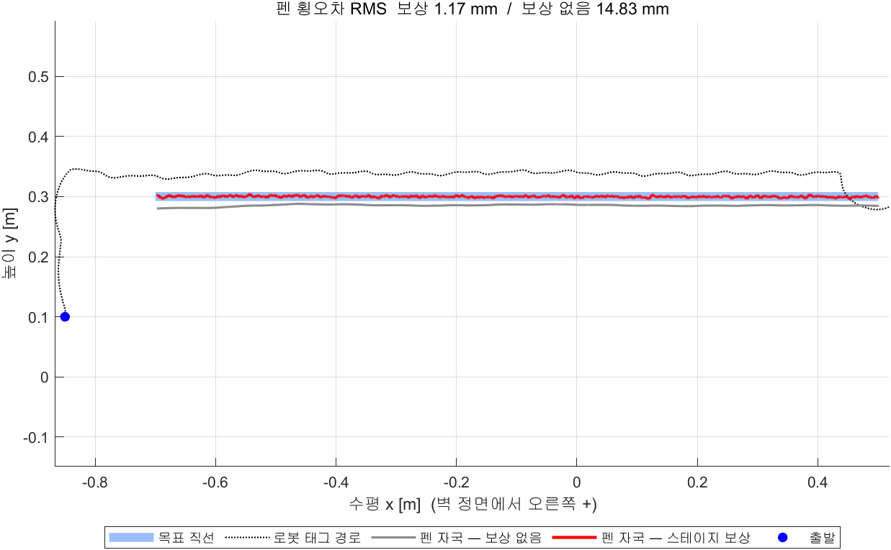

*그림 11. 벽면 궤적 (파랑 목표 직선, 빨강 보상 펜 자국, 회색 보상 없는 펜 자국)*

로봇은 직선에서 수 cm 벗어나며 진행하지만 펜은 1 mm 수준으로 직선 위에 머문다. 그림 11 의 회색 자국과 빨강 자국의 차이가 스테이지가 한 일이다.

---

## 10. 실기 적용 절차와 점검 항목

시뮬레이션의 제어기는 실기에 그대로 연결되지만, 다음 값들은 시뮬레이션이 가정한 것이므로 실기 전에 확인해야 한다. 특히 부호와 단위가 틀리면 보상이 오차를 줄이는 대신 두 배로 키운다.

| 순서 | 확인 | 방법 | 틀렸을 때 |
|---|---|---|---|
| 1 | 스테이지 축 부호: X 가 $x_B$ (전진), Y 가 $y_B$ (왼쪽) 로 증가 | 로봇을 세워 두고 `/stage/target_pos` 에 (60, 50.8), (50.8, 60) 을 보내 캐리지 방향 확인 | 펜이 직선에서 멀어지는 쪽으로 움직임 |
| 2 | 태그 위치 $r_{tag}$, 펜 위치 $r_{pen0}$ | 레이저 트래커 또는 자 | heading 이 바뀔 때 펜이 원호를 그림 |
| 3 | heading 기준 $\psi_0$ 과 IMU 회전 방향 | 천장을 보게 놓고 시작($\psi_0 = 90^{\circ}$), 벽 정면에서 반시계로 돌려 $\hat\psi$ 가 증가하는지 | 회전 방향이 반대면 모드 2 가 발산 |
| 4 | ZeroKey 축 (z 위 +, x 방향 → `zk_xsign`) | 로봇을 벽 정면에서 오른쪽으로 옮기며 `/zerokey/position` 의 x 증감 확인: 감소 → $-1$, 증가 → $+1$ | 로봇이 수평으로 반대로 감 |
| 5 | ZeroKey 잡음·지연 | 정지 로그 1 분, 표준편차와 지연 | 7 장의 오차 예산이 달라짐 |
| 6 | ESC 데드존, `v_full` | 일정 PWM 주행 속도 측정 | 모드 1·4 가 느리거나 떨림 (펜 정확도는 영향 적음) |
| 7 | 펜 없이 주행 | `/stage/target_pos` 가 10–90 mm 안인지 | 행정 끝 포화 |
| 8 | 펜 승강 | 마커를 언제 벽에 댈지 결정 | 직선 앞뒤 연장 구간까지 그어짐 |
| 9 | 2 판: 자이로 단위 | `angular_velocity.z` 가 rad/s 인지 (0.1443 의 출처) | ω 진동 |

---

## 11. 결론

벽면 궤도 로봇은 옆으로 움직일 수 없고 벽에서 미끄러지므로, 로봇만으로는 mm 수준의 직선을 그을 수 없다. 이 문서의 구조는 이 한계를 받아들이고, 로봇에게는 진행과 큰 이동을, 빠르고 좁은 XY 스테이지에게는 직선과의 어긋남을 맡긴다. 스테이지 명령은 측정된 태그 위치와 heading 으로 펜 위치 식을 거꾸로 풀어 얻으며, 목표를 수선의 발로 두어 스테이지가 횡 방향 오차만 지우게 한다. 상용 스테이지의 위치 서보는 바꿀 수 없지만, 그 정확도가 센서보다 훨씬 좋고 필요한 속도가 최고속도의 수 % 에 불과하므로 위치 명령만으로 충분하다. 남은 오차는 센서가 정하며, 그중 가장 큰 ZeroKey 잡음은 펜을 가운데 두고 로봇 몸체에 태그를 하나 더 달아 줄일 수 있다.

## 참고문헌

1. T. Zou, J. Angeles, F. Hassani, "Dynamic modeling and trajectory tracking control of unmanned tracked vehicles," *Robotics and Autonomous Systems*, vol. 110, pp. 102–111, 2018. doi:10.1016/j.robot.2018.09.008
2. A. D. Sabiha, M. A. Kamel, E. Said, W. M. Hussein, "ROS-based trajectory tracking control for autonomous tracked vehicle using optimized backstepping and sliding mode control," *Robotics and Autonomous Systems*, vol. 152, 104058, 2022. doi:10.1016/j.robot.2022.104058
3. Y. Kanayama, Y. Kimura, F. Miyazaki, T. Noguchi, "A stable tracking control method for an autonomous mobile robot," *Proc. IEEE ICRA*, pp. 384–389, 1990. doi:10.1109/ROBOT.1990.126006
4. A. Sharon, N. Hogan, D. E. Hardt, "The macro/micro manipulator: An improved architecture for robot control," *Robotics and Computer-Integrated Manufacturing*, vol. 10, no. 3, pp. 209–222, 1993. doi:10.1016/0736-5845(93)90056-P
